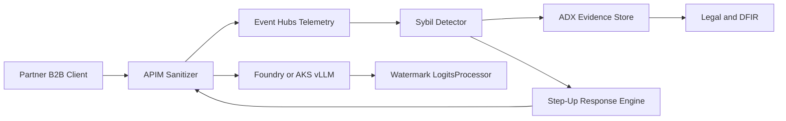
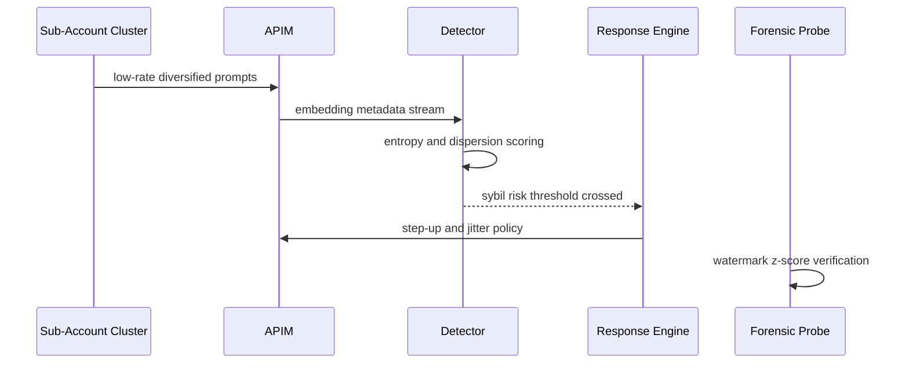

# 企业专有大模型防蒸馏与模型提取防御选型 FAQ
> Topic ID: #474
> Section: 3.6 零信任身份与强监管安全合规
> Audience: 企业 AI 安全团队、平台治理团队与法务取证团队
> Goal: 在 B2B 开放接口场景下降低模型提取成功率并提升可追责证据强度

## 1 生产问题与攻击面定义
企业在 `Foundry RFT`、`LoRA` 与 `AKS vLLM` 上训练行业模型，常投入 `20` 万到 `200` 万美元用于语料、标注与调参。
当这些模型通过 B2B API 对外提供服务时，攻击者可把合法账号伪装成普通租户，执行系统化 Teacher Student 蒸馏。
第一类高危泄露来自 `logprobs` 与 `top_logprobs`，软标签让学生模型获得远高于硬标签的暗知识密度。
第二类高危泄露来自原始 `reasoning_content`，未经净化的推理痕迹会显著降低攻击者构造高保真学生模型的样本复杂度。
第三类风险是低频慢速 Sybil 采样，攻击流量拆散到 `40` 到 `80` 个子账号，每个仅 `8` 到 `15 RPM`，完全低于静态阈值。
单 key 配额策略无法看见跨账号协同扫空间，攻击可在一夜内覆盖大量语义流形区域而不触发传统告警。
更现实的挑战是攻击者并不追求单次命中，而是持续多天低强度采集，最终拼出高质量学生模型。
因此防护策略必须同时覆盖预防、检测、响应与取证，任何单点措施都不足以在生产长期有效。

## 2 传统限流与密钥治理为什么不足
传统 `RPM/TPM` 只约束单账号速率，不度量跨账号语义覆盖趋势，无法识别“慢而广”的提取策略。
即使启用更严格配额，攻击者可增加账号数量并降低单账号噪声，保持总提取吞吐不变。
API key 轮换与 IP 白名单可阻挡粗糙爬取，却无法识别来自真实合作伙伴账号的内部滥用。
仅靠日志审计也常滞后，攻击完成后才发现数据被系统化收集，防御价值偏被动。
要有效对抗蒸馏提取，平台必须减少每次响应的信息泄露，同时建立跨账号语义行为相关检测。

## 3 四种架构路径总览
Pattern A 在 `APIM` 做 `logprobs/CoT` 净化，并将提示语义特征异步送入 `Event Hubs + Redis/ADX` 做流形覆盖与 Sybil 相关检测。
Pattern B 在推理层加入带密钥的绿色词表水印偏置，后续可用黑盒探针对可疑模型做统计取证。
Pattern C 通过 `Entra B2B` 可信身份与结构化输出约束，把每次调用信息熵压缩到任务所需最小值。
Pattern D 反模式是暴露软标签与原始推理，再配合静态配额，表面合规但实质低防护。

## 4 十二维量化对比矩阵
| 维度 | Pattern A 净化加行为检测 | Pattern B 密钥水印取证 | Pattern C 结构化最小信息输出 | Pattern D 反模式 |
|---|---|---|---|---|
| 学生克隆保真度压制 | `45%` 到 `68%` 降幅 | `20%` 到 `35%` 降幅 | `30%` 到 `72%` 降幅 | 几乎无 |
| Sybil 检测 AUC | `0.95` 到 `0.98` | `0.55` 到 `0.70` | `0.82` 到 `0.91` | `< 0.60` |
| 查询到检测窗口 | `1,200` 到 `2,500` | 事后取证 | `2,500` 到 `6,000` | 不可控 |
| 网关额外 `P95` 延迟 | `< 2 ms` | `< 1 ms` | `< 1.5 ms` | `0` |
| 合法突发误报率 | `0.03%` 到 `0.12%` | `0%` | `0.02%` 到 `0.10%` | 无检测 |
| 软标签暗知识阻断 | `100%` | `0%` | `100%` | `0%` |
| CoT 泄露阻断 | `100%` | `0%` | `80%` 到 `100%` | `0%` |
| 事后法律取证强度 | 中高 | 极高 | 中 | 低 |
| 生成质量影响 | 低 | 低到中 | 视约束强度而定 | 无 |
| 运维复杂度 | 中高 | 中 | 中 | 低 |
| 三年综合 TCO | `4.5M` 到 `14M` | `3.8M` 到 `12M` | `3.2M` 到 `10M` | `6M` 到 `18M` |
| 推荐结论 | 生产主防线 | 法务取证强化层 | 场景化降熵层 | 禁用并迁移 |

## 5 Pattern A 主路径 APIM 净化与流形覆盖检测
Pattern A 的第一道闸门在 API 网关，所有请求与响应先做字段净化，禁止软标签与原始推理痕迹越过边界。
入站阶段删除 `logprobs`、`top_logprobs` 与 `include_reasoning`，出站阶段剥离 `reasoning_content` 与内部调试字段。
净化后仍保留业务必需输出，确保体验不被破坏，同时显著降低单位请求可蒸馏信息密度。
第二道闸门在异步行为检测，平台将提示嵌入向量投影到语义网格，跟踪租户与跨租户覆盖熵斜率变化。
真实业务流量常呈 Zipf 式聚焦，覆盖熵长期较低，攻击流量则倾向均匀扫网格并维持高新颖度。
系统基于滑动窗口 `k-NN` 离散度与覆盖熵构建风险分，达到阈值后触发分级响应而非一刀切封禁。
常见响应包括温度扰动、验证码或条件访问升级、延迟注入与蜜罐路由，目标是提高攻击成本并保全证据。
该模式在 `1,200` 到 `2,500` 查询内即可识别大多数空间填充型提取攻击，且网关内联开销通常低于 `2 ms`。

## 6 Pattern B 主路径 密钥水印与统计取证
Pattern B 通过带密钥 PRF 对绿色词表施加细粒度 logit 偏置，让输出携带不可见但可统计验证的“放射性”信号。
核心价值在事后证明，若竞争方模型通过黑盒探针表现出显著水印继承，可形成高可信法律证据。
在 `gamma=0.25`、`delta=1.5` 配置下，常见困惑度漂移可控制在可接受范围，用户体验影响较低。
水印单独使用并不能阻止在途提取，因此应与 Pattern A 组合，形成“前置压制 + 事后取证”双重策略。
对监管行业而言，Pattern B 显著提升维权可执行性，降低“怀疑被抄但无法举证”的治理盲区。

## 7 Pattern C 路径 身份约束与结构化最小信息输出
Pattern C 先做身份可信化，要求 `Entra B2B` 实名租户并绑定合同范围，再按任务域限制输出模式。
在可结构化场景，响应可收敛到 `choice/score/code` 等有限字段，把每次互信息从自由文本大幅压缩。
当单次输出信息量从 `800` 自由 token 降到十余比特，攻击者所需样本量通常提升 `25x` 以上。
该模式对需要开放解释的业务限制较大，因此常作为高价值接口的分层防护，而非全局默认。
与 Pattern A 联合后，可在保留关键业务能力的同时显著提高蒸馏攻击成本。

## 8 Pattern D 反模式风险
反模式第一类是对外暴露 `top_logprobs=20` 与原始 CoT，仅依赖静态配额限制请求速度。
反模式第二类是把 API key 当作唯一安全边界，忽视真实租户账号被盗或内部滥用场景。
反模式第三类是不做跨账号关联检测，导致低速 Sybil 多账号攻击长期隐身。
反模式第四类是只在事件后做日志审计，缺乏在线阻断与分级响应，错失最佳防御窗口。
这些配置会把高价值模型资产置于持续可提取状态，治理成本最终转嫁到法务与品牌风险。

## 9 Mermaid 多层防蒸馏防线拓扑


## 10 Mermaid 低慢 Sybil 攻击捕获时序


## 11 量化推导 Q1 到 Q6
Q1 单 token 信息泄露比较。
若返回 `top_logprobs=20`，每 token 可近似泄露 `I_soft`，通常是硬标签 `I_hard` 的多倍。
在典型蒸馏任务中，`I_soft / I_hard` 常见落在 `8` 到 `12` 区间。
Q2 网格覆盖熵判别。
定义 `H_grid = -sum(p_b * log2(p_b))`。
真实业务租户通常集中在少量语义桶，`H_grid` 常低于 `4.8`。
空间填充型攻击趋向均匀覆盖，`H_grid` 常高于 `8.9`。
Q3 水印统计检验。
`z = (|G| - gamma * T) / sqrt(T * gamma * (1 - gamma))`。
当 `T=1000`、`gamma=0.25`、`|G|=335`，可得 `z≈6.25`，对应极小 `p` 值。
Q4 检测窗口估计。
`Q_detect ~= f(theta_entropy, theta_dispersion, noise)`。
在实际攻防回放中，Pattern A 常在 `1,850` 左右查询触发高置信告警。
Q5 误报平衡。
提高阈值可降误报但延后检测，降低阈值可早检但可能影响合法突发。
工程上应按租户等级分层阈值，避免单一全局参数。
Q6 防御收益评估。
可用 `ROI = (avoided_loss - defense_cost) / defense_cost`。
当模型重建损失预估高于防线投入数倍时，联防策略通常具备显著正收益。

## 12 代码块一 APIM 策略净化与异步遥测
```xml
<policies>
  <inbound>
    <base />
    <set-body>@{
      var body = context.Request.Body.As<JObject>(true);
      body.Remove("logprobs");
      body.Remove("top_logprobs");
      body.Remove("include_reasoning");
      return body.ToString();
    }</set-body>
    <log-to-eventhub logger-id="distill-telemetry">
      @{
        return "{ \"tenant\":\"" + context.Subscription.Key + "\",\"prompt_hash\":\"" +
          context.RequestId + "\" }";
      }
    </log-to-eventhub>
  </inbound>
  <outbound>
    <base />
    <set-body>@{
      var payload = context.Response.Body.As<JObject>(true);
      payload.Remove("reasoning_content");
      payload.Remove("top_logprobs");
      return payload.ToString();
    }</set-body>
  </outbound>
</policies>
```

## 13 代码块二 vLLM 水印处理器与 z-score 校验
```python
import hmac
import hashlib
import math

class GreenListWatermark:
    def __init__(self, secret: str, gamma: float = 0.25, delta: float = 1.5):
        self.secret = secret.encode("utf-8")
        self.gamma = gamma
        self.delta = delta

    def bias(self, token_id: int, step: int) -> float:
        seed = f"{token_id}:{step}".encode("utf-8")
        digest = hmac.new(self.secret, seed, hashlib.sha256).digest()
        bucket = digest[0] / 255.0
        return self.delta if bucket < self.gamma else 0.0

def z_score(green_hits: int, total_tokens: int, gamma: float = 0.25) -> float:
    mean = gamma * total_tokens
    var = total_tokens * gamma * (1.0 - gamma)
    if var <= 0:
        return 0.0
    return (green_hits - mean) / math.sqrt(var)

def suspicious(z: float, threshold: float = 5.0) -> bool:
    return z >= threshold
```

## 14 代码块三 流式 Sybil 行为检测器
```python
from collections import deque
import numpy as np

class SybilDetector:
    def __init__(self, window: int = 2048):
        self.window = deque(maxlen=window)

    def add(self, tenant: str, emb: np.ndarray):
        self.window.append((tenant, emb))

    def entropy_score(self, bins: np.ndarray) -> float:
        p = bins / max(bins.sum(), 1)
        p = p[p > 0]
        return float(-(p * np.log2(p)).sum())

    def dispersion(self) -> float:
        if len(self.window) < 16:
            return 0.0
        vectors = np.stack([e for _, e in self.window[-128:]])
        norms = np.linalg.norm(vectors, axis=1, keepdims=True) + 1e-8
        unit = vectors / norms
        sim = unit @ unit.T
        tri = sim[np.triu_indices_from(sim, k=1)]
        return float(1.0 - tri.mean())

    def alert(self, entropy: float, disp: float) -> bool:
        return entropy >= 8.9 and disp >= 0.42
```

## 15 企业落地场景与三年 TCO
### 15.1 场景 A 全球特险与信用风控 B2B API
该平台对 `340` 家经纪机构开放专有 `70B` 风控模型接口，历史上出现异常多账号高相似提示请求但难以定性。
采用 Pattern A 加 Pattern B 后，平台在约 `1,850` 查询识别到 `42` key 协同抓取，并触发分级响应。
事件中误报率约 `0.04%`，在攻击预算尚未达到蒸馏门槛前完成拦截，避免核心资产外泄。
后续通过水印探针对外部可疑服务完成统计证据固化，支持法务流程进入可执行阶段。
### 15.2 场景 B 临床编码与先审后付 SaaS
该业务对解释文本敏感，先采用 Pattern C 结构化输出将高风险接口收敛到 `enum/score` 结果，再叠加 Pattern A 净化检测。
上线后每次调用信息泄露显著下降，蒸馏样本复杂度上升，同时临床审核流程保持可用性。
团队在不牺牲核心业务 SLA 的前提下，把模型提取风险从高暴露降到可治理区间。
### 15.3 三档三年综合 TCO
| 档位 | 年调用规模 | 推荐组合 | 三年综合 TCO |
|---|---:|---|---:|
| Tier 1 | `3` 亿 | Pattern C 加 A | `4.2M` 美元 |
| Tier 2 | `10` 亿 | Pattern A 主路径 | `8.9M` 美元 |
| Tier 3 | `25` 亿 | Pattern A 加 B | `14.4M` 美元 |
### 15.4 D0 D1 D2 运行手册共 18 项
- **D0-1** 梳理对外接口并标注高价值模型资产清单。
- **D0-2** 定义 `logprobs` 与 CoT 输出红线字段策略。
- **D0-3** 建立租户分层阈值与分级响应矩阵。
- **D0-4** 部署向量遥测管道与证据仓存储规范。
- **D0-5** 定义水印密钥托管与轮换流程。
- **D0-6** 完成法务取证模板与响应剧本联调。
- **D1-1** 在 APIM 开启入站参数净化与出站字段剥离。
- **D1-2** 启用跨账号覆盖熵与离散度实时评分。
- **D1-3** 配置风险升阶动作含温度扰动与身份升级。
- **D1-4** 对高风险租户启用结构化输出模板。
- **D1-5** 执行红队低慢 Sybil 回放并校准阈值。
- **D1-6** 完成水印探针与统计检验流水线演练。
- **D2-1** 每周复核告警召回率与误报率趋势。
- **D2-2** 每周复核租户覆盖熵分布与异常迁移。
- **D2-3** 每月复核净化策略对业务质量影响。
- **D2-4** 每月复核密钥轮换与证据可追溯性。
- **D2-5** 每季度复核法务取证命中与处置闭环。
- **D2-6** 每季度更新蒸馏威胁模型与预算评估。
运行后应把“提取检测时延、误报率、证据可用率”纳入固定安全运营指标，与可用性指标同级跟踪。
对重点租户建议建立白名单行为画像，减少季节性业务波峰引发的误报波动。
当检测分数持续抬升但未达阻断阈值时，可先启用轻量响应如温度扰动与答复长度约束。
若出现跨区域协同攻击迹象，应联合身份团队检查登录风险与令牌重放事件。
建议在季度演练中加入“被盗合法账号”场景，以验证行为检测能否覆盖非典型攻击路径。
对于高解释需求接口，可分层输出摘要解释并保留内部详解，兼顾业务可读性与泄露控制。
证据链应统一保存在不可变审计仓，确保事后可还原告警、响应、探针与统计检验全过程。
当误报率高于阈值时，应优先优化特征与阈值，而非直接放宽净化策略，避免防线退化。
平台治理需要与商务合同联动，把结构化输出要求与安全条款写入合作准入条件。
如需跨云对比验证，可在影子环境执行同样探针，评估竞争对手输出是否继承水印统计特征。
长期运营中应持续更新攻击样本库，覆盖最新 `Evol-Instruct` 与自动提示生成策略。
若检测系统宕机，网关应退化到保守策略，继续执行净化并收紧高风险租户速率。
通过这些措施，企业可把模型提取风险从被动追责转向主动压制，实现可持续的知识产权安全运营。
最终目标是让专有模型在开放生态中仍保持可控外泄面、可解释防线与可执行取证能力。
同时要把安全策略解释为业务连续性能力，确保销售、法务、平台与客户成功团队在同一指标口径下协同。

来源抓取日期 2026 11 27
Azure API Management policy reference
https://learn.microsoft.com/azure/api-management/api-management-howto-policies
Azure Event Hubs overview
https://learn.microsoft.com/azure/event-hubs/event-hubs-about
OpenAI model extraction and policy discussions
https://openai.com/policies/usage-policies
Watermark for LLM generation research summary
https://arxiv.org/abs/2301.10226
Azure AI Search and vector fundamentals
https://learn.microsoft.com/azure/search/vector-search-overview
