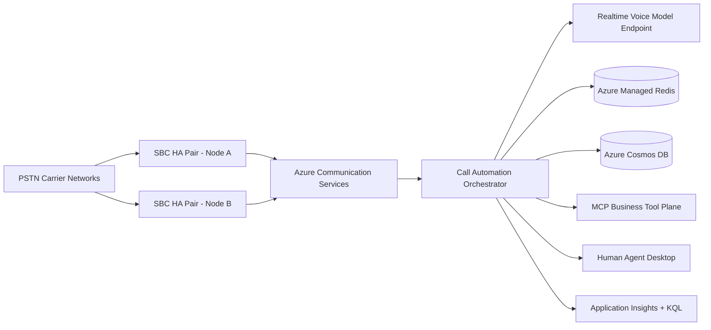
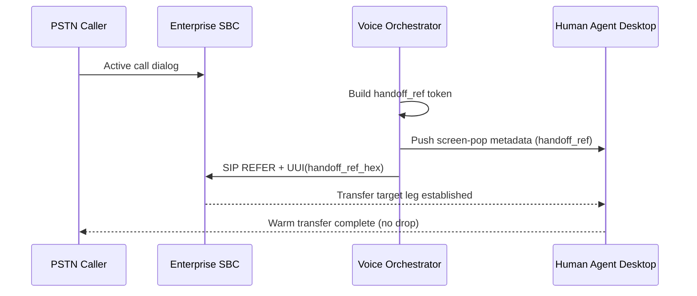

# Enterprise PSTN/SIP Telephony Voice Agent Infrastructure Selection FAQ on Azure: `ACS Direct Routing + Call Automation` vs `Pipecat + SIP/RTP on AKS` vs `CCaaS Media Forking/SIPREC`

## 1. Executive Summary: Carrier-Grade Voice AI Is a Realtime Systems Problem Before It Is a Prompt Problem
When an AI agent answers a PSTN call, your architecture inherits telecom physics and telecom compliance.
The stack must survive carrier jitter, SBC failover, SIP retransmission storms, and strict transfer reliability.
At the same time, it must keep conversational quality under a telephony-grade mouth-to-ear target `<550 ms`.
The practical options on Azure converge into three delivery paths:
- **Path A**: `ACS Direct Routing + Call Automation`, anchored by certified SBC pairs and managed media relays.
- **Path B**: `Pipecat/LiveKit SIP` media pods on AKS, terminating RTP directly for maximum latency control.
- **Path C**: `CCaaS AudioHook/SIPREC` for passive or assistive AI while preserving incumbent queue/routing logic.
Cross-cutting all three is a non-negotiable control plane for `RFC 2833/4733` DTMF masking, `SIP REFER` context continuity, AMD, and STIR/SHAKEN evidence retention.
If rollout risk and governance speed dominate, Path A usually delivers best first-year outcomes.
If conversational latency and barge-in precision are product differentiators, Path B can outperform by `80-140 ms` with the right SRE maturity.
If migration risk and organizational friction dominate, Path C is often the only realistic phase-1 route.

## 2. Problem Boundary: PSTN Voice Agents Fail at the Edges Teams Ignore
Most project failures are not caused by LLM quality.
They are caused by under-specified telephony boundaries.
Typical blind spots:
- Assuming browser/WebRTC behavior maps cleanly to `8kHz G.711` carrier audio.
- Treating DTMF as a speech-to-text concern rather than out-of-band signaling.
- Rolling media pods like stateless HTTP services, causing active-call drops.
- Overloading UUI headers with oversized context payloads.
- Ignoring AMD false positives in outbound campaigns.
Architecture review must therefore include telecom SRE and compliance engineering from day 0.
A voice AI platform that cannot prove deterministic masking and transfer continuity is not production-ready, even if model metrics look strong.

## 3. Four Option Landscape and What Each Option Actually Solves
**Option 1: ACS Direct Routing + Call Automation**
- Best for enterprise trunk retention, certified SBC governance, and managed media relay operations.
- Strong fit for regulated programs that need deterministic operational runbooks.
**Option 2: Pipecat/LiveKit SIP on AKS**
- Best for low-latency customization, direct RTP handling, and advanced VAD/barge-in tuning.
- Strong fit when voice UX quality is a strategic moat.
**Option 3: CCaaS Media Forking/SIPREC**
- Best for low-change migration and preserving existing contact-center logic.
- Strong fit when number routing and queue logic cannot be disturbed.
**Option 4: Compliance and telephony edge controls**
- Mandatory layer across all options: DTMF masking, UUI reference strategy, AMD gates, and signed-call evidence.
- If this layer is weak, every platform choice remains high-risk.

## 4. 12-Dimension Comparison Matrix for Architecture Review Boards
| Dimension | ACS Direct Routing + Call Automation | Pipecat/LiveKit SIP on AKS | CCaaS AudioHook/SIPREC | Architecture Signal |
|---|---|---|---|---|
| PSTN trunk continuity | Excellent | Good with more custom interop | Excellent with existing CCaaS | Start from telecom estate constraints |
| Mouth-to-ear latency | Good (`~520-680 ms`) | Best (`~430-560 ms`) | Moderate (`~600-900 ms`) | Path B wins pure latency race |
| SBC lifecycle governance | Excellent | Good but team-owned | Inherited from CCaaS | Regulated sectors favor mature SBC paths |
| Media-path programmability | Medium | High | Low-medium | Complex DSP needs Path B |
| DTMF PCI isolation | High with policy discipline | High if implemented correctly | Vendor-dependent | Require proof, not claims |
| Warm transfer context (`REFER/UUI`) | Strong API-driven patterns | Strong SIP-native control | Variable by vendor feature | Validate early with real trunks |
| Rolling upgrade safety | High with managed relay | Medium; needs strict drain controls | Medium; opaque internals | Call-drain design is mandatory |
| Ops burden | Low-medium | High | Medium | Match with available telecom SRE |
| Change velocity | Medium-high | Highest | Medium | Product iteration favors Path B |
| Lock-in profile | Medium | Low-medium | High | Path C can deepen vendor dependency |
| Compliance attestability | High | High with custom evidence pipes | Medium-high | Define evidentiary schema upfront |
| Cost predictability | Medium-high | Medium | Medium-low (license volatility) | Include hidden licensing and recontact costs |

## 5. Azure Reference Architecture for Telephony-Grade Voice AI

Design rule: keep telecom boundary, orchestration boundary, and model boundary separated.
Do not collapse all responsibilities into one service.
Boundary separation is what allows controlled change windows without call-quality regression.

## 6. Option 1 Deep Dive: ACS Direct Routing + Call Automation
Why it works for large enterprises:
- Preserves existing carrier relationships and enterprise number portability.
- Uses certified SBC combinations with known interop playbooks.
- Offers deterministic API control for stream start/stop, transfer, and event handling.
- Keeps operations teams aligned with familiar telephony governance processes.
In production, this path often reaches stable `~520-680 ms` mouth-to-ear in multi-region deployments.
Not always the absolute fastest path, but typically the fastest to pass telecom and compliance gates.
Recommended rollout pattern:
1. Launch in **assist mode** (agent assist + analytics).
2. Add **bounded autonomy** for low-risk intents.
3. Expand to **pre-queue triage** only after transfer and masking SLOs are stable.
This phased approach avoids high-impact migration shocks.

## 7. Option 2 Deep Dive: Pipecat/LiveKit SIP Media Pods on AKS
Why teams choose it:
- Direct RTP handling removes unnecessary relay/transcode hops.
- Custom DSP stack (`Silero VAD`, RNNoise/Krisp-class suppression) can improve noisy-call quality.
- Barge-in behavior can be tuned for `<150 ms` interruption handling.
Where teams fail:
- Treating SIP media pods like ordinary stateless HTTP workloads.
- Ignoring UDP balancing and port-range planning.
- Rolling updates without explicit SIP drain semantics.
Minimum controls for safe operation:
- `terminationGracePeriodSeconds: 1800`.
- preStop command that rejects new dialogs with SIP `503` + `Retry-After`.
- dialog-drain monitor that waits active calls to complete.
- capacity model based on concurrent dialogs and packet loss tolerance.
When engineered correctly, measured improvement versus managed multi-hop chains is often `80-140 ms`.

## 8. Option 3 Deep Dive: CCaaS Media Forking/SIPREC as Controlled Transition
Where it shines:
- Existing IVR and queue logic remains unchanged.
- Minimal number-routing disruption.
- Rapid assistive AI deployment for guidance/summarization/quality scoring.
Where it constrains:
- Less control over turn-taking and hard barge-in behavior.
- Additional path latency due to media replication layers.
- Feature scope tied to CCaaS extension model.
Best use:
- Transitional architecture for enterprise call centers with high change-management resistance.
- Early value realization while preparing direct-control migration for selected intents.

## 9. Compliance and Edge Cases: DTMF, AMD, STIR/SHAKEN, and UUI Limits
Key rules:
- Capture DTMF through out-of-band events (`RFC 4733`) and mask before transcript/log ingestion.
- Keep card/SSN/member-number capture out of LLM audio logs by design, not by post-processing.
- Run AMD classification with `<1,800 ms` decision targets for outbound flows.
- Retain STIR/SHAKEN attestation metadata in call evidence pipelines.
- Treat `SIP UUI` as compact reference channel; many routes practically tolerate around `128` bytes.
For context handoff, send a reference token and resolve payload from Redis/Cosmos.
Do not attempt to push full state JSON through UUI.

## 10. Quantitative Q&A for CAB and Architecture Governance
**Q1. Is `<550 ms` mouth-to-ear realistic on PSTN?**  
Yes, with budget discipline. Example: carrier `45 ms` + SBC `15 ms` + `8kHz->24kHz` resample `8 ms` + VAD turn-end `220 ms` + realtime TTFA `210 ms` = `498 ms`.

**Q2. Why does `8kHz G.711` hurt alphanumeric accuracy?**  
Narrowband speech degrades fricative distinction (`F` vs `S`), especially under line noise. Use speech-first capture with deterministic DTMF fallback for high-entropy identifiers.

**Q3. How do we avoid dropped live calls during AKS rollouts?**  
Use `terminationGracePeriodSeconds: 1800`, preStop SIP drain (`503` for new dialogs), and wait for active dialogs to empty before pod termination.

**Q4. Why constrain UUI payload to token references?**  
Intermediary behavior and practical limits (`~128 bytes`) can truncate larger payloads. Token pointers are safer and more interoperable than full context blobs.

**Q5. How much latency can direct RTP media pods save?**  
Observed pilot range is `80-140 ms`, largely from avoiding extra encode/decode and relay hops.

**Q6. What is the business impact of rollout-induced drop rates?**  
At `180,000` daily calls, a `0.8%` drop rate means `1,440` failed interactions/day. At `$6.5` blended recontact cost, direct impact is `~$9,360/day` before CX damage.

**Q7. Is SIPREC always lower risk than direct control?**  
Lower migration risk, yes. Lower total risk, not always. Latency and intervention depth can remain limited.

**Q8. How should PCI masking be validated?**  
Use synthetic DTMF test runs with known PAN/SSN patterns. Acceptance: zero raw digits in model transcripts, data lake records, and analytics sinks.

## 11. Production Code Example: ACS Media Stream + PCI-Safe DTMF + SIP REFER/UUI Handoff
```python
import json
import os
from datetime import datetime, timezone
from azure.communication.callautomation import CallAutomationClient
import redis

ACS_CONNECTION = os.environ["ACS_CONNECTION_STRING"]
REDIS_HOST = os.environ["REDIS_HOST"]

acs = CallAutomationClient.from_connection_string(ACS_CONNECTION)
cache = redis.Redis(host=REDIS_HOST, port=6379, decode_responses=True)

def build_handoff_ref(call_id: str, tenant_id: str) -> str:
    stamp = datetime.now(timezone.utc).strftime("%Y%m%d%H%M%S")
    return f"{tenant_id}:{call_id}:{stamp}"

def persist_handoff(ref: str, payload: dict) -> None:
    cache.setex(f"handoff:{ref}", 900, json.dumps(payload))

def mask_dtmf_event(event: dict) -> dict:
    if event.get("type") != "dtmf":
        return event
    return {
        "type": "dtmf",
        "digit_count": len(event.get("digits", "")),
        "masked": True,
        "timestamp": event.get("timestamp"),
    }

def process_media_event(event: dict) -> None:
    if event.get("type") == "dtmf":
        safe = mask_dtmf_event(event)
        print("safe_dtmf_event", safe)
        return
    if event.get("type") == "speech":
        # stream PCM chunk to realtime endpoint (omitted)
        return

def warm_transfer(call_connection_id: str, target_sip_uri: str, tenant_id: str, context: dict) -> None:
    ref = build_handoff_ref(call_connection_id, tenant_id)
    persist_handoff(ref, context)
    # Keep UUI compact; pass reference token in hex-safe form.
    uui_hex = ref.encode("utf-8").hex()[:256]
    conn = acs.get_call_connection(call_connection_id)
    conn.transfer_call_to_participant(
        target_participant=target_sip_uri,
        operation_context=json.dumps({
            "handoff_ref": ref,
            "uui_hex": uui_hex
        })
    )
```
This pattern enforces a strict rule: no raw DTMF digits enter transcript stores.
It also keeps transfer metadata short and interoperable across SBC and contact-center hops.

## 12. Production Runtime/IaC Example: AKS SIP Pod Drain and UDP Service
```yaml
apiVersion: apps/v1
kind: Deployment
metadata:
  name: sip-media
  namespace: voice-ai
spec:
  replicas: 12
  strategy:
    type: RollingUpdate
    rollingUpdate:
      maxUnavailable: 0
      maxSurge: 1
  selector:
    matchLabels:
      app: sip-media
  template:
    metadata:
      labels:
        app: sip-media
    spec:
      hostNetwork: true
      terminationGracePeriodSeconds: 1800
      containers:
      - name: pipecat-sip
        image: ghcr.io/example/pipecat-sip:2.3.1
        ports:
        - containerPort: 5060
          protocol: UDP
        - containerPort: 10000
          protocol: UDP
        lifecycle:
          preStop:
            exec:
              command:
              - /bin/sh
              - -c
              - |
                /app/bin/sip-drain --reject-new=503 --retry-after=120
                /app/bin/wait-active-calls --timeout=1700
        env:
        - name: VAD_ENGINE
          value: "silero"
        - name: TURN_END_MS
          value: "220"
---
apiVersion: v1
kind: Service
metadata:
  name: sip-media-udp
  namespace: voice-ai
spec:
  type: LoadBalancer
  externalTrafficPolicy: Local
  selector:
    app: sip-media
  ports:
  - name: sip-udp
    protocol: UDP
    port: 5060
    targetPort: 5060
  - name: rtp-start
    protocol: UDP
    port: 10000
    targetPort: 10000
```
The objective is deterministic no-drop behavior during rollout windows, not merely successful deployment.



## 13. Enterprise Scenario A: National Health Plan + PBM Hotline at Scale
Context:
- `180,000` inbound toll-free calls/day.
- Existing dual-carrier trunks and AudioCodes SBC HA pairs in Azure.
- Strict HIPAA + PCI requirements.
Architecture:
- ACS Direct Routing for trunk continuity.
- Call Automation for deterministic event handling and transfer orchestration.
- DTMF masking pipeline before any transcript/analytics sink.
- UUI transfer token for clinician or claims-agent screen-pop.
Outcome:
- Stable governed rollout with compliant data handling.
- Reduced repetitive questioning after transfer due to context continuity.

## 14. Enterprise Scenario B: Global Roadside Assistance + Auto Claims Voice Intake
Context:
- Noisy roadside call environments.
- Regional dispatch handoff required with minimal delay.
- High sensitivity to barge-in responsiveness.
Architecture:
- Multi-region AKS deployment running Pipecat + LiveKit SIP media pods.
- Custom VAD/noise suppression tuned for highway/background noise.
- SIP REFER warm transfer to regional dispatch with compact UUI references.
Outcome:
- Sustained sub-`500 ms` median mouth-to-ear in target regions.
- Better interruption handling in noisy contexts.
- Higher SRE burden accepted for superior conversational UX.

## 15. FinOps, Day-0/Day-2 Checklist, and Final Recommendation
### FinOps/TCO Comparison (Monthly)
| Cost Component | ACS Direct Routing | Pipecat SIP on AKS | CCaaS Forking/SIPREC | Notes |
|---|---:|---:|---:|---|
| SBC + trunk operations | `$18,000` | `$19,500` | `$17,000` | Telecom baseline cost |
| Media platform compute | `$9,500` | `$21,000` | `$6,800` | Self-hosted media footprint is higher |
| Engineering + SRE staffing | `$14,000` | `$32,000` | `$12,500` | Path B requires deeper telecom SRE |
| Platform licensing uplift | `$2,500` | `$1,000` | `$24,000` | CCaaS contracts can dominate |
| Recontact cost from drop events | `$3,500` | `$2,400` | `$5,200` | Reliability quality materially matters |
| Observability + compliance evidence | `$4,200` | `$5,500` | `$4,800` | Include retention/export pipelines |
| Estimated monthly total | `$51,700` | `$81,400` | `$70,300` | Evaluate with latency + risk together |

### Day-0/Day-2 Checklist (12 Items)
- Validate carrier/SBC interop in each target region before AI release.
- Instrument packet-level latency probes, not only app-level timers.
- Enforce event-level DTMF masking and verify zero raw digit persistence.
- Standardize compact handoff tokens for UUI and desktop screen-pop.
- Lock SIP timer/retry settings across SBC and media runtimes.
- Implement preStop drain behavior and reject new dialogs during rollout.
- Separate release gates for assistive and autonomous voice actions.
- Track AMD precision/recall and tune per campaign segment.
- Persist STIR/SHAKEN metadata for fraud and dispute workflows.
- Monitor intent-level SLOs: latency, drop rate, transfer completion, barge-in delay.
- Conduct regional failover drills with live-call simulation.
- Run joint CAB with telecom, platform, security, and compliance stakeholders.

### Final Recommendation
For most enterprises entering production telephony AI, start with **ACS Direct Routing + Call Automation**.
For latency-critical products with strong telecom SRE teams, adopt **Pipecat/AKS SIP** for direct media control.
For incumbent-heavy contact centers, use **CCaaS forking/SIPREC** as a low-friction bridge.
Across all paths, make DTMF masking, warm-transfer continuity, and auditable evidence first-class architecture constraints.
