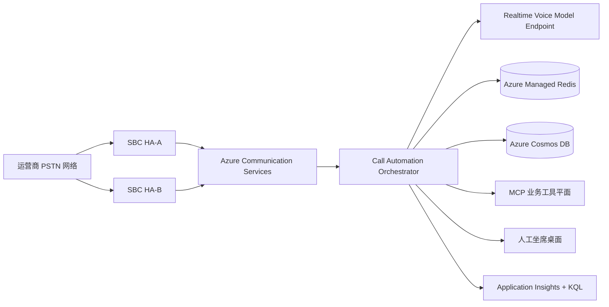
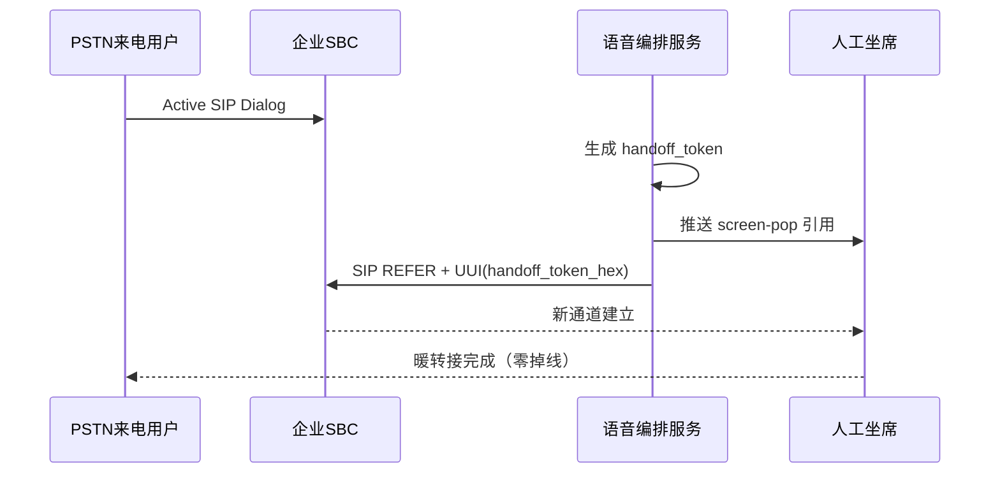

# 企业 PSTN/SIP 语音智能体基础设施选型 FAQ：`ACS Direct Routing + Call Automation` vs `AKS 上 Pipecat + SIP/RTP` vs `CCaaS Media Forking/SIPREC`

## 1. 执行摘要：电话语音智能体首先是电信实时系统问题，其次才是模型问题
当企业把 AI 智能体接入真实 PSTN 热线时，系统即进入运营商级约束环境。  
这不是“把语音模型换成更快版本”就能解决的工程。  
架构必须同时满足口到耳时延、SBC 高可用、SIP 会话稳定、DTMF 合规、暖转接零掉线。  
在 Azure 生产实践中，最常见三条路径是：  
- **路径 A**：`ACS Direct Routing + Call Automation`，依托认证 SBC 与托管媒体中继。  
- **路径 B**：AKS 上 `Pipecat/LiveKit SIP` 自建媒体 Pod，直接终止 RTP 追求最低时延。  
- **路径 C**：`CCaaS AudioHook/SIPREC` 分叉，保留现有联络中心主路由。  
三条路径都必须叠加同一条控制面：`RFC 2833/4733` DTMF 脱敏、`SIP REFER + UUI` 上下文接力、AMD 识别、`STIR/SHAKEN` 证据留存。  
若优先目标是稳态上线与治理效率，路径 A 常是最优起点。  
若产品差异化来自语音交互极致体验，路径 B 通常上限更高。  
若组织约束是“不能大改联络中心”，路径 C 往往是现实可行的阶段化路线。  

## 2. 问题边界：PSTN 语音 AI 的失败多发生在模型之外
企业语音项目常见误区是把浏览器语音经验直接平移到电话网。  
电话网现实与 Web 语音现实差异很大。  
第一，入口音频通常是 `8kHz G.711`，存在天然信息损失。  
第二，SIP 信令与 RTP 媒体穿越多个边界，抖动和重传会放大尾时延。  
第三，DTMF 与转接不是“附加能力”，而是合规主链路。  
第四，发布窗口内的媒体 Pod 升级若无排空机制，会直接造成在话中断。  
因此电话语音 AI 架构应被看作双栈工程：  
- 一条是“媒体低时延与稳定性工程”；  
- 另一条是“合规可审计与证据工程”。  
若只优化模型推理而忽略这两条，项目会在生产阶段出现结构性回退。  

## 3. 四类方案与真实职责边界：不是谁替代谁，而是谁承担什么
**方案一：ACS Direct Routing + Call Automation**  
适合保留既有运营商与企业 PBX 关系，快速建立可治理语音 AI 基线。  
**方案二：AKS Pipecat/LiveKit SIP 媒体平面**  
适合把时延、打断、音频处理能力作为核心竞争力的产品型团队。  
**方案三：CCaaS Media Forking/SIPREC**  
适合组织变更阻力大、要求先“低扰动增量价值”的企业。  
**方案四：跨方案控制面**  
包含 DTMF 屏蔽、UUI 引用策略、AMD、STIR/SHAKEN、发布排空规范。  
这条控制面缺失时，前三种平台能力都无法形成合规生产闭环。  

## 4. 12 维对比矩阵：时延、迁移风险、治理复杂度、成本与可审计性
| 维度 | ACS Direct Routing + Call Automation | AKS Pipecat/LiveKit SIP | CCaaS AudioHook/SIPREC | 选型信号 |
|---|---|---|---|---|
| 现网 PSTN/PBX 保留 | 强 | 中 | 强 | 先看现网资产与合同约束 |
| 口到耳时延 | 中高（`~520-680ms`） | 最优（`~430-560ms`） | 中（`~600-900ms`） | 极致时延选 B |
| SBC 治理成熟度 | 高 | 中（团队自管） | 高（继承现网） | 强监管偏向成熟方案 |
| 媒体可编程性 | 中 | 高 | 低到中 | 复杂 DSP 场景偏 B |
| DTMF 合规脱敏 | 高 | 高（实现前提） | 厂商依赖 | 必须事件化验证 |
| 暖转接上下文保留 | 高 | 高 | 中 | 先验证 UUI 约束 |
| 发布爆炸半径 | 中低 | 中高 | 中 | B 需强排空发布治理 |
| 运维复杂度 | 低到中 | 高 | 中 | 团队能力决定可行性 |
| 供应商锁定 | 中 | 低到中 | 高 | C 需接受较高锁定 |
| 能力演进速度 | 中高 | 高 | 中 | 产品创新偏 B |
| 审计证据可得性 | 高 | 高（自建） | 中高 | 证据模型需统一 |
| 成本可预测性 | 中高 | 中 | 中低（许可波动） | TCO 必须含许可和重联损失 |

## 5. Azure 参考架构：运营商、SBC、编排、模型、坐席分层

此分层把电信边界与 AI 推理边界明确分开。  
SBC 负责电信接入治理，编排层负责会话状态和动作，模型层负责语音智能。  
边界清晰才能支持低风险迭代和稳定发布窗口。  

## 6. 方案 A 深入：ACS Direct Routing 的价值在“稳态生产可治理”
大型企业电话系统往往承载多年流程、合同、监管要求。  
ACS Direct Routing 最大价值是“在不破坏既有电信治理的前提下引入 AI”。  
认证 SBC 组合（AudioCodes/Ribbon/Oracle）有成熟互通路径。  
Call Automation 提供确定性 API，便于控制流媒体、转接和事件处理。  
在多区域生产环境中，常见口到耳可落在 `520-680ms`。  
这不是理论最低时延，但通常是最易通过 CAB/安全/合规评审的路线。  
推荐落地节奏：  
1. 先上坐席辅助（assist）；  
2. 再上低风险自治意图；  
3. 最后扩展到预分流与自动化闭环。  
这种节奏能避免“全量改造一次到位”带来的大面积回滚。  

## 7. 方案 B 深入：AKS SIP 媒体 Pod 的低时延上限与运维代价
在 AKS 直接终止 RTP 可以减少中间 hop 和转码次数。  
这通常带来 `80-140ms` 的端到端收益。  
同时你可自定义 VAD、降噪、回声抑制、打断阈值。  
但这条路对团队能力要求非常高。  
你要管理 UDP 端口范围、SIP 计时器、负载均衡、跨区回切、滚动升级排空。  
若把媒体 Pod 当普通无状态服务滚动发布，会直接造成在话掉线。  
最低治理基线应包括：  
- `terminationGracePeriodSeconds: 1800`；  
- preStop 阶段 SIP `503` 拒绝新会话并携带 `Retry-After`；  
- 等待活动 Dialog 完成后再退出。  
当团队具备电信级 SRE 能力时，这条路径能交付最佳交互体验。  

## 8. 方案 C 深入：CCaaS 分叉架构的组织友好性
很多企业已深度绑定 CCaaS 体系。  
排队策略、质检流程、绩效模型、班表体系都在现有平台中。  
直接替换主路由风险极高。  
媒体分叉（AudioHook/SIPREC）允许“先增强，不替换”。  
这使 AI 可以先在旁路做实时建议、摘要、预判和辅助决策。  
优点是迁移阻力低，价值出现快。  
缺点是链路可控性与可编程性有限，时延通常不占优。  
最佳实践是把它作为阶段性架构：  
先旁路验证价值，后将高价值意图逐步迁移到直连控制路径。  

## 9. 合规与边界条件：DTMF、AMD、STIR/SHAKEN、UUI 限长策略
`RFC 4733` DTMF 必须事件化捕获。  
对卡号、身份证号、保单号输入，必须在进入文本/日志前即脱敏。  
“先识别再屏蔽”的策略在监管审查中风险很高。  
AMD（答录机检测）对外呼效率影响显著。  
应设置 `<1,800ms` 内判别真人/语音信箱目标，并持续评估误判成本。  
`STIR/SHAKEN` 可信标记要进入审计链路，支持反欺诈与争议追溯。  
`SIP UUI` 应仅传引用 token。  
考虑中间设备限制，实务上可用长度常约 `128` 字节。  
完整上下文应通过 Redis/Cosmos 以 token 解引用获取。  

## 10. 定量 Q&A：评审会必问指标与可复用算式
**Q1. `<550ms` 口到耳是否可达？**  
可达。示例预算：运营商 `45ms` + SBC `15ms` + `8kHz->24kHz` 重采样 `8ms` + VAD 句尾 `220ms` + Realtime TTFA `210ms` = `498ms`。  

**Q2. 为什么 `8kHz G.711` 会造成 `'F'` 与 `'S'` 混淆？**  
窄带压缩削弱擦音细节，噪声环境放大误差。高熵标识符应设计“语音 + DTMF 回退”双通道。  

**Q3. AKS 发布如何保证 `15` 分钟在话不掉线？**  
配置 `terminationGracePeriodSeconds: 1800`，preStop 先 SIP `503` 拒新会话，再等待 Dialog 排空。  

**Q4. UUI 为什么只放 `handoff_token` 引用？**  
UUI 头实务可用空间有限，约 `128` 字节级。放完整 JSON 易截断且互通性差。  

**Q5. 自建 RTP 媒体路径能省多少时延？**  
实测常见 `80-140ms`。收益主要来自减少中继 hop 与转码链路。  

**Q6. 变更导致掉话的业务损失如何估算？**  
若 `180,000` 日呼入里 `0.8%` 掉话，则 `1,440` 通失败；按 `$6.5` 重联成本，约 `$9,360/日`。  

**Q7. SIPREC 一定是长期最优吗？**  
不一定。它迁移风险低，但在时延、打断控制、自治深度上通常不如直连路径。  

**Q8. DTMF 脱敏如何验收？**  
用已知 PAN/SSN 合成测试通话回放，验收标准是日志、转写、分析库原始数字出现次数为 `0`。  

## 11. 生产代码示例：ACS 双向流媒体 + DTMF PCI 屏蔽 + UUI 暖转接
```python
import json
import os
from datetime import datetime, timezone
from azure.communication.callautomation import CallAutomationClient
import redis

ACS_CONNECTION = os.environ["ACS_CONNECTION_STRING"]
REDIS_HOST = os.environ["REDIS_HOST"]

acs = CallAutomationClient.from_connection_string(ACS_CONNECTION)
cache = redis.Redis(host=REDIS_HOST, port=6379, decode_responses=True)

def build_handoff_ref(call_id: str, tenant_id: str) -> str:
    stamp = datetime.now(timezone.utc).strftime("%Y%m%d%H%M%S")
    return f"{tenant_id}:{call_id}:{stamp}"

def persist_handoff(ref: str, payload: dict) -> None:
    cache.setex(f"handoff:{ref}", 900, json.dumps(payload))

def mask_dtmf_event(event: dict) -> dict:
    if event.get("type") != "dtmf":
        return event
    return {
        "type": "dtmf",
        "digit_count": len(event.get("digits", "")),
        "masked": True,
        "timestamp": event.get("timestamp"),
    }

def process_media_event(event: dict) -> None:
    if event.get("type") == "dtmf":
        safe = mask_dtmf_event(event)
        print("safe_dtmf_event", safe)
        return
    if event.get("type") == "speech":
        # send PCM frame to realtime model endpoint
        return

def warm_transfer(call_connection_id: str, target_sip_uri: str, tenant_id: str, context: dict) -> None:
    ref = build_handoff_ref(call_connection_id, tenant_id)
    persist_handoff(ref, context)
    uui_hex = ref.encode("utf-8").hex()[:256]
    conn = acs.get_call_connection(call_connection_id)
    conn.transfer_call_to_participant(
        target_participant=target_sip_uri,
        operation_context=json.dumps({
            "handoff_ref": ref,
            "uui_hex": uui_hex
        })
    )
```
关键点是“先事件化脱敏，再进入任何文本或分析路径”。  
上下文传递采用引用 token，避免 UUI 载荷过大导致互通风险。  

## 12. 生产 IaC/运行时示例：AKS SIP Pod 发布排空与 UDP 服务治理
```yaml
apiVersion: apps/v1
kind: Deployment
metadata:
  name: sip-media
  namespace: voice-ai
spec:
  replicas: 12
  strategy:
    type: RollingUpdate
    rollingUpdate:
      maxUnavailable: 0
      maxSurge: 1
  selector:
    matchLabels:
      app: sip-media
  template:
    metadata:
      labels:
        app: sip-media
    spec:
      hostNetwork: true
      terminationGracePeriodSeconds: 1800
      containers:
      - name: pipecat-sip
        image: ghcr.io/example/pipecat-sip:2.3.1
        ports:
        - containerPort: 5060
          protocol: UDP
        - containerPort: 10000
          protocol: UDP
        lifecycle:
          preStop:
            exec:
              command:
              - /bin/sh
              - -c
              - |
                /app/bin/sip-drain --reject-new=503 --retry-after=120
                /app/bin/wait-active-calls --timeout=1700
        env:
        - name: VAD_ENGINE
          value: "silero"
        - name: TURN_END_MS
          value: "220"
---
apiVersion: v1
kind: Service
metadata:
  name: sip-media-udp
  namespace: voice-ai
spec:
  type: LoadBalancer
  externalTrafficPolicy: Local
  selector:
    app: sip-media
  ports:
  - name: sip-udp
    protocol: UDP
    port: 5060
    targetPort: 5060
  - name: rtp-start
    protocol: UDP
    port: 10000
    targetPort: 10000
```
这份模板强调的是“发布窗口不掉线”，而不是“部署命令执行成功”。  



## 13. 企业场景 A：全国性健康险与药事福利热线（高并发 + 强监管）
业务背景：  
- 日均 `180,000` 通热线呼入；  
- 现网双运营商 Trunk + AudioCodes SBC HA；  
- HIPAA/PCI 合规刚性要求。  
架构选择：  
- 采用 ACS Direct Routing 保留现网号码与中继；  
- Call Automation 承担会话编排与媒体动作；  
- DTMF 采用 `RFC 4733` 事件脱敏；  
- 暖转接通过 UUI 传 `handoff_ref`，坐席侧拉取完整上下文。  
结果：  
- 在合规边界不放松前提下实现自治预分流；  
- 坐席接管重复询问显著下降；  
- 电信运维流程与 AI 创新节奏可并行推进。  

## 14. 企业场景 B：全球道路救援与车险报案（低时延 + 强噪声）
业务背景：  
- 高速公路噪声场景多，打断频繁；  
- 要求跨区域调度并快速交接人工坐席；  
- 口到耳体验目标 `<500ms`。  
架构选择：  
- AKS 多区域部署 `Pipecat + LiveKit SIP`；  
- 自定义 VAD、降噪、句尾策略；  
- 通过 SIP REFER + UUI token 做上下文交接。  
结果：  
- 目标区域中位口到耳保持 `<500ms`；  
- 噪声环境下可用性与打断响应提升；  
- 团队接受更高 SRE 运营成本以换取体验优势。  

## 15. FinOps、12 项 Day-0/Day-2 清单与最终建议
### FinOps / TCO（月度估算）
| 成本项 | ACS Direct Routing | AKS Pipecat SIP | CCaaS Forking/SIPREC | 说明 |
|---|---:|---:|---:|---|
| SBC 与 Trunk 运维 | `$18,000` | `$19,500` | `$17,000` | 电信底座成本接近 |
| 媒体平面算力 | `$9,500` | `$21,000` | `$6,800` | 自建媒体算力更高 |
| 工程与 SRE 人力 | `$14,000` | `$32,000` | `$12,500` | B 路线人力门槛最高 |
| 平台许可增量 | `$2,500` | `$1,000` | `$24,000` | C 路线许可波动大 |
| 掉话重联损失 | `$3,500` | `$2,400` | `$5,200` | 与发布治理强相关 |
| 可观测与合规证据 | `$4,200` | `$5,500` | `$4,800` | 包含留存与导出 |
| 月度总估算 | `$51,700` | `$81,400` | `$70,300` | 需与体验与风险联合评估 |

### Day-0 / Day-2 检查清单（12 项）
- 完成每个区域的运营商/SBC 互通与容灾切换验收。  
- 建立口到耳预算分解并持续观测载波抖动与队列延迟。  
- 强制 DTMF 事件化脱敏并回归验证“零原始数字落库”。  
- 统一 UUI 引用 token 规范，禁止大载荷上下文直传。  
- 固化 SIP 计时器、重传、回退策略，避免设备默认值冲突。  
- 发布流程强制 preStop 排空与新会话拒绝策略。  
- assist 与 autonomy 分开发布门，避免一次性全量自治。  
- 建立 AMD 质量回归与策略调优闭环。  
- 保存 STIR/SHAKEN 元数据用于反欺诈与争议追踪。  
- 以意图维度监控 SLO（时延、掉话、转接成功、打断响应）。  
- 定期演练区域故障、SBC 节点失效与链路降级。  
- 建立电信、平台、安全、合规联合 CAB 审核节奏。  

### 最终建议
对大多数企业生产首发场景，优先 `ACS Direct Routing + Call Automation`。  
对把语音体验当核心竞争力的团队，选 `AKS Pipecat/LiveKit SIP`，但需先补齐电信级 SRE。  
对迁移风险敏感组织，先走 `CCaaS Forking/SIPREC`，再按业务价值迁移到直连控制。  
无论选择哪条路径，DTMF 脱敏、暖转接零掉线、证据可回放都必须是一等约束。  
建议在季度架构评审中同时复盘三组指标：体验、合规、运营成本。  
若三组指标出现背离，应优先修正控制面而不是继续扩容模型算力。  
语音智能体的长期稳定性来自跨团队协同，而非单点技术堆叠。  
把电信工程、平台工程和合规审计放到同一条发布链路，才能避免“上线即返工”。  
在高峰季节前执行全链路演练，可显著降低突发扩容时的系统性风险。  
最终目标不是“能接电话”，而是“可持续、可审计、可规模化地接好电话”。  
