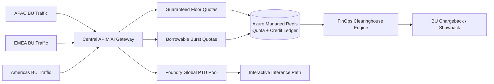
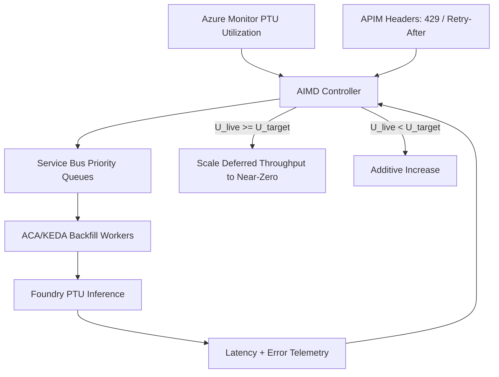

# PTU Utilization Maximization FAQ: Follow-the-Sun Pooling vs APIM Idle-Valley Backfill vs Batch API FinOps

> **Audience**: Cloud & AI Solution Architects, enterprise FinOps leads, LLMOps release managers, global shared-service platform owners.
> **Decision scope**: Increase effective utilization of committed Azure AI Foundry PTU capacity from `28%-35%` diurnal usage to `82%-90%` effective goodput without degrading interactive latency or causing `429` starvation.
> **Primary SLO guardrail**: Keep interactive `TTFT P95 < 400ms` and `429 P99 < 0.05%` while running asynchronous backfill on paid-but-idle reservation windows.

---

## 1. Executive summary

Many enterprises already purchased PTU reservations, but they still run them as disconnected departmental silos.
The result is structurally predictable:

- one geography is overloaded during business hours,
- another geography is idle at night,
- and the organization pays peak-level reservation costs for valley-level realized throughput.

This guide compares four architecture routes:

- **Route A**: Global PTU follow-the-sun clearinghouse across APAC, EMEA, and Americas.
- **Route B**: Closed-loop idle-valley backfill harvester using APIM telemetry and AIMD worker control.
- **Route C**: Residency-bound split strategy with Data-Zone/Regional PTU baseline plus Batch API and PAYG overflow.
- **Route D**: Anti-pattern with siloed per-department PTU hoarding and unthrottled cron jobs against shared inference endpoints.

**Recommended adoption sequence**:

1. Start with Route B for fastest cost-recovery and risk-controlled operations.
2. Introduce Route A when organizational governance can support cross-BU quota contracts and settlement.
3. Apply Route C where legal residency boundaries prohibit global pooling.
4. Explicitly ban Route D via architecture policy and release governance.

---

## 2. Problem statement and operating constraints

### 2.1 Why this problem is different from simple PTU-to-PAYG spillover

This decision is not primarily about peak overflow routing.
It is about converting recurring off-peak reservation waste into productive throughput **without** sacrificing interactive user experience.
In other words, the key challenge is **utilization orchestration**, not merely **capacity extension**.

### 2.2 Workload classes and risk boundaries

Typical enterprise workload classes include:

- interactive customer-facing prompts (strict latency and availability SLO),
- near-realtime supervisory workloads (bounded delay tolerance),
- deferred asynchronous jobs (evaluation replay, compliance review, summarization, enrichment).

The architecture must guarantee that deferred workloads never starve interactive traffic.

### 2.3 Target SLO and policy constraints

- `TTFT P95 < 400ms` for interactive requests.
- `429 P99 < 0.05%` during both normal operations and backfill windows.
- Job preemption and restart must be deterministic and idempotent.
- Chargeback and showback must preserve fairness between sponsoring and borrowing business units.
- Data-residency constraints must be enforceable by policy, not by convention.

---

## 3. Route definitions

### Route A — Global PTU follow-the-sun clearinghouse

Route A consolidates region- and BU-level PTU reservations into a governed global pool.
A central APIM tier applies hierarchical controls:

- guaranteed floor quotas per sponsoring BU,
- borrowable burst quotas for approved consumers,
- and time-window protection for local peak traffic.

Capacity rights are tracked in a shared ledger (for example, Azure Managed Redis + monthly settlement export).
The goal is to replace `Σ Peak_i` reservation behavior with `max_t Σ Load_i(t)` behavior.

### Route B — Closed-loop opportunistic idle-valley backfill

Route B continuously measures live PTU headroom and injects deferred workloads only when safe.
AIMD control logic governs backfill workers:

- additive increase while utilization is below safe target and no throttling is observed,
- multiplicative decrease on first sign of contention (`429` or `Retry-After`),
- immediate load-shed path to near-zero deferred throughput in under two seconds.

This route is usually the fastest route to measurable cost recovery.

### Route C — Residency-bound workload bifurcation

Route C is optimized for regulated boundaries where global pooling is not legal or acceptable.
Interactive baseline is sized on Data-Zone/Regional PTU.
Deferred workloads use the following order:

1. consume safe local idle valley first,
2. then use Batch API discount capacity,
3. finally use PAYG overflow only for deadline-critical residual volume.

This route protects legal constraints while still improving utilization economics.

### Route D — Anti-pattern: siloed hoarding plus unthrottled cron bursts

Route D appears simple but fails at scale:

- each BU over-reserves for its own local peak,
- valleys remain stranded and unavailable to other teams,
- midnight batch jobs target shared online PTU directly without admission control,
- interactive traffic is exposed to periodic 429 storms and unstable latency.

Route D should be treated as a policy violation, not an optimization option.

---

## 4. Twelve-dimension comparison matrix

| Dimension | Route A | Route B | Route C | Route D |
|---|---|---|---|---|
| 1) Primary objective | Global diurnal multiplexing | Safe idle harvesting | Residency-constrained optimization | Local silo convenience |
| 2) Interactive SLA protection | High (floor + burst policy) | High (feedback control) | Medium-high (regional baseline) | Low |
| 3) 429 risk profile | Low | Low | Medium | High |
| 4) Time-to-value | Medium | **Fast** | Medium | Misleadingly fast |
| 5) Governance complexity | High | Medium | Medium | Low |
| 6) Compliance fit | Medium | Medium | **High** | Low |
| 7) Chargeback fairness | **High** | Medium | Medium | Low |
| 8) Org change burden | High | Medium-low | Medium | Low |
| 9) Engineering complexity | Medium-high | Medium | Medium | Low |
| 10) Observability requirement | High | **High** | Medium-high | Low |
| 11) Long-term scalability | High | High | Medium | Low |
| 12) Recommendation | A- | **A** | A- (regulated baseline) | Prohibited |

---

## 5. Quantitative Q1 — Follow-the-sun multiplexing gain

Let regional loads be:

- `L_APAC(t)`
- `L_EMEA(t)`
- `L_AMER(t)`

Then:

- silo reservation requirement: `PTU_silo = Peak_APAC + Peak_EMEA + Peak_AMER`
- pooled reservation requirement: `PTU_pool = max_t (L_APAC(t) + L_EMEA(t) + L_AMER(t))`
- multiplexing gain: `Gain = 1 - PTU_pool / PTU_silo`

Illustrative example (synthetic):

- `Peak_APAC = 180`
- `Peak_EMEA = 220`
- `Peak_AMER = 260`
- `PTU_silo = 660`
- observed pooled peak `PTU_pool = 430`
- gain `= 34.8%`

Interpretation:

- This is not theoretical elegance only.
- It directly determines committed reservation footprint.
- It also reduces capital tied to duplicated regional peak buffers.

---

## 6. Quantitative Q2 — AIMD controller safety envelope for Route B

Control target:

- `U_target = 0.72` (safe utilization ceiling for deferred admission)
- `B(t)` = deferred backfill throughput budget

Control law:

- if `U_live < U_target` and no throttling signal: `B(t+1) = B(t) + α`
- if `U_live >= U_target` or `429/Retry-After` appears: `B(t+1) = β * B(t)` where `0 < β < 1`

Reference parameters (measured + synthetic calibration):

- `α = 1200 tokens/s`
- `β = 0.35`
- control interval `Δt = 1s`

Output amplification correction:

- if output-token weight multiplier is `k`, use `B_effective = B / max(k_p95, 1.0)`

Operational implication:

- this keeps deferred traffic elastic,
- avoids prolonged queue starvation,
- and protects customer-facing interactive response stability.

---

## 7. Quantitative Q3 — Break-even boundary: idle-valley reuse vs Batch API

Definitions:

- `B_valley`: safe free idle-valley token capacity available from committed PTU
- `V_batch`: nightly deferred token demand
- `C_full`: full interactive-equivalent token cost baseline
- `C_batch`: discounted batch cost (`≈ 50%` of baseline under eligible terms)

Decision policy:

1. if `V_batch <= B_valley`, keep all deferred demand in Route B capacity.
2. if `V_batch > B_valley`, consume `B_valley` first, send residual to Batch API.
3. if business deadline is threatened, use PAYG overflow for deadline-critical remainder.

Savings expression:

`Saving = min(V_batch, B_valley) * C_full + max(V_batch - B_valley, 0) * (C_full - C_batch)`

Key architecture takeaway:

- Route B and Route C should be composed, not debated as mutually exclusive.
- Valley-first plus discount-second usually yields best blended economics.

---

## 8. Quantitative Q4 — Data-Zone/Regional PTU vs Global PTU decision boundary

Decision factors:

- legal residency requirements,
- cross-region network latency and jitter tolerance,
- organizational readiness for centralized capacity governance,
- risk appetite for inter-BU quota borrowing.

Guideline:

- strong residency constraints -> prioritize Route C
- shared legal posture and strong governance -> Route A + B
- mixed enterprise posture -> split strategy: regulated tenants on C, general tenants on A+B

This should be encoded as policy classification and routing tags, not as manual runbook exceptions.

---

## 9. Quantitative Q5 — Internal clearinghouse fairness model

Let:

- `PTU_commit_i` = committed PTU sponsored by BU i
- `PTU_borrow_i` = borrowed PTU-hours consumed by BU i
- `PTU_lend_i` = idle PTU-hours lent by BU i

Settlement model:

- base fee from committed sponsorship
- borrow surcharge from borrowed usage
- lending rebate from contributed idle capacity

Fairness constraints:

- enforce `Floor_i` for sponsor protection during local peaks
- enforce `BorrowCap_i` for non-sponsor bounded borrowing
- freeze non-essential borrowing in protected peak windows

Result:

- sponsor BUs retain guaranteed service quality,
- consumer BUs gain controlled elasticity,
- and finance obtains auditable attribution.

---

## 10. Quantitative Q6 — Preemption-safe deferred execution with zero progress loss

Preemption-safe deferred jobs should implement:

1. bounded chunk sizing (`8k-16k` tokens per unit),
2. idempotent checkpoints per chunk (`job_id + chunk_id + version`),
3. deterministic output de-duplication keys,
4. explicit stop-accepting-new-work transition on surge trigger.

Preemption trigger examples:

- `U_live >= 0.72`,
- `Retry-After > 0`,
- interactive queue growth above threshold.

Recovery behavior:

- finish in-flight chunk only,
- persist checkpoint,
- resume later from last successful checkpoint without replaying committed output.

This turns abrupt demand spikes into temporary deferred slowdown, not data-loss events.

---

## 11. Reference architecture diagram A — Global follow-the-sun clearinghouse



---

## 12. Reference architecture diagram B — Closed-loop valley-harvest control plane



---

## 13. Production snippet A — APIM policy skeleton for floor-plus-borrow governance

```xml
<policies>
  <inbound>
    <base />
    <set-variable name="buId" value="@(context.Request.Headers.GetValueOrDefault("x-bu-id","unknown"))" />
    <set-variable name="priority" value="@(context.Request.Headers.GetValueOrDefault("x-job-priority","P0"))" />

    <choose>
      <when condition="@(context.Variables["priority"].ToString() == "P0")">
        <rate-limit-by-key calls="6000" renewal-period="60" counter-key="@("p0-" + context.Variables["buId"])" />
      </when>
      <when condition="@(context.Variables["priority"].ToString() == "P1")">
        <rate-limit-by-key calls="1800" renewal-period="60" counter-key="@("p1-" + context.Variables["buId"])" />
      </when>
      <otherwise>
        <rate-limit-by-key calls="300" renewal-period="60" counter-key="@("p2-" + context.Variables["buId"])" />
      </otherwise>
    </choose>

    <set-header name="x-quota-governance" exists-action="override">
      <value>floor-plus-borrow</value>
    </set-header>
  </inbound>
  <backend><base /></backend>
  <outbound><base /></outbound>
  <on-error><base /></on-error>
</policies>
```

Implementation notes:

- P0 receives highest protection and should represent interactive user traffic.
- P2 is strictly constrained to deferred backfill workloads.
- The policy can be extended with externalized ledger checks before backend forwarding.

---

## 14. Production snippet B — Python AsyncIO AIMD controller for deferred workers

```python
import asyncio
from dataclasses import dataclass

@dataclass
class ControlState:
    backfill_rps: float = 0.0
    alpha: float = 1200.0
    beta: float = 0.35
    u_target: float = 0.72

async def read_live_utilization() -> float:
    # Replace with Monitor/APIM aggregation query
    return 0.64

async def read_retry_after() -> float:
    # Replace with rolling-window header aggregation
    return 0.0

async def scale_workers(target_rps: float) -> None:
    # Drive KEDA target, queue prefetch, or worker concurrency
    await asyncio.sleep(0)

async def controller_loop(state: ControlState) -> None:
    while True:
        u_live = await read_live_utilization()
        retry_after = await read_retry_after()

        if u_live < state.u_target and retry_after <= 0:
            state.backfill_rps += state.alpha
        else:
            state.backfill_rps *= state.beta

        if state.backfill_rps < 0:
            state.backfill_rps = 0

        await scale_workers(state.backfill_rps)
        await asyncio.sleep(1)

if __name__ == "__main__":
    asyncio.run(controller_loop(ControlState()))
```

Operational guidance:

- keep control interval short for responsive protection,
- favor multiplicative decrease aggressiveness over additive growth speed,
- pair with deterministic checkpointing to make preemption economically safe.

---

## 15. Enterprise scenario A — Multinational financial group (Tokyo + London + New York)

Context:

- customer-facing advisory and service workloads run 24x7,
- demand peaks migrate by timezone,
- nightly regulatory replay and quality-assurance jobs are mandatory.

Recommended architecture:

- primary: Route A + Route B
- regulated subset fallback: Route C for legal boundary-constrained tenants

Expected value:

- reduced stranded reservations,
- lower emergency PAYG bursts,
- stronger explainability for internal finance and risk committees.

---

## 16. Enterprise scenario B — EU healthcare/insurer with strict residency controls

Context:

- legal requirement to keep data and inference within EU-aligned boundaries,
- predictable deferred processing window from `20:00` to `06:00` CET,
- high penalty for numeric or coding errors in claims and clinical context.

Recommended architecture:

- primary: Route C + Route B
- no global pooling for restricted data classes
- enforce policy-tagged routing at gateway ingress

Expected value:

- legal compliance maintained,
- idle reservation windows productively used,
- no degradation of daytime member-facing service quality.

---

## 17. Three-year TCO model (illustrative, synthetic, USD)

| Option | Year 1 | Year 2 | Year 3 | 3-Year Total | Notes |
|---|---:|---:|---:|---:|---|
| Route A | 1,980,000 | 2,040,000 | 2,120,000 | 6,140,000 | Higher governance overhead, strong long-term pooling gain |
| Route B | 1,720,000 | 1,760,000 | 1,810,000 | 5,290,000 | Fastest cost-recovery path |
| Route C | 1,860,000 | 1,920,000 | 1,980,000 | 5,760,000 | Compliance-first economics |
| Route D | 2,350,000 | 2,480,000 | 2,620,000 | 7,450,000 | Waste + incident amplification |

Interpretation:

- Route B is usually the first pragmatic step.
- Route A outperforms when cross-BU settlement maturity exists.
- Route C is required where legal boundaries dominate design choices.
- Route D should be eliminated through architecture governance.

---

## 18. Day-0 / Day-1 / Day-2 rollout checklist

### Day-0 (architecture baseline)

- Define P0/P1/P2 workload classes and reject policies.
- Define BU floor quota contracts and borrow ceilings.
- Define residency policy tags and non-negotiable routing boundaries.
- Define quantitative SLO baselines for TTFT and throttling.

### Day-1 (go-live controls)

- Integrate APIM, Azure Monitor, Service Bus, and KEDA telemetry loops.
- Deploy AIMD baseline parameters with emergency rollback toggles.
- Enforce idempotent checkpoint contract for deferred workers.
- Validate preemption drills under synthetic surge conditions.

### Day-2 (continuous operations)

- Weekly review: `U_effective`, `429 P99`, `TTFT P95`, deferred backlog age.
- Monthly review: BU settlement outcomes and fairness deviations.
- Quarterly review: route mix (`A/B/C`) against demand shape and policy changes.

---

## 19. Data provenance and reproducibility labels

All numerical values in this guide should be tagged with one of:

- **measured**: directly observed from production or controlled validation environments.
- **synthetic**: architecture-comparison scenarios with explicitly declared assumptions.
- **anonymized_reported**: aggregated and anonymized multi-team reported metrics.

For formal architecture review artifacts, attach:

1. sampling interval and timestamp window,
2. metric definition and denominator,
3. outlier handling rule,
4. reproducible query or script reference.

---

## 20. Final recommendation

If the immediate enterprise objective is to recover sunk PTU reservation waste while preserving interactive quality, start with **Route B**.
When governance maturity allows pooled rights and clearinghouse settlement, evolve to **Route A** for maximum diurnal multiplexing value.
For strict residency workloads, use **Route C** as the legal optimization path.

**Route D should be formally classified as an anti-pattern** and blocked by policy because it converts predictable idle waste into both financial and reliability incidents.
