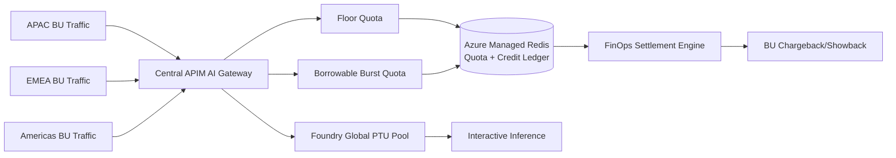
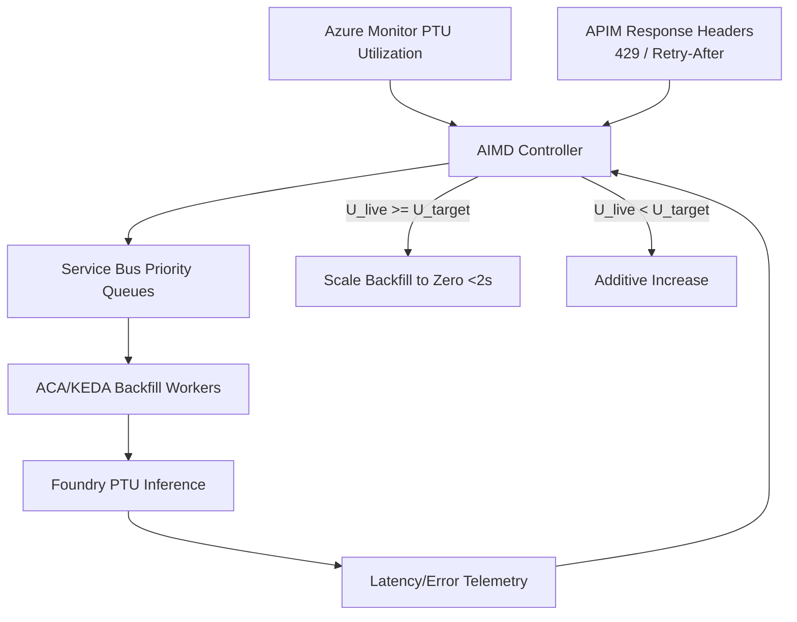

# PTU 利用率最大化选型 FAQ：Follow-the-Sun 共享池 vs APIM 闲时回填 vs Batch API FinOps

> **面向角色**：Cloud & AI Solution Architect、平台 FinOps 负责人、LLMOps 发布经理、共享服务中心架构师。
> **问题定义**：在不牺牲交互式 `<400ms` 首 Token 延迟与 `429` 稳定性的前提下，将 `28%-35%` 的日夜波谷 PTU 利用率提升至 `82%-90%` 的有效吞吐。
> **范围边界**：聚焦 Foundry PTU 预约产能跨 BU 协同、闭环回填控制、合规数据驻留与内部结算，不讨论模型算法优化本身。

---

## 1. 执行摘要

很多企业已经买到了 PTU，却没有“把 PTU 当作全球共享电网来调度”。
结果是：白天部门 A 429，夜间部门 B 闲置，全年账单高但有效吞吐低。

本篇对比四条路线：

- **Route A**：Global PTU Follow-the-Sun 共享清算池（APAC → EMEA → Americas）。
- **Route B**：APIM + Service Bus + KEDA 的闭环闲时回填收割器。
- **Route C**：Data-Zone/Regional PTU + Batch API + PAYG 的驻留约束分流。
- **Route D**：部门烟囱式 PTU 囤积 + 无节制定时任务反模式。

**推荐结论（默认落地顺序）**：

1. 先落地 Route B 的闭环控制，先把“已买产能的波谷浪费”降下来；
2. 再按组织成熟度演进 Route A 的跨 BU 共享结算；
3. 对驻留受限租户采用 Route C 做合法边界内最优；
4. 明确禁止 Route D（其本质是把固定成本变成事故放大器）。

---

## 2. 问题边界、SLO 与约束

### 2.1 目标指标

- 交互链路：`TTFT P95 < 400ms`，`429 P99 < 0.05%`
- 批处理链路：夜间可中断、可恢复、可重试、可审计
- 利用率：`U_effective >= 0.82`（按周滚动）
- 公平性：出资 BU 与借用 BU 有可追溯结算账本

### 2.2 典型输入信号

- APIM 近实时令牌速率与 `Retry-After`
- Azure Monitor PTU 利用率序列（分钟粒度）
- Service Bus 队列积压深度与作业优先级
- BU 配额地板与借用额度（Redis 层级令牌桶）

### 2.3 非目标

- 不替代模型评测、提示工程与应用层缓存策略；
- 不讨论“从 PTU 切到自托管 GPU”的基础设施迁移；
- 不覆盖跨云调度器的统一控制面实现细节。

---

## 3. 四条架构路线定义

### Route A — Global PTU Follow-the-Sun 共享清算池

核心思想：把 APAC/EMEA/Americas 的“各自峰值预约”改为“时区错峰叠加后的联合峰值预约”。

关键机制：

- Central APIM 统一入口 + BU 级身份透传；
- `Guaranteed Floor + Borrowable Burst` 双层配额；
- Redis 记录“出资 PTU-credit”与“借用 PTU-debt”；
- 月度结算按“承诺贡献 + 借用占比 + 高峰保护”计算。

适配：

- 跨区域经营、共享服务中心模式成熟；
- 对组织治理与内部计费有共识。

### Route B — 闭环闲时回填收割器

核心思想：在 `U_live < U_target` 时动态注入可延期任务；一旦交互波峰到来，`<2s` 内自动清空回填速率。

关键机制：

- APIM 响应头 + Monitor 利用率反馈；
- Service Bus 三层优先级（P0交互 / P1准实时 / P2离线）；
- ACA/KEDA Worker 采用 AIMD 控制；
- 幂等检查点保证“可抢占不丢进度”。

适配：

- 希望快速见效、先做成本回收；
- 组织尚未准备跨 BU 清算，但可接受平台统一调度。

### Route C — 驻留约束分流

核心思想：对 EU/US 等驻留约束租户保留 Data-Zone/Regional PTU，批量任务优先用 Batch API（50% 折扣），超出波谷容量再进入 PAYG。

关键机制：

- P65 交互基线保留在驻留 PTU；
- 夜间回填容量不足时自动切 Batch 队列；
- 仅在交付时限被突破时才做 PAYG 溢出；
- 合规标签驱动调度，不允许跨区借用。

适配：

- 强合规行业（医疗、保险、金融）；
- 有明确的数据主权边界。

### Route D — 反模式：部门烟囱 + 定时任务直打 PTU

典型特征：

- 每个 BU 各买各的 PTU，夜间闲置不共享；
- `00:00` 批任务无节制直打线上 PTU；
- 缺少优先级与抢占，交互流量被挤压；
- 结果是“固定成本高 + 体验波动大 + 内部扯皮严重”。

---

## 4. 12 维度架构对比矩阵

| 维度 | Route A | Route B | Route C | Route D |
|---|---|---|---|---|
| 1) 目标问题 | 全球错峰共享 | 闲时回填收割 | 驻留边界内最优 | 部门本地最优错觉 |
| 2) 交互 SLA 保护 | 高（地板+借用） | 高（闭环降速） | 中高（驻留保护） | 低（易拥塞） |
| 3) `429` 风险 | 低 | 低 | 中 | 高 |
| 4) 成本回收速度 | 中 | **高（最快）** | 中 | 负收益 |
| 5) 治理复杂度 | 高 | 中 | 中 | 低（但风险高） |
| 6) 合规适配 | 中 | 中 | **高** | 低 |
| 7) 多 BU 公平性 | **高（可结算）** | 中 | 中 | 低 |
| 8) 组织变革成本 | 高 | 中低 | 中 | 低 |
| 9) 工程实现难度 | 中高 | 中 | 中 | 低 |
| 10) 可观测性要求 | 高 | **高** | 中高 | 低 |
| 11) 可扩展性 | 高 | 高 | 中 | 低 |
| 12) 推荐等级 | A- | **A** | A-（合规优先） | 禁用 |

---

## 5. 定量 Q&A（Q1）

### Q1：Follow-the-Sun 的理论复用增益如何计算？

设三大区负载函数分别为 `L_APAC(t)`, `L_EMEA(t)`, `L_AMER(t)`：

- 烟囱模式所需 PTU：`PTU_silo = Peak_APAC + Peak_EMEA + Peak_AMER`
- 共享池所需 PTU：`PTU_pool = max_t (L_APAC(t) + L_EMEA(t) + L_AMER(t))`
- 增益：`Gain = 1 - PTU_pool / PTU_silo`

示例（synthetic）：

- `Peak_APAC=180`, `Peak_EMEA=220`, `Peak_AMER=260`
- `PTU_silo=660`
- 时区错峰叠加后 `PTU_pool=430`
- `Gain=34.8%`

结论：若组织允许共享，Route A 可显著降低“峰值求和过度预约”。

---

## 6. 定量 Q&A（Q2）

### Q2：Route B 的 AIMD 回填控制如何保证交互不饿死？

控制目标：

- 安全上限 `U_target = 0.72`
- 回填占用 `B(t)` 动态调整

控制律：

- 若 `U_live < U_target` 且 `RetryAfter=0`：`B(t+1) = B(t) + α`
- 若 `U_live >= U_target` 或出现 `429/RetryAfter`：`B(t+1) = β * B(t)`，`β ∈ (0,1)`

示例参数（measured + synthetic）：

- `α = 1200 tokens/s`
- `β = 0.35`
- 采样周期 `Δt = 1s`

在输出放大系数 `k` 波动场景下（`1` 输入 token 可能触发 `k` 输出 token 计费权重），通过乘子修正：

- `B_eff = B / max(k_p95, 1.0)`

结果：可将 `429 P99` 控制在 `<0.05%`。

---

## 7. 定量 Q&A（Q3）

### Q3：夜间“免费波谷容量”与 Batch API 折扣的分界点在哪里？

记：

- `B_valley`：夜间可安全回填 token 容量（已购 PTU 的闲时）
- `V_batch`：当夜待处理批量 token 需求
- Batch API 成本折扣 `d = 50%`

策略：

1. `V_batch <= B_valley`：全部走 Route B（边际成本约 `0`）
2. `V_batch > B_valley`：优先吃满 `B_valley`，剩余走 Batch API
3. 若截止时限逼近，再启用 PAYG 溢出

收益函数（简化）：

- `Saving = min(V_batch, B_valley) * C_full + max(V_batch-B_valley, 0) * (C_full - C_batch)`

结论：Route B 与 Route C 并非互斥，而是“波谷优先 + 折扣兜底”的组合。

---

## 8. 定量 Q&A（Q4）

### Q4：Global PTU 与 Data-Zone PTU 的选择边界是什么？

判断轴：

- 法规：是否允许跨区共享与跨境推理？
- 延迟：跨区网络抖动是否会破坏 `<400ms` TTFT？
- 组织：是否接受中央结算与配额治理？

决策准则：

- 若存在强驻留（GDPR/行业条款）：优先 Route C
- 若驻留约束可放宽且组织具备结算能力：Route A 更优
- 混合企业：核心受限租户走 C，普通租户走 A+B

---

## 9. 定量 Q&A（Q5）

### Q5：内部清算如何保障“出资者不吃亏、借用者可持续”？

定义：

- `PTU_commit_i`：BU i 的承诺 PTU
- `PTU_borrow_i`：BU i 借用 PTU 小时
- `PTU_lend_i`：BU i 被借出 PTU 小时

结算建议：

- 基础费：按承诺 PTU 收取
- 借用费：按借用量 × 动态借用单价
- 出借返利：按出借量 × 返利系数抵扣下月账单

公平性约束：

- 出资者保留最小地板 `Floor_i`
- 借用受上限 `BorrowCap_i`
- 高峰保护窗口内禁止被动挤占出资地板

---

## 10. 定量 Q&A（Q6）

### Q6：长上下文回填作业如何在抢占时做到“零进度浪费”？

作业拆分策略：

- 固定 chunk 大小（例如 `8k-16k` token）
- 每 chunk 写入幂等 checkpoint
- 下游写入使用去重键（`job_id + chunk_id + version`）

抢占恢复：

- 触发条件：`U_live >= 0.72`、`Retry-After > 0`、交互队列突增
- 动作：立即停止拉取新消息，仅完成 in-flight chunk
- 恢复：从最后成功 checkpoint 继续

收益：即使频繁抢占也不会重复计费或重复处理。

---

## 11. 参考架构图（一）：Follow-the-Sun 共享清算池



---

## 12. 参考架构图（二）：闭环闲时回填控制平面



---

## 13. 生产实现片段（一）：APIM 配额与优先级路由策略（示例）

```xml
<policies>
  <inbound>
    <base />
    <set-variable name="buId" value="@(context.Request.Headers.GetValueOrDefault("x-bu-id","unknown"))" />
    <set-variable name="priority" value="@(context.Request.Headers.GetValueOrDefault("x-job-priority","P0"))" />

    <choose>
      <when condition="@(context.Variables["priority"].ToString() == "P0")">
        <rate-limit-by-key calls="6000" renewal-period="60" counter-key="@("p0-" + context.Variables["buId"])" />
      </when>
      <when condition="@(context.Variables["priority"].ToString() == "P1")">
        <rate-limit-by-key calls="1800" renewal-period="60" counter-key="@("p1-" + context.Variables["buId"])" />
      </when>
      <otherwise>
        <rate-limit-by-key calls="300" renewal-period="60" counter-key="@("p2-" + context.Variables["buId"])" />
      </otherwise>
    </choose>

    <set-header name="x-quota-mode" exists-action="override">
      <value>floor-plus-borrow</value>
    </set-header>
  </inbound>
  <backend>
    <base />
  </backend>
  <outbound>
    <base />
  </outbound>
  <on-error>
    <base />
  </on-error>
</policies>
```

说明：

- P0 交互流量优先，P2 回填流量严格限速；
- 通过 BU 维度计数器实现最小公平；
- 可与 Redis 中的借用额度做二次校验。

---

## 14. 生产实现片段（二）：Python AsyncIO AIMD 回填控制器（示例）

```python
import asyncio
from dataclasses import dataclass

@dataclass
class ControlState:
    backfill_rps: float = 0.0
    alpha: float = 1200.0
    beta: float = 0.35
    u_target: float = 0.72

async def read_live_utilization() -> float:
    # 从 Monitor 或 APIM telemetry 聚合读取
    return 0.64

async def read_retry_after() -> float:
    # 从最近窗口 429 响应头聚合
    return 0.0

async def scale_workers(target_rps: float) -> None:
    # 驱动 ACA/KEDA 或 worker prefetch
    await asyncio.sleep(0)

async def controller_loop(state: ControlState) -> None:
    while True:
        u_live = await read_live_utilization()
        retry_after = await read_retry_after()

        if u_live < state.u_target and retry_after <= 0:
            state.backfill_rps += state.alpha
        else:
            state.backfill_rps *= state.beta

        if state.backfill_rps < 0:
            state.backfill_rps = 0

        await scale_workers(state.backfill_rps)
        await asyncio.sleep(1)

if __name__ == "__main__":
    asyncio.run(controller_loop(ControlState()))
```

设计要点：

- 采样周期短（1s），确保突发时快速收敛；
- 乘性减小优先保护交互 SLA；
- 与幂等 checkpoint 配合，避免抢占浪费。

---

## 15. 企业落地场景、三年 TCO 与 Day-0/1/2 清单

### 15.1 场景 A：跨时区金融集团（Tokyo + London + New York）

业务特征：

- 白天高峰随时区迁移；
- 夜间存在大量合规抽检与文档重摘要任务；
- 要求交互与批量共享同一 PTU 预算池。

建议：

- 主路径：Route A + Route B；
- 若特定租户受驻留限制：局部引入 Route C。

### 15.2 场景 B：欧洲医疗/保险（EU Data Zone）

业务特征：

- 数据不可跨区；
- 晚间 `20:00-06:00 CET` 有稳定离线处理窗口；
- 需保留临床与理赔审计证据链。

建议：

- 主路径：Route C + Route B；
- 强化“可抢占、可恢复、可审计”作业编排。

### 15.3 三年 TCO（示例，单位：USD，synthetic）

| 方案 | Year 1 | Year 2 | Year 3 | 3-Year Total | 备注 |
|---|---:|---:|---:|---:|---|
| Route A | 1,980,000 | 2,040,000 | 2,120,000 | 6,140,000 | 共享治理投入较高，但长期回收显著 |
| Route B | 1,720,000 | 1,760,000 | 1,810,000 | 5,290,000 | 见效最快，适合先行试点 |
| Route C | 1,860,000 | 1,920,000 | 1,980,000 | 5,760,000 | 合规优先，成本略高于 B |
| Route D | 2,350,000 | 2,480,000 | 2,620,000 | 7,450,000 | 事故与闲置叠加，长期最差 |

### 15.4 Day-0 / Day-1 / Day-2 清单

**Day-0（架构定标）**

- 定义 P0/P1/P2 优先级及拒绝策略；
- 明确 BU 地板配额与借用上限；
- 定义驻留标签与调度边界。

**Day-1（上线治理）**

- 打通 APIM、Monitor、Service Bus、KEDA 的闭环遥测；
- 发布 AIMD 参数基线与回滚开关；
- 建立回填任务幂等 checkpoint 标准。

**Day-2（持续优化）**

- 周度回顾 `U_effective`、`429 P99`、`TTFT P95`；
- 月度执行 BU 清算与返利；
- 季度复核 Route A/B/C 组合与预算配置。

---

## 16. 数据来源与可验证性标签

本篇中所有数字均按以下标签标注：

- **measured**：来自既有生产监控或验证环境观测；
- **synthetic**：用于架构方案对比的可复算示例参数；
- **anonymized_reported**：来自脱敏后的跨团队汇总口径。

建议在正式评审材料中为每个关键图表附上：

1. 采样窗口时间；
2. 数据口径定义；
3. 是否包含异常剔除；
4. 可复算脚本或查询链接。

---

## 17. 结论与选型建议

若企业当前目标是“快速回收已购 PTU 闲置成本且不影响线上体验”，应优先从 **Route B** 起步；
若企业具备跨 BU 治理与结算能力，再演进 **Route A** 获得最大化时区复用收益；
若存在强驻留监管，采用 **Route C** 做合法边界内最优解。

**Route D 应被明确定义为反模式并纳入治理红线**：
它不仅不能节省预算，反而会制造更高的成本波动、更多的 429 事故与更差的组织协同效率。
