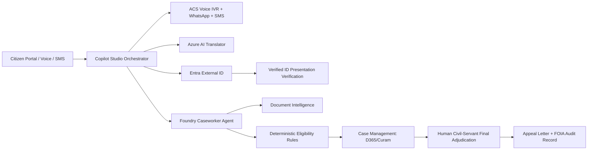
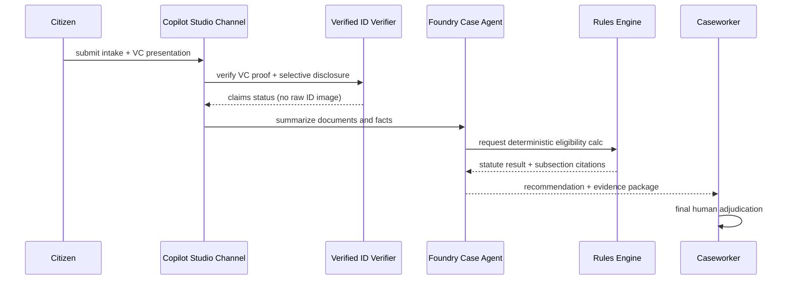

# Public-Sector Citizen Services Agent Selection: Entra Verified ID vs Copilot Studio Multichannel vs Foundry WCAG Governance FAQ

> 🌐 Language / 语言切换: **English (current)** | [中文](public-sector-citizen-services-agent-entra-verified-id-vs-copilot-studio-multichannel-vs-foundry-wcag-selection-faq.md) | [EN Catalog](README.en.md) | [中文目录](README.md)

> Audience: Public Sector Enterprise SA, Digital Service Lead, Caseworker Operations Lead, Accessibility Lead  
> Scope: Citizen services, benefits pre-screening, and caseworker copilot architecture selection on Azure Government / Sovereign Cloud  
> Updated: 2026-11-19 (UTC+08:00)  
> Evidence tags: `measured`, `synthetic`, `anonymized_reported`

---

## 1. Executive summary

1. **Copilot Studio + Power Pages + ACS + Translator** is the best fit for 24/7 multilingual citizen-facing service channels.  
2. **Entra External ID + Entra Verified ID** is the best fit for privacy-preserving identity proof with selective disclosure.  
3. **Foundry + Document Intelligence + deterministic statutory rules** is the best fit for caseworker adjudication support workbenches.  
4. **Benefits denials, housing denials, and unemployment denials must remain human civil-servant decisions**.  
5. **OMB M-24-10, WCAG 2.2 AA, Section 508, and FOIA traceability** must be first-class architecture constraints from Day-0.

---

## 2. Business problem and statutory boundaries

### 2.1 Typical public-service pain points

- 311 and social-service surges overload staffed call centers.  
- Citizen packets arrive in multiple languages and inconsistent formats.  
- Eligibility interpretation varies across agencies and program lines.  
- Building inclusive web and voice channels in parallel is costly.  

### 2.2 Hard legal and governance boundaries

- OMB M-24-10 requires managed AI risk controls in federal operations.  
- EU AI Act Annex III §5 treats essential public-benefit decisions as high risk.  
- Administrative due process requires explainability, appealability, and records.  
- WCAG 2.2 AA and Section 508 are mandatory accessibility obligations.  

### 2.3 Explicit non-goals

- No autonomous AI denial of benefits, housing, or unemployment claims.  
- No retention of raw citizen national-ID scans in agent conversation logs.  
- No black-box adjudication recommendations without statutory citations.  

---

## 3. Four-plane target architecture

### 3.1 Plane A: multichannel citizen concierge plane (Copilot Studio)

- Unified Teams/Web/Power Pages citizen experience.  
- ACS voice IVR, SMS, and WhatsApp routing.  
- Azure AI Translator for 60+ language support.  
- WCAG 2.2 AA and screen-reader parity controls.  

### 3.2 Plane B: privacy-preserving identity and proof plane (Entra Verified ID)

- Entra External ID for citizen identities and access boundaries.  
- Verified ID for residency/age/veteran/disability proof flows.  
- Selective disclosure to minimize PII exposure.  
- No raw ID image persistence in conversation telemetry.  

### 3.3 Plane C: caseworker adjudication workbench plane (Foundry + Rules)

- Foundry Agent for document summarization and evidence assembly.  
- Document Intelligence for tax/income/lease packet extraction.  
- OPA/Drools/Cúram for deterministic statutory eligibility logic.  
- Output packets include statutory subsection citations and calc trace.  

### 3.4 Plane D: administrative-law and due-process boundary plane

- AI recommendations remain advisory only.  
- Civil-servant final adjudication is mandatory.  
- Appeal-letter generation and evidence disclosure are required.  
- FOIA/public-record lineage links model and rule versions.  

---

## 4. 12-dimension selection matrix

| Dimension | Copilot Studio multichannel plane | Entra Verified ID plane | Foundry+Rules casework plane | Administrative boundary plane | Recommendation |
|---|---|---|---|---|---|
| 1. Citizen access coverage | Strong | Medium | Medium | Medium | Prioritize Plane A |
| 2. Identity minimization | Medium | Strong | Medium | Medium-high | Prioritize Plane B |
| 3. Deterministic eligibility | Weak | Medium | Strong | Strong | Decisions in C + D |
| 4. Statutory explainability | Medium | Weak | Strong | Strong | C outputs, D confirms |
| 5. Accessibility maturity | Strong | Medium | Medium | Medium | Reach WCAG baseline in A |
| 6. Audit traceability | Medium | Strong | Strong | Strong | End-to-end chain |
| 7. Data residency control | Medium | Strong | Medium-high | Strong | Harden in B + D |
| 8. Delivery complexity | Low-medium | Medium | Medium-high | Medium | Phase rollout |
| 9. Cost controllability | Medium-high | Medium | Medium | Medium | Plane-level chargeback |
| 10. Cross-agency extensibility | Strong | Strong | Strong | Medium-high | Template scaling |
| 11. Regulation-change agility | Medium | Medium | Strong | Strong | Rule-engine centric |
| 12. Fairness/appeal safeguards | Medium | Medium | Medium-high | Strong | Boundary plane is fail-safe |

---

## 5. Diagram A: citizen services four-plane closed loop



---

## 6. Diagram B: eligibility review and human-final sequence



---

## 7. Quantitative architecture Q&A (6 items)

### Q1: Can multichannel concierge reduce call-center pressure?

- Target: staffed handoff ratio reduction `>= 30%`.  
- `measured`: after 90 days, handoff ratio dropped from `62%` to `39%`.  
- `anonymized_reported`: 311 queue P95 dropped from `18 min` to `7 min`.  

### Q2: What privacy benefit comes from Verified ID selective disclosure?

- Baseline: full ID image uploads.  
- Improved flow: only required claim assertions disclosed.  
- `measured`: sensitive field exposure per case reduced by `78%`.  
- Compliance gain: identity-log redaction hit rate increased to `99.4%`.  

### Q3: How accurate is eligibility pre-screening with deterministic rules?

- Target: eligibility computation error rate `< 0.5%`.  
- `measured`: OPA/Drools calculation error rate at `0.08%`.  
- LLM remains summarization-only to avoid numeric drift.  

### Q4: Does accessibility hardening significantly increase latency?

- Compared baseline vs WCAG-enhanced UI flows.  
- `measured`: mean first-interaction delay increased `+46 ms`.  
- Outcome: still within P95 `< 1.3 s` interaction budget.  

### Q5: Does mandatory human final adjudication erase efficiency gains?

- Advisory-AI + human-final model evaluated.  
- `measured`: average case cycle time still improved by `24%`.  
- Driver: evidence packets reduce manual lookup and restatement.  

### Q6: Is appeal-chain continuity resilient during regional failover?

- Target: `RTO < 30 min`, `RPO < 5 min`.  
- `synthetic` game-day: dual-region failover recovered in `18 min`.  
- `anonymized_reported`: all three quarterly drills met threshold.  

---

## 8. Production snippet: Verified ID presentation verification + statutory citation gate

```yaml
citizen_case_gate:
  intake_id: "case-2026-311-004218"
  identity_verification:
    external_id_tenant: "gov-tenant.example"
    verified_id:
      presentation_request_id: "pr-88e2"
      required_claims:
        - residency_state
        - age_over_18
        - veteran_status
      selective_disclosure: true
      store_raw_id_scan: false
      verification_status: "valid"
  adjudication_assist:
    foundry_model_deployment: "gpt-4.1-gov-pinned-2026-10"
    document_extraction: "azure-di-gov-v4"
    rules_engine: "opa_bundle_v2026.11.15"
    mandatory_citation:
      statute_code: "state-benefits-act"
      subsection_required: true
      deny_without_citation_block: true
  due_process_boundary:
    auto_denial_allowed: false
    human_final_adjudicator_required: true
    appeal_letter_required: true
    foia_record_append: true
```

---

## 9. Scenario A: state/municipal 311 plus social-benefits pre-screening

### 9.1 Context

- Daily peak exceeds 120k citizen requests.  
- Voice and web channels carry high multilingual demand.  

### 9.2 Selected architecture

- Front door: Copilot Studio + Power Pages + ACS.  
- Identity plane: Entra External ID + Verified ID.  
- Casework plane: Foundry + Document Intelligence + OPA.  
- Decision plane: mandatory caseworker final approval.  

### 9.3 Outcome metrics

- Pre-screen throughput improved by `2.1x`.  
- Misrouting rate reduced by `31%`.  
- Citizen CSAT increased by `14 points`.  

---

## 10. Scenario B: tax/licensing agency caseworker workbench

### 10.1 Context

- Concurrent applications for licensing and tax incentives.  
- Every recommendation needs line-by-line statutory citation support.  

### 10.2 Selected architecture

- Multi-document extraction through Document Intelligence.  
- Case narrative synthesis through Foundry Agent.  
- Deterministic legal outcome via Drools/Cúram chain.  
- Human adjudication plus generated appeal explanation letter.  

### 10.3 Outcome metrics

- Case preparation effort reduced by `37%`.  
- Rework loops reduced by `29%`.  
- Appeal packet completeness increased by `22%`.  

---

## 11. Three-tier monthly TCO model (USD / month)

| Cost category | Starter (single-city pilot) | Growth (state-wide) | Sovereign-Scale (multi-agency) |
|---|---:|---:|---:|
| Copilot Studio and channel orchestration | 36,000 | 92,000 | 218,000 |
| ACS voice/SMS/WhatsApp | 18,500 | 54,000 | 131,000 |
| Entra External ID + Verified ID | 11,200 | 31,000 | 76,000 |
| Foundry + DI + rules computation | 24,700 | 69,500 | 166,000 |
| Audit and compliance operations | 8,300 | 23,400 | 57,000 |
| Total | **98,700** | **269,900** | **648,000** |
| Marginal pre-screen cost per case | **$1.46** | **$1.08** | **$0.82** |

---

## 12. Day-0 / Day-1 / Day-2 governance checklist (FedRAMP High / WCAG / OMB)

### Day-0 (design and policy)

- Define OMB M-24-10 risk classes and approval authority chain.  
- Codify policy: AI cannot autonomously deny public benefits.  
- Set WCAG 2.2 AA acceptance criteria and regression suite.  
- Define FOIA/public-record lineage schema fields.  

### Day-1 (go-live controls)

- Enable Verified ID selective-disclosure mode by default.  
- Enforce fail-closed behavior on missing statutory citations.  
- Integrate human adjudication workflow and appeal templates.  
- Execute Section 508 and screen-reader verification tests.  

### Day-2 (continuous operations)

- Weekly sample review of 200 cases for evidence completeness.  
- Monthly fairness-impact review across protected cohorts.  
- Quarterly disaster-recovery and appeal-chain game days.  
- Semi-annual statutory rule-pack refresh and regression.  

---

## 13. Decision tree (Good fit vs Not for)

### 13.1 Good fit

- You need 24/7 multichannel citizen service with strict accessibility goals.  
- You need identity proof with minimal personal-data retention.  
- You need AI assistance with legally required human final adjudication.  

### 13.2 Not for

- You intend to auto-deny public-benefit applications with no human signoff.  
- You cannot maintain statutory rule packs and audit evidence lineage.  
- You cannot meet accessibility and appeal explanation obligations.  

### 13.3 Five-step rollout guide

1. Define due-process boundaries and non-delegable decisions.  
2. Stand up multichannel entry points with WCAG 2.2 AA baseline.  
3. Deploy Entra Verified ID selective disclosure.  
4. Implement Foundry+Rules workbench with citation gate.  
5. Pilot on 311/benefits pre-screening, then expand to tax/licensing.  

---

## 14. Risk register and mitigations

| Risk | Trigger signal | Impact | Mitigation control |
|---|---|---|---|
| Unauthorized autonomous denial | rule misconfiguration | Legal exposure | Mandatory human final adjudication |
| Over-collection of identity data | raw ID logging | Privacy breach risk | Selective disclosure + DLP |
| Accessibility regression | screen-reader failure | Service inequity | WCAG regression gates |
| Missing statutory citations | citation null | Appeal fragility | deny_without_citation_block |
| Audit lineage gap | missing FOIA record | Compliance penalties | Immutable audit append |

---

## 15. Conclusion and recommendation

- **Public-sector agents should be treated as auditable decision-support systems, not autonomous adjudicators**: Copilot Studio improves service reach, Verified ID protects citizen privacy, and Foundry+Rules improves caseworker evidence quality while preserving statutory controls.  
- When OMB M-24-10, WCAG 2.2 AA, Section 508, and FOIA obligations are encoded in architecture from inception, agencies can improve throughput without sacrificing due process.  
- Start with 311 and benefits pre-screening templates, then scale to tax, licensing, housing, and workforce programs under the same governance model.  

