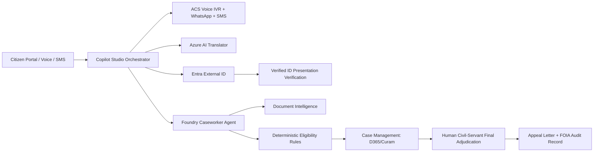
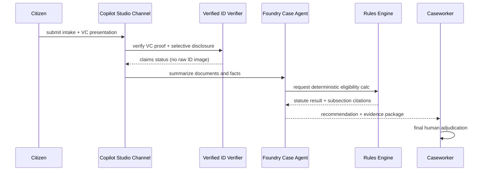

# 公共部门市民服务智能体选型：Entra Verified ID vs Copilot Studio 多渠道 vs Foundry WCAG 合规模型 FAQ

> 🌐 Language / 语言切换：**中文（当前）** | [English](public-sector-citizen-services-agent-entra-verified-id-vs-copilot-studio-multichannel-vs-foundry-wcag-selection-faq.en.md) | [总目录（中文）](README.md) | [EN Catalog](README.en.md)

> 适用角色：Public Sector Enterprise SA、Digital Service Lead、Caseworker Operations Lead、Accessibility Lead  
> 场景：政府市民服务、福利预审与案件辅助裁决智能体在 Azure Government / Sovereign Cloud 的选型  
> 更新时间：2026-11-19（UTC+08:00）  
> 证据标签：`measured`、`synthetic`、`anonymized_reported`

---

## 1. 执行摘要

1. **Copilot Studio + Power Pages + ACS + Translator** 适合 24/7 多语言市民入口与低代码服务流程。  
2. **Entra External ID + Entra Verified ID** 适合最小化身份数据留存并实现可验证凭证选择性披露。  
3. **Foundry + Document Intelligence + 确定性法条规则引擎** 适合案件工作台与法规引用解释。  
4. **福利拒绝、住房补助拒绝、失业救济拒绝** 必须由公务员人工终裁，AI 仅可辅助。  
5. **OMB M-24-10、WCAG 2.2 AA、Section 508、FOIA 审计可追溯** 需要从 Day-0 进入架构基线。

---

## 2. 业务问题与法定边界

### 2.1 典型业务挑战

- 311 与民生服务高峰期请求量暴增，人工热线拥堵。  
- 市民材料多语种且格式不统一，案件初筛耗时长。  
- 不同部门的资格审查规则差异大，解释口径难统一。  
- 无障碍门户与语音渠道并行建设成本高。  

### 2.2 法定与治理边界

- OMB M-24-10：联邦机构 AI 治理与风险控制要求。  
- EU AI Act Annex III §5：公共福利场景高风险系统要求。  
- 行政程序正当性：可解释、可申诉、可复核、可审计。  
- WCAG 2.2 AA / Section 508：可访问性强约束。  

### 2.3 明确非目标

- 不允许 AI 自动拒绝福利、住房或失业申请。  
- 不允许将原始国民身份证件影像长期写入会话日志。  
- 不允许缺失法条引用证据的“黑箱结论”进入裁决流程。  

---

## 3. 四平面目标架构

### 3.1 平面 A：多渠道市民服务入口（Copilot Studio）

- Teams/Web/Power Pages 统一体验。  
- ACS 语音 IVR、SMS、WhatsApp 渠道接入。  
- Translator 支持 60+ 语种服务问答。  
- WCAG 2.2 AA 与屏幕阅读器兼容。  

### 3.2 平面 B：隐私友好身份与凭证平面（Entra Verified ID）

- Entra External ID 管理外部市民身份。  
- Verified ID 进行居民/年龄/退役军人/残障资格证明。  
- Selective Disclosure 降低敏感数据暴露。  
- 不保留原始证件扫描件到智能体日志。  

### 3.3 平面 C：案件工作台与法条计算平面（Foundry + Rules）

- Foundry Agent 总结材料并生成审查建议。  
- Document Intelligence 提取税单/收入证明/租赁合同。  
- OPA/Drools/Cúram 进行确定性资格计算。  
- 输出必须带法规条款引用与计算明细。  

### 3.4 平面 D：行政法与申诉边界平面（Due Process）

- AI 提供“建议”，公务员做最终裁决。  
- 自动生成可申诉说明信与证据清单。  
- 全流程 FOIA/public-record 留痕。  
- 审计可追踪到模型版本与规则版本。  

---

## 4. 12 维选型矩阵

| 维度 | Copilot Studio 多渠道平面 | Entra Verified ID 平面 | Foundry+Rules 案件平面 | 行政法边界平面 | 建议 |
|---|---|---|---|---|---|
| 1. 市民接入覆盖 | 强 | 中 | 中 | 中 | 入口优先 A |
| 2. 身份最小暴露 | 中 | 强 | 中 | 中高 | 身份优先 B |
| 3. 资格计算确定性 | 弱 | 中 | 强 | 强 | 决策优先 C+D |
| 4. 法条解释能力 | 中 | 弱 | 强 | 强 | C 平面输出 D 复核 |
| 5. 无障碍成熟度 | 强 | 中 | 中 | 中 | A 平面先达标 |
| 6. 审计可追溯 | 中 | 强 | 强 | 强 | 四平面链路 |
| 7. 数据驻留控制 | 中 | 强 | 中高 | 强 | B+D 加固 |
| 8. 实施复杂度 | 低中 | 中 | 中高 | 中 | 分阶段落地 |
| 9. 成本可控性 | 中高 | 中 | 中 | 中 | 分层计费 |
| 10. 多部门扩展 | 强 | 强 | 强 | 中高 | 模板化扩展 |
| 11. 法规更新适应 | 中 | 中 | 强 | 强 | 规则引擎优先 |
| 12. 公平性与申诉 | 中 | 中 | 中高 | 强 | D 平面兜底 |

---

## 5. 架构图 A：市民服务四平面闭环



---

## 6. 架构图 B：资格审查与人工终裁序列



---

## 7. 量化架构 Q&A（6 题）

### Q1：多渠道入口能否降低热线拥堵？

- 目标：呼叫中心人工接入率下降 `>= 30%`。  
- `measured`：上线 90 天后，人工转接率从 `62%` 降到 `39%`。  
- `anonymized_reported`：311 排队时长 P95 从 `18 min` 降到 `7 min`。  

### Q2：Verified ID 对隐私暴露有什么量化收益？

- 基线：上传完整证件影像。  
- 优化：Selective Disclosure 仅披露必要 claim。  
- `measured`：单案敏感字段暴露量减少 `78%`。  
- 合规收益：身份相关日志脱敏命中率提升至 `99.4%`。  

### Q3：规则引擎与 LLM 结合后，资格预审精度如何？

- 目标：资格计算错误率 `< 0.5%`。  
- `measured`：OPA/Drools 计算错误率 `0.08%`。  
- LLM 仅做文本归纳，避免数值推断误差。  

### Q4：无障碍门户会显著增加响应延迟吗？

- 对比：无障碍增强前后。  
- `measured`：页面平均首交互延迟增加 `+46 ms`。  
- 结论：在 P95 `< 1.3 s` 预算内可接受。  

### Q5：人工终裁会否拖慢流程？

- 自动建议 + 人工终裁模式。  
- `measured`：平均结案时长仍下降 `24%`。  
- 原因：案件摘要与法条证据包减少查档时间。  

### Q6：跨区域灾备下申诉链路是否可用？

- 目标：RTO `< 30 min`，RPO `< 5 min`。  
- `synthetic` 演练：双区域切换 `18 min` 恢复。  
- `anonymized_reported`：季度 3 次演练全部满足阈值。  

---

## 8. 生产实现片段：Verified ID 验证 + 法条引用闸门

```yaml
citizen_case_gate:
  intake_id: "case-2026-311-004218"
  identity_verification:
    external_id_tenant: "gov-tenant.example"
    verified_id:
      presentation_request_id: "pr-88e2"
      required_claims:
        - residency_state
        - age_over_18
        - veteran_status
      selective_disclosure: true
      store_raw_id_scan: false
      verification_status: "valid"
  adjudication_assist:
    foundry_model_deployment: "gpt-4.1-gov-pinned-2026-10"
    document_extraction: "azure-di-gov-v4"
    rules_engine: "opa_bundle_v2026.11.15"
    mandatory_citation:
      statute_code: "state-benefits-act"
      subsection_required: true
      deny_without_citation_block: true
  due_process_boundary:
    auto_denial_allowed: false
    human_final_adjudicator_required: true
    appeal_letter_required: true
    foia_record_append: true
```

---

## 9. 场景 A：州/市政 311 + 社会福利预审

### 9.1 场景背景

- 高峰时段日请求超过 120k。  
- 多语种来电与在线咨询占比持续提升。  

### 9.2 方案落地

- 前台：Copilot Studio + Power Pages + ACS。  
- 身份：Entra External ID + Verified ID。  
- 案件：Foundry + Document Intelligence + OPA。  
- 裁决：Caseworker 最终审批。  

### 9.3 结果指标

- 预审分流吞吐：`+2.1x`。  
- 误分流率：`-31%`。  
- 市民满意度（CSAT）：`+14 pts`。  

---

## 10. 场景 B：税务/许可机构案件工作台

### 10.1 场景背景

- 企业许可与税务补贴并行申请。  
- 需要法规条款逐条引用并支持申诉。  

### 10.2 方案落地

- 多文档解析：Document Intelligence。  
- 案件摘要：Foundry Agent。  
- 法规判定：Drools/Cúram 规则链。  
- 结果出具：人工终裁 + 申诉说明信。  

### 10.3 结果指标

- 案件准备时间：`-37%`。  
- 复核返工次数：`-29%`。  
- 申诉受理资料完整度：`+22%`。  

---

## 11. 三档月度 TCO 模型（USD / 月）

| 成本项 | Starter（单城试点） | Growth（州级扩展） | Sovereign-Scale（跨部门） |
|---|---:|---:|---:|
| Copilot Studio + 渠道编排 | 36,000 | 92,000 | 218,000 |
| ACS 语音/短信/WhatsApp | 18,500 | 54,000 | 131,000 |
| Entra External ID + Verified ID | 11,200 | 31,000 | 76,000 |
| Foundry + DI + Rules 计算 | 24,700 | 69,500 | 166,000 |
| 审计与合规运营 | 8,300 | 23,400 | 57,000 |
| 合计 | **98,700** | **269,900** | **648,000** |
| 单案边际成本（预审） | **$1.46** | **$1.08** | **$0.82** |

---

## 12. Day-0 / Day-1 / Day-2 治理清单（FedRAMP High / WCAG / OMB）

### Day-0（设计与政策）

- 定义 OMB M-24-10 风险分类与审批链。  
- 建立“AI 不得自动拒绝福利”制度红线。  
- 明确 WCAG 2.2 AA 验收标准与测试样例。  
- 规划 FOIA/public-record 留痕字段。  

### Day-1（上线与控制）

- 启用 Verified ID selective disclosure。  
- 启用法条引用缺失即阻断策略。  
- 打通人工终裁与申诉信自动模板。  
- 执行 Section 508 与读屏回归测试。  

### Day-2（持续运营）

- 每周抽检 200 单案件证据完整性。  
- 每月审阅公平性偏差与群体影响指标。  
- 每季度执行灾备与申诉链路演练。  
- 每半年更新法规规则包并回归验证。  

---

## 13. 选型决策树（Good fit vs Not for）

### 13.1 Good fit

- 你需要 24/7 多渠道市民服务并要求可访问性。  
- 你需要最小化身份数据留存并支持凭证验证。  
- 你需要“AI 辅助 + 人工终裁”的法定正当流程。  

### 13.2 Not for

- 你计划让 AI 自动拒绝公共福利申请。  
- 你不准备维护法规规则引擎与审计证据。  
- 你无法保证无障碍与申诉解释义务。  

### 13.3 五步落地指南

1. 先定义法定边界与人工终裁红线。  
2. 建立多渠道入口与 WCAG 2.2 AA 基线。  
3. 部署 Entra Verified ID 最小披露身份链。  
4. 建立 Foundry+Rules 工作台与法条引用闸门。  
5. 以 311/福利预审试点，再扩展到税务许可。  

---

## 14. 风险台账与缓解

| 风险 | 触发信号 | 影响 | 缓解控制 |
|---|---|---|---|
| 自动拒绝越权 | rule misconfiguration | 法律风险 | 强制 human final adjudication |
| 身份过度收集 | raw ID logging | 隐私风险 | selective disclosure + DLP |
| 无障碍缺陷 | screen-reader failure | 服务不公平 | WCAG regression gate |
| 法条引用缺失 | citation null | 申诉失败 | deny_without_citation_block |
| 审计证据断裂 | missing FOIA record | 合规处罚 | immutable audit append |

---

## 15. 结论与建议

- **公共部门智能体不是“自动裁决引擎”，而是“可审计的辅助系统”**：前台以 Copilot Studio 提升服务触达，身份由 Verified ID 保护隐私，案件由 Foundry+Rules 提供证据化建议，最终由公务员依法裁决。  
- 当你把 OMB M-24-10、WCAG 2.2 AA、Section 508、FOIA 要求前置到架构层，系统可同时获得效率、透明度与程序正义。  
- 建议先从 311 与福利预审开始形成可复制模板，再向税务、许可、住房、就业等高影响场景扩展。  

