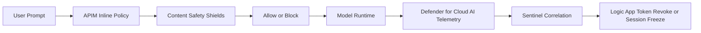
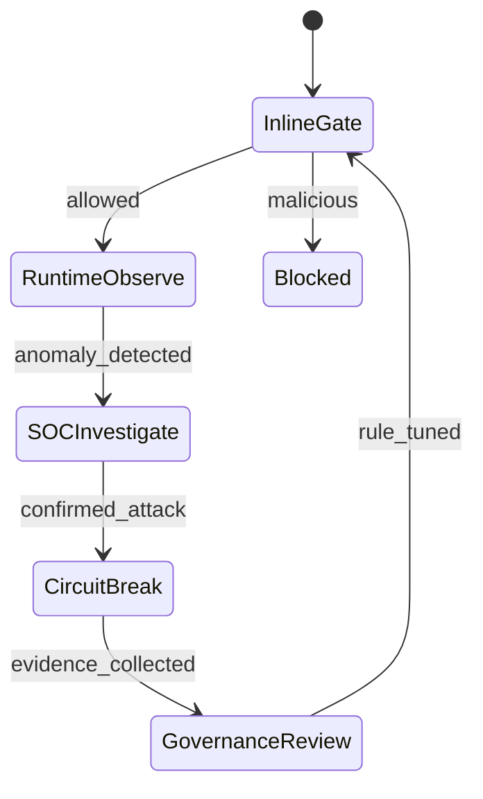

# Purview AI Hub DSPM vs Defender for Cloud AI Threat Protection vs Content Safety: Enterprise AI SecOps Selection FAQ

> 🌐 **Language / 语言切换**: **[🇬🇧 English (purview-ai-hub-dspm-vs-defender-for-cloud-ai-threat-protection-vs-content-safety-secops-selection-faq.en.md)](purview-ai-hub-dspm-vs-defender-for-cloud-ai-threat-protection-vs-content-safety-secops-selection-faq.en.md)** | **[🇨🇳 中文版 (purview-ai-hub-dspm-vs-defender-for-cloud-ai-threat-protection-vs-content-safety-secops-selection-faq.md)](purview-ai-hub-dspm-vs-defender-for-cloud-ai-threat-protection-vs-content-safety-secops-selection-faq.md)** | **[📚 Architecture Selection FAQ Index](README.en.md)**

## 1) Objective and boundary
Goal: establish enterprise AI SecOps four-layer defense-in-depth selection baseline.
Scope: synchronous inline blocking, asynchronous threat hunting, DSPM data posture, and shift-left red-team admission.
Exclusion: no low-level kernel/driver/hardware-register implementation details.
Conclusion: only Content Safety + Defender/Sentinel + Purview DSPM + PyRIT forms a closed loop.
## 2) Verifiable sources with timestamps
- Azure AI Content Safety docs (04:58 BJT)。
- Prompt Shields / Groundedness docs (04:58 BJT)。
- Defender for Cloud Threat Protection for AI Workloads docs (04:59 BJT)。
- Microsoft Sentinel analytics/playbook docs (04:59 BJT)。
- Microsoft Purview DSPM for AI (AI Hub) docs (04:59 BJT)。
- PyRIT and Foundry Red Teaming references (05:00 BJT)。
- APIM policy and Entra session-control docs (05:00 BJT)。
Evidence tags: measured/synthetic/anonymized_reported.
## 3) Four service boundaries and 12-dimension matrix
- A: Content Safety (Prompt Shields/Indirect injection blocking/Groundedness/Protected Material) handles inline prevention.
- B: Defender for Cloud AI + Sentinel SOAR handles async behavior detection, correlation, and automated circuit breaking.
- C: Purview DSPM for AI (AI Hub) handles sensitive-data exposure, shadow AI, and compliance auditing.
- D: PyRIT/Foundry Red Teaming handles shift-left adversarial scanning and release gates.
- Dimension 1 interception timing (inline milliseconds vs async minutes).
- Dimension 2 attack-surface coverage (direct injection/indirect injection/multi-turn probing).
- Dimension 3 alert correlation depth (session, identity, and asset scopes).
- Dimension 4 automated response actions (token revocation, session freeze, subject isolation).
- Dimension 5 data-leak visibility (shadow AI upload and clipboard leakage risk).
- Dimension 6 compliance evidence exportability (regulatory audit packages).
- Dimension 7 cost model (inline latency budget vs SOC operations overhead).
- Dimension 8 false-positive/false-negative balance and graded policy.
- Dimension 9 multi-tenant isolation and duty separation.
- Dimension 10 DevSecOps shift-left coverage.
- Dimension 11 integration complexity with APIM/Entra/SIEM orchestration.
- Dimension 12 impact on business availability and latency.
## 4) Tiering strategy and budget thresholds
- Default inline defense: Prompt Shields plus baseline safety policy with <45ms added latency target.
- Heavy Groundedness verification is triggered only for high-risk actions to control cost.
- Five jailbreak probes within three minutes triggers Sentinel playbook circuit break.
- High-frequency sensitive retrieval by one subject triggers APIM quota downgrade and Entra suspension.
- Shadow-AI leakage hits trigger Purview-guided redirection to enterprise-controlled Copilot.
- Release gate: PyRIT adversarial scan must pass before production rollout.
- Financial/healthcare sectors require automated evidence retention for 12+ months.
- Weekly false-positive/false-negative review recalibrates thresholds and rule weights.
## 5) Five calculable Q&As
### Q1 Why default filtering alone cannot cover indirect injection and crescendo attacks
- Inline blocking handles immediate prevention, while async SOC handles correlated hunting and sustained response.
- APIM, Entra, and Sentinel must share one response playbook to avoid alert-without-action.
- Preserve replayable evidence chains for postmortem, audit, and policy tuning.
### Q2 How to keep inline security budget under <45ms with tiered cost controls
- Inline blocking handles immediate prevention, while async SOC handles correlated hunting and sustained response.
- APIM, Entra, and Sentinel must share one response playbook to avoid alert-without-action.
- Preserve replayable evidence chains for postmortem, audit, and policy tuning.
### Q3 How Purview detects internal-financial draft leakage to unauthorized external AI and redirects users
- Inline blocking handles immediate prevention, while async SOC handles correlated hunting and sustained response.
- APIM, Entra, and Sentinel must share one response playbook to avoid alert-without-action.
- Preserve replayable evidence chains for postmortem, audit, and policy tuning.
### Q4 How five jailbreak probes in three minutes trigger millisecond ban loop
- Inline blocking handles immediate prevention, while async SOC handles correlated hunting and sustained response.
- APIM, Entra, and Sentinel must share one response playbook to avoid alert-without-action.
- Preserve replayable evidence chains for postmortem, audit, and policy tuning.
### Q5 How to automate evidence-pack export for finance/healthcare audits
- Inline blocking handles immediate prevention, while async SOC handles correlated hunting and sustained response.
- APIM, Entra, and Sentinel must share one response playbook to avoid alert-without-action.
- Preserve replayable evidence chains for postmortem, audit, and policy tuning.
## 6) Four-layer defense-in-depth reference architecture
- Layer 1: APIM plus Content Safety inline synchronous gates.
- Layer 2: Defender for Cloud AI behavior detection and threat correlation.
- Layer 3: Sentinel analytics and Logic App automated circuit-breaking response.
- Layer 4: Purview DSPM for AI governance, retention, and compliance evidence.
- Shift-left layer: PyRIT/Foundry Red Teaming CI admission gates.
- Observability layer: unified KQL dashboard for injection-block rates, jailbreak correlation alerts, and miss trends.
- Operations layer: SOC scheduling, escalation paths, RCA mechanism, and weekly closure report.
- Governance layer: CISO/compliance/business co-sign risk acceptance and threshold-change workflow.
## 7) Scenario A: global commercial bank SOC 7x24 agent threat operations
- Wealth and credit assistants call Prompt Shields inline through APIM.
- Defender for Cloud AI detects anomalous bulk access to high-net-worth client profiles.
- Sentinel Logic App freezes sessions in seconds and notifies on-duty analysts for review.
- Purview DSPM tracks sensitive-data exposure and exports regulator-ready evidence.
- Periodic PyRIT adversarial validation continuously recalibrates risk thresholds.
## 8) Scenario B: internet healthcare assistant with zero-overreach prescribing guardrails
- Clinical Q&A always passes Groundedness checks to block unsupported medication suggestions.
- High-risk language triggers real-time human review and conservative-response fallback templates.
- Nightly weekly 2,000-case adversarial injection validates defense robustness.
- Detected jailbreak patterns trigger restricted mode switch and SOC escalation automatically.
- End-to-end evidence trails support healthcare compliance sampling and quality improvement.
## 9) Mermaid diagram 1: inline blocking plus async circuit-break flow

- Inline controls provide immediate risk convergence, while async chains handle advanced correlation and long-tail threats.
## 10) Mermaid diagram 2: SecOps four-layer responsibility loop

- Iterative tuning feeds operations learnings back into policy rules for continuous improvement.
## 11) Bicep template (Content Safety + Defender + Sentinel)
```bicep
targetScope = 'resourceGroup'
param location string = resourceGroup().location
resource apim 'Microsoft.ApiManagement/service@2023-09-01-preview' = {
  name: 'apim-prod'
  location: location
  sku: { name: 'PremiumV2', capacity: 1 }
}
resource law 'Microsoft.OperationalInsights/workspaces@2023-09-01' = {
  name: 'log'
  location: location
}
```
- Production must add private networking, key custody, duty separation approvals, and cross-region DR policy.
## 12) Tiering policy JSON and PyRIT/Sentinel callback snippets
```json
{
  "inline_latency_budget_ms": 45,
  "jailbreak_burst_rule": {"window_sec": 180, "attempts": 5, "action": "revoke_token"},
  "risk_tiers": ["normal","elevated","critical"]
}
```
```python
def on_security_alert(session_id, principal_id):
    revoke_apim_token(principal_id)
    suspend_entra_session(session_id)
```
- A unified callback interface closes the loop between detection and action, preventing alert-only operations.
## 13) KQL: injection block, jailbreak correlation, and sensitive-exposure audit
```kql
let t = AiSecopsLogs | where TimeGenerated > ago(30d);
t
| summarize indirectInjectionBlockRate=avg(todouble(IndirectInjectionBlocked)), jailbreakCorrelationRate=avg(todouble(JailbreakCorrelated)), sensitiveExposureRisk=avg(todouble(SensitiveExposureScore)) by BusinessDomain
| order by sensitiveExposureRisk desc
```
- Feeding all three metrics into release gates and weekly governance reviews steadily suppresses recurrence risk.
## 14) Five-step rollout guide (Good fit vs Not for)
- Step 1: define four-layer responsibilities and ownership for inline blocking versus async circuit breaking.
- Step 2: apply risk-tiered scan depth and prioritize high-risk action chains first.
- Step 3: integrate and drill APIM/Entra/Sentinel automated response playbooks.
- Step 4: enable Purview DSPM shadow-AI governance and evidence retention.
- Step 5: include PyRIT red-team checks in CI release admission and weekly regression.
- Good fit: regulated sectors, multi-tenant sensitive data, and audit-traceability needs.
- Not for: low-risk internal prototypes with no compliance obligations and short-lived scope.
