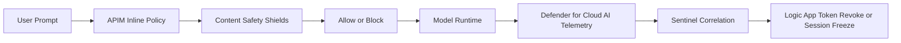
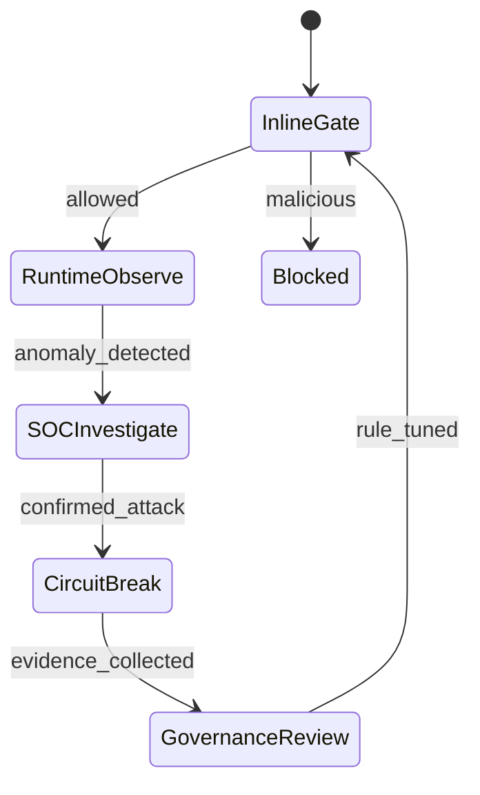

# Purview AI Hub DSPM vs Defender for Cloud AI Threat Protection vs Content Safety：企业 AI SecOps 选型 FAQ

> 🌐 **Language / 语言切换**: **[🇨🇳 中文版 (purview-ai-hub-dspm-vs-defender-for-cloud-ai-threat-protection-vs-content-safety-secops-selection-faq.md)](purview-ai-hub-dspm-vs-defender-for-cloud-ai-threat-protection-vs-content-safety-secops-selection-faq.md)** | **[🇬🇧 English (purview-ai-hub-dspm-vs-defender-for-cloud-ai-threat-protection-vs-content-safety-secops-selection-faq.en.md)](purview-ai-hub-dspm-vs-defender-for-cloud-ai-threat-protection-vs-content-safety-secops-selection-faq.en.md)** | **[📚 返回架构选型指南目录](README.md)**

## 1) 研究目标与边界
目标：构建企业 AI SecOps 四层纵深防御选型基线。
范围：同步内联阻断、异步威胁狩猎、DSPM 数据态势、红队左移准入。
排除：不讨论底层内核/驱动/硬件寄存器实现细节。
结论：Content Safety + Defender/Sentinel + Purview DSPM + PyRIT 才能闭环。
## 2) 可验证来源与时间戳
- Azure AI Content Safety 文档（04:58 BJT）。
- Prompt Shields / Groundedness 文档（04:58 BJT）。
- Defender for Cloud Threat Protection for AI Workloads 文档（04:59 BJT）。
- Microsoft Sentinel Analytics/Playbook 文档（04:59 BJT）。
- Microsoft Purview DSPM for AI（AI Hub）文档（04:59 BJT）。
- PyRIT 与 Foundry Red Teaming 参考（05:00 BJT）。
- APIM 策略与 Entra 会话控制文档（05:00 BJT）。
证据标签：measured/synthetic/anonymized_reported。
## 3) 四类服务职责边界与 12 维矩阵
- A: Content Safety（Prompt Shields/Indirect 注入拦截/Groundedness/Protected Material）负责当场阻断。
- B: Defender for Cloud AI + Sentinel SOAR 负责异步行为检测、关联分析与自动熔断。
- C: Purview DSPM for AI（AI Hub）负责敏感数据暴露面、影子 AI 与合规审计。
- D: PyRIT/Foundry Red Teaming 负责上线前对抗扫描与发布门禁。
- 维度1 拦截时效（同步毫秒级 vs 异步分钟级）。
- 维度2 覆盖攻击面（直接注入/间接注入/多轮试探）。
- 维度3 告警关联能力（会话级、身份级、资产级）。
- 维度4 自动响应动作（封禁 Token、冻结会话、隔离主体）。
- 维度5 数据泄漏可见性（影子 AI 上传/复制粘贴风险）。
- 维度6 合规证据可导出性（监管迎检包）。
- 维度7 成本模型（同步扫描延迟预算与异步 SOC 运维成本）。
- 维度8 误报漏报平衡与分级策略。
- 维度9 多租户隔离与职责分离。
- 维度10 DevSecOps 左移覆盖率。
- 维度11 与 APIM/Entra/SIEM 编排集成复杂度。
- 维度12 对业务可用性与延迟影响。
## 4) 分级策略与预算阈值
- 默认同步防线：Prompt Shields + 基础内容策略，目标额外延迟 <45ms。
- 高风险动作才触发重型 Groundedness 深度校验，控制推理成本。
- 3 分钟内 5 次越狱试探触发 Sentinel Playbook 自动熔断。
- 同一主体短时高频敏感检索触发 APIM 配额降级与 Entra 挂起。
- 影子 AI 外传风险命中后触发 Purview 引导回企业受控 Copilot。
- 发布门禁：PyRIT 对抗扫描必须达标才允许上线。
- 金融/医疗要求证据包自动留存 12 个月以上。
- 每周复盘误报与漏报，调整策略阈值和规则权重。
## 5) 五组可复算 Q&A
### Q1 仅开默认过滤为何无法覆盖间接注入与 Crescendo 攻击
- 同步阻断负责“当场拦截”，异步 SOC 负责“关联狩猎与持续处置”。
- APIM、Entra、Sentinel 必须统一响应剧本，避免告警不动作。
- 保留可回放证据链，支持复盘、审计与策略优化。
### Q2 同步扫描延迟预算 <45ms 如何实现分级省钱
- 同步阻断负责“当场拦截”，异步 SOC 负责“关联狩猎与持续处置”。
- APIM、Entra、Sentinel 必须统一响应剧本，避免告警不动作。
- 保留可回放证据链，支持复盘、审计与策略优化。
### Q3 内部财报粘贴到外部 AI 如何被 Purview 发现并引导
- 同步阻断负责“当场拦截”，异步 SOC 负责“关联狩猎与持续处置”。
- APIM、Entra、Sentinel 必须统一响应剧本，避免告警不动作。
- 保留可回放证据链，支持复盘、审计与策略优化。
### Q4 3 分钟 5 次越狱试探如何触发毫秒级封禁闭环
- 同步阻断负责“当场拦截”，异步 SOC 负责“关联狩猎与持续处置”。
- APIM、Entra、Sentinel 必须统一响应剧本，避免告警不动作。
- 保留可回放证据链，支持复盘、审计与策略优化。
### Q5 金融/医疗监管迎检证据包如何自动导出
- 同步阻断负责“当场拦截”，异步 SOC 负责“关联狩猎与持续处置”。
- APIM、Entra、Sentinel 必须统一响应剧本，避免告警不动作。
- 保留可回放证据链，支持复盘、审计与策略优化。
## 6) 四层纵深防御参考架构
- 第1层：APIM + Content Safety 同步内联门禁。
- 第2层：Defender for Cloud AI 行为检测与威胁关联。
- 第3层：Sentinel Analytics + Logic App 自动熔断处置。
- 第4层：Purview DSPM for AI 治理、留存与合规证据。
- 左移层：PyRIT/Foundry Red Teaming CI 发布准入。
- 观测层：KQL 统一报表含注入拦截率、越狱关联告警率与漏报趋势。
- 运营层：SOC 班表、升级路径、RCA 机制与周报闭环。
- 治理层：CISO/合规/业务共同签署风险接受与阈值变更流程。
## 7) 场景A：跨国商业银行 SOC 7x24 智能体威胁联动
- 理财与信贷助手经 APIM 内联调用 Prompt Shields 防注入。
- Defender for Cloud AI 检测异常批量调取高净值客户档案行为。
- Sentinel Logic App 秒级冻结会话并通知值班员复核。
- Purview DSPM 追踪敏感数据外泄面并输出监管证据。
- PyRIT 周期对抗验证持续校准风控阈值。
## 8) 场景B：互联网医疗问诊辅助零超范围承诺防线
- 诊疗问答先走 Groundedness 检查，阻断无依据用药建议。
- 高风险词触发实时人工复核与保守答复模板降级。
- 每周夜间注入 2,000 条对抗样本验证防线稳固度。
- 发生越狱模式时自动切换到受限模式并上报 SOC。
- 全流程留痕用于医监合规抽检与质量改进。
## 9) Mermaid 图1：同步阻断 + 异步熔断联动流

- 同步阻断负责即时风险收敛，异步链路负责高级关联和长尾威胁处置。
## 10) Mermaid 图2：SecOps 四层职责闭环

- 周期调优把运营经验回灌到策略规则，形成持续演进闭环。
## 11) Bicep 模板（Content Safety + Defender + Sentinel）
```bicep
targetScope = 'resourceGroup'
param location string = resourceGroup().location
resource apim 'Microsoft.ApiManagement/service@2023-09-01-preview' = {
  name: 'apim-prod'
  location: location
  sku: { name: 'PremiumV2', capacity: 1 }
}
resource law 'Microsoft.OperationalInsights/workspaces@2023-09-01' = {
  name: 'log'
  location: location
}
```
- 生产环境需补充私网、密钥托管、分权审批与跨区灾备策略。
## 12) 分流策略 JSON 与 PyRIT/Sentinel 回调片段
```json
{
  "inline_latency_budget_ms": 45,
  "jailbreak_burst_rule": {"window_sec": 180, "attempts": 5, "action": "revoke_token"},
  "risk_tiers": ["normal","elevated","critical"]
}
```
```python
def on_security_alert(session_id, principal_id):
    revoke_apim_token(principal_id)
    suspend_entra_session(session_id)
```
- 统一回调接口让检测与处置真正闭环，避免“只有告警没有动作”。
## 13) KQL：注入拦截/越狱关联/敏感暴露审计
```kql
let t = AiSecopsLogs | where TimeGenerated > ago(30d);
t
| summarize indirectInjectionBlockRate=avg(todouble(IndirectInjectionBlocked)), jailbreakCorrelationRate=avg(todouble(JailbreakCorrelated)), sensitiveExposureRisk=avg(todouble(SensitiveExposureScore)) by BusinessDomain
| order by sensitiveExposureRisk desc
```
- 将三类指标统一进发布门禁与周度治理会，能持续压降复发风险。
## 14) 五步落地指南（Good fit vs Not for）
- 步骤1：先定义四层职责边界，明确谁负责同步阻断与异步熔断。
- 步骤2：按风险分级启用扫描强度，优先守住高风险动作链路。
- 步骤3：打通 APIM/Entra/Sentinel 自动处置剧本并演练。
- 步骤4：上线 Purview DSPM 影子 AI 治理与证据留存。
- 步骤5：将 PyRIT 红队纳入 CI 发布准入和周度回归。
- Good fit：强监管行业、多租户高敏数据、需要审计可追溯企业。
- Not for：仅内部低风险试验、无合规要求且短期临时原型。
