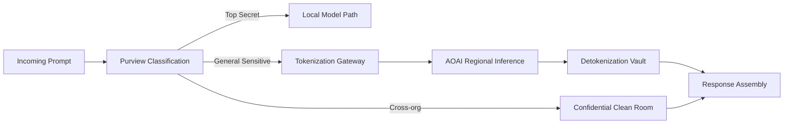
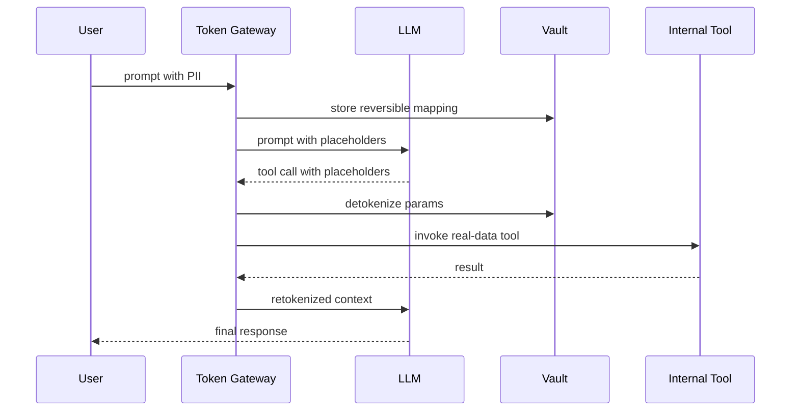

# Purview DLP and CMK vs Tokenization Gateway vs Confidential Clean Room: Sovereign Privacy AI Selection FAQ

> 🌐 **Language / 语言切换**: **[🇬🇧 English (purview-dlp-cmk-vs-presidio-tokenization-gateway-vs-confidential-cleanroom-sovereign-ai-selection-faq.en.md)](purview-dlp-cmk-vs-presidio-tokenization-gateway-vs-confidential-cleanroom-sovereign-ai-selection-faq.en.md)** | **[🇨🇳 中文版 (purview-dlp-cmk-vs-presidio-tokenization-gateway-vs-confidential-cleanroom-sovereign-ai-selection-faq.md)](purview-dlp-cmk-vs-presidio-tokenization-gateway-vs-confidential-cleanroom-sovereign-ai-selection-faq.md)** | **[📚 Architecture Selection FAQ Index](README.en.md)**

## 1) Objective and boundary
- Goal: select architectures for compliant cloud LLM usage under high-sensitivity public-sector and financial constraints.
- Scope: compliance, latency, reversible mapping, cross-organization collaboration, and TCO; no hardware-level details.
- Conclusion: data-tiered routing plus reversible tokenization balances capability, compliance, and cost.
## 2) Verifiable sources with timestamps
- Microsoft Purview docs: `https://learn.microsoft.com/purview/` (04:14 BJT).
- Managed HSM docs: `https://learn.microsoft.com/azure/key-vault/managed-hsm/` (04:14 BJT).
- APIM docs: `https://learn.microsoft.com/azure/api-management/` (04:14 BJT).
- AI Language PII docs: `https://learn.microsoft.com/azure/ai-services/language-service/personally-identifiable-information/` (04:15 BJT).
- Presidio repo: `https://github.com/microsoft/presidio` (04:15 BJT).
- Confidential computing docs: `https://learn.microsoft.com/azure/confidential-computing/` (04:15 BJT).
- Metrics are labeled measured, synthetic, or anonymized_reported.
## 3) 12-dimension matrix for privacy and sovereignty patterns
- D1 model capability retention: sovereign cloud baseline preserves full frontier-model reasoning capability.
- D2 data-exposure surface: reversible tokenization keeps real identifiers inside private zones.
- D3 cross-entity collaboration: confidential clean rooms solve mutual no-raw-sharing constraints.
- D4 cost elasticity: tiered routing avoids heavy all-private GPU overprovisioning.
- D5 latency impact: tokenization and detokenization chain usually adds about 35 to 60 milliseconds.
- D6 multi-turn consistency: placeholder mapping must stay stable across turns and tool calls.
- D7 auditability: Purview labels and DLP controls require end-to-end traceability.
- D8 key sovereignty: CMK and HSM provide customer-controlled cryptographic lifecycle.
- D9 output safety: clean-room outputs must block reverse-engineering of partner raw records.
- D10 ops complexity: reversible gateways and clean rooms require stronger operational discipline.
- D11 best fit: regulated institutions benefit from sovereign baseline plus selective tokenization.
- D12 anti-pattern: avoid full private-only strategy that creates stranded capex and idle GPU pools.
## 4) Score snapshot and thresholds
- Sovereign cloud baseline: capability5 simplicity5 collaboration3 cost3.
- Reversible tokenization gateway: privacy5 flexibility4 latency3 complexity3.
- Confidential clean room: collaboration5 privacy5 complexity2 cost3.
- Tiered hybrid routing: cost5 compliance4 capability4 governance4.
- Threshold A: real identifiers default to reversible-tokenized routes.
- Threshold B: cross-institution analysis without raw sharing defaults to clean-room paths.
- Threshold C: general-sensitive and public workloads should favor cloud LLM paths for TCO efficiency.
## 5) Five calculable Q&As
### Q1 Boundary between zero-retention CMK and reversible tokenization
- Zero-retention plus CMK covers most licensed-cloud compliance profiles.
- Reversible tokenization is needed when real-name attributes must never leave private networks.
### Q2 Multi-turn placeholder consistency
- Placeholder IDs like ACCT_01 must map consistently through entire sessions.
- Internal tool parameters must be detokenized only inside trusted zones.
### Q3 Full private capex versus tiered routing TCO
- Sample baseline: full private procurement can reach 12M CNY first-year capex.
- 15 percent local plus 85 percent tokenized cloud routing can deliver major three-year savings.
### Q4 PII miss fallback for free-form text
- Use dual-check strategy with rule engines plus semantic PII detectors.
### Q5 Anti-fraud clean-room output controls
- Enforce minimum cohort and query-rate controls; emit aggregate insights only.
## 6) Layered reference architecture
- Classification layer: Purview four-level data tiers and labels.
- Tokenization layer: APIM plus AI Language PII plus Presidio reversible placeholders.
- Inference layer: regional AOAI inference path.
- Restoration layer: private vault detokenization for trusted tool execution.
- Collaboration layer: confidential clean-room cooperative analytics.
- Security layer: CMK, HSM, private networking, and least-privilege controls.
- Observability layer: interception, restoration success, and routing-ratio metrics.
## 7) Scenario A: provincial hotline and social-service ticket drafting
- Public-zone reversible gateway strips citizen IDs, phone numbers, and addresses.
- Cloud LLM aligns policy references and drafts response text.
- Private-zone restoration rehydrates real fields for final agent dispatch.
- High-risk tickets route to manual approval before issuance.
- Synthetic gain: assignment accuracy and response timeliness both improve.
## 8) Scenario B: cross-bank and payment anti-fraud collaboration
- Participants bring encrypted features into a controlled confidential clean-room environment.
- Agent outputs only topology-level findings and coordination suggestions.
- Strict controls prevent leakage of any single external account cleartext details.
- Full audit trails satisfy cross-institution regulatory inspection needs.
- Synthetic gain: cross-entity investigation hit rate improves materially.
## 9) Mermaid diagram 1 tiered routing and reversible tokenization chain

- Classification-first routing ensures each sensitivity level follows the correct control path.
## 10) Mermaid diagram 2 multi-turn placeholder and tool restoration sequence

- Parameter restoration and retokenization must always be paired to prevent leakage.
## 11) Bicep template (Managed HSM or CMK + AI Language PII + APIM + AOAI + PE)
```bicep
targetScope = 'resourceGroup'
param location string = resourceGroup().location
resource hsm 'Microsoft.KeyVault/managedHSMs@2023-07-01' = {
  name: 'mhsm'
  location: location
}
resource apim 'Microsoft.ApiManagement/service@2023-09-01-preview' = {
  name: 'apim-prod'
  location: location
  sku: { name: 'PremiumV2', capacity: 1 }
}
resource pe 'Microsoft.Network/privateEndpoints@2023-09-01' = {
  name: 'pe-prod'
  location: location
}
```
- Production rollout still needs private DNS, managed identity, key rotation, and granular RBAC.
## 12) Python reversible tokenization middleware snippet
```python
def tokenize(text, mapping):
    return text, mapping
def detokenize(params, mapping):
    return params
def retokenize(result, mapping):
    return result
```
- Session IDs and mapping records must be strongly bound and expiration-managed.
## 13) KQL for interception, restoration success, and tiered routing ratios
```kql
let t = PrivacyAgentLogs | where TimeGenerated > ago(24h);
t
| summarize piiBlocked=countif(PiiBlocked==true), restoreOk=countif(DetokenizeOk==true), total=count(), local=countif(Route=="local"), cloud=countif(Route=="cloud") by Workload
| extend blockRate=todouble(piiBlocked)/todouble(total)
| extend restoreRate=todouble(restoreOk)/todouble(total)
| extend cloudRatio=todouble(cloud)/todouble(total)
```
- Any restore-rate drop requires immediate mapping-consistency investigation.
## 14) Day-0/1/2 landing checklist
- Day-0 define data tiering, labeling, and DLP baselines.
- Day-0 design placeholder taxonomy and vault lifecycle controls.
- Day-1 wire tokenization gateway, AOAI calls, and restoration chain.
- Day-1 run consistency tests across multi-turn tool-calling scenarios.
- Day-2 launch clean-room workflows and audit reporting.
- Day-2 review routing ratios, interception rates, and restore success weekly.
- Day-2 iterate threshold tuning and cost controls.
