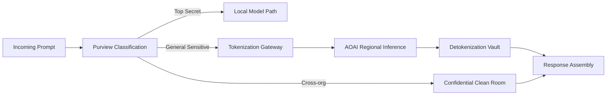
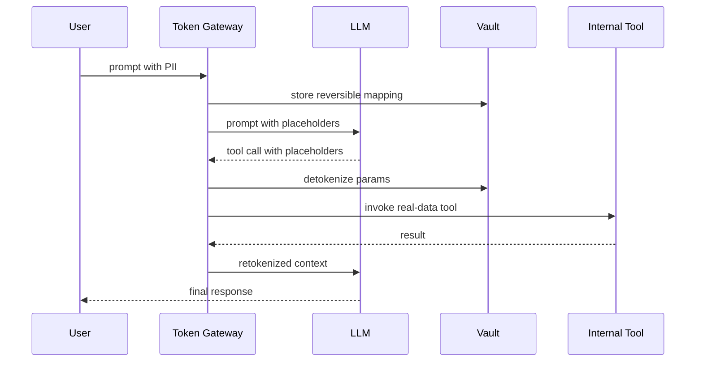

# Purview DLP+CMK vs 可逆脱敏网关 vs 机密清洁室：主权隐私 AI 选型 FAQ

> 🌐 **Language / 语言切换**: **[🇨🇳 中文版 (purview-dlp-cmk-vs-presidio-tokenization-gateway-vs-confidential-cleanroom-sovereign-ai-selection-faq.md)](purview-dlp-cmk-vs-presidio-tokenization-gateway-vs-confidential-cleanroom-sovereign-ai-selection-faq.md)** | **[🇬🇧 English (purview-dlp-cmk-vs-presidio-tokenization-gateway-vs-confidential-cleanroom-sovereign-ai-selection-faq.en.md)](purview-dlp-cmk-vs-presidio-tokenization-gateway-vs-confidential-cleanroom-sovereign-ai-selection-faq.en.md)** | **[📚 返回架构选型指南目录](README.md)**

## 1) 研究目标与边界
- 目标：政企与金融场景下“敏感数据合规上云大模型”架构选型。
- 范围：聚焦合规、时延、还原一致性、跨机构协作与TCO，不讨论硬件寄存器细节。
- 结论：分级分流与可逆脱敏是兼顾能力与成本的关键路径。
## 2) 可验证来源与时间戳
- Microsoft Purview：`https://learn.microsoft.com/purview/`（抓取 04:14 BJT）。
- Key Vault Managed HSM：`https://learn.microsoft.com/azure/key-vault/managed-hsm/`（抓取 04:14 BJT）。
- APIM：`https://learn.microsoft.com/azure/api-management/`（抓取 04:14 BJT）。
- Azure AI Language PII：`https://learn.microsoft.com/azure/ai-services/language-service/personally-identifiable-information/`（抓取 04:15 BJT）。
- Presidio：`https://github.com/microsoft/presidio`（抓取 04:15 BJT）。
- Confidential Clean Rooms：`https://learn.microsoft.com/azure/confidential-computing/`（抓取 04:15 BJT）。
- 数据标签统一 measured/synthetic/anonymized_reported。
## 3) 四类隐私与主权 AI 架构 12 维矩阵
- 维度1模型能力保真：云原生主权底座可保留前沿模型完整能力。
- 维度2数据外泄面：可逆脱敏网关可确保实名要素不出专网。
- 维度3跨机构协作：机密清洁室适合“明细互不可见”的联合建模。
- 维度4成本弹性：分级分流可避免全量私有化重资产闲置。
- 维度5时延：脱敏回填链路通常增加约 35~60ms。
- 维度6多轮一致性：占位符需跨轮次稳定映射。
- 维度7审计可追溯：Purview 标签与DLP规则要全链路可审计。
- 维度8密钥主权：CMK/HSM 支持客户侧密钥生命周期控制。
- 维度9输出安全：清洁室需限制可逆推演与单条明文外泄。
- 维度10运维复杂度：可逆网关和清洁室治理门槛更高。
- 维度11最佳场景：持牌金融/政务优先主权合规底座 + 脱敏协同。
- 维度12反模式：禁止“一刀切全私有化”导致算力CapEx闲置。
## 4) 评分与决策阈值
- 云原生主权底座：能力5、简洁5、协作3、成本3。
- 可逆脱敏网关：隐私5、灵活4、时延3、复杂度3。
- 机密清洁室：协作5、隐私5、复杂度2、成本3。
- 分级分流混合云：成本5、合规4、能力4、治理4。
- 阈值A：涉及实名敏感字段时默认走可逆脱敏。
- 阈值B：跨机构数据不可直连时优先清洁室模式。
- 阈值C：一般敏感和公开数据优先上云大模型以控成本。
## 5) 五组可复算 Q&A
### Q1 零留存+CMK 与可逆脱敏边界
- 零留存+CMK适配多数持牌金融云合规场景。
- 可逆脱敏适配对实名字段“绝不出网”要求场景。
### Q2 多轮会话占位符一致性
- `[ACCT_01]` 等占位符需在会话级映射表稳定。
- 工具调用参数必须在内网侧还原再执行。
### Q3 全私有化CapEx vs 分级分流TCO
- 样例：全私有化首年 1200 万CapEx。
- 15%本地+85%脱敏上云三年可节省显著总拥有成本。
### Q4 非结构化文本PII漏检兜底
- 双检策略：规则引擎 + 语义PII识别并联。
### Q5 清洁室联合反诈输出防逆推演
- 限制最小群组与查询频率，输出仅聚合结论与建议。
## 6) 分层参考架构
- 分类层：Purview 四级分级与标签。
- 脱敏层：APIM + PII识别 + Presidio可逆占位符。
- 推理层：Foundry AOAI 区域驻留调用。
- 还原层：内网映射金库回填实名参数。
- 协作层：Confidential Clean Rooms 联合分析。
- 安全层：CMK/HSM、私网、最小权限。
- 观测层：拦截率、还原成功率、路由占比。
## 7) 场景A：省级12345与人社医保工单平台
- 外网前置可逆脱敏剥离身份证号、手机号、住址。
- 云端大模型结合公开法规库生成答复草稿。
- 回到内网自动还原实名要素并推送坐席签发。
- 高风险条目进入人工复核与审批链。
- synthetic收益：工单分派准确率与响应时效双提升。
## 8) 场景B：跨银行与支付机构联合反诈清洁室
- 多机构以加密特征接入受控机密清洁室。
- 智能体仅输出团伙拓扑定性结论与协查建议。
- 严格阻断单笔他行储户明文信息外泄。
- 全流程审计留痕满足跨机构监管抽检。
- synthetic收益：跨机构协查命中率显著提升。
## 9) Mermaid 图1：分级分流与可逆脱敏主链路

- 分级路由先行，确保不同敏感级别走不同处理链路。
## 10) Mermaid 图2：多轮占位符与工具还原时序

- 参数还原与再脱敏必须成对出现以防数据泄露。
## 11) Bicep 模板（Managed HSM/CMK + AI Language PII + APIM + AOAI + PE）
```bicep
targetScope = 'resourceGroup'
param location string = resourceGroup().location
resource hsm 'Microsoft.KeyVault/managedHSMs@2023-07-01' = {
  name: 'mhsm'
  location: location
}
resource apim 'Microsoft.ApiManagement/service@2023-09-01-preview' = {
  name: 'apim-prod'
  location: location
  sku: { name: 'PremiumV2', capacity: 1 }
}
resource pe 'Microsoft.Network/privateEndpoints@2023-09-01' = {
  name: 'pe-prod'
  location: location
}
```
- 生产需补齐私网DNS、托管身份、密钥轮换与RBAC。
## 12) Python 可逆占位符与多轮还原中间件片段
```python
def tokenize(text, mapping):
    # map real entities to placeholders
    return text, mapping
def detokenize(params, mapping):
    # restore placeholders before internal tool call
    return params
def retokenize(result, mapping):
    # mask sensitive values before returning to model
    return result
```
- 会话ID与映射表必须强绑定并设置过期策略。
## 13) KQL：拦截率/还原成功率/分级路由占比
```kql
let t = PrivacyAgentLogs | where TimeGenerated > ago(24h);
t
| summarize piiBlocked=countif(PiiBlocked==true), restoreOk=countif(DetokenizeOk==true), total=count(), local=countif(Route=="local"), cloud=countif(Route=="cloud") by Workload
| extend blockRate=todouble(piiBlocked)/todouble(total)
| extend restoreRate=todouble(restoreOk)/todouble(total)
| extend cloudRatio=todouble(cloud)/todouble(total)
```
- restoreRate 下降需立即触发映射一致性排查。
## 14) Day-0/1/2 落地清单
- Day-0：完成数据分级、标签与DLP规则基线。
- Day-0：设计占位符词典与映射金库生命周期。
- Day-1：接通脱敏网关、AOAI调用与回填链路。
- Day-1：对多轮工具调用做一致性压测。
- Day-2：上线清洁室协作流程与审计报表。
- Day-2：周度复盘路由占比、拦截率与还原成功率。
- Day-2：迭代分级阈值与成本优化策略。
