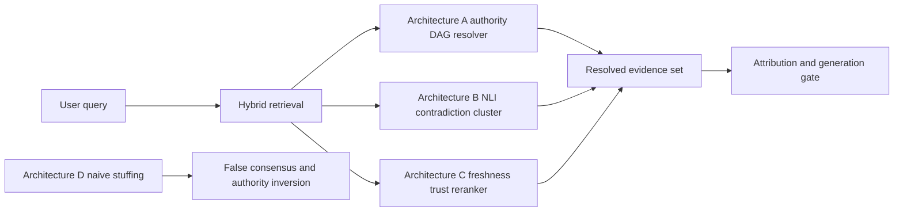
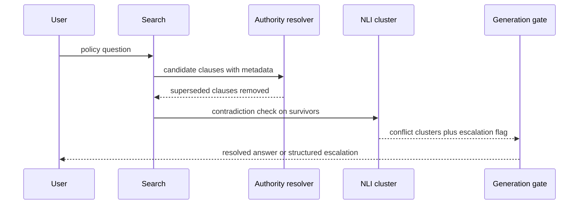
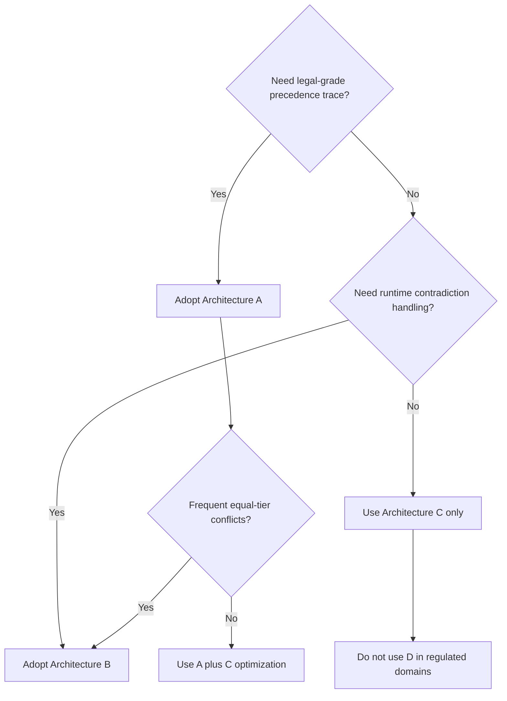

# Enterprise RAG conflicting-source authority selection FAQ: lex specialis and lex posterior vs NLI clustering vs recency boosting
> **Audience**: Cloud and AI Solution Architects, enterprise knowledge-platform teams, legal/compliance stakeholders, and LLMOps owners.
> **Core decision**: how to prevent false consensus and authority inversion when retrieved sources disagree.

## 1. Executive Summary
The hardest enterprise RAG failures come from conflicting evidence, not from missing evidence.
Architecture A resolves precedence explicitly with clause-level supersession graphs and legal partial-order rules.
Architecture B detects runtime semantic conflicts with pairwise NLI contradiction clustering.
Architecture C applies freshness and trust weighting, improving average ranking without full precedence guarantees.
Architecture D stuffs naive Top-K chunks from mixed authority and superseded drafts, creating silent false consensus.
For regulated deployments, A as primary authority layer plus B as conflict detector is the most reliable path.

## 2. Problem Definition
Enterprise policy corpora include amendments, regional exceptions, temporary revocations, and draft collaboration artifacts.
Ignoring `effective_from/to`, `jurisdiction_scope`, and `authority_tier` leads to unsafe evidence fusion.
Vector similarity alone can favor low-authority but lexically similar documents over signed canonical clauses.
Increasing Top-K depth cannot solve normative precedence conflicts and often worsens ambiguity.
Production architecture must treat precedence resolution and contradiction handling as first-class capabilities.

## 3. Authority-DAG and Contradiction Resolution Panorama


## 4. Architecture A: Normative Authority Graph with Lex Resolver
A stores clause-level metadata including supersession edges, authority tiers, jurisdiction scopes, and validity windows.
At query time, candidate clauses are filtered by temporal and jurisdiction constraints before ranking.
`Lex specialis` and `lex posterior` rules are executed as partial-order comparisons across candidate nodes.
Unresolved equal-tier conflicts are escalated explicitly instead of being silently merged.
A provides audit-grade precedence lineage but requires disciplined ingestion governance.

## 5. Architecture B: Runtime Pairwise NLI Contradiction Clustering
B evaluates entailment and contradiction relationships across retrieved chunks to surface semantic conflict sets.
Conflict-graph components guide structured disambiguation responses or human escalation triggers.
This approach is robust for cross-silo textual inconsistency but introduces `O(k^2)` pairwise complexity.
Batch inference, tiered candidate pruning, and early-stop rules are required to meet `<180ms` targets.
B is strongest when paired with A rather than used as a standalone authority engine.

## 6. Architecture C: Freshness and Trust-Boosted Hybrid Reranking
C modifies retrieval ranking using freshness profiles and source-trust multipliers.
It improves stale-content demotion and can quickly raise canonical-source visibility.
However C lacks explicit supersession semantics and contradiction reasoning.
Therefore C should be treated as optimization over a stronger governance backbone, not the backbone itself.

## 7. Architecture D Anti-Pattern: Naive Top-K Stuffing
D concatenates high-similarity chunks from mixed authority without temporal or normative filtering.
This often causes authority inversion where draft or superseded text overrides active signed policy.
Audit explainability collapses because evidence selection rationale is implicit and unstable.

## 8. 12-Dimension Horizontal Selection Matrix
| Dimension | A Authority DAG | B NLI Cluster | C Freshness Boost | D Top-K Stuffing |
|---|---|---|---|---|
| Superseded-policy hallucination rate | Low | Medium-low | Medium | High |
| `Lex specialis` amendment accuracy | High | Medium | Low | Low |
| Cross-silo contradiction detection | Medium-high | High | Low | Low |
| Retrieval plus resolution P95 latency | Medium | Medium-high | Low | Low |
| Metadata and amendment-graph ingestion cost | High | Medium | Low | Low |
| Query-time compute/token overhead | Medium | High | Low | Low |
| Conditional disambiguation versus abstention UX | High | High | Low | Low |
| Emergency revocation cutover SLA | High | Medium | Medium | Low |
| Precedence audit lineage | High | Medium-high | Medium | Low |
| Low-authority spoofing immunity | High | Medium | Medium-low | Low |
| Multi-hop amendment reconstruction | High | Medium | Low | Low |
| Three-year governance TCO | Medium-high | Medium | Medium | Low surface / high hidden |

## 9. Amendment Override and Conflict Escalation Sequence


## 10. Selection Decision Tree


## 11. Python: Lex Dominance and Batched NLI Conflict Resolver
```python
from __future__ import annotations
from dataclasses import dataclass

@dataclass
class Clause:
    clause_id: str
    authority_tier: int
    jurisdiction_scope: str
    effective_from: str
    effective_to: str

def lex_dominates(a: Clause, b: Clause) -> bool:
    if a.jurisdiction_scope != b.jurisdiction_scope and a.jurisdiction_scope != 'global':
        return False
    if a.authority_tier != b.authority_tier:
        return a.authority_tier > b.authority_tier
    return a.effective_from >= b.effective_from

def contradiction_clusters(pairs: list[tuple[str, str, str]]) -> dict[int, list[tuple[str, str]]]:
    clusters: dict[int, list[tuple[str, str]]] = {}
    idx = 0
    for left, right, label in pairs:
        if label == 'contradiction':
            clusters[idx] = [(left, right)]
            idx += 1
    return clusters
```

## 12. JSON/Python: Search Schema and OData Validity Filters
```json
{
  "name": "policy_clause_index",
  "fields": [
    {"name": "clause_id", "type": "Edm.String", "key": true},
    {"name": "authority_tier", "type": "Edm.Int32", "filterable": true},
    {"name": "jurisdiction_scope", "type": "Edm.String", "filterable": true},
    {"name": "effective_from", "type": "Edm.DateTimeOffset", "filterable": true},
    {"name": "effective_to", "type": "Edm.DateTimeOffset", "filterable": true}
  ],
  "scoringProfiles": [
    {"name": "freshness_authority", "functions": ["freshness", "magnitude"]}
  ]
}
```

### Q1: Why recency boosting fails when a 2026 wiki outranks a signed 2025 amendment
Recency captures timestamp, not legal authority, signature validity, or amendment precedence.
Without authority metadata and supersession edges, newer drafts can outrank canonical contracts.
This yields plausible but non-binding answers that fail legal and procurement governance.
Freshness should be applied inside, not instead of, normative precedence controls.

### Q2: How to bound pairwise NLI `O(k^2)` latency under `<180ms`
Use authority-tier pruning and temporal filtering before pairwise contradiction checks.
Run blockwise batched cross-encoder inference and early-stop on high-confidence non-conflicting sets.
Limit dynamic K by intent class and route low-risk intents through lighter paths.
With these controls, contradiction checks at `k=12-16` can fit strict latency budgets.

### Q3: How to materialize clause-level deltas for `MSA -> SOW -> Change Order`
Store amendments as clause-level diffs rather than whole-document overwrite snapshots.
At retrieval time, replay supersession edges to reconstruct the active clause set deterministically.
This preserves lineage clarity while reducing rebuild costs for frequent policy updates.
Delta lineage is essential for audit-grade explainability and rollback safety.

### Q4: When to abstain versus branch conditionally on equal-tier conflicts
If equal-tier sources conflict without discriminating context, deterministic abstention is safer.
When explicit context variables exist, return conditional branches with explicit evidence mapping.
This avoids silent conflict merges and preserves decision transparency for users and auditors.
Branch rationale should always be returned as structured attribution metadata.

### Q5: How to prevent low-authority Slack or SharePoint drafts from spoofing cosine relevance
Assign lower trust tiers by default to collaborative drafts and require signed promotion workflows.
Before generation, enforce checks for higher-authority contradictory clauses and prefer canonical evidence.
Separate editable collaboration corpora from citation-eligible corpora at index-policy level.
This sharply reduces semantically similar but non-authoritative retrieval contamination.

### Q6: How CI should track false consensus in amendment and contradiction benchmarks
Build paired benchmark suites for amendment-overrides and equal-tier contradiction scenarios.
Measure false-consensus rate as the fraction of conflicts incorrectly collapsed into one answer.
Gate releases on both absolute FCR thresholds and regression deltas versus prior stable versions.
This turns conflict-governance quality into a durable measurable release contract.

## 13. Enterprise Scenarios
### Scenario A: Global commercial-bank legal and procurement copilot across 85k contracts
The workload requires clause-level lineage replay across MSA, SOW, and regional addenda conflicts.
Recommended architecture is A for precedence backbone, B for equal-tier conflict handling, and C for optimization.
### Scenario B: Biopharma GMP and medical-affairs SOP assistant
The workload reconciles FDA and EMA updates against site SOPs under strict audit evidence requirements.
Recommended architecture is A+B with mandatory escalation on unresolved high-risk contradictions.

## 14. Three-Year Governance TCO
| Pattern | Annualized Cost Range | Conflict Governance Quality | Audit Explainability |
|---|---:|---:|---:|
| A + B (recommended) | `$0.73M-$1.02M` | High | High |
| A + C | `$0.65M-$0.91M` | Medium-high | High |
| C only | `$0.48M-$0.70M` | Medium-low | Medium |
| D baseline | `$0.29M-$0.43M` | Low | Low |
After governance-loss and audit-risk adjustments, A+B is usually the superior long-horizon option in regulated sectors.

## 15. Day-0 and Day-2 Go-Live Checklist
Day-0: define authority-tier taxonomy, jurisdiction mapping, and clause schema standards.
Day-0: complete amendment-edge backfill validation and supersession chain integrity checks.
Day-0: enable conflict benchmark gates for FCR, escalation quality, and attribution completeness.
Day-2: review weekly contradiction-cluster precision, abstention quality, and human-escalation outcomes.
Day-2: run emergency revocation drills to validate cutover SLA and cache-eviction correctness.
Day-2: refresh contradiction benchmark sets monthly with new regional and draft-collaboration patterns.

## 16. KPI Baseline and Release-Gate Controls
Conflict-authority governance needs coordinated monitoring across retrieval, resolution, and generation layers.
Answer-level accuracy alone hides precedence drift and escalation overload risks.
Mature teams maintain governance dashboards where legal consistency and latency are evaluated together.
Threshold changes should include counterfactual replay evidence and explicit rollback criteria.
The table below captures a practical minimum metric baseline.

| KPI Domain | Metric | Target Band | Cadence | Default Action |
|---|---|---|---|---|
| Authority consistency | `lex_resolution_accuracy` | `>= 0.97` | daily | block release below threshold |
| Conflict governance | `false_consensus_rate` | `< 1.5%` | daily | trigger replay investigation |
| Escalation quality | `escalation_precision` | `>= 0.90` | weekly | refine conflict policies |
| Performance budget | `resolve_p95_ms` | `< 220ms` | hourly | apply bucketed pruning |
| Revocation agility | `revocation_cutover_sla` | `< 5 min` | weekly drill | trigger hotfix process |
| Spoofing defense | `low_authority_spoof_block` | `> 99%` | daily | tighten trust-policy controls |

## 17. Compliance Evidence and Audit Mapping
In legal and quality-regulated environments, correctness is insufficient without evidence-chain replay.
Each answer should be attributable to clause versions, amendment lineage, and conflict-resolution outcomes.
Missing lineage often invalidates otherwise accurate outputs during external audits.
Signed archival of resolver outputs and policy versions is therefore essential.
The mapping below supports legal, compliance, and platform joint governance.

| Compliance Concern | Technical Control | Evidence Artifact | Failure Consequence |
|---|---|---|---|
| Explainable precedence | authority DAG with supersession edges | precedence trace artifact | legal rationale ambiguity |
| Traceable conflict handling | NLI conflict graph and verdict log | conflict-cluster artifact | non-replayable decisions |
| Emergency revocation control | temporal filters plus cache invalidation | cutover timeline | stale policy exposure |
| Draft-spoofing defense | trust-tier demotion and signed publication | blocked-source telemetry | low-authority contamination |
| Jurisdiction boundary compliance | region-aware filtering and routing | regional lineage logs | cross-border policy breach |
| Version rollback safety | canary plus baseline replay | change tickets and replay reports | drift amplification |

## 18. Common Delivery Drift and Corrective Paths
One common drift is equating recency with authority and ignoring supersession semantics.
Another drift is deploying NLI conflict checks without authority bucketing, creating high-noise contradiction graphs.
A third drift tracks escalation volume but not escalation correctness.
A fourth drift skips revocation drills and fails real cutover SLAs during incidents.
A robust correction path is authority graph first, contradiction handling second, and latency optimization third.
High-risk domains should accept moderate latency overhead in exchange for governance determinism.
Where capacity is constrained, start with A minimal governance and then incrementally add B.
The long-term goal is sustained reduction of authority inversion and false consensus, not only better single-run recall.

## 19. Final Recommendation
Use A for normative precedence correctness, B for runtime contradiction discovery, and C for lightweight ranking gains.
Avoid D as a production default for contracts, regulations, and SOP-heavy knowledge domains.
When precedence logic, contradiction resolution, and auditable evidence are unified, enterprise RAG becomes governance-ready.
Where budget is constrained, prioritize authority-correctness gates before latency optimization layers.
For cross-jurisdiction enterprises, include contradiction-governance KPIs in quarterly architecture reviews and annual compliance audits.
