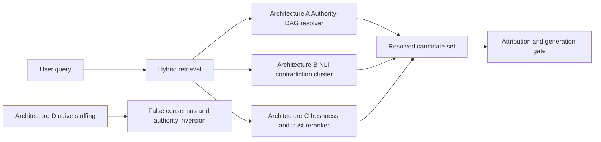
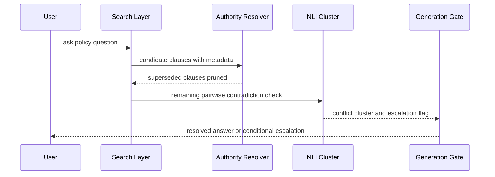
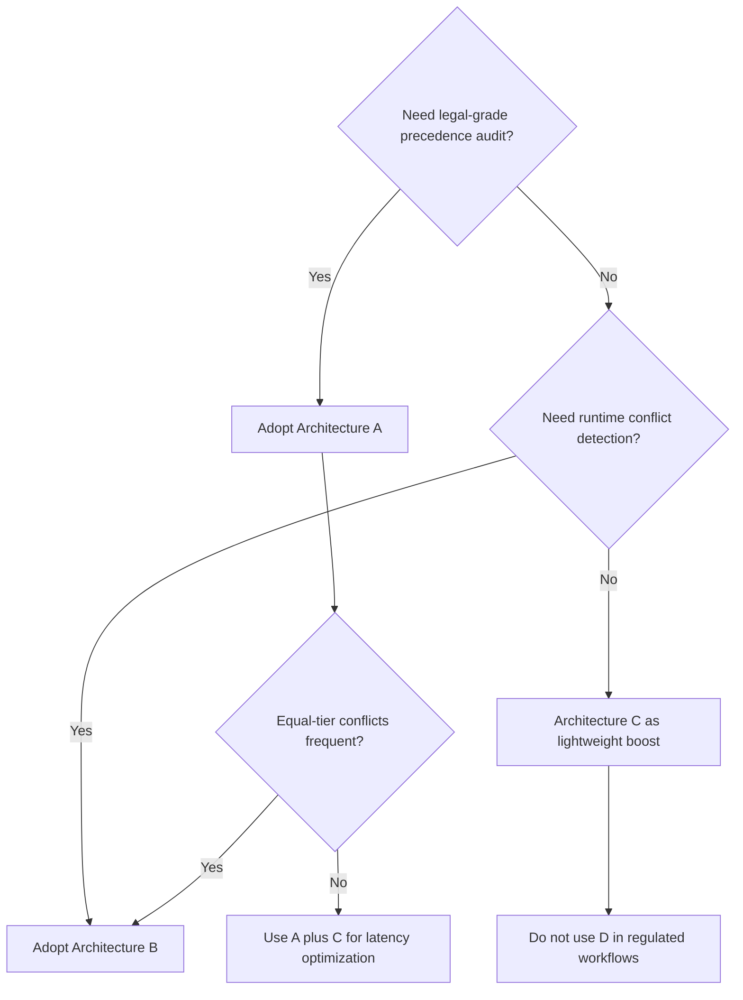

# 企业 RAG 冲突来源权威解析选型 FAQ：Lex Specialis / Lex Posterior vs NLI 冲突聚类 vs 新鲜度加权 vs Top-K 反模式
> **适用对象**：Cloud & AI Solution Architect、企业知识平台团队、法务与合规治理团队、LLMOps 负责人。
> **核心问题**：当多个来源彼此矛盾时，RAG 如何避免“看似有证据、实则权威倒置”的错误回答。

## 1. Executive Summary
企业 RAG 的高风险场景不是“检索不到”，而是“检索到互相冲突且层级不同的内容”。
Architecture A 通过显式 Authority-DAG 与条款级 supersedes 关系，先解 precedence 再生成。
Architecture B 在运行时做 pairwise NLI 冲突图聚类，识别语义矛盾并触发分歧分支或升级。
Architecture C 仅靠新鲜度和来源权重提升排序，能改进平均命中但无法保证法理一致性。
Architecture D 将未过滤草稿、失效合同与区域冲突文本直接拼接，最易产生虚假共识。
在受监管组织，建议采用 A 作为事实主干，B 作为运行时矛盾探测，C 仅作轻量增益层。

## 2. Problem Definition
合同、政策、SOP、区域附录通常存在版本链与适用范围差异。
若检索层忽略 `effective_from/to`、`jurisdiction_scope`、`authority_tier`，模型会错误合并证据。
更隐蔽的问题是低权威文本在向量空间更“相似”，从而压过正式条款。
单纯提高 Top-K 或 reranker 分数阈值无法解决法理上的优先级冲突。
因此系统必须把“权威优先级”和“语义矛盾检测”设计成显式可审计能力。

## 3. Authority-DAG and NLI Conflict Resolution Panorama


## 4. Architecture A 深入：Normative Authority-DAG + Lex Resolver
A 将文档拆到 clause 级，记录 `supersedes_clause_id`、`authority_tier`、`jurisdiction_scope` 与生效窗口。
查询时先构建候选条款子图，再执行 `Lex Specialis` 与 `Lex Posterior` 局部偏序比较。
若同层级同时间窗存在冲突，则标记为 unresolved 并进入升级路径而非强行生成。
该架构可提供清晰 precedence lineage，适合法务与审计场景。
A 的代价是入库治理成本更高，需要维护 amendment 边与条款版本映射。

## 5. Architecture B 深入：Pairwise NLI 冲突聚类
B 在 Top-k chunk 间执行 pairwise NLI，识别 contradiction / entailment / neutral。
通过冲突图连通分量与簇内中心性，可快速定位“互斥证据簇”并触发条件分支。
当等权威来源冲突时，B 能给出结构化多视角输出或升级人审。
该路径对异构文本语义冲突有较强适配，但计算复杂度随 `k^2` 增长。
工程上需通过截断、分层采样与批量推理控制 `<180ms` 目标时延。

## 6. Architecture C 深入：Freshness + Trust Boosted Hybrid Reranker
C 在检索分数上叠加新鲜度与来源权重，适合低治理成本的快速改造。
它可降低“过旧文档长期占位”的概率，并提升官方来源的平均排序。
但 C 没有显式条款覆盖关系，也没有语义冲突判定，仍可能输出错误融合结论。
因此 C 更适合作为 A/B 的加速层，而不是单独治理冲突权威问题。

## 7. Architecture D 反模式：Naive Top-K Stuffing
D 将高相似 chunk 直接拼接，不区分草稿、正式条款、区域附录与已废止版本。
该模式常导致 authority inversion：低权威草稿覆盖已签署协议。
在审计场景中，D 的回答很难解释“为何选择这条证据而非另一条”。
其短期实现快，但长期返工与风险成本极高。

## 8. 12-Dimension Horizontal Selection Matrix
| 维度 | A Authority-DAG | B NLI 聚类 | C 新鲜度增强 | D Top-K 拼接 |
|---|---|---|---|---|
| Superseded-Policy Hallucination Rate | 低 | 中低 | 中 | 高 |
| `Lex Specialis` 适配准确率 | 高 | 中 | 低 | 低 |
| 跨系统矛盾检测能力 | 中高 | 高 | 低 | 低 |
| 检索+解析 P95 延迟 | 中 | 中高 | 低 | 低 |
| 元数据与修订图入库成本 | 高 | 中 | 低 | 低 |
| 查询时算力/Token 开销 | 中 | 高 | 低 | 低 |
| 条件分支/弃答体验 | 高 | 高 | 低 | 低 |
| 紧急政策撤销切换 SLA | 高 | 中 | 中 | 低 |
| 优先级审计追踪 | 高 | 中高 | 中 | 低 |
| 低权威草稿欺骗免疫 | 高 | 中 | 中低 | 低 |
| 多跳修订链重建 | 高 | 中 | 低 | 低 |
| 三年治理 TCO | 中高 | 中 | 中 | 低表面/高隐性 |

## 9. Amendment Override and Conflict Escalation Sequence


## 10. Selection Decision Tree


## 11. Python：Lex Dominance + Batched NLI Conflict Resolver
```python
from __future__ import annotations
from dataclasses import dataclass

@dataclass
class Clause:
    clause_id: str
    authority_tier: int
    jurisdiction_scope: str
    effective_from: str
    effective_to: str

def lex_dominates(a: Clause, b: Clause) -> bool:
    if a.jurisdiction_scope != b.jurisdiction_scope and a.jurisdiction_scope != 'global':
        return False
    if a.authority_tier != b.authority_tier:
        return a.authority_tier > b.authority_tier
    return a.effective_from >= b.effective_from

def nli_conflict_clusters(pairs: list[tuple[str, str, str]]) -> dict[int, list[tuple[str, str]]]:
    clusters: dict[int, list[tuple[str, str]]] = {}
    idx = 0
    for left, right, label in pairs:
        if label == 'contradiction':
            clusters[idx] = [(left, right)]
            idx += 1
    return clusters
```

## 12. JSON/Python：Search Schema + OData Validity Filter
```json
{
  "name": "policy_clause_index",
  "fields": [
    {"name": "clause_id", "type": "Edm.String", "key": true},
    {"name": "authority_tier", "type": "Edm.Int32", "filterable": true},
    {"name": "jurisdiction_scope", "type": "Edm.String", "filterable": true},
    {"name": "effective_from", "type": "Edm.DateTimeOffset", "filterable": true},
    {"name": "effective_to", "type": "Edm.DateTimeOffset", "filterable": true}
  ],
  "scoringProfiles": [
    {"name": "freshness_authority", "functions": ["freshness", "magnitude"]}
  ]
}
```

### Q1: 为什么仅靠 recency boost 会让 2026 wiki 盖过 2025 签署修订
新鲜度只能表示时间，不表示法律效力或合同约束层级。
若缺少 authority_tier 与 supersedes 关系，最新草稿可能压过正式修订条款。
这会在回答中产生“看似合理但法律错误”的权威倒置。
因此新鲜度必须在 precedence 框架内使用，而不是单独作为裁决依据。

### Q2: 如何把 `O(k^2)` NLI 成本控制在 `<180ms`
可先用召回分层与权威分桶，把低价值候选在进入 pairwise 前过滤。
再对候选执行 block-wise 批处理并在 GPU 上并行 cross-encoder 推理。
对高置信 entailment 对可早停，降低完整图构建开销。
实践中 `k=12-16` 的冲突检测可在目标时延内实现。

### Q3: Base MSA -> SOW -> Change Order 链如何做条款级增量物化
建议把每次修订写成 clause-level delta，而不是全文覆盖。
查询时按 chain 追踪并应用 supersedes 边生成最终有效条款集。
这样既能保留历史追踪，也能降低每次更新的重建成本。
对审计场景而言，delta lineage 是解释能力的核心。

### Q4: 等权威冲突时何时弃答，何时条件分支
当冲突来源同层级且缺乏额外判别条件时，应优先弃答并升级。
若能从上下文获得明确条件变量，可输出条件分支答案并标注差异。
该策略比强行合并更安全，也更符合治理透明性要求。
关键是把分支依据与证据链显式返回给用户。

### Q5: 如何防止 Slack/SharePoint 草稿通过相似度欺骗检索
应对低权威协作文档设置独立 trust_tier 与默认降权策略。
在生成前强制检查是否存在高权威冲突条款，如有则优先高权威证据。
此外可用签名发布流程把“可引用”与“可编辑草稿”严格分域。
这能显著降低语义相似但权威不足的误导风险。

### Q6: CI 如何评估 False Consensus Rate
应构建成对基准：一组为修订覆盖冲突，一组为区域政策冲突。
统计模型在冲突样本中错误合并为单结论的比例，即 `FCR`。
门禁可设置 `FCR` 上限并追踪版本间变化趋势。
这样能把冲突治理能力转化为可持续量化指标。

## 13. Enterprise Scenarios
### 场景 A：全球商业银行法务与采购 Copilot（85k MSA/SOW/Regional Addenda）
该场景要求合同问答可回放到具体条款与修订链，且跨法域冲突必须可解释。
推荐 A 作为主干，B 处理等层级冲突，C 仅用于性能补偿。
### 场景 B：生物制药 GMP 制造与医学事务 SOP 助手
该场景需要同步 FDA/EMA 更新与站点 SOP，冲突处理要满足审计追责。
推荐 A+B 组合，并对高风险问答启用强制升级路径。

## 14. 3-Year Governance TCO
| 方案 | 年化成本区间 | 权威冲突治理能力 | 审计解释性 |
|---|---:|---:|---:|
| A + B（推荐） | `$0.73M-$1.02M` | 高 | 高 |
| A + C | `$0.65M-$0.91M` | 中高 | 高 |
| C only | `$0.48M-$0.70M` | 中低 | 中 |
| D baseline | `$0.29M-$0.43M` | 低 | 低 |
综合错误决策损失与审计成本后，A+B 在高合规企业通常更具长期收益。

## 15. Day-0 / Day-2 Go-Live Checklist
Day-0：定义 authority_tier 规则与法域映射，冻结 clause 级字段规范。
Day-0：完成 amendment 边回填与 supersedes 关系抽检，确保链路完整。
Day-0：接入冲突样本门禁，验证 `FCR`、升级率与回答可追溯性。
Day-2：按周复盘冲突聚类命中率、弃答准确率与人审回流质量。
Day-2：对紧急撤销政策执行演练，验证切换 SLA 与缓存清理路径。
Day-2：按月更新冲突基准集，覆盖新区域条款和跨部门草稿模式。

## 16. 运营指标与门禁基线
冲突权威治理的稳定性依赖检索、解析、生成三层协同监控。
如果只看回答准确率，往往会漏掉 precedence 误判与升级过载。
建议建立治理看板，把法理一致性指标与系统性能指标同时纳管。
所有阈值变更应附带反事实回放结果和风险评估。
下表给出企业 RAG 冲突治理最小指标集合。

| 指标域 | 指标定义 | 目标区间 | 采样频率 | 默认动作 |
|---|---|---|---|---|
| 权威一致性 | `lex_resolution_accuracy` | `>= 0.97` | 每日 | 低于阈值阻断发布 |
| 冲突治理 | `false_consensus_rate` | `< 1.5%` | 每日 | 超阈值触发回放复盘 |
| 升级质量 | `escalation_precision` | `>= 0.90` | 每周 | 低于阈值优化规则 |
| 性能预算 | `resolve_p95_ms` | `< 220ms` | 每小时 | 超阈值降采样或分桶 |
| 索引时效 | `revocation_cutover_sla` | `< 5 min` | 每周演练 | 超时触发热修复 |
| 安全防护 | `low_authority_spoof_block` | `> 99%` | 每日 | 更新 trust 策略 |

## 17. 合规证据链与审计映射
在法律与质量体系场景，回答正确只是底线，可追责证据链才是上线门槛。
每次回答应可追溯到条款版本、修订链、冲突分支与最终裁决依据。
若证据链缺失，系统在外部审计中难以被采信。
因此建议将解析结果与策略版本签名后归档。
以下映射用于法务、合规与平台团队联合审查。

| 合规关注点 | 技术控制 | 审计证据 | 失效后果 |
|---|---|---|---|
| 条款优先级可解释 | Authority-DAG + supersedes 边 | precedence trace | 法理依据不清 |
| 冲突处理可追溯 | NLI 冲突图与裁决日志 | conflict cluster artifact | 决策不可复盘 |
| 紧急撤销可执行 | 生效时间过滤 + 缓存驱逐 | cutover timeline | 失效政策继续生效 |
| 草稿欺骗可抑制 | trust_tier 降权与签名发布 | blocked-source logs | 低权威污染放行 |
| 区域边界可证明 | jurisdiction filter 与路由策略 | region lineage logs | 跨域合规违规 |
| 版本治理可回退 | 灰度发布与回放基线 | change tickets | 漂移失控 |

## 18. 常见实施偏差与纠偏路径
第一类偏差是把“最新”当作“最高权威”，忽略正式修订与草稿差异。
第二类偏差是引入 NLI 却不做权威分层，导致冲突图噪声过大。
第三类偏差是升级路径只统计数量，不评估升级正确性。
第四类偏差是缺少撤销演练，导致紧急政策切换无法在 SLA 内生效。
纠偏建议是先建权威图，再做冲突检测，最后做性能优化。
对高风险业务，应优先牺牲少量延迟换取可追责性与合规确定性。
若团队资源有限，可先落地 A 最小闭环，再逐步引入 B。
长期目标是稳定降低 authority inversion 与 false consensus，而非追求单次命中率。

## 19. Final Recommendation
用 A 保障法理优先级正确性，用 B 发现运行时语义冲突，用 C 做轻量性能增益。
避免将 D 作为生产默认，尤其在合同、法规、SOP 等高风险知识域。
当 precedence 逻辑、冲突解析和审计证据形成闭环时，企业 RAG 才具备可持续治理能力。
在预算允许的情况下，应优先保证权威裁决正确性，再优化平均响应延迟。
面向跨法域大型组织，建议将冲突治理门禁纳入季度架构评审与年度合规审计基线。
