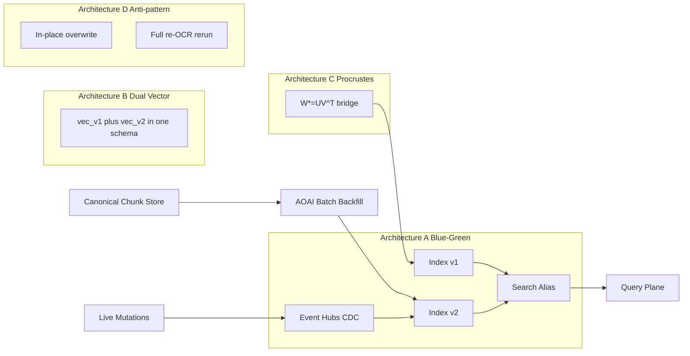
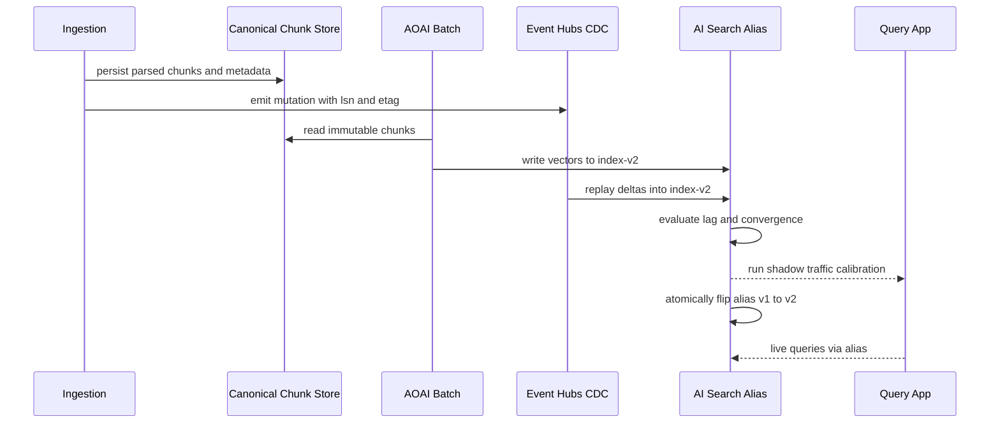
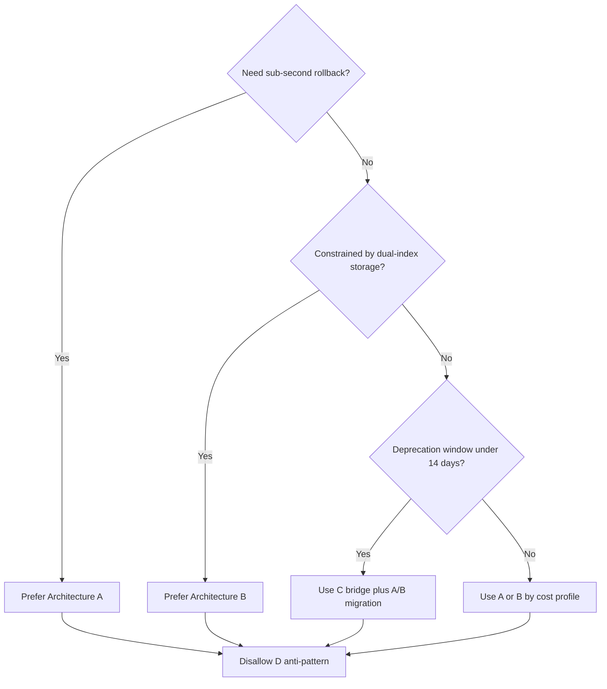

# Enterprise Zero-Downtime RAG Embedding Migration Selection FAQ: Blue-Green Alias Swap vs Dual-Vector Side-by-Side vs Procrustes Bridge vs Overwrite Anti-Pattern
> **Audience**: Cloud & AI Solution Architects, RAG platform owners, search and data engineering teams.
> **Core mission**: migrate embedding models at `10M/100M/1B` chunk scale without service interruption or recall collapse.
> **Bottom line**: prefer Architecture A in production, augment with B/C by constraints, explicitly ban D.

## 1. Executive summary
Embedding upgrades are routine events in mature enterprise RAG platforms.
The core risk is not whether vectors can be recomputed.
The core risk is whether retrieval quality remains stable during and after migration.
Typical failures include mixed-space neighborhood corruption, stale threshold policies, and CDC divergence.
Architecture A gives the strongest reliability posture through blue-green indexes and atomic alias cutover.
Architecture B reduces storage duplication by coexisting `vec_v1` and `vec_v2` in a single schema.
Architecture C provides emergency continuity when deprecation timelines are shorter than full re-embed windows.
Architecture D, in-place overwrite or full source re-OCR, multiplies both quality and cost risk.
Migration should pass only when recall, latency, consistency, and rollback readiness all pass defined gates.
This guide provides formulas, control conditions, and tiered TCO trade-offs for architecture decisions.

## 2. Why embedding migration often “finishes” but online quality regresses
Many programs define completion as “new vectors written,” which is insufficient.
Embedding model changes alter similarity distribution geometry and ranking behavior.
If thresholds are not recalibrated, precision/recall trade-offs drift unexpectedly.
If CDC catch-up has not converged, writes split across index generations.
If incompatible vectors share a graph, neighborhood routing quality degrades rapidly.
Therefore migration is a three-plane operation: data plane, control plane, and threshold plane.

## 3. Four architecture candidates
Architecture A: blue-green index with alias swap, canonical chunk-store batch backfill, and CDC convergence gating.
Architecture B: dual-vector side-by-side fields with tenant-prioritized phased routing.
Architecture C: orthogonal Procrustes bridge for emergency continuity under compressed timelines.
Architecture D: in-place same-column overwrite or full source re-OCR anti-pattern.
Architecture A is the enterprise default path for high-assurance rollout.
Architecture B is a practical optimization path when metadata duplication is too expensive.
Architecture C is a tactical bridge, not a final-state architecture.
Architecture D should be prohibited by standards and release policy.

## 4. Architecture A: blue-green plus atomic alias swap
With A, teams build and hydrate `index-v2` while `index-v1` serves production traffic.
Backfill source should be immutable canonical chunks, not repeated OCR pipelines.
`AOAI Batch API` backfill can reduce embedding token spend by roughly 50 percent.
This also prevents online PTU/TPM starvation during migration windows.
Live updates are replayed through `Event Hubs` CDC into `index-v2` using `lsn/etag` high-watermarks.
Cutover happens only when lag and throughput gates prove sustained convergence.
Alias flip is atomic and supports immediate rollback by pointing alias back to `index-v1`.
This path has higher setup complexity but best operational safety at enterprise scale.

## 5. Architecture B: dual-vector side-by-side
B keeps `content_vec_v1` and `content_vec_v2` in one document schema.
Tenant-level routing decides which vector field drives retrieval.
Hot tenants can be migrated first to accelerate business impact.
The main advantage is avoiding duplicate BM25 and metadata footprint across two full indexes.
The main trade-off is temporary vector-memory inflation and more complex query policy logic.
B fits teams with strong tenancy boundaries and disciplined migration-state governance.

## 6. Architecture C: Procrustes bridge under urgent deprecation pressure
C addresses compressed deprecation windows where full cold-shard migration is infeasible.
Using anchor pairs, solve `W* = U V^T` by SVD and map `v2` query vectors into `v1` retrieval space.
In practice this adds sub-millisecond overhead in many systems.
Relative Recall@10 retention around 88 to 93 percent can be maintained during transition.
Risk increases on long-tail semantic domains if anchor coverage is narrow.
Therefore C should always run with parallel lazy backfill to reduce bridge exposure over time.

## 7. Architecture D anti-pattern
Overwriting vectors in the same field mixes incompatible spaces in one ANN structure.
This distorts graph neighborhoods and can collapse recall during mid-backfill phases.
Re-running full OCR/parsing for all source documents usually costs 10x to 25x more than embedding tokens.
D may appear operationally simple but is usually worst in reliability-adjusted TCO.
At scale, D often causes both quality incidents and budget overruns.

## 8. Core math: backfill duration, cost, and convergence
Backfill duration estimate:
`T_backfill = N_chunks / R_embed_effective`
`R_embed_effective` should account for retries, queueing, and ingestion overhead.
Batch embedding cost estimate:
`C_embed_batch = Tokens_total * Price_embed * 0.5`
OCR avoidance savings estimate:
`C_OCR_saved = C_reparse_reocr - C_canonical_reuse`
CDC convergence gate:
`λ_CDC < μ_drain`
If this condition does not hold over sustained windows, lag cannot converge and cutover must be blocked.

## 9. Threshold recalibration after embedding-space shift
Embedding upgrades shift cosine-score distributions.
Old relevance thresholds and abstention gates no longer preserve prior operating points.
Shadow traffic should be used for quantile alignment and isotonic recalibration.
Distribution-shift indicator:
`Δ_cos = |Q_p(v2) - Q_p(v1)|`, for `p` in median, p90, and p99 bands.
If `Δ_cos` exceeds guardrails and business KPIs degrade, cutover should pause or roll back.
Threshold policy updates must be versioned and auditable with rollout metadata.

## 10. Twelve-dimension architecture comparison matrix
| Dimension | Architecture A | Architecture B | Architecture C | Architecture D |
|---|---|---|---|---|
| Zero-downtime confidence | Highest | High | Medium-high | Low |
| Rollback speed | Highest | Medium | Medium | Low |
| Recall stability | High | Medium-high | Medium | Very low |
| Implementation complexity | Medium-high | Medium-high | High | Low |
| Peak storage burden | Medium-high | Medium | Low | Low |
| Compute-cost controllability | High | High | Medium | Low |
| CDC consistency governance | High | Medium | Medium | Low |
| Urgent deprecation readiness | Medium | Medium | Highest | Low |
| Threshold recalibration support | High | Medium-high | Medium | Low |
| Auditability | High | Medium-high | Medium | Low |
| Team maturity requirement | Medium-high | Medium-high | High | Low |
| Recommendation | Primary path | Scenario optimization | Tactical bridge | Prohibited |

## 11. Migration-plane topology across four architectures


## 12. Sequence: watermark snapshot to alias cutover


## 13. Selection decision tree


### Q1. Why embedding migration is more than vector recomputation
Vector recomputation updates only one layer of the retrieval stack.
Ranking behavior also depends on ANN topology, threshold policy, and consistency lag.
Ignoring these layers produces unexplained online quality variance.
User-visible symptoms include intermittent misses and unstable relevance ordering.
Production migration should therefore be defined as a full-system state transition.
Architecture governance must codify measurable success and rollback conditions.

### Q2. What must be gated before Architecture A alias cutover
Backfill completeness and retry health must satisfy predefined thresholds.
CDC lag must converge with sustained `λ_CDC < μ_drain`.
Shadow traffic must preserve key quality and latency KPIs relative to baseline.
Alias operations must be idempotent and rollback-tested.
Rollback drills should pass in both pre-production and production-like environments.
Without these gates, blue-green still carries hidden transition risk.

### Q3. When Architecture B is preferable to A
B is attractive when full duplicate index footprint is economically unacceptable.
It works best when tenancy boundaries are explicit and migration-state metadata is reliable.
Hot-tenant-first migration can accelerate value capture while limiting cold-tenant overhead.
However, B increases query routing complexity and policy branch maintenance burden.
Teams without strong observability discipline may struggle to keep B stable.
Therefore B should be selected intentionally, not as a convenience shortcut.

### Q4. How to deploy Procrustes bridge safely in Architecture C
Bridge quality is determined by anchor-pair coverage and domain representativeness.
Residual-error distributions must be measured, not assumed.
Bridge scope should be constrained to emergency windows and monitored with strict SLOs.
If residual tails degrade, fallback to conservative routing or constrained tenant scope is required.
Parallel lazy migration should run continuously to shrink bridge dependency.
C should be treated as continuity insurance, not permanent operating mode.

### Q5. How to quantify migration economics and risk exposure
Cost should include embedding tokens, index storage, CDC replay, calibration runs, and operations labor.
Benefit should include avoided OCR spend, avoided downtime, and reduced incident probability.
Risk should include recall-collapse probability, cutover-failure probability, and rollback-execution risk.
When modeled together, A often has the best reliability-adjusted economics at medium-to-large scale.
B can win in constrained environments with mature tenant controls.
C wins when time-to-compliance is shorter than full migration lead time.

### Q6. Anti-patterns, go-live checklist, and five-step rollout
Anti-pattern one: mixed v1/v2 vectors in a single active column during migration.
Anti-pattern two: alias cutover before CDC catch-up convergence is proven.
Anti-pattern three: threshold reuse without post-migration distribution calibration.
Anti-pattern four: full source re-OCR despite canonical chunk availability.
Anti-pattern five: production cutover without validated rollback rehearsal.
Five-step rollout:
Step 1: establish immutable canonical chunk store and high-watermark tracking.
Step 2: hydrate index-v2 by batch backfill and continuously replay CDC deltas.
Step 3: run shadow traffic and recalibrate thresholds for new embedding distribution.
Step 4: execute atomic alias cutover with live convergence guards.
Step 5: keep rollback window open and capture post-cutover evidence for the next cycle.
Good fit: large-scale production RAG with strict availability and controlled change governance.
Not for: one-off offline indexes with no ongoing write path.

### Operational observability and rollback runbook addendum
To make migration repeatable, teams should treat observability as a first-class migration control plane.
A dedicated dashboard should track at least nine metric families: backfill throughput, backfill failure ratio, CDC lag percentiles, alias operation success, v1/v2 latency deltas, Recall@k drift, abstention-rate drift, hot-tenant hit stability, and rollback drill pass rate.
Every metric must have an actionable threshold; for example, if lag p95 stays above 45 seconds for ten minutes, freeze cutover eligibility automatically.
For multi-region estates, evaluate `λ_CDC` and `μ_drain` per region, not only globally, to prevent local instability from being hidden by aggregate averages.
Shadow calibration output should be versioned as policy artifacts with immutable change history.
Resilience drills should inject at least two failure classes: CDC congestion and ANN-node degradation.
If drills omit failure injection, migration should be marked non-compliant for production cutover.
Rollback runbooks should specify trigger authority, threshold criteria, evidence retention, and re-entry conditions.
A dual-control approval pattern for alias rollback reduces accidental operator risk.
In regulated sectors, rollback-window duration itself should be audited as a control objective.
The practical goal is to transform migration from expert craft into auditable automation.

### Three common failure patterns and control mappings
Pattern one: backfill appears complete but CDC has not converged, causing delayed visibility for new documents.
Control mapping: enforce sustained `λ_CDC < μ_drain` with hard lag gates before alias flip.
Pattern two: recall metrics look stable but business engagement drops due to threshold mismatch after embedding-space shift.
Control mapping: combine quantile alignment, isotonic recalibration, and business KPI gates.
Pattern three: emergency bridge mode is enabled but cold-shard backfill milestones are never completed.
Control mapping: enforce maximum bridge duration and bind it to mandatory backfill checkpoints.
Failure-pattern mapping helps convert architecture choices into deterministic release operations.

### Budget and governance coupling recommendations
Migration budgeting should separate infrastructure, model, and quality-assurance envelopes.
When quality-assurance budget is cut, costs often reappear later as incident remediation and trust recovery.
Each migration cycle should publish a variance explanation linking cost deltas to quality outcomes.
At 1B scale, cadence-tiering is recommended: daily hot-tier updates, weekly warm-tier updates, monthly cold-tier updates aligned to business criticality.
This approach creates an explicit reliability-versus-cost operating model instead of bursty all-at-once resource contention.

## 14. Three-tier enterprise TCO profile (10M, 100M, 1B chunks)
| Tier | Scale | Preferred path | Dominant cost drivers | Main value |
|---|---|---|---|---|
| Tier-1 | 10M chunks | A or B | Backfill tokens and index memory | Avoid downtime and rework |
| Tier-2 | 100M chunks | A primary plus B selective | CDC pipeline and calibration complexity | Stable migration and fast rollback |
| Tier-3 | 1B chunks | A plus C | Long-horizon backfill and cold-shard governance | Emergency deprecation continuity |

## 15. Implementation snippets (bridge, lag guard, migration assets)
```python
import numpy as np
from sklearn.isotonic import IsotonicRegression

def orthogonal_procrustes(x_v2: np.ndarray, y_v1: np.ndarray) -> np.ndarray:
    m = x_v2.T @ y_v1
    u, _, vt = np.linalg.svd(m, full_matrices=False)
    return u @ vt

def apply_bridge(q_v2: np.ndarray, w: np.ndarray) -> np.ndarray:
    return q_v2 @ w

def fit_threshold_recalibrator(cos_scores: np.ndarray, labels: np.ndarray):
    ir = IsotonicRegression(out_of_bounds="clip")
    ir.fit(cos_scores, labels)
    return ir

def can_swap_alias(cdc_lambda: float, drain_mu: float, lag_seconds: float, lag_slo: float = 30.0) -> bool:
    return (cdc_lambda < drain_mu) and (lag_seconds <= lag_slo)
```

```yaml
apiVersion: batch/v1
kind: CronJob
metadata:
  name: rag-cdc-lag-guard
spec:
  schedule: "*/2 * * * *"
  jobTemplate:
    spec:
      template:
        spec:
          containers:
            - name: lag-guard
              image: ghcr.io/example/rag-migrate:latest
              args:
                - "--check-lag"
                - "--max-lag-seconds=30"
                - "--require-lambda-lt-mu=true"
                - "--emit-gate-signal=eventhubs://rag-migration/gates"
          restartPolicy: OnFailure
```

```bicep
param searchServiceName string
param eventHubNamespace string

resource search 'Microsoft.Search/searchServices@2023-11-01' existing = {
  name: searchServiceName
}

resource ns 'Microsoft.EventHub/namespaces@2022-10-01-preview' existing = {
  name: eventHubNamespace
}

resource cdcHub 'Microsoft.EventHub/namespaces/eventhubs@2022-10-01-preview' = {
  name: '${ns.name}/rag-cdc'
  properties: {
    messageRetentionInDays: 3
    partitionCount: 8
  }
}

resource cdcCg 'Microsoft.EventHub/namespaces/eventhubs/consumergroups@2022-10-01-preview' = {
  name: '${ns.name}/${cdcHub.name}/index-v2-catchup'
  properties: {}
}
```

## 16. Conclusion
Embedding migration is a recurring enterprise capability, not a one-off technical task.
Architecture A provides the strongest default for zero downtime and deterministic rollback.
Architecture B is a valid optimization where storage duplication pressure is dominant.
Architecture C is a tactical emergency bridge and must run with planned backfill completion.
Architecture D amplifies both quality and cost risk and should be disallowed by policy.
When CDC convergence, threshold recalibration, and rollback rehearsals are institutionalized, migration becomes repeatable engineering practice instead of high-risk change theater.
