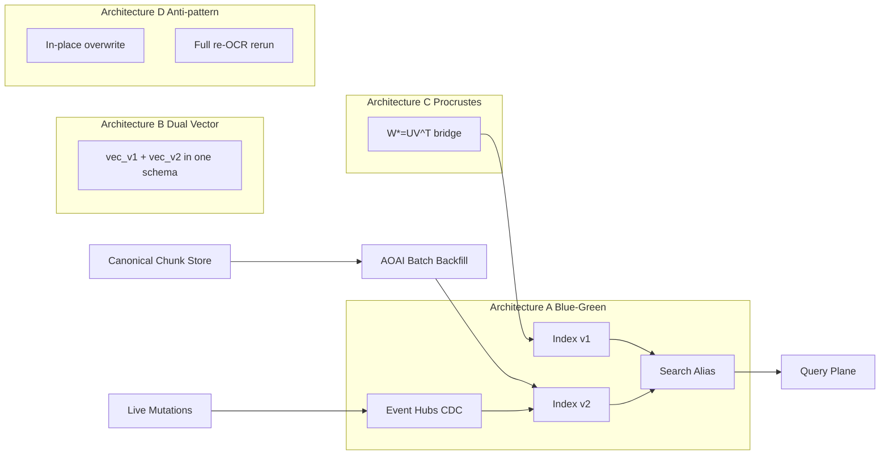
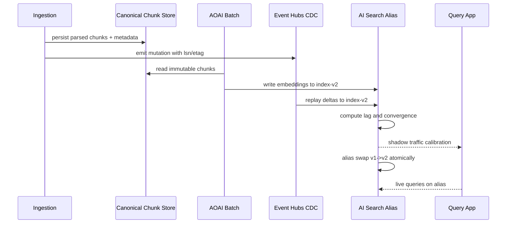
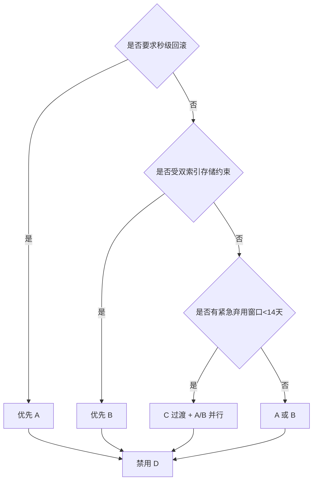

# 企业 RAG 向量模型零停机迁移选型 FAQ：Blue-Green Alias Swap vs Dual-Vector Side-by-Side vs Procrustes Bridge vs 覆写反模式
> **适用对象**：Cloud & AI Solution Architect、RAG 平台负责人、搜索与数据工程团队。
> **核心任务**：在 `10M/100M/1B` 级 chunk 规模下完成 embedding 模型升级，避免业务中断与召回坍塌。
> **核心结论**：生产优先 A，按场景补 B/C；D 必须禁用。

## 1. 执行摘要
企业 RAG 平台进入规模化后，embedding 模型升级是高频且高风险动作。
风险不在“能否重算向量”，而在“重算期间是否破坏在线检索稳定性”。
常见失败包括：同图混写导致 HNSW 邻域失真、重建期间阈值漂移导致误拒答、回放滞后导致新旧索引数据分叉。
Architecture A 以蓝绿索引与别名原子切换提供最稳健升级路径。
Architecture B 用双向量字段降低双集群成本，适合存储敏感型团队。
Architecture C 用 Procrustes 桥接解决紧急弃用窗口下的冷数据迁移压力。
Architecture D 的“同列覆写或全量重 OCR”会把迁移风险与成本同时放大。
迁移成功标准应同时满足：召回稳定、延迟可控、成本可解释、回滚可执行。
本文给出完整公式、三档 TCO、CDC 收敛条件与落地检查表。

## 2. 问题背景：为什么 embedding 升级容易“看起来完成，线上却退化”
很多团队把迁移定义为“新向量写完”，忽略了检索分布与阈值分布的同步更新。
模型升级后，向量空间几何发生变化，旧阈值不再对应原有精确率/召回率平衡。
如果 CDC 回放未收敛就切换，线上会出现“新写入文档不可见”或“旧文档幽灵结果”。
如果在同一向量列混写 v1/v2，索引图会出现邻域污染，召回会阶段性崩塌。
因此迁移必须是“数据面 + 控制面 + 阈值面”三平面协同工程。

## 3. 四种候选架构
Architecture A：Blue-Green 索引 + Alias 原子切换 + Canonical Chunk Store 回填 + CDC 追平。
Architecture B：同索引/同存储双向量字段并行（`vec_v1` 与 `vec_v2`）按租户渐进切流。
Architecture C：Procrustes 线性正交桥接，争取冷数据迁移窗口。
Architecture D：同列覆写或全量源文档重 OCR。
A 是最标准的企业升级主路径。
B 在预算受限且元数据巨大时更有吸引力。
C 是紧急弃用条件下的战术桥接层。
D 是高失败率、高返工成本反模式。

## 4. Architecture A：Blue-Green + Alias Swap 主路径
A 的关键做法是“先建 `index-v2`，再切 Alias”，而不是在 `index-v1` 上原地动刀。
回填数据来源应是不可变 canonical chunk store，而不是再次跑 OCR/解析流水线。
用 `AOAI Batch API` 回填可以获得 `50%` token 折扣并避免挤占在线 PTU/TPM。
实时增量通过 `Event Hubs` CDC 通道回放到 `index-v2`，并以 `lsn/etag` 维护高水位。
当 `λ_CDC < μ_drain` 持续成立且 lag 进入阈值后，允许执行 alias 原子切换。
切换后保留 `index-v1` 回滚窗口，保证秒级回退可用。
该架构部署资产多，但可靠性最高，尤其适合高价值生产流量。

## 5. Architecture B：Dual-Vector Side-by-Side
B 在同一文档 schema 内保留 `content_vec_v1` 与 `content_vec_v2` 两套向量字段。
迁移按热租户优先回填，查询路由逻辑为“已迁租户走 v2，未迁租户走 v1”。
优势是无需双份 BM25 与元数据副本，降低存储复制成本。
代价是向量索引内存占用短期上升，且查询分支逻辑更复杂。
当租户隔离边界清晰、回填节奏可控时，B 可取得较好成本平衡。

## 6. Architecture C：Procrustes Bridge 过渡层
C 假设短期无法完成全量冷数据重嵌入，先做“查询空间到旧索引空间”的线性桥接。
基于锚点对求解 `W* = U V^T`（SVD），使 `E_v2(q)W` 可在 `v1` 索引检索。
在工程上可把桥接作为查询前处理，额外时延通常可控制在 `<1ms` 级。
典型收益是在 14 天紧急弃用窗口内维持 `88%-93%` 相对 Recall@10。
风险是桥接误差在长尾域可能放大，因此必须与懒迁移并行推进。

## 7. Architecture D：覆写/重 OCR 反模式
同列覆写会让 HNSW 图在迁移期同时容纳不兼容向量，邻域拓扑被污染。
全量重 OCR 会把成本放大到向量 token 成本的 `10x-25x`，且交付周期失控。
D 常被误认为“实现简单”，但长期是最高总拥有成本路径。
在大规模企业场景，D 几乎必然触发召回事故与预算超支。

## 8. 关键数学：回填时长、成本与收敛条件
回填时长近似：
`T_backfill = N_chunks / R_embed_effective`
其中 `R_embed_effective` 需扣除失败重试与批处理排队折损。
若采用 Batch API，回填成本近似：
`C_embed_batch = Tokens_total * Price_embed * 0.5`
避免重 OCR 的节省可写为：
`C_OCR_saved = C_reparse_reocr - C_canonical_reuse`
CDC 收敛条件：
`λ_CDC < μ_drain`
若该条件不成立，lag 不会收敛，Alias 切换应被门禁阻断。

## 9. 阈值重标定：余弦分布漂移与拒答阈值再校准
模型迁移后，query-doc 余弦分布中心和尾部都会变化。
直接沿用旧阈值会导致误召回或误拒答同步上升。
建议在 shadow traffic 上做分位对齐与 isotonic 校准。
可定义迁移前后分布漂移指标：
`Δ_cos = |Q_p(v2) - Q_p(v1)|`，`p` 取 0.5/0.9/0.99 等关键分位。
当 `Δ_cos` 超阈且业务 KPI 受损时，应回退切换或放缓迁移节奏。

## 10. 12 维横向对比矩阵
| 维度 | Architecture A | Architecture B | Architecture C | Architecture D |
|---|---|---|---|---|
| 零停机能力 | 最高 | 高 | 中高 | 低 |
| 回滚速度 | 最高 | 中 | 中 | 低 |
| 召回稳定性 | 高 | 中高 | 中 | 极低 |
| 实施复杂度 | 中高 | 中高 | 高 | 低 |
| 存储成本峰值 | 中高 | 中 | 低 | 低 |
| 计算成本可控性 | 高 | 高 | 中 | 低 |
| CDC 一致性治理 | 高 | 中 | 中 | 低 |
| 紧急弃用适配 | 中 | 中 | 最高 | 低 |
| 阈值校准支持 | 高 | 中高 | 中 | 低 |
| 可审计性 | 高 | 中高 | 中 | 低 |
| 组织成熟度要求 | 中高 | 中高 | 高 | 低 |
| 推荐结论 | 主路径 | 场景补充 | 应急桥接 | 禁用 |

## 11. 四架构迁移平面拓扑


## 12. 时序：水位快照到 alias 切换


## 13. 方案选择决策树


### Q1. 为什么 embedding 迁移不能等同于“重算向量”
向量重算只是数据面动作，检索系统还受索引拓扑、阈值策略与增量一致性影响。
若忽略控制面和阈值面，迁移后会出现难以解释的召回波动。
业务感知通常表现为“偶发搜不到”“相关性忽高忽低”。
因此迁移定义必须覆盖数据、索引、路由、校准与回滚五个维度。
企业级方案要先定义可验证门禁，再执行技术实现。

### Q2. A 的关键门禁项有哪些
第一，`index-v2` 回填完成率与失败重试率必须达标。
第二，CDC lag 需连续窗口收敛，且 `λ_CDC < μ_drain` 保持成立。
第三，shadow 流量下关键业务指标不低于基线。
第四，alias 切换脚本支持幂等与秒级回退。
第五，回退演练必须在预生产与生产分别验证通过。

### Q3. B 在什么条件下优于 A
当文档元数据巨大、双索引复制成本不可接受时，B 更具现实可行性。
若租户分层明显且热租户占比高，B 可优先迁移高价值流量。
但 B 需要更严格的查询分支治理与租户迁移状态管理。
若团队缺少高质量路由与观测能力，B 的运维复杂度会迅速上升。

### Q4. C 的 Procrustes 桥接如何安全落地
桥接层应只作为过渡，不应长期替代正式迁移。
锚点样本需覆盖主要语义域，避免只在头部样本表现良好。
上线前要量化残差分布与 Recall@k 损失区间。
当残差超阈值时，应限制桥接适用租户或请求类型。
同时启动 Batch 懒迁移，持续减少桥接依赖面。

### Q5. 如何量化成本收益与风险暴露
成本侧至少包括：Embedding token、索引存储、CDC 回放、观测与演练人力。
收益侧至少包括：避免重 OCR 成本、减少停机损失、降低相关性事故概率。
风险侧至少包括：召回坍塌概率、切换失败概率、回退执行失败概率。
把三者放入同一 TCO 模型后，A 往往在中大规模场景最优。
在预算极限场景，B 可作为折中路径，但需更强治理前提。

### Q6. 反模式、上线检查与五步实施
反模式一：在同一向量列混写 v1/v2。
反模式二：忽略 CDC 收敛直接切 alias。
反模式三：迁移后沿用旧阈值且不做 shadow 校准。
反模式四：为省事全量重 OCR 重建语料。
反模式五：无回滚演练即生产切换。
五步实施如下。
第一步：确定 canonical chunk store 与高水位记录策略。
第二步：批量回填 `index-v2` 并持续 CDC 追平。
第三步：开启 shadow 查询并完成阈值再校准。
第四步：执行 alias 原子切换并监控关键分位指标。
第五步：保留回滚窗口并复盘参数，沉淀下一轮模板。
Good fit：大规模生产 RAG、强可用要求、严格变更治理团队。
Not for：一次性离线索引、无持续增量写入的实验场景。

### 运维观测与回滚剧本补充
为了把迁移从“项目事件”变成“标准能力”，建议建立专用迁移观测面板并固化 SLO。
面板至少应包含九类指标：回填吞吐、回填失败率、CDC lag 分位、alias 切换成功率、v1/v2 查询延迟分位、Recall@k 漂移、阈值拒答率、热租户命中率、回滚演练成功率。
每项指标必须绑定动作门槛，例如“lag p95 > 45s 且持续 10 分钟”自动冻结切换窗口。
对于多区域部署，应分区域计算 `λ_CDC` 与 `μ_drain`，避免全局平均掩盖局部失稳。
建议把 shadow 校准结果写入版本化策略仓，保留每次迁移阈值变更证据。
在故障演练中，至少包含两类注入：CDC 堵塞注入与 ANN 节点退化注入。
如果演练未覆盖故障注入，生产切换应视为未通过门禁。
回滚剧本应明确定义“谁触发、何条件触发、回滚后保留哪些证据”。
建议采用双人审批机制执行 alias 回滚，降低误操作风险。
对于高监管行业，可把回滚窗口长度纳入审计检查项并定期复核。
最终目标是把迁移动作从“专家经验”转为“可审计自动化流程”。

### 三类典型失败案例与防护映射
案例一：回填完成率达标但 CDC 未收敛，切换后新文档延迟可见，表现为客服“刚上传搜不到”。
对应防护：强制 `λ_CDC < μ_drain` 连续窗口校验并设置 lag 熔断门禁。
案例二：召回看似稳定但业务点击率下降，根因是阈值未重标定导致拒答率上升。
对应防护：shadow 分位对齐 + isotonic 校准 + 业务 KPI 联合门禁。
案例三：紧急弃用仅启用桥接层，长期未推进冷数据回填，桥接误差累积。
对应防护：把桥接使用时长设为硬上限并绑定批量回填里程碑。
通过失败案例映射，可把架构决策直接转化为可执行的上线守则。

### 指标与预算联动治理建议
迁移预算应拆分为“基础设施预算、模型预算、质量保障预算”三条线独立跟踪。
当质量保障预算被压缩时，通常会在后续周期以事故成本形式反弹。
建议每轮迁移后输出“预算偏差说明 + 质量结果解释”，供技术与财务联合复盘。
对于 1B 级规模，回填窗口建议分层：热层日更、温层周更、冷层月更，并与业务优先级联动。
这样可以在稳定性与成本之间形成可解释平衡，而不是一次性全量冲刺造成资源争用。

### 多租户与跨区域实施细节补充
在多租户平台中，建议把迁移状态定义为租户级状态机：`Pending -> Backfilling -> CDC-CatchingUp -> Shadow-Calibrated -> CutoverReady -> Migrated`。
每个状态迁移都应写入不可变事件日志，并携带触发条件快照，便于事后审计。
对于跨区域部署，建议优先在流量较小区域先行切换，验证阈值与 lag 门禁参数后再推广。
如果区域间文档分布差异显著，应为每个区域维护独立校准曲线，避免“统一阈值”导致局部退化。
在容量治理上，Batch 回填与在线查询应通过独立配额池隔离，防止回填抢占在线延迟预算。
对于 B 路径，路由层必须支持“租户白名单 + 比例灰度 + 自动回退”，避免一次性扩大风险面。
对于 C 路径，桥接矩阵 `W` 应按领域版本化，不应把单一矩阵跨所有业务域复用。
在数据质量层面，建议对 canonical chunk store 维护“解析版本号 + 清洗版本号 + 分块策略版本号”三元标签。
这样在迁移后出现异常时，可以快速定位是 embedding 变更还是上游分块/清洗变更导致。
上线后建议至少保留一周双写观察窗口，监控热点查询的一致性偏差与投诉变化。
若投诉率与偏差同时上升，应优先回退 alias，再在 shadow 环境复盘阈值与回放链路。
通过这些细化策略，团队可以把迁移从“单次项目”沉淀为“长期可复制运行机制”。

### 风险治理与验收门槛建议
建议在变更评审中设立四个硬门槛：召回降幅门槛、延迟抖动门槛、CDC 收敛门槛、回滚可执行门槛，任一不达标即禁止切换。
召回门槛不应只看整体均值，应至少覆盖关键业务标签、关键租户与高价值查询集三个切面。
延迟门槛建议同时看 p95 与 p99，防止长尾用户体验被平均值掩盖。
对于合规场景，回滚门槛还应包含“回滚后证据可追溯性”，确保切换与回退都有完整操作轨迹。
建议在迁移后 24 小时、72 小时、7 天执行三次阶段复盘，分别关注即时故障、滞后漂移与中期稳定性。
若 72 小时窗口内出现两次以上阈值漂移告警，应重新训练校准器并冻结下一批租户切换。
这些门槛使迁移不再依赖个人经验判断，而是由可重复、可量化、可审计的规则驱动。
在组织协同层面，建议把产品、搜索、数据、运维四个团队纳入同一迁移看板，统一定义“成功”“降级”“回退”语义，避免跨团队口径不一致造成执行延迟。
同时应把客户支持团队纳入迁移沟通机制，在切换窗口前后启用专项 FAQ 与工单标签，缩短问题识别闭环。
对于国际化业务，还需在多语种查询集上单独验证迁移效果，防止向量空间变化对低资源语言造成不成比例影响。
当这些治理动作与技术门禁联合执行时，迁移结果通常更稳定，且复盘效率显著提高。
建议在季度层面维护迁移知识库，把每次阈值调整、回退触发与最终业务影响沉淀为可检索案例，供后续项目复用。
这能显著缩短新团队的学习曲线，并降低“同类问题重复踩坑”的组织成本，同时提升跨团队协作与审计准备效率与知识复用率，并强化持续改进闭环与能力沉淀质量提升能力增强。

## 14. 三档规模 TCO（10M/100M/1B chunk）
| 档位 | 规模 | 推荐路径 | 主要成本驱动 | 关键收益 |
|---|---|---|---|---|
| Tier-1 | 10M chunks | A 或 B | 回填 token 与索引容量 | 避免停机与返工 |
| Tier-2 | 100M chunks | A 主 + B 补 | CDC 管道与校准复杂度 | 稳定迁移与快速回滚 |
| Tier-3 | 1B chunks | A + C 组合 | 长周期回填与冷数据治理 | 紧急弃用可持续 |

## 15. 实现片段（Alias、CDC 门禁、桥接校准）
```python
import numpy as np
from sklearn.isotonic import IsotonicRegression

def orthogonal_procrustes(x_v2: np.ndarray, y_v1: np.ndarray) -> np.ndarray:
    m = x_v2.T @ y_v1
    u, _, vt = np.linalg.svd(m, full_matrices=False)
    return u @ vt

def apply_bridge(q_v2: np.ndarray, w: np.ndarray) -> np.ndarray:
    return q_v2 @ w

def fit_threshold_recalibrator(cos_scores: np.ndarray, labels: np.ndarray):
    ir = IsotonicRegression(out_of_bounds="clip")
    ir.fit(cos_scores, labels)
    return ir

def can_swap_alias(cdc_lambda: float, drain_mu: float, lag_seconds: float, lag_slo: float = 30.0) -> bool:
    return (cdc_lambda < drain_mu) and (lag_seconds <= lag_slo)
```

```yaml
apiVersion: batch/v1
kind: CronJob
metadata:
  name: rag-cdc-lag-guard
spec:
  schedule: "*/2 * * * *"
  jobTemplate:
    spec:
      template:
        spec:
          containers:
            - name: lag-guard
              image: ghcr.io/example/rag-migrate:latest
              args:
                - "--check-lag"
                - "--max-lag-seconds=30"
                - "--require-lambda-lt-mu=true"
                - "--emit-gate-signal=eventhubs://rag-migration/gates"
          restartPolicy: OnFailure
```

```bicep
param searchServiceName string
param eventHubNamespace string

resource search 'Microsoft.Search/searchServices@2023-11-01' existing = {
  name: searchServiceName
}

resource ns 'Microsoft.EventHub/namespaces@2022-10-01-preview' existing = {
  name: eventHubNamespace
}

resource cdcHub 'Microsoft.EventHub/namespaces/eventhubs@2022-10-01-preview' = {
  name: '${ns.name}/rag-cdc'
  properties: {
    messageRetentionInDays: 3
    partitionCount: 8
  }
}

resource cdcCg 'Microsoft.EventHub/namespaces/eventhubs/consumergroups@2022-10-01-preview' = {
  name: '${ns.name}/${cdcHub.name}/index-v2-catchup'
  properties: {}
}
```

## 16. 结论
Embedding 迁移是 RAG 平台的常规动作，但不是低风险动作。
A 提供最稳健的零停机与回滚能力，是企业主路径。
B 适合存储受限且租户治理成熟场景。
C 适合紧急弃用窗口，必须与正式迁移并行而非替代。
D 反模式会同时放大质量风险与成本风险，应在组织规范中禁用。
当团队把 CDC 收敛、阈值重标定与回滚演练纳入标准流程，向量迁移就能从“高危变更”变成“可重复工程能力”。
