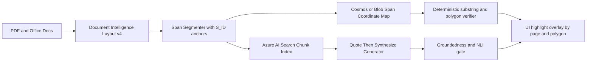
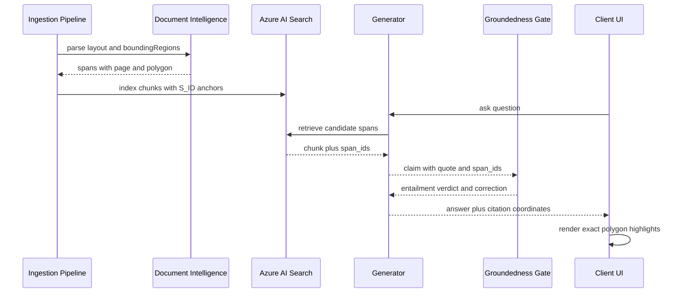
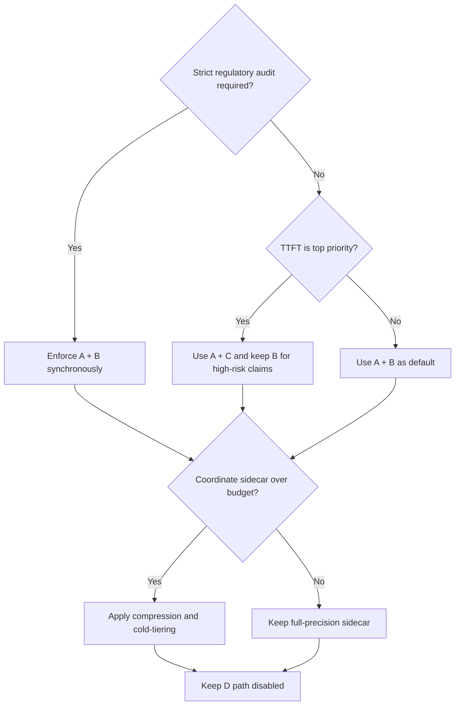

# Enterprise verifiable RAG citation and span-level provenance selection FAQ: exact `Span-ID + Polygon` verification vs `Groundedness/NLI` entailment gates vs streaming post-hoc attribution vs free-footnote anti-pattern
> **Audience**: Cloud & AI Solution Architects, enterprise knowledge platform leads, and compliance governance teams.
> **Core question**: how to guarantee that every answer is backed by verifiable text evidence, exact PDF coordinates, and auditable provenance without collapsing user latency.
> **Recommendation**: use A+B as the default trust baseline; add C for highly interactive workloads; enforce D as a prohibited anti-pattern.

## 1. Executive summary
The dominant production risk in enterprise RAG is not missing retrieval; it is unsupported interpretation.
Many incidents happen when a citation exists but the final claim inverts the cited meaning.
Architecture A enforces `Quote-Then-Synthesize` with deterministic span verification and coordinate-level provenance.
Architecture B decomposes generated responses into atomic claims and blocks non-entailed statements.
Architecture C preserves streaming responsiveness by resolving citations at sentence boundaries.
Architecture D emits free-form footnotes with no deterministic validation and no polygon provenance.
This guide provides `F1_cite`, coordinate overhead `ΔS_poly`, quote overhead vs NLI latency trade-offs, and tiered TCO.
The goal is to move from cosmetic citations to machine-verifiable evidence contracts.

## 2. Why citation trust has become a proof problem
Early RAG stacks optimized recall and reranking and assumed citation presence implied correctness.
That assumption fails in regulated domains with negations, exceptions, temporal clauses, and unit conversions.
Teams must separate three layers: retrieval hit, textual verification, and semantic entailment.
If only the first layer is implemented, the system still produces plausible but unsupported claims.
A solves deterministic evidence existence and coordinate mapping.
B solves semantic support and contradiction interception.
C solves latency-sensitive interaction without abandoning provenance.
D fails all three layers under document churn and chunk reorder.

## 3. Goals and boundaries
Goal 1: ensure critical claims are linked to verifiable substrings and precise coordinates.
Goal 2: intercept negation flips, numeric drift, and conditional-logic misreads before delivery.
Goal 3: preserve acceptable TTFT in interactive channels.
Goal 4: control coordinate-sidecar storage growth.
Goal 5: keep evidence export replayable for audit and incident response.
Boundary 1: this guide focuses on text/table evidence, not video frame evidence.
Boundary 2: it assumes layout extraction and chunk indexing already exist.
Boundary 3: it governs evidence validity, not business policy adjudication.

## 4. Candidate architectures
Architecture A: `Document Intelligence Layout v4` plus `Span-ID` coordinate sidecar with deterministic NFKC substring verification.
Architecture B: atomic claim decomposition with `Groundedness/NLI` gate and auto-rewrite or redaction path.
Architecture C: streaming sentence-first output with asynchronous citation resolution events.
Architecture D: prompt-only free `[1]` footnotes with no coordinate anchor and no semantic gate.
A guarantees provenance existence, B guarantees semantic support, C guarantees interaction speed, D guarantees future incidents.
Recommended baseline: A+B, with C added selectively for strict latency envelopes.

## 5. Architecture A deep dive: coordinate sidecar and deterministic evidence checks
A binds each sentence or table cell to stable `S_xxx` anchors during ingestion.
Response generation must output `claim + span_ids + verbatim_evidence_substring` as a structured contract.
A deterministic verifier runs NFKC normalization and substring existence checks.
When checks pass, the UI can render exact `(pageNumber, polygon)` overlays.
This is audit-friendly because every claim can be replayed and machine-validated.
The main trade-off is sidecar storage and ingestion complexity.
In most enterprises, this cost is far lower than regulatory remediation costs from unverifiable answers.
A is also the prerequisite layer for B and C quality.

## 6. Architecture B deep dive: entailment gate for citation inversion bugs
B targets failures where evidence exists but does not entail the generated claim.
A frequent example is policy text saying “excludes flood damage” while the answer says “covers flood damage”.
B splits responses into atomic claims and runs entailment scoring against bound evidence spans.
Non-entailed claims are rewritten, redacted, or downgraded according to risk policy.
Numeric and negation clauses should also receive rule-based secondary checks.
B significantly reduces high-severity contradiction incidents.
The trade-off is incremental latency and compute cost.
Risk-tier routing can keep high-risk claims synchronous and low-risk claims asynchronous.

## 7. Architecture C deep dive: streaming post-hoc citation attribution
C keeps TTFT low by streaming prose before full citation resolution finishes.
Citation coordinates are resolved at sentence boundaries and emitted as `citation.resolved` events.
Clients update highlights progressively without blocking the initial response token.
This mode requires explicit status semantics for unresolved vs failed citations.
Without status clarity, users misinterpret temporary gaps as missing evidence.
C must still share the same evidence registry as A and entailment ledger as B.
For regulated claims, synchronous B gating should remain mandatory.

## 8. Architecture D anti-pattern
D appears when teams rely on prompt instructions like “add citations” and stop there.
Footnote numbers drift as chunks are reranked, deduplicated, or updated.
No stable anchor means no deterministic replay for audits.
No coordinate mapping means no exact source highlighting.
No entailment gate means contradictions pass silently.
At scale, D creates confidence theater instead of evidence assurance.
D should be removed from production templates and CI policy checks.

## 9. Metrics and trade-off equations
Citation quality should be measured with `Precision_cite`, `Recall_cite`, and `F1_cite`.
`F1_cite = 2PR/(P+R)` should be segmented by risk-critical claim classes.
Coordinate sidecar growth can be estimated as `ΔS_poly ≈ N_span × B_poly`.
Quote-first generation introduces token overhead `ΔT_quote`.
Entailment gating introduces latency overhead `ΔL_nli`.
End-to-end latency approximation: `L_total = L_retrieval + L_generation + ΔL_quote + ΔL_nli`.
SLA policy should define acceptable `ΔL_nli` per risk tier.
High-risk domains should optimize for correctness and auditability first, then latency.

## 10. Twelve-dimension comparison matrix
| Dimension | Architecture A | Architecture B | Architecture C | Architecture D |
|---|---|---|---|---|
| Verifiability | High | High | Medium-High | Low |
| Semantic correctness | Medium | High | Medium | Low |
| TTFT impact | Medium | Medium-High | Low | Low |
| Audit traceability | High | High | Medium-High | Low |
| Implementation complexity | Medium | Medium-High | High | Low |
| Runtime cost | Medium | Medium-High | Medium | Low but risky |
| Coordinate fidelity | High | Depends on A | Depends on A | None |
| Contradiction interception | Medium | High | Medium | Low |
| Regulatory fitness | High | High | Medium-High | Low |
| Lifecycle stage | Baseline | High-risk default | Latency extension | Prohibited |
| Main risk | Storage overhead | Latency overhead | State consistency | Silent drift |
| Recommendation | Required | Strongly recommended | Conditional | Prohibited |

## 11. Ingestion-to-citation data plane


## 12. Verification and entailment sequence


## 13. Selection decision tree


### Q1. Why are footnote numbers alone insufficient for verifiable citations
Footnote numbering expresses linkage, not proof.
When chunk ordering changes, number-to-source mapping drifts.
Without substring and coordinate anchors, machine verification is impossible.
Auditors require replayable provenance, not visual approximation.
Therefore numbering must be upgraded to deterministic anchor contracts.

### Q2. Why enforce quote-before-synthesize
Quote-first constrains generation to retrievable evidence boundaries.
Synthesize-second reduces free-form extrapolation risk.
It lowers the chance of unsupported claim expansion.
It also provides clean inputs for downstream entailment checks.
This makes quote-first the first hard trust gate.

### Q3. Which failures are best intercepted by groundedness/NLI
Negation inversion and numeric-unit drift are top categories.
Temporal-boundary confusion is another common source of harm.
Conditional clause omission often causes overgeneralized conclusions.
String existence checks alone cannot detect these semantic failures.
NLI gates complete the trust stack for these error modes.

### Q4. When should streaming post-hoc attribution be preferred
Prefer C when first-token latency is a critical product metric.
Use it for lower-risk interactions where progressive citation rendering is acceptable.
Keep high-risk claims on synchronous gate paths.
Risk-tier routing is the mechanism to reconcile speed and trust.
The key is explicit state semantics for unresolved evidence.

### Q5. How to control sidecar storage without losing auditability
Use coordinate quantization, hot-cold tiering, and differential encoding.
Retain high precision for high-risk corpora and compressed precision for low-risk corpora.
Archive low-frequency evidence in cold tiers while preserving queryability.
Optimization should target cost control, not evidence deletion.
Never trade away replayability for short-term storage savings.

### Q6. Five-step rollout and Good fit vs Not for
Step 1: connect layout parsing, span anchors, sidecar store, and index contracts.
Step 2: deploy Quote-Then-Synthesize with deterministic substring validation.
Step 3: add synchronous groundedness/NLI gates for high-risk claims.
Step 4: add sentence-boundary post-hoc attribution for latency-sensitive channels.
Step 5: enforce audit export, replay verification, and hard disablement of D.
Good fit: document-dense enterprise workflows with audit or compliance obligations.
Not for: one-off demos with no replay or evidentiary requirements.

## 14. Implementation snippets
```python
from unicodedata import normalize
from typing import Dict, List, Tuple

def nfkc(text: str) -> str:
    return normalize("NFKC", text)

def build_span_table(layout_items: List[Dict]) -> Dict[str, Dict]:
    table = {}
    for item in layout_items:
        sid = item["span_id"]
        table[sid] = {
            "text": item["text"],
            "page": item["pageNumber"],
            "polygon": item["boundingRegions"][0]["polygon"],
        }
    return table

def deterministic_verify(claim: str, quote: str, span_ids: List[str], span_table: Dict[str, Dict]) -> Tuple[bool, List[Dict]]:
    quote_n = nfkc(quote)
    resolved = []
    ok = False
    for sid in span_ids:
        span = span_table.get(sid)
        if not span:
            continue
        if quote_n in nfkc(span["text"]):
            ok = True
            resolved.append({"span_id": sid, "page": span["page"], "polygon": span["polygon"]})
    return ok, resolved

def gate_with_groundedness(claim: str, entailment_score: float, threshold: float = 0.72) -> str:
    if entailment_score >= threshold:
        return claim
    return "[REDACTED_UNENTAILED] " + claim
```

```json
{
  "name": "rag-citation-index",
  "fields": [
    {"name": "id", "type": "Edm.String", "key": true},
    {"name": "chunk_text", "type": "Edm.String", "searchable": true},
    {"name": "span_ids", "type": "Collection(Edm.String)", "filterable": true},
    {"name": "doc_id", "type": "Edm.String", "filterable": true},
    {"name": "page", "type": "Edm.Int32", "filterable": true},
    {"name": "polygon", "type": "Collection(Edm.Double)", "retrievable": true}
  ],
  "vectorSearch": {
    "algorithms": [{"name": "hnsw-default", "kind": "hnsw"}]
  },
  "semantic": {
    "configurations": [{"name": "default", "prioritizedFields": {"contentFields": [{"fieldName": "chunk_text"}]}}]
  }
}
```

## 15. Enterprise TCO framing for 50K / 1M / 20M cited queries
| Tier | Monthly cited queries | Recommended architecture | Dominant cost drivers | Primary value |
|---|---|---|---|---|
| Tier-1 | 50K | A | Sidecar build plus retrieval | Verifiable citation baseline |
| Tier-2 | 1M | A + B | Entailment gating plus sidecar storage | Major contradiction interception |
| Tier-3 | 20M | A + B + C | Elastic gating plus post-hoc attribution | Trustability with responsive UX |

## 16. Production readiness checklist
Confirm parser version, span policy, and index version are hash-linked.
Confirm output schema always returns claim, span_ids, and verbatim substring.
Confirm NFKC substring failures trigger block or controlled downgrade.
Confirm coordinates map back to original pages with deterministic rendering.
Confirm high-risk claims always run synchronous groundedness/NLI gates.
Confirm low-risk streaming paths clearly expose unresolved versus failed states.
Confirm audit export bundles include timestamps, model versions, and policy versions.
Confirm sidecar storage has compression, tiering, and lifecycle controls.
Confirm D anti-pattern path is disabled in templates and runtime policy.
Confirm replay scripts can reproduce sampled audit outcomes.
Confirm dashboards correlate `F1_cite`, block rate, latency, and unit cost.

## 17. Operational lessons and optimization guidance
Track `F1_cite` by document class to avoid risk masking in blended averages.
Maintain dedicated red-team sets for negation, numerics, units, and temporal clauses.
Review blocked claims weekly and classify fixable prompt versus model issues.
Tie sidecar storage policy to evidence heatmaps and regulatory retention tiers.
Escalate polygon-render failures as primary reliability incidents, not cosmetic defects.
Include post-hoc attribution completion rate in C-path SLA definitions.
Standardize evidence-export contracts to reduce cross-team audit friction.
Require synchronous gating for all business-critical claims by policy.
Run citation-consistency regression suites on every model upgrade window.
Balance accuracy, latency, cost, and compliance in one quarterly governance review.

## 18. Conclusion
Verifiable RAG requires proof-oriented architecture, not citation-looking text output.
A delivers deterministic provenance, B delivers semantic truth gating, and C delivers latency-aware attribution.
D cannot survive multi-document, reranked, audited production conditions and should be retired.
With A+B+C operated as one trust system, teams can improve correctness without abandoning interactive UX.
The most durable outcome is a replayable evidence contract that aligns engineering, compliance, and business decisions.
This path elevates enterprise RAG from plausible answers to auditable, governable, and defensible knowledge delivery.

In sustained operations, track `F1_cite` by risk class so high-severity misses are not diluted by low-risk traffic.
Monitor entailment-block precision and recall separately to avoid over-blocking while still catching contradiction claims.
Correlate sidecar storage growth with document churn to keep retention policy and budget policy synchronized.
Measure replay pass-rate with independent runners to prove provenance exports are not coupled to one execution host.
Log quote-verification failures by parser version so ingestion regressions can be isolated quickly.
Watch citation-resolution lag distribution on C-path channels to prevent hidden backlog accumulation.
Add unit-normalization drift checks for currency, dosage, and percentages before final claim release.
Compare contradiction rates before and after model rollouts to detect silent semantic regression.
Track unresolved citation states by channel and tenant to detect integration quality gaps.
Publish monthly trust scorecards that map evidence quality directly to customer-impact classes.
Keep anti-pattern D disabled through CI policy assertions and runtime admission controls.

## 19. Measurement protocol appendix
To keep `F1_cite` honest, evaluate on sealed holdout claims sampled by risk tier rather than random mixed prompts.
Record both claim-level and answer-level citation metrics, because aggregate answer scores can hide high-severity claim misses.
For coordinate checks, validate page and polygon replay against rendered overlays, not only against stored JSON.
Maintain a contradiction challenge set with negations, exclusions, temporal clauses, and unit conversions.
Track entailment-gate precision separately from block-rate so policy teams can tune intervention thresholds safely.
Measure TTFT and full-response latency independently when C-path post-hoc attribution is enabled.
Log unresolved-citation dwell time to prevent silent drift in asynchronous resolution workers.
For cost accounting, split sidecar storage, retrieval, and NLI inference into distinct meters.
When model versions change, rerun the same sealed set and compare citation deltas before rollout.
Publish monthly trust reports that tie citation quality to incident rates and customer-impact classes.
Use red-team replay exports to verify that blocked claims remain blocked across policy and model updates.
Finally, keep architecture D permanently disabled in release templates and policy baselines.
