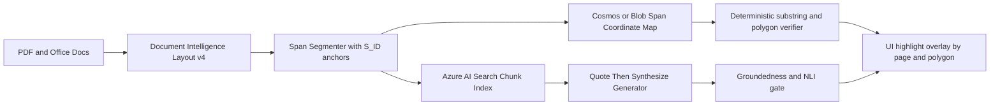
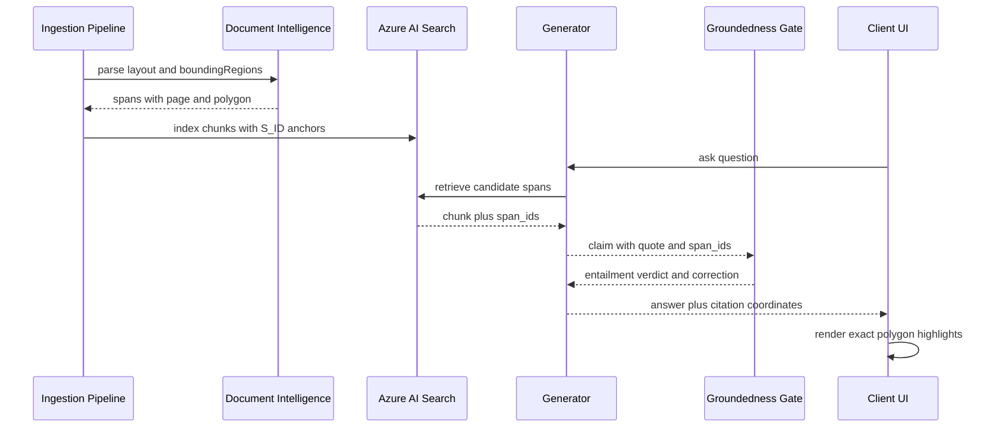
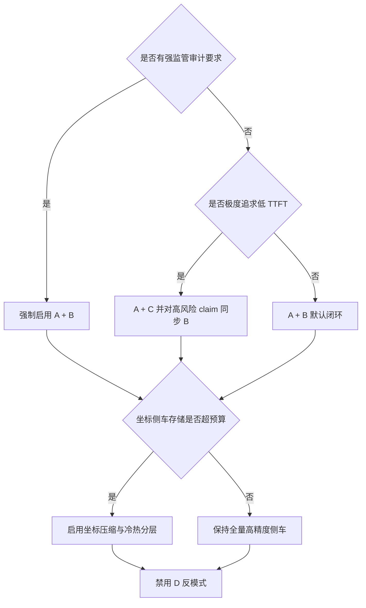

# 企业 RAG 可验证引用与坐标级证据选型 FAQ：`Span-ID + Polygon` 精确定位 vs `Groundedness/NLI` 语义蕴含门禁 vs 流式后归因对齐 vs 自由脚注反模式
> **适用角色**：Cloud & AI Solution Architect、企业知识平台负责人、合规审计与模型风险治理团队。
> **核心问题**：如何让每条回答都能回溯到可验证原文、精确页面坐标和可解释证据链，同时保持低延迟交互体验。
> **建议结论**：默认采用 A+B 形成“可验证引用 + 蕴含拦截”双闸门；对强交互场景追加 C；D 作为禁用反模式纳入发布门禁。

## 1. 执行摘要
企业 RAG 在生产中的核心风险不是“查不到”，而是“查到了却解释错了”。
许多事故并非缺少引用，而是引用存在但语义方向被反转。
Architecture A 用 `Span-ID` 侧车与 `Quote-Then-Synthesize` 强约束输出，先保证可核验证据存在。
Architecture B 对原子化 claim 做实时蕴含校验，拦截“引用存在但结论不成立”的隐蔽错误。
Architecture C 在流式输出场景做句边界后归因，尽量不牺牲 TTFT。
Architecture D 只输出自由脚注编号，不提供可验证坐标与确定性字符串校验。
本文给出 `F1_cite`、坐标存储开销 `ΔS_poly`、引用开销与 NLI 时延权衡，以及三档规模 TCO。
目标是把引用能力从“看起来像证据”升级为“可计算、可审计、可回放”的证据系统。

## 2. 背景：RAG 可信度问题正在从检索问题转向证明问题
早期 RAG 关注召回率与重排质量，默认“引用存在即可信”。
在监管场景，这个假设并不成立。
当文档包含否定词、例外条款、时间边界或单位换算时，引用与结论可能方向相反。
因此企业需要区分三个层级：检索命中、文本可证、语义可蕴含。
仅做到第一层会产生“伪可信”回答。
A 解决“能否定位到精确证据与坐标”的问题。
B 解决“结论是否由证据蕴含”的问题。
C 解决“实时交互如何兼顾证据解析延迟”的问题。
D 则是仅靠提示要求模型自己加脚注，无法满足审计要求。

## 3. 目标与边界
目标一：保证回答中的关键 claim 都有可验证原文子串与坐标锚点。
目标二：拦截否定反转、数字误读、单位错配等语义不蕴含错误。
目标三：在流式体验下控制证据解析增加的额外时延。
目标四：控制坐标侧车存储膨胀，避免索引成本失控。
目标五：建立可审计的证据链路，支持事后复盘与监管抽检。
边界一：本文聚焦文本与表格证据，不覆盖视频帧级证据。
边界二：本文默认已有布局解析与分块索引基础设施。
边界三：本文不讨论业务裁决本身，仅讨论证据与蕴含技术门禁。

## 4. 四类候选架构
Architecture A：`Document Intelligence Layout v4` 解析 `boundingRegions.polygon[8]`，构建 `Span-ID` 坐标侧车并执行确定性子串校验。
Architecture B：对生成 claim 做原子化拆分并走 `Groundedness/NLI` 门禁，自动重写或删减不蕴含片段。
Architecture C：先流式输出，再在句边界异步补齐 citation 坐标事件，降低首字节等待成本。
Architecture D：自由 `[1]` 脚注编号，无坐标锚点、无确定性校验、无语义门禁。
A 确保“证据可找得到”，B 确保“证据能支撑结论”，C 确保“交互不变慢”，D 只会积累审计风险。
推荐基线是 A+B，交互极敏感场景加 C，D 全面禁用。

## 5. Architecture A 深入：Span-ID 坐标侧车与可验证引用
A 的核心是先把文档语义片段与物理坐标绑定，再进入生成流程。
每个句子或表格单元在入库时分配稳定 `S_xxx` 锚点。
回答时要求先输出 `claim + span_ids + verbatim_evidence_substring`。
随后执行 NFKC 归一化与确定性子串匹配，验证证据真实存在。
匹配成功后可在 UI 直接高亮 `(pageNumber, polygon)`。
这种方式对审计最友好，因为证据链闭环可机器复核。
A 的主要成本在坐标侧车存储与构建开销。
但相比后续合规事故成本，通常可接受且可预测。
A 也是 B 与 C 的数据基础，没有 A 很难做高质量门禁。

## 6. Architecture B 深入：Groundedness/NLI 语义蕴含拦截
B 关注的是“证据存在但结论不成立”的灰区错误。
典型例子是证据写着“除外条款”，回答却写成“覆盖条款”。
B 将回答拆成原子 claim，并与对应证据做蕴含判定。
当判定为不蕴含或冲突时，可触发自动改写、降级摘要或直接拒答。
对数字与否定词可增加规则层校验，减少模型判别漂移。
B 的收益是显著降低高风险事实反转错误。
代价是增加一定实时时延与调用成本。
因此应按风险等级选择同步门禁或异步审计策略。

## 7. Architecture C 深入：流式后归因与句边界补证
C 适用于低延迟交互优先场景。
系统先输出内容，再按句边界异步解析与补齐 citation。
客户端收到 `citation.resolved` 事件后补渲染高亮坐标。
这样可避免等待全量验证才显示首字。
C 需要严格区分“暂未解析”与“解析失败”状态。
若状态表达不清，用户会误以为引用缺失。
C 应与 A 的侧车和 B 的蕴含结果统一归档，避免链路割裂。
在审计要求极高场景，仍应把关键 claim 保持同步门禁。

## 8. Architecture D 反模式说明
D 常见于只在提示词里要求“请加引用”的快速实现。
模型生成脚注编号看似完整，但编号与分块重排后常发生错位。
当文档更新或去重后，旧编号几乎不可追溯。
D 既无法给出精确坐标，也无法机器验证原文子串。
在监管审计中，D 的证据链通常被判定为不可采信。
随着多文档聚合复杂度提高，D 的错误率会持续上升。
因此 D 必须从生产发布模板中移除。

## 9. 度量公式与权衡模型
引用质量可用：`Precision_cite`、`Recall_cite` 与 `F1_cite` 衡量。
其中 `F1_cite = 2PR/(P+R)`，并建议按高风险 claim 单独统计。
坐标侧车开销可估：`ΔS_poly ≈ N_span × B_poly`。
以 8 点多边形为例，`B_poly` 受坐标编码与压缩策略影响。
`Quote-Then-Synthesize` 会增加输出 token，记为 `ΔT_quote`。
NLI 门禁增加时延可记为 `ΔL_nli`。
整体延迟近似：`L_total = L_retrieval + L_generation + ΔL_quote + ΔL_nli`。
应按业务 SLA 确定可接受 `ΔL_nli` 上限并做分级策略。
在高风险场景，准确与可审计优先于极致首字节。

## 10. 12 维架构对比矩阵
| 维度 | Architecture A | Architecture B | Architecture C | Architecture D |
|---|---|---|---|---|
| 证据可验证性 | 高 | 高 | 中高 | 低 |
| 语义正确性 | 中 | 高 | 中 | 低 |
| TTFT 影响 | 中 | 中高 | 低 | 低 |
| 审计可追溯 | 高 | 高 | 中高 | 低 |
| 实施复杂度 | 中 | 中高 | 高 | 低 |
| 运行成本 | 中 | 中高 | 中 | 低但高风险 |
| 坐标精度 | 高 | 依赖 A | 依赖 A | 无 |
| 反转错误抑制 | 中 | 高 | 中 | 低 |
| 监管适配 | 高 | 高 | 中高 | 低 |
| 推荐阶段 | 基线必选 | 高风险必选 | 交互增强 | 禁用 |
| 主要风险 | 存储膨胀 | 额外时延 | 状态一致性 | 错位失真 |
| 总体建议 | 必选 | 强烈建议 | 条件启用 | 禁用 |

## 11. 引用数据平面与坐标侧车拓扑


## 12. 坐标解析与蕴含门禁时序


## 13. 选型决策树


### Q1. 为什么仅有脚注编号仍不足以构成可验证引用
脚注编号只能表示“关联”，不能表示“证明”。
当分块重排、去重或索引更新后，编号对应关系会漂移。
没有原文子串与坐标锚点，就无法做机器复核。
监管抽检要求的是可重放证据链，而不是视觉上看起来有引用。
因此必须把编号升级为可验证锚点体系。

### Q2. Quote-Then-Synthesize 为什么要先 quote 再生成
先 quote 能把模型约束在已检索证据边界内。
后 synthesize 可以降低自由发挥导致的事实扩写。
这能明显降低“引用存在但表述外推过度”的风险。
同时也为后续 NLI 门禁提供清晰输入对齐对象。
因此 quote 阶段是证据治理的第一道硬闸门。

### Q3. Groundedness/NLI 门禁最适合拦截哪些错误
最常见的是否定词方向反转与数字单位错读。
其次是时间边界错配，例如历史条款被当作现行条款。
再者是条件语句丢失，导致结论过度泛化。
这些错误仅靠字符串存在性校验无法发现。
NLI 门禁专门补齐这一层语义真实性控制。

### Q4. 何时采用流式后归因而非全同步校验
当首字节时延是关键体验指标时，可优先 C。
当场景风险较低且用户更在意对话流畅时，可接受后补证据。
但高风险 claim 应保持同步门禁，不能全部后置。
关键是把不同风险等级映射到不同验证路径。
这样才能同时兼顾体验与可信度。

### Q5. 坐标侧车成本如何治理而不损失审计能力
可通过坐标量化压缩、冷热分层与差分存储降低成本。
还可按风险级别保留不同精度，核心文档保留高精度坐标。
同时可把低频历史证据迁移到冷存储并保留检索索引。
治理目标是“成本可控”而非“证据降级”。
不要用删除证据换取短期成本收益。

### Q6. 五步落地与 Good fit / Not for
第一步：打通布局解析、span 锚点、坐标侧车与索引链路。
第二步：上线 Quote-Then-Synthesize 与确定性子串校验。
第三步：对高风险 claim 接入 Groundedness/NLI 同步门禁。
第四步：在低延迟场景引入句边界后归因与状态可视化。
第五步：建立审计导出、回放复核与发布禁用 D 的策略门禁。
Good fit：需要可核验事实回答、受审计约束、文档密集型企业场景。
Not for：一次性演示、无审计要求且无需证据回放的轻量问答场景。

## 14. 生产实现片段
```python
from unicodedata import normalize
from typing import Dict, List, Tuple

def nfkc(text: str) -> str:
    return normalize("NFKC", text)

def build_span_table(layout_items: List[Dict]) -> Dict[str, Dict]:
    table = {}
    for item in layout_items:
        sid = item["span_id"]
        table[sid] = {
            "text": item["text"],
            "page": item["pageNumber"],
            "polygon": item["boundingRegions"][0]["polygon"],
        }
    return table

def deterministic_verify(claim: str, quote: str, span_ids: List[str], span_table: Dict[str, Dict]) -> Tuple[bool, List[Dict]]:
    quote_n = nfkc(quote)
    resolved = []
    ok = False
    for sid in span_ids:
        span = span_table.get(sid)
        if not span:
            continue
        if quote_n in nfkc(span["text"]):
            ok = True
            resolved.append({"span_id": sid, "page": span["page"], "polygon": span["polygon"]})
    return ok, resolved

def gate_with_groundedness(claim: str, evidence: str, entailment_score: float, threshold: float = 0.72) -> str:
    if entailment_score >= threshold:
        return claim
    return "[REDACTED_UNENTAILED] " + claim
```

```json
{
  "name": "rag-citation-index",
  "fields": [
    {"name": "id", "type": "Edm.String", "key": true},
    {"name": "chunk_text", "type": "Edm.String", "searchable": true},
    {"name": "span_ids", "type": "Collection(Edm.String)", "filterable": true},
    {"name": "doc_id", "type": "Edm.String", "filterable": true},
    {"name": "page", "type": "Edm.Int32", "filterable": true},
    {"name": "polygon", "type": "Collection(Edm.Double)", "retrievable": true}
  ],
  "vectorSearch": {
    "algorithms": [{"name": "hnsw-default", "kind": "hnsw"}]
  },
  "semantic": {
    "configurations": [{"name": "default", "prioritizedFields": {"contentFields": [{"fieldName": "chunk_text"}]}}]
  }
}
```

## 15. 50K / 1M / 20M 月引用查询 TCO 框架
| 档位 | 月查询规模 | 推荐组合 | 主成本项 | 主收益 |
|---|---|---|---|---|
| Tier-1 | 50K | A | 侧车构建与检索 | 可验证引用基线 |
| Tier-2 | 1M | A + B | 蕴含门禁与坐标存储 | 显著降低语义反转错误 |
| Tier-3 | 20M | A + B + C | 门禁弹性与流式后归因 | 兼顾审计能力与低时延体验 |

## 16. 上线核查清单
应确认布局解析版本、span 规则与索引版本严格绑定。
应确认引用输出包含 claim、span_ids、verbatim_substring 三元组。
应确认 NFKC 子串校验失败会触发阻断或降级。
应确认坐标数据可反查原文并支持页面高亮。
应确认高风险 claim 已接入 Groundedness/NLI 同步门禁。
应确认低风险流式路径对“未解析/失败”状态有明确区分。
应确认证据回放导出包含时间戳、模型版本与策略版本。
应确认坐标侧车存储有压缩、分层与生命周期策略。
应确认 D 反模式路径在发布模板与运行配置中均被禁用。
应确认审计抽样脚本可重放并复现实验结果。
应确认运营看板覆盖 `F1_cite`、阻断率、时延与成本联动指标。

## 17. 运营经验与优化建议
建议按文档类型分开评估 `F1_cite`，避免合同与手册混合掩盖问题。
建议将否定词、单位、时间边界作为高优先级红队样本池。
建议每周回顾被 NLI 拦截的 claim，筛选可自动修复模式。
建议把坐标侧车开销与查询热度联合建模，动态优化冷热策略。
建议将 UI 高亮失败作为一级告警，而不是仅记录日志。
建议把后归因解析成功率纳入 C 路径 SLA。
建议将证据链导出格式标准化，减少跨团队审计摩擦。
建议建立“高风险问题必须同步门禁”的产品规范。
建议对模型升级做引用一致性回归，防止行为漂移。
建议在季度复盘中同时评估准确、时延、成本与合规四维平衡。

## 18. 结论
企业 RAG 可信化的关键在于把“引用”从展示元素升级为可计算证明对象。
A 负责证据定位与坐标可追溯，B 负责语义蕴含正确性，C 负责流式体验与证据补齐平衡。
D 的自由脚注方案无法在多文档、重排、审计条件下保持可靠，应被系统性淘汰。
当 A+B+C 形成统一治理闭环后，企业可以在不牺牲交互体验的前提下显著提高证据可信度。
进一步建议把引用质量指标与业务风险指标联动，把技术门禁直接映射到业务决策阈值。
最终，这套方案可将 RAG 输出从“看似有依据”提升到“可重放、可验证、可监管”的企业级证据标准。
在持续运营中，应按风险等级拆分 `F1_cite` 并追踪高风险样本段落的误引原因闭环（治理要点01）。
在持续运营中，应将 NLI 阻断精度与召回分开看板化，避免单一阻断率掩盖策略偏置（治理要点02）。
在持续运营中，应把坐标侧车存储增速与文档更新频率联动建模，防止容量规划滞后（治理要点03）。
在持续运营中，应按租户与业务线统计证据回放通过率，识别集成质量断层（治理要点04）。
在持续运营中，应建立页面高亮失败的一线告警策略，避免证据渲染异常长期隐蔽（治理要点05）。
在持续运营中，应对否定词与例外条款构建专项红队集，以验证语义门禁稳定性（治理要点06）。
在持续运营中，应定期抽检单位换算与数值四舍五入链路，避免数字语义偏移（治理要点07）。
在持续运营中，应为流式后归因路径增加未解析驻留时长阈值，防止异步积压恶化（治理要点08）。
在持续运营中，应将模型升级前后的引用一致性差分纳入发布准入报告（治理要点09）。
在持续运营中，应把坐标压缩策略与审计可读性一起评估，避免过度压缩破坏复核（治理要点10）。
在持续运营中，应要求高风险 Claim 默认走同步门禁，并记录所有人工放行理由（治理要点11）。
在持续运营中，应把证据导出格式版本化管理，确保跨团队回放脚本向后兼容（治理要点12）。
在持续运营中，应对多文档聚合回答做跨源冲突统计，提前发现知识库一致性缺陷（治理要点13）。
在持续运营中，应按季度校准蕴含阈值并回测误杀率，平衡安全与可用性（治理要点14）。
在持续运营中，应对 OCR 质量波动建立回归面板，避免布局误差传导到引用坐标（治理要点15）。
在持续运营中，应把检索重排策略变更与引用命中波动关联分析，降低变更盲区（治理要点16）。
在持续运营中，应建立证据链路事件的统一追踪 ID，确保端到端排障可还原（治理要点17）。
在持续运营中，应对策略拒答样本进行语义分层复盘，减少同类误拦截重复发生（治理要点18）。
在持续运营中，应把成本看板拆分为解析、检索、门禁三段，明确优化责任归属（治理要点19）。
在持续运营中，应把关键领域条款更新通知接入索引重建流程，降低时效性风险（治理要点20）。
在持续运营中，应对法规文本中的时间生效边界做专项校验，防止过期条款误用（治理要点21）。
在持续运营中，应在夜间批处理窗口执行证据链抽样回放，减轻白天业务流量干扰（治理要点22）。
在持续运营中，应将异常工单与引用失败标签自动关联，提升运维定位速度（治理要点23）。
在持续运营中，应将证据链 KPI 与业务风险等级挂钩呈现，避免指标解释脱离场景（治理要点24）。
在持续运营中，应对跨语言文档建立同义证据映射，减少双语回答中的引用错位（治理要点25）。
在持续运营中，应把外部审计发现反写到测试集生成器，形成持续改进闭环（治理要点26）。
在持续运营中，应对边缘案例启用人工复核白名单并设置自动过期策略（治理要点27）。
在持续运营中，应使用分层缓存记录引用解析命中率，评估缓存策略是否有效（治理要点28）。
在持续运营中，应将证据回放脚本纳入灾备演练，验证极端情况下的可审计连续性（治理要点29）。
在持续运营中，应保持反模式 D 在配置与代码层双重禁用，避免回退路径意外启用（治理要点30）。

## 19. 审计与演练附录
建议建立“每月一次、跨团队联合”的证据链演练机制，确保研发、运维、审计三方对同一回放结果达成一致解释。
建议将 `F1_cite` 的分层阈值写入发布策略文件，由平台自动判定是否允许模型或索引配置上线。
建议对高频法规文档维护“条款变更热区图”，并在热区变化后优先触发重解析与回归验证流程。
建议将 Groundedness 拦截样本沉淀为标准化案例库，支持新成员快速理解语义反转的真实事故模式。
建议为每次引用失败自动生成最小可复现工单，包含原问题、候选证据、门禁结果与最终处理动作。
建议在租户维度建立“可信预算”概念，将延迟、成本、误拦截容忍度映射为可配置治理档位。
建议把跨语言语料中的术语对齐策略纳入索引构建流水线，减少同义词差异导致的证据漂移。
建议将证据链导出接口接入法务审查平台，降低合规抽检时人工整理与格式转换的成本。
建议在季度架构评审中同时复核 A/B/C 路径的容量弹性，避免单一路径成为系统性瓶颈。
建议持续以“可重放、可解释、可追责”三原则审视实现细节，防止系统在迭代中滑回展示型引用。
建议把引用失败样本与业务损失事件做关联分析，形成“技术指标—业务影响”双向可验证证据。
建议在大版本升级窗口执行跨区域双活回放，验证网络抖动下坐标映射与蕴含门禁的一致性行为。
建议将核心合同与监管条款语料纳入高优先级缓存策略，降低高峰期证据解析冷启动抖动风险。
建议建立年度治理里程碑，对证据可信度、响应时延、运行成本与审计通过率设定可量化改进目标。
建议将“证据定位失败率”纳入周例会固定指标，确保问题在早期即可被发现并追责闭环。
