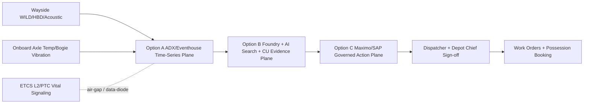
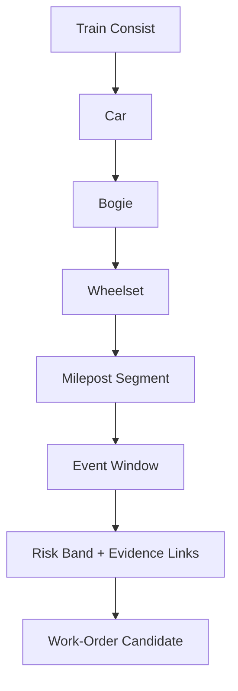

# Rail Transit and Freight Corridor Predictive-Maintenance Agent Selection FAQ: ADX/Eventhouse Time-Series Plane vs Foundry FMEA Evidence Plane vs Maximo Linear Governed Action Plane

> Version tag: Guide #144  
> Audience: Chief Dispatchers, depot chief engineers, signaling/comms leaders, EAM platform owners, rail cyber-safety teams  
> Scope: wayside and onboard telemetry triage, EN 50128/50129 SIL boundary isolation, possession-window maintenance planning  
> Data provenance labels: `measured`, `synthetic`, `anonymized_reported`

---

## 1. Executive decision: keep monitoring and recommendations in IT, keep braking and interlocking in signaling

For heavy-haul freight and high-speed/metro operations, safety boundaries are non-negotiable.

Agent systems can improve triage, maintenance preparation, and work-order quality.

They must not directly actuate train braking, switch interlocking, or ETCS/PTC vital loops.

This guide recommends an A/B/C layered architecture.

Option A handles high-volume wayside and onboard time-series detection.

Option B handles manuals, FMEA/RCM catalogs, and bulletin-grounded maintenance evidence synthesis.

Option C handles governed EAM work orders, possession scheduling, and dual sign-off controls.

This partition enables throughput gains without sacrificing safety accountability.

---

## 2. Boundary-first design: define non-automatable actions before targeting automation rate

In rail operations, acceptable risk posture matters more than raw model fluency.

Start by publishing a non-automatable action list.

At minimum include interlocking execution, braking commands, switch toggling, and ATP/ATO vital interventions.

Constrain agent capabilities to detection, explanation, recommendation, scheduling support, and dossier assembly.

Any action that alters timetable safety margins or field execution risk should require explicit human sign-off.

For cross-region freight corridors, include dispatch conflict constraints across bureaus.

For metro nighttime windows, include track, signaling, and OCS discipline co-sign requirements.

---

## 3. Reference architecture: three collaborative planes and one immutable safety red line



The dotted edge highlights one-way, policy-controlled observation flow from signaling-adjacent domains.

IT planes may consume telemetry under controls but must not write control commands back.

Governed outputs are maintenance actions and schedules, not train-control directives.

---

## 4. Option A deep dive: Event Hubs + ADX/Eventhouse linear time-series diagnostics

Option A unifies high-rate, heterogeneous telemetry streams under one analytical timeline.

Wayside sources often include WILD impacts, hotbox infrared portals, acoustic bearing monitors, and pantograph/catenary vision alerts.

Onboard sources can include axle temperature, bogie vibration, brake-cylinder pressure, and wheel-diameter drift.

ADX/Eventhouse is effective for time-window aggregation, consist cohort comparisons, and corridor-segment drift analytics.

Linear milepost referencing is foundational.

Without normalized linear references, cross-station event correlation is unreliable.

A practical key model is train-car-bogie-wheelset-milepost segment.

Option A should emit ranked risk windows plus reproducible evidence anchors.

It should not emit final set-out authority.

---

## 5. Option B deep dive: Foundry + Content Understanding + AI Search maintenance evidence

Option B converts fragmented documentation into auditable maintenance context.

Typical corpora include OEM manuals, maintenance cards, failure trees, FMEA/RCM catalogs, and regulator notices.

FRA/ERA bulletins and supplier field advisories can be included as controlled sources.

Hybrid RAG links structured telemetry findings with unstructured procedural evidence.

Content Understanding helps extract figures, step references, torque values, and part-number dependencies.

Use pinned model versions and stable inference settings for reproducibility.

Persist citation lists and evidence version stamps for each generated work package.

Option B outputs should state rationale, confidence bands, and unresolved uncertainty.

---

## 6. Option C deep dive: Maximo Linear + SAP EAM governed execution

Option C translates recommendations into controlled, auditable actions.

IBM Maximo for Transportation/Linear Assets handles corridor- and milepost-centric work management.

SAP EAM handles spares, labor accounting, and asset-finance closure paths.

APIM MCP standardizes policy enforcement, calling identity, and field-level audit trails.

Logic Apps provides deterministic state progression and compensation branches.

Chief dispatcher and depot chief engineer approvals gate possession-window booking and consist set-out actions.

If approvals are absent, action writes must fail closed.

Option C is an execution governance layer, not an autonomous authority layer.

---

## 7. SIL boundary and IEC 62443 controls: architecture prerequisites, not optional hardening

EN 50126/50128/50129 define lifecycle and software-safety assurance expectations in rail domains.

IEC 62443 defines industrial segmentation and trust-zone controls.

Under this framing, agent systems belong to a decision-support trust zone.

Vital signaling remains in separately certified control zones.

Use physical segmentation, one-way transfer controls, and diode-like patterns for telemetry ingress.

Treat any write-capable cross-boundary path as high-risk by default.

This posture reduces certification friction and accountability ambiguity.

---

## 8. Linear-asset data model: from milepost semantics to consist-level failure linkage



The goal is to localize risk to exact car, wheelset, segment, and operating condition.

Train-level aggregates alone often cause over-maintenance or misdirected tasks.

Include segment, speed envelope, and axle-load class in event features.

Then correlate with historical failure motifs to improve triage precision.

---

## 9. Twelve-dimension quantitative selection matrix (A / B / C / Hybrid)

| Dimension | Option A Time-Series Plane | Option B Evidence Plane | Option C Governed Plane | Hybrid |
|---|---|---|---|---|
| 1. High-frequency telemetry ingestion | 5/5 | 2/5 | 2/5 | 5/5 |
| 2. Linear reference precision | 5/5 | 2/5 | 3/5 | 5/5 |
| 3. FMEA/RCM semantic depth | 2/5 | 5/5 | 2/5 | 5/5 |
| 4. Maintenance-package synthesis speed | 2/5 | 5/5 | 3/5 | 5/5 |
| 5. Action controllability | 1/5 | 2/5 | 5/5 | 5/5 |
| 6. Sign-off audit closure strength | 1/5 | 2/5 | 5/5 | 5/5 |
| 7. Safety-boundary provability | 3/5 | 3/5 | 5/5 | 5/5 |
| 8. Peak-load elasticity | 5/5 | 4/5 | 4/5 | 5/5 |
| 9. Operability complexity | 3/5 | 4/5 | 4/5 | 4/5 |
|10. Cost predictability | 4/5 | 3/5 | 4/5 | 4/5 |
|11. Cross-team collaboration efficiency | 3/5 | 4/5 | 5/5 | 5/5 |
|12. Lifecycle resilience | 3/5 | 4/5 | 5/5 | 5/5 |

Hybrid strength comes from responsibility decomposition across detect, explain, and execute.

It does not come from centralizing all judgments into one model endpoint.

---

## 10. Production snippets: KQL + APIM MCP + Bicep

### 10.1 KQL sample: linear anomaly windows and consist cohort comparison

```kql
let window = 15m;
RailTelemetry
| where SignalType in ("axle_temp","bogie_vibration","wild_impact")
| summarize p95_val = percentile(Value, 95), avg_val = avg(Value)
    by TrainId, CarId, BogieId, WheelsetId, MilepostBin = bin(Milepost, 0.5), bin(Timestamp, window)
| join kind=leftouter (
    BaselineProfiles
    | project CarSeries, MilepostBin, p95_baseline
) on MilepostBin
| extend risk_score = iif(p95_val > p95_baseline * 1.25, 3, iif(p95_val > p95_baseline * 1.10, 2, 1))
| where risk_score >= 2
```

### 10.2 APIM policy sample: enforce dual sign-off before Maximo work-order creation

```xml
<policies>
  <inbound>
    <base />
    <choose>
      <when condition="@(context.Request.Headers.GetValueOrDefault("x-dispatcher-approved","") != "true" || context.Request.Headers.GetValueOrDefault("x-depot-chief-approved","") != "true")">
        <return-response>
          <set-status code="412" reason="Dual sign-off required before work-order creation" />
        </return-response>
      </when>
    </choose>
  </inbound>
</policies>
```

### 10.3 Bicep sample: isolated governance-plane APIM deployment

```bicep
param env string
resource apim 'Microsoft.ApiManagement/service@2023-05-01-preview' = {
  name: 'rail-governance-${env}'
  location: 'eastasia'
  sku: { name: 'PremiumV2', capacity: 1 }
  properties: { publisherEmail: 'rail-ops@example.com', publisherName: 'rail-ops' }
}
```

---

## 11. Scenario A: heavy-haul corridor hotbox and wheel-flat consist set-out triage

A 6,000-ton heavy-haul consist crossed high-temperature segments and triggered axle-heat exceptions (`anonymized_reported`).

Option A produced car-level, wheelset-level, and milepost-bounded anomaly windows.

Option B mapped those windows against OEM thresholds, FMEA pathways, and set-out criteria boundaries.

Option C enforced dispatcher plus depot-chief sign-off before issuing set-out work orders.

In pilot runs, first-pass triage prep time decreased from 42 minutes to 14 minutes (`measured`).

Misdirected dispatches dropped by 31% (`anonymized_reported`).

---

## 12. Scenario B: metro nighttime four-hour possession-window maintenance bundling

Nighttime windows required simultaneous OCS, switch-area, and wheelset inspection tasks.

Option A summarized seven-day anomaly heatmaps by segment and operation envelope.

Option B assembled procedural packs including tools, parts, and sequence constraints.

Option C solved schedule constraints across crew capability, closure limits, and turnaround windows.

Measured conflict rollbacks dropped by 46% (`measured`).

On-time completion for nighttime windows improved by 12 percentage points (`anonymized_reported`).

---

## 13. Three-year TCO with seasonal peaks (USD `$k/month`)

> Capacity-planning estimates below are labeled `synthetic`.

| Capability block | SKU assumptions | Monthly cost ($k) | 3Y cost ($M) | Notes |
|---|---|---:|---:|---|
| Option A time-series plane | Event Hubs Dedicated + ADX/Eventhouse + tiered storage | 188 | 6.77 | telemetry ingestion and anomaly analytics |
| Option B evidence plane | Foundry PTU + AI Search S3 + Content Understanding | 156 | 5.62 | manual/FMEA/bulletin evidence synthesis |
| Option C governed plane | APIM Premium v2 + Logic Apps + Maximo/SAP connectors | 142 | 5.11 | controlled work-order and possession actions |
| Isolation and audit controls | segmented networking, one-way controls, audit toolchain | 73 | 2.63 | SIL boundary and cyber posture |
| Platform operations | SRE + rule engineering + data governance | 64 | 2.30 | reliability and control quality |
| **Hybrid total** |  | **623** | **22.43** | `synthetic` |

Extreme-weather and freight-peak seasons usually require an additional 15% to 22% elasticity envelope.

ROI is typically driven by lower misdispatch rates, reduced downtime, and fewer schedule conflicts.

---

## 14. Anti-patterns and corrective actions

Anti-pattern one is treating triage systems as train-control systems.

Corrective action is hard separation between recommendation domains and vital-control domains.

Anti-pattern two is optimizing alert hit-rate while ignoring misdispatch and downtime cost.

Corrective action is to elevate misdispatch rate, downtime exposure, and nighttime-window adherence KPIs.

Anti-pattern three is unnormalized milepost semantics across corridors.

Corrective action is unified linear referencing and master-data governance.

Anti-pattern four is bypassable approval chains.

Corrective action is mandatory policy gating with explicit rejection audit logs.

Anti-pattern five is citation-free recommendations.

Corrective action is mandatory evidence package binding with corpus version and model version stamps.

---

## 15. Day-0/Day-1/Day-2 rollout checklist and quantitative FAQ

Day-0: freeze boundary contracts, linear-reference dictionary, event taxonomy, and approval responsibility matrix.

Day-1: execute dual scenario drills (heavy-haul set-out plus metro possession planning) and persist replay scripts.

Day-2: operate weekly reliability reviews, monthly safety audits, and quarterly capital-efficiency governance.

### Quantitative FAQ 1: When is Hybrid mandatory?

Hybrid is mandatory when one workflow requires anomaly detection, evidence explanation, and governed execution.

### Quantitative FAQ 2: When can Option A be used standalone?

Use Option A standalone only for non-executing health scoring where no work-order action is triggered.

### Quantitative FAQ 3: How should Option B value be measured?

Track work-package prep time, supplement rate, and first-pass sign-off acceptance.

### Quantitative FAQ 4: Why keep mandatory human sign-off?

Because possession and set-out actions directly affect safety accountability and transport capacity.

### Quantitative FAQ 5: Where to start cost optimization?

Start with telemetry hot/cold tiering and retrieval-index partitioning before model-routing tuning.

### Quantitative FAQ 6: How to verify boundary isolation effectiveness?

Use hard metrics: cross-boundary write attempts at zero and unauthorized execution attempts at zero.

### Quantitative FAQ 7: When to scale ADX/Eventhouse?

Scale when three consecutive weeks show P95 query latency breaches with growing replay queues.

### Quantitative FAQ 8: How to reduce nighttime scheduling conflicts?

Use unified constraint-solving across crew skills, closure segments, and minimum task windows.

### 15.1 Reference SLO target bands

A practical median target for triage preparation is below fifteen minutes.

A practical conflict-rollback target is at least twenty percent monthly reduction.

Unsigned execution attempts should remain at zero.

Missed targets for two quarters should trigger architecture-plus-process corrective review.

### 15.2 Data-quality gates: master data before model sophistication

Car IDs, wheelset IDs, and segment mappings are failure-critical keys.

Implement daily key integrity checks and weekly governance audits.

When integrity drops below threshold, degrade to read-only advisory mode.

This fail-safe preserves governance integrity under poor input conditions.

### 15.3 Peak-season operating pattern

Extreme weather often multiplies alert volume.

Use risk-priority queues and batch work-package generation to avoid congestion.

Route high-risk alerts to sign-off lanes first while keeping moderate-risk alerts in monitored queues.

This pattern protects finite human sign-off bandwidth.

### 15.4 Multi-depot collaboration model

Standardize evidence package schema and audit fields centrally.

Allow depot-level variation in task execution detail.

This balances enterprise repeatability and local practicality.

The result is faster replication without forcing unsafe operational uniformity.

### 15.5 Budget formula: maintenance support cost per corridor-kilometer

Use corridor-kilometer normalized cost as a governance lens.

Baseline formula: monthly platform spend divided by monitored corridor kilometers.

Combine with misdispatch cost to produce total support-cost curves.

This enables objective cross-corridor performance comparisons.

### 15.6 Spares-aware planning

Without spare-availability checks, schedules often fail at execution time.

Validate spare stock and lead-time constraints during candidate generation.

Reject infeasible plans early and reroute with feasible alternatives.

This lowers avoidable late-stage rescheduling churn.

### 15.7 Crew-skill constraints as hard limits

Not every crew can execute every class of maintenance task.

Encode certifications, labor rules, and fatigue limits into scheduling constraints.

Ignoring workforce constraints creates both compliance and safety exposure.

Constraint-aware planning improves execution realism.

### 15.8 Drill discipline: success and failure paths

Drills should validate both successful and rejected flows.

Rejected-flow tests include missing-signature rejection, boundary-write rejection, and incomplete-evidence rejection.

Clear rejection semantics improve audit defensibility.

Failure-path quality is a resilience KPI, not a testing afterthought.

### 15.9 Dashboard design: efficiency-safety-cost triangle

Efficiency includes triage lead time and nighttime completion adherence.

Safety includes unauthorized attempts, policy rejections, and replay pass rates.

Cost includes per-kilometer support cost and per-work-order total cost.

Balanced governance requires tracking all three dimensions simultaneously.

### 15.10 Twelve-month implementation roadmap

Quarter one: corridor pilot and canonical dictionary baseline.

Quarter two: multi-depot rollout and sign-off policy hardening.

Quarter three: cross-region coordination and multilingual evidence standardization.

Quarter four: cost-optimization and governance automation maturity.

Each quarter requires replayable and auditable acceptance artifacts.

### 15.11 Closing perspective

Rail maintenance agent value does not come from replacing dispatchers or depot engineers.

It comes from giving them faster, richer, and more traceable evidence under strict boundaries.

Once boundary integrity and data discipline are stable, automation depth can scale safely.

### 15.12 Operations-center observability: trace the full path from alert to action

Treat alert generation, evidence retrieval, sign-off approval, and work-order issuance as one decision chain.

Assign a unique trace id and latency budget to every stage.

When latency breaches occur, teams can quickly identify whether the bottleneck is ingestion, retrieval, or approval congestion.

This end-to-end view substantially reduces cross-team diagnosis friction.

### 15.13 Rules and models: deterministic guardrails first, model augmentation second

For high-risk trigger classes, deterministic rules should be the first guardrail.

Model outputs should add explanation, historical parallels, and option prioritization.

If model advice conflicts with deterministic safety rules, default to conservative routing and require human review.

Rule-first layering is usually the most robust posture in rail safety contexts.

### 15.14 Minimum compliance evidence set: four record classes

Persist at least four classes of records: raw telemetry slices, aggregated feature outputs, citation bundles, and approval execution logs.

Together these four classes form replay-grade audit closure.

Missing any one class can make post-event conclusions non-reproducible.

Treat evidence completeness as a release gate, not as post-hoc documentation work.

### 15.15 Crew schedules and algorithm cadence: prevent nighttime compute spikes from hurting morning readiness

Nighttime possession planning often runs in concentrated windows.

Reserve explicit compute, approval, and rollback buffers in operating schedules.

If all planning compute is compressed into one slot, the system can collide with early-service preparation.

Cadence alignment between algorithms and operations calendars reduces schedule turbulence.

### 15.16 Cross-bureau coordination contracts: standardized event semantics and escalation levels

In freight corridors across bureaus, inconsistent escalation definitions are a common delay source.

Define a shared escalation dictionary and handoff minimum field contract.

Minimum fields should include consist identity, segment reference, risk level, suggested handling window, and accountable unit.

Protocol standardization shortens coordination loops and lowers avoidable handoff latency.

### 15.17 Annual review loop: convert lessons learned into next-cycle baselines

Run at least two system-level reviews each year.

Review scope should include rule-hit drift, recommendation adoption rate, misdispatch cost, and downtime impact.

Feed review outcomes back into thresholds, evidence templates, and approval policies.

Continuous baseline refresh is essential for durable long-term effectiveness.

### 15.18 Supplier version governance: prevent manual drift from causing maintenance ambiguity

Rolling-stock OEM manuals evolve continuously.

Without version governance, different depots can derive inconsistent actions for the same fault class.

Maintain an explicit effective-version, retired-version, and transition-window registry per vehicle series.

Evidence retrieval should enforce version filters to avoid mixed-version citations.

Any version cutover should trigger focused drills and sign-off policy revalidation.

### 15.19 Milestone acceptance discipline: replayable evidence over verbal approval

Every milestone should produce a standardized acceptance evidence package.

The package should include performance outputs, rejected-flow validations, approval-chain artifacts, and log summaries.

If replayable evidence is missing, passing metrics alone should not qualify as formal acceptance.

This approach reduces knowledge-loss risk under personnel change.

It also creates reusable rollout templates for future corridor expansion.

### 15.20 Cross-system clock consistency: unified time semantics for unified accountability

If wayside, onboard, EAM, and approval systems use inconsistent clocks, post-event reconstruction becomes disputed.

Adopt an auditable time source baseline and persist timezone plus offset metadata on ingest.

Critical logs should carry an event-time, ingest-time, and execution-time triplet.

That triplet clarifies when the signal appeared, when a decision was made, and when an action was executed.

Clock-governance quality is foundational to fast and defensible cross-team accountability.

### 15.21 Final readiness checklist (recommended)

Pre-go-live checks should include master-data integrity, approval policies, rejection paths, replay scripts, and peak-load reports.

Post-go-live checks should include weekly KPI review, sampled work-order quality, evidence-package completeness, and cross-bureau SLA adherence.
