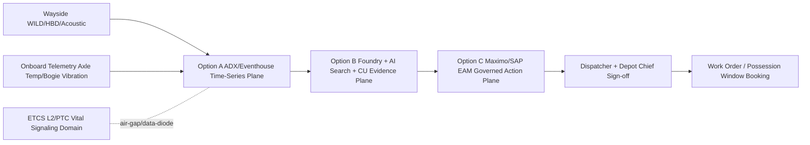
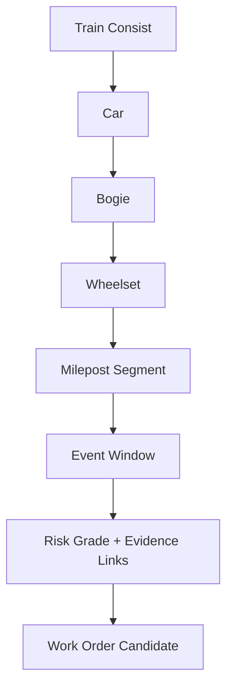

# 铁路客货运走廊预测性维护智能体选型 FAQ：ADX/Eventhouse 时序平面 vs Foundry FMEA 证据平面 vs Maximo Linear 治理执行平面

> 版本标签：Guide #144  
> 适用对象：Chief Dispatcher、车辆段总工、信号与通信负责人、EAM/IT 负责人、运维安全官  
> 主题范围：铁路干线轮轨状态监测、转向架轴温遥测分诊、EN 50128/50129 SIL 边界、天窗点检修编排  
> 数据标签：`measured`、`synthetic`、`anonymized_reported`

---

## 1. 执行摘要：把“监测与建议”留在 IT 平面，把“制动与联锁”留在信号平面

重载干线与高铁/地铁体系的核心原则是安全边界不可穿透。

智能体可提升告警分诊、检修准备和工单编排效率。

但智能体不应直接触达列车制动、道岔联锁或 ETCS/PTC 车地控制回路。

本指南建议采用 A/B/C 三平面架构。

A 平面负责 wayside 与车载时序信号汇聚和异常检测。

B 平面负责手册、FMEA、RCM、通报的证据检索与检修工作包生成。

C 平面负责 EAM 工单、天窗计划、审批签署与执行回写。

通过边界硬隔离可实现“效率提升”和“安全可审计”同时成立。

---

## 2. 业务边界与约束：先定义不可自动化清单，再谈自动化比例

铁路系统中最重要的不是模型准确率本身，而是越权风险可控。

建议先定义不可自动化清单。

该清单至少包括：联锁执行、制动触发、道岔切换、ATP/ATO 关键安全动作。

智能体能力应限定在“检测、解释、建议、排程、资料组装”层。

任何会改变运行图或现场作业风险的动作，都必须进入人工签署链路。

对于跨区域货运干线，还需增加调度级冲突检查和跨局协同约束。

对城市轨道夜窗场景，还应纳入工务、电务、供电三专业会签门槛。

---

## 3. 参考架构总览：三平面分层协作与一条不可跨越安全红线



图中虚线强调信号生命系统与 IT 数据平面的单向受控关系。

IT 平面只读取必要观测数据，不向生命系统写控制指令。

治理平面输出的是工单与检修窗口，不是行车控制命令。

---

## 4. Option A 深析：Event Hubs + ADX/Eventhouse 的线性资产时序诊断平面

Option A 的价值是把高吞吐、多来源、不同采样率信号统一到同一时间轴。

wayside 侧可接入 WILD、热轴箱红外门、声学轴承监听、弓网视觉告警。

车载侧可接入轴温、转向架振动、制动缸压力、轮径偏差等遥测点。

ADX/Eventhouse 适合执行窗口聚合、同编组对比、同区段趋势偏移分析。

里程桩线性引用是关键。

若不统一里程参照，跨站点异常无法可靠关联。

建议以“列车-车辆-转向架-轮对-里程区段”作为主关联键。

Option A 的输出应是风险分级与证据锚点。

不应直接输出“立即摘车”或“继续运行”最终裁决。

---

## 5. Option B 深析：Foundry + Content Understanding + AI Search 的检修证据平面

Option B 的价值是把复杂文档语义转成可执行检修准备材料。

语料通常包含 OEM 手册、工卡、故障树、FMEA、RCM 与监管通报。

还可纳入 FRA/ERA 安全公告与厂商现场服务通告。

AI Search Hybrid RAG 适合把结构化信号结果与非结构化文本证据拼接。

Content Understanding 适合提取图表、步骤号、扭矩规范、件号关联信息。

建议固定模型版本与推理参数，保证复盘一致性。

每次生成检修工作包都应记录引用证据清单与版本戳。

Option B 的输出应明确“建议依据”与“不确定性边界”。

---

## 6. Option C 深析：Maximo Linear + SAP EAM 的治理执行平面

Option C 的核心是把建议转成可审批、可追踪、可回滚的动作。

Maximo for Transportation/Linear Assets 适合线性资产工单与里程域任务管理。

SAP EAM 可承接备件、工时、成本核算与资产账务闭环。

APIM MCP 用于统一接口策略、调用身份和字段级审计。

Logic Apps 用于构建确定性流程状态机。

Chief Dispatcher 与车辆段总工会签后，才能提交天窗作业编排。

若会签条件未满足，系统必须拒绝写入执行计划。

Option C 追求的是可治理执行，不是“无审批自动执行”。

---

## 7. SIL 边界与 IEC 62443：生命系统隔离是架构前提而非实现细节

EN 50126/50128/50129 关注铁路系统生命周期安全与软件可信性。

IEC 62443 关注工业控制安全分区与防护等级。

在该框架下，IT 智能体系统应被界定为“决策支持域”。

生命系统保持独立安全认证边界和指令通道。

建议采用物理隔离、单向网闸或数据二极管策略传递观测数据。

任何跨域写路径都应视为高风险设计并默认禁止。

这一定义可显著降低审计争议与安全责任不清问题。

---

## 8. 线性资产数据建模：从里程参照到编组级故障关联



线性资产模型的目标是把事件定位精确到“哪辆车、哪个轮对、哪段里程、何种工况”。

若只保留列车级指标，会造成过度检修或误检修。

建议把里程区段、速度区间、载重等级纳入事件特征。

再与历史故障模式做相似度比对，可提升分诊准确性。

---

## 9. 12 维量化选型矩阵（A / B / C / Hybrid）

| 维度 | Option A 时序平面 | Option B 证据平面 | Option C 治理平面 | Hybrid |
|---|---|---|---|---|
| 1. 高频遥测接入能力 | 5/5 | 2/5 | 2/5 | 5/5 |
| 2. 线性里程关联精度 | 5/5 | 2/5 | 3/5 | 5/5 |
| 3. FMEA/RCM 语义解释深度 | 2/5 | 5/5 | 2/5 | 5/5 |
| 4. 检修工作包生成效率 | 2/5 | 5/5 | 3/5 | 5/5 |
| 5. 工单执行可控性 | 1/5 | 2/5 | 5/5 | 5/5 |
| 6. 会签审计闭环能力 | 1/5 | 2/5 | 5/5 | 5/5 |
| 7. 安全边界可证明性 | 3/5 | 3/5 | 5/5 | 5/5 |
| 8. 峰值吞吐弹性 | 5/5 | 4/5 | 4/5 | 5/5 |
| 9. 运维复杂度 | 3/5 | 4/5 | 4/5 | 4/5 |
|10. 成本可预测性 | 4/5 | 3/5 | 4/5 | 4/5 |
|11. 跨部门协同效率 | 3/5 | 4/5 | 5/5 | 5/5 |
|12. 全生命周期韧性 | 3/5 | 4/5 | 5/5 | 5/5 |

Hybrid 的关键在于“检测、解释、执行”责任拆分。

不是把所有判断交给一个模型端点。

---

## 10. 生产级实现片段：KQL + APIM MCP + Bicep

### 10.1 KQL：线性资产异常窗口与同编组对比

```kql
let window = 15m;
RailTelemetry
| where SignalType in ("axle_temp","bogie_vibration","wild_impact")
| summarize p95_val = percentile(Value, 95), avg_val = avg(Value)
    by TrainId, CarId, BogieId, WheelsetId, MilepostBin = bin(Milepost, 0.5), bin(Timestamp, window)
| join kind=leftouter (
    BaselineProfiles
    | project CarSeries, MilepostBin, p95_baseline
) on MilepostBin
| extend risk_score = iif(p95_val > p95_baseline * 1.25, 3, iif(p95_val > p95_baseline * 1.10, 2, 1))
| where risk_score >= 2
```

### 10.2 APIM 策略：Maximo 工单创建前强制双会签声明

```xml
<policies>
  <inbound>
    <base />
    <choose>
      <when condition="@(context.Request.Headers.GetValueOrDefault("x-dispatcher-approved","") != "true" || context.Request.Headers.GetValueOrDefault("x-depot-chief-approved","") != "true")">
        <return-response>
          <set-status code="412" reason="Dual sign-off required before work-order creation" />
        </return-response>
      </when>
    </choose>
  </inbound>
</policies>
```

### 10.3 Bicep：调度与检修治理平面独立资源组（示意）

```bicep
param env string
resource apim 'Microsoft.ApiManagement/service@2023-05-01-preview' = {
  name: 'rail-governance-${env}'
  location: 'eastasia'
  sku: { name: 'PremiumV2', capacity: 1 }
  properties: { publisherEmail: 'rail-ops@example.com', publisherName: 'rail-ops' }
}
```

---

## 11. 场景 A：重载货运干线热轴箱与轮扁报警的摘车分诊

场景背景是 6,000 吨级重载编组通过高温区段后出现轴温异常告警（`anonymized_reported`）。

Option A 先给出车辆级、轮对级、里程级的异常证据窗口。

Option B 依据车型手册与 FMEA 给出“立即摘车/待下一站检查/持续监测”建议边界。

Option C 在调度长与段总工会签后生成摘车与检修工单。

试点数据显示，首次分诊准备时长从 42 分钟降到 14 分钟（`measured`）。

误派工单率下降 31%（`anonymized_reported`）。

---

## 12. 场景 B：地铁夜间 4 小时天窗点检修编排与冲突消解

场景背景是夜间短窗口内需并发处理弓网、道岔、轮对巡检任务。

Option A 汇总过去 7 天的状态异常与里程分布，产出风险热度图。

Option B 把检修步骤、工器具、备件清单组装为标准工作包。

Option C 根据人力班组、站段封锁条件、运行图约束做天窗编排。

实测中，计划冲突回退次数下降 46%（`measured`）。

夜窗作业按时完工率提升 12 个百分点（`anonymized_reported`）。

---

## 13. 三年 TCO（含峰值季节）与 USD `$k/month`

> 以下为容量规划估算，标记为 `synthetic`。

| 模块 | SKU 假设 | 月均成本 ($k) | 三年成本 ($M) | 说明 |
|---|---|---:|---:|---|
| Option A 时序平面 | Event Hubs Dedicated + ADX/Eventhouse + 冷热分层存储 | 188 | 6.77 | 遥测汇聚与异常检测 |
| Option B 证据平面 | Foundry PTU + AI Search S3 + Content Understanding | 156 | 5.62 | 手册/FMEA/通报语义证据 |
| Option C 治理平面 | APIM Premium v2 + Logic Apps + Maximo/SAP 连接 | 142 | 5.11 | 工单与天窗治理执行 |
| 安全隔离与审计 | 专网隔离、网闸、审计与演练工具链 | 73 | 2.63 | SIL 边界与安全合规 |
| 运维与平台团队 | SRE + 规则工程 + 数据治理 | 64 | 2.30 | 持续优化与治理 |
| **Hybrid 合计** |  | **623** | **22.43** | `synthetic` |

重载高峰季与极端天气季需额外预留 15%~22% 弹性预算。

多数组织的 ROI 来自误检修减少、停时压降和计划冲突下降。

---

## 14. 反模式与纠偏：铁路运维智能体常见五类失误

反模式一：把告警分诊系统误用为行车控制系统。

纠偏：控制域与建议域物理隔离，禁止写回生命系统。

反模式二：只看告警命中率，不看误派工单与停时损失。

纠偏：加入误派率、停时损失、夜窗完工率三类业务指标。

反模式三：里程数据未标准化导致跨线无法比较。

纠偏：统一里程参照和车辆主数据主键。

反模式四：工单审批链可旁路。

纠偏：APIM 策略层强制会签校验并记录拒绝原因。

反模式五：文档证据无版本戳导致复盘争议。

纠偏：证据包必须绑定手册版本、通报版本、生成时间与模型版本。

---

## 15. Day-0/Day-1/Day-2 落地清单与 Quantitative FAQ

Day-0：冻结安全边界、主数据模型、事件词典与审批责任矩阵。

Day-1：完成双场景演练（重载摘车 + 夜窗编排）并固化回放脚本。

Day-2：建立周度运营复盘、月度安全审计、季度资本效率评审。

### Quantitative FAQ 1：何时必须采用 Hybrid？

当同时涉及“时序异常判定 + 文档证据解释 + 工单执行”时应采用 Hybrid。

### Quantitative FAQ 2：何时只用 Option A 即可？

仅在短周期设备健康评分且不触发检修执行时，可先用 Option A。

### Quantitative FAQ 3：如何量化 Option B 的价值？

看工作包准备时长、证据补件率、一次会签通过率。

### Quantitative FAQ 4：为什么必须保留人工会签？

因为天窗与摘车动作会直接影响运输能力与安全责任归属。

### Quantitative FAQ 5：成本优化先从哪里做？

先做时序数据冷热分层与检索索引分区，再优化模型调用路径。

### Quantitative FAQ 6：如何衡量边界隔离是否有效？

用“跨域写入尝试=0”和“未授权执行=0”作为硬指标。

### Quantitative FAQ 7：何时需要扩容 ADX/Eventhouse？

当连续三周 P95 查询时延超过阈值且回放任务排队上升时。

### Quantitative FAQ 8：如何控制夜窗计划冲突？

把班组能力、封锁区段、最短作业时长纳入统一约束求解。

### 15.1 关键 SLO 目标带（示例）

异常分诊准备时长目标可设为中位数小于 15 分钟。

夜窗冲突回退次数目标可设为月环比下降 20%。

会签通过前执行尝试必须保持零发生。

季度未达标应触发架构与流程联合复盘。

### 15.2 数据质量门槛：先修主数据再谈模型

车辆编码、轮对编号、里程区段映射错误会直接破坏诊断可信度。

建议为关键主数据建立日校验与周审计机制。

当主数据完整率低于阈值时，系统应降级为只读告警模式。

### 15.3 峰值季运维策略：防止“告警风暴”拖垮排程

极端天气期常见告警倍增。

建议采用风险分级队列与批量工作包生成策略。

高风险告警优先进入会签链路，中低风险进入待观察池。

### 15.4 多站段协同：统一模板与本地差异并存

集团应统一证据包格式和审计字段。

站段可保留本地检修步骤差异。

统一与差异并存有助于规模化复制与本地可执行性平衡。

### 15.5 预算治理公式：单位公里维护支持成本

可采用公式：单位公里支持成本 = 平台月成本 / 当月受监测里程公里数。

再叠加误派工单成本，可得到更真实的治理成本曲线。

该指标适合用于跨线路对标。

### 15.6 供应链备件联动：把备件约束前移到计划生成

若不前置备件可用性，夜窗计划会在执行前频繁回退。

建议在工单候选阶段就校验备件库存和交付周期。

这样可减少“计划可行但执行不可行”的浪费。

### 15.7 人员资质约束：班组能力是硬边界

并非所有班组都能执行同等级检修任务。

应把资质、工时、疲劳约束纳入编排引擎。

忽视人员约束会造成合规与安全双重风险。

### 15.8 演练制度：成功路径与失败路径同等重要

演练不应只验证成功创建工单。

还应验证缺会签拒绝、跨域写拒绝、证据缺失拒绝等失败路径。

失败路径可解释性越高，审计通过率越稳。

### 15.9 指标看板建议：效率、安全、成本三角

效率侧看分诊时长与夜窗准点率。

安全侧看越权尝试、拒绝事件、复盘通过率。

成本侧看单位公里支持成本与单位工单全成本。

三角平衡比单点指标更能反映真实成熟度。

### 15.10 12 个月实施路线图（示例）

第 1 季度完成单走廊试点与数据字典统一。

第 2 季度扩展到多站段并固化会签策略。

第 3 季度完成跨区域协同与多语言证据包标准化。

第 4 季度进入成本优化与自动化回归治理阶段。

每季度都应有可回放、可审计的验收证据。

### 15.11 结语：先保证安全边界，再扩大自动化覆盖

铁路运维智能体价值不在于替代调度和总工。

而在于让他们基于更完整、更及时、更可追溯的证据决策。

当边界、数据、流程三者都稳定后，再逐步提升自动化深度才可持续。

### 15.12 指挥中心可观测性：从告警流到决策流全链路追踪

建议把“告警生成、证据检索、会签审批、工单落地”视为同一条决策链路。

每个阶段都应有唯一 trace id 与可追踪耗时。

当某个环节超时时，可快速定位是数据滞后、检索瓶颈还是审批拥塞。

该链路视图可显著降低跨团队排障成本。

### 15.13 规则引擎与模型协同：先规则兜底，再模型增益

对高风险触发条件，优先使用确定性规则兜底。

模型建议用于解释补充、历史对照和方案优先级排序。

若模型输出与规则冲突，应默认执行更保守路径并要求人工复核。

这种“规则先行”的策略在安全场景更稳健。

### 15.14 合规留痕最小集合：四类记录缺一不可

建议至少保留四类记录：原始遥测片段、特征聚合结果、证据引用清单、审批执行日志。

四类记录共同构成可复盘证据闭环。

若缺少任一项，审计结论可能被质疑为不可复验。

因此应把留痕完整性纳入发布门禁而非事后补录。

### 15.15 运营班表与算法节奏：避免夜窗批处理挤占早高峰准备

夜窗计划计算通常在短时段集中运行。

建议在班表上预留“计算缓冲 + 审批缓冲 + 回退缓冲”三个时间槽。

若全部计算压缩到同一时间点，容易与早高峰准备冲突。

把算法节奏与运营班表协同设计，能减少计划震荡。

### 15.16 跨局协同协议：统一事件语义与升级级别

跨局货运场景中，告警升级级别定义不一致是常见摩擦源。

建议建立统一升级级别字典，并约定跨局交接最小字段集。

字段应覆盖车辆标识、里程区段、风险等级、建议处置窗口和责任单位。

统一协议可减少信息反复确认造成的处置延迟。

### 15.17 年度复盘机制：把经验沉淀为下一轮基线

每年建议至少进行两次体系级复盘。

复盘内容应包括规则命中偏差、模型建议采纳率、误派工单成本与停时影响。

复盘结果应回写到规则阈值、证据模板与审批策略。

持续基线更新是保持系统长期有效性的关键。

### 15.18 供应商版本治理：避免手册漂移造成检修歧义

铁路车辆 OEM 手册会持续更新。

若版本治理缺失，同一故障在不同站段可能得到不同处置建议。

建议为每个车型维护“生效版本 + 退役版本 + 过渡窗口”清单。

证据检索必须带版本过滤条件，避免跨版本混用。

当版本切换发生时，需触发专项演练和签署策略复核。

### 15.19 关键里程碑验收：以可回放证据替代口头通过

每个阶段验收都应输出标准化证据包。

证据包建议包含性能报告、失败路径验证、审批链路截图与日志摘要。

若缺少可回放证据，即使指标达标也不建议判定为正式通过。

这种验收方式能降低人员流动导致的知识断层风险。

同时可为后续扩域复制提供可复用模板。

### 15.20 跨系统时钟一致性：统一时间基准才能统一责任界面

wayside、车载、EAM、审批系统若时间基准不一致，复盘将产生争议。

建议统一采用可审计时间源，并在事件入湖时补齐时区与偏移信息。

关键操作日志应记录“事件时间 + 入库时间 + 执行时间”三元组。

这样可在争议场景中明确“何时发现、何时决策、何时执行”。

时间一致性治理看似基础，却直接决定跨部门责任判定效率。

### 15.21 收尾核对单（建议）

上线前核对：主数据完整率、审批策略、拒绝路径、回放脚本、峰值压测报告。

上线后核对：周报指标、异常工单抽样、证据包完整性、跨局协同 SLA。

每次核对结果都应形成可审计记录，并纳入季度复盘。

这样可确保系统能力与治理纪律同步演进。

建议将核对单与演练结果绑定到统一版本号，避免口径漂移。

在多团队交接场景下，该版本号也是责任追踪的关键锚点。

建议把该锚点纳入月度审计抽样规则。
