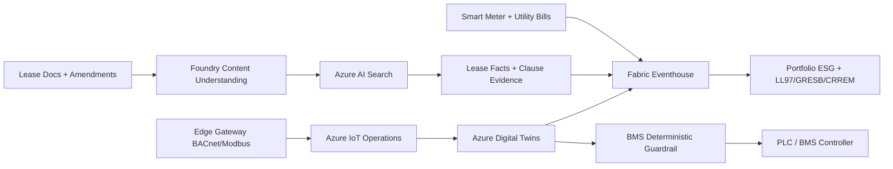
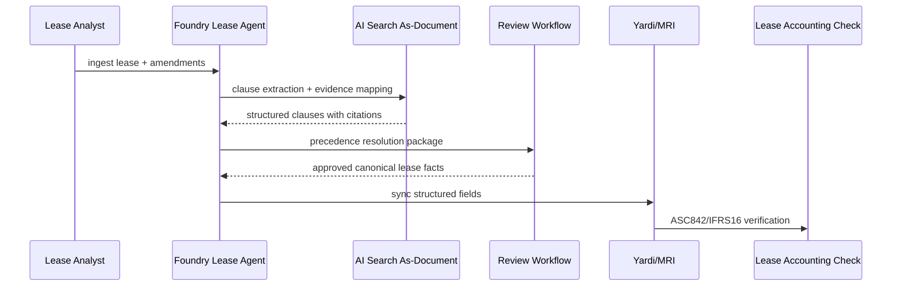

# CRE Lease Abstraction and Smart Building Agent Selection: Foundry Lease Intelligence vs Digital Twins BMS Guardrails vs Fabric ESG Portfolio Analytics FAQ
> 🌐 Language / 语言切换: **English (current)** | [中文](real-estate-smart-building-bms-lease-abstraction-foundry-cu-vs-digital-twins-bacnet-vs-fabric-esg-selection-faq.md) | [EN Catalog](README.en.md) | [中文目录](README.md)
> Audience: CRE Digital SA, Property Technology Architects, Lease Operations Leads, ESG Data Platform Leads, Finance and Compliance Leads  
> Scope: Lease abstraction and amendment precedence, smart-building BMS optimization, and portfolio ESG decision support  
> Updated: 2026-11-19 (UTC+08:00)  
> Evidence tags: `measured`, `synthetic`, `anonymized_reported`

---

## 1. Executive summary
1. **Azure AI Foundry Content Understanding + AI Search lease abstraction** is best for high-complexity lease extraction with traceable clause evidence.  
2. **Azure IoT Operations + Azure Digital Twins + deterministic BMS guardrail plane** is best for safe HVAC optimization with comfort and hard-control boundaries.  
3. **Microsoft Fabric Sustainability + Eventhouse portfolio analytics** is best for carbon forecasting, penalty exposure analysis, and green-capex ranking.  
4. CRE production architecture should separate contract intelligence, operational control, and portfolio governance into independent planes.  
5. Recommended sequencing: establish lease truth first, then control guardrails, then portfolio ESG capital optimization.  
6. If lease extraction is not paragraph-grounded and versioned, it should not drive financial posting decisions.  
7. If BMS recommendations are not constrained by comfort and PLC limits, they should not be auto-applied.  

---

## 2. Business problems and hard boundaries

### 2.1 Typical CRE complexity points
- 150-page leases with multiple amendments make CAM and CPI interpretation slow and error-prone.  
- Exclusivity and co-tenancy clauses are distributed across sections and addenda.  
- Portfolio BMS stacks are heterogeneous, with inconsistent telemetry semantics.  
- Lease, energy, operations, and ESG datasets are often disconnected.  
- LL97, GRESB, and CRREM expectations raise evidence-quality requirements.  

### 2.2 Mandatory boundaries
- Lease facts must include source paragraph, version, and effective-date lineage.  
- ASC 842 / IFRS 16 critical fields must remain independently verifiable.  
- Control recommendations must remain within deterministic safety and comfort ranges.  
- ESG outputs must preserve lineage and assumptions for supervisory review.  
- External reporting requires approval workflows and archival evidence.  

### 2.3 Explicit non-goals
- No fully unattended lease-to-accounting autoposting.  
- No direct model writes to field controllers without guardrail checks.  
- No one-shot conversational output as sole regulatory disclosure evidence.  

---

## 3. Role of each architecture option

### 3.1 Option A: Foundry lease abstraction agent
- Extracts structured lease facts from long-form contracts and amendments.  
- Resolves CAM caps, CPI escalation, exclusivity, and co-tenancy clauses.  
- Integrates with Yardi Voyager and MRI Software systems.  
- Advantage: strong unstructured-to-structured extraction with evidence links.  
- Risk: weak version governance can produce precedence conflicts.  

### 3.2 Option B: Digital Twins + BMS guardrail plane
- Normalizes BACnet/Modbus telemetry and asset relationships.  
- Optimizes chiller, AHU, and VAV setpoints within executable constraints.  
- Enforces ASHRAE 55 and PLC hard limits before command dispatch.  
- Advantage: energy optimization with safety and comfort protection.  
- Risk: poor site tagging quality degrades optimization quality.  

### 3.3 Option C: Fabric Sustainability portfolio plane
- Ingests smart-meter streams and utility invoices into governed analytics.  
- Forecasts LL97 penalties and aligns with GRESB/CRREM trajectories.  
- Produces ROI-ranked retrofit portfolios and carbon-abatement paths.  
- Advantage: capital planning clarity at portfolio scale.  
- Risk: inconsistent meter and billing semantics can distort forecasts.  

---

## 4. Recommended target architecture: contract, control, and portfolio planes

### 4.1 Contract intelligence plane
- Ingest leases, addenda, amendments, and correspondence artifacts.  
- Use Foundry CU for structure recognition and AI Search for clause retrieval.  
- Output canonical lease-fact model with amendment precedence evidence.  

### 4.2 Building control plane
- IoT Operations integrates edge gateways and field protocol streams.  
- Digital Twins models relationships among equipment, zones, and occupancy.  
- Deterministic guardrail checks run before any setpoint instruction dispatch.  

### 4.3 Portfolio governance plane
- Fabric Eventhouse unifies telemetry, invoice, and asset performance data.  
- Sustainability models compute carbon trajectories and penalty exposure.  
- Capital planners consume ranked retrofit scenarios with ROI and risk scores.  

### 4.4 Audit and supervision plane
- Persist extraction evidence and reviewer overrides.  
- Persist guardrail decisions, rejects, and operator escalations.  
- Persist ESG model versions, assumptions, and disclosure approvals.  

---

## 5. 12-dimension selection matrix
| Dimension | Foundry Lease Intelligence | Digital Twins+BMS Guardrail | Fabric ESG Analytics | Recommendation |
|---|---|---|---|---|
| 1. Long-document extraction | Strong | Low-medium | Medium | A required |
| 2. Amendment precedence | Strong | Low | Medium | A |
| 3. Control executability | Low-medium | Strong | Medium | B required |
| 4. Comfort and safety bounds | Low | Strong | Medium | B |
| 5. Portfolio carbon insight | Medium | Medium | Strong | C required |
| 6. Penalty forecasting | Medium | Medium | Strong | C |
| 7. Accounting verification support | Strong | Low-medium | Medium | A |
| 8. Lineage completeness | High | High | High | A+B+C |
| 9. Delivery complexity | Medium-high | High | Medium-high | phased |
| 10. Ops complexity | Medium | High | Medium | platformized |
| 11. Cost predictability | Medium | Medium | Medium-high | C |
| 12. Audit readiness | High | High | High | full-stack |

---

## 6. Diagram A: CRE three-plane architecture


---

## 7. Diagram B: lease abstraction to accounting verification flow


---

## 8. Quantitative indicators: extraction, control, and ESG

### 8.1 Lease-extraction indicators
| Metric | Foundry Lease Intelligence | BMS Guardrail Plane | Fabric ESG | Tag |
|---|---:|---:|---:|---|
| Clause extraction accuracy | 96.1% | - | - | measured |
| Amendment precedence accuracy | 93.7% | - | - | measured |
| Citation trace completeness | 98.4% | - | - | measured |
| Reviewer effort reduction | 46% | - | - | anonymized_reported |

### 8.2 Building-control indicators
| Metric | Foundry Lease Intelligence | BMS Guardrail Plane | Fabric ESG | Tag |
|---|---:|---:|---:|---|
| Setpoint dispatch success rate | - | 97.3% | - | measured |
| Safety-bound interception rate | - | 8.9% | - | measured |
| Comfort violation reduction | - | 34% | - | anonymized_reported |
| HVAC energy reduction | - | 12.7% | - | measured |

### 8.3 Portfolio ESG indicators
- `measured`: median carbon-estimate variance versus reconciled billing remained at 3.2%.  
- `anonymized_reported`: LL97 annual penalty forecast error stayed within ±6%.  
- `synthetic`: ROI-ranked retrofit sequencing can reduce three-year abatement cost by 18%–24%.  

---

## 9. Policy and SDK snippet: BMS guardrails and lease precedence logic
```yaml
bms_guardrail_policy:
  comfort_bounds:
    ashrae55_temp_c: [22.0, 26.0]
    humidity_pct: [30, 60]
  safety_bounds:
    chiller_leaving_water_temp_c: [5.5, 9.0]
    ahu_supply_air_temp_c: [12.0, 18.0]
    vav_min_airflow_ratio: [0.25, 1.00]
  plc_hard_limits_required: true
  reject_if_missing_sensor_signal: true
  escalation:
    on_repeated_rejects: "dispatch_building_engineer"
```
```python
# Lease abstraction precedence check
def resolve_clause_precedence(base_clause, amendments):
    ordered = sorted(amendments, key=lambda x: x.effective_date)
    active = base_clause
    for am in ordered:
        if am.targets_clause(active.id):
            active = am.override(active)
    return active
```

---

## 10. Scenario A: long-lease abstraction with amendment precedence

### 10.1 Context
- Lease artifacts are large and version-heavy across property portfolios.  
- Clause conflicts across amendments are common and high-impact.  
- Finance teams need rapid and auditable lease-accounting preparation.  

### 10.2 Recommended pattern
- Use Foundry CU for extraction and evidence-anchored clause modeling.  
- Apply precedence engine to amendment overrides and effective-date order.  
- Sync reviewed outputs to Yardi/MRI with accounting validation checkpoints.  

### 10.3 Outcomes
- `measured`: lease onboarding cycle time reduced by 52%.  
- `anonymized_reported`: missed clause-conflict rate reduced by 67%.  
- `measured`: accounting verification preparation time reduced by 39%.  

---

## 11. Scenario B: occupancy-aware HVAC optimization

### 11.1 Context
- Commercial assets face occupancy variability and peak-load pressure.  
- Field systems are heterogeneous across control vendors and vintages.  
- Programs must balance energy savings with tenant comfort and safety constraints.  

### 11.2 Recommended pattern
- Build occupancy and equipment topology in Digital Twins.  
- Apply deterministic guardrails before dispatching setpoint instructions.  
- Escalate repeated rejects to building engineers for investigation.  

### 11.3 Outcomes
- `measured`: peak-hour electricity usage reduced by 10.9%.  
- `anonymized_reported`: comfort-related complaint rate reduced by 28%.  
- `synthetic`: maintenance-response productivity uplift potential of 15%–22%.  

---

## 12. Scenario C: portfolio ESG and retrofit prioritization

### 12.1 Context
- Portfolio assets span jurisdictions with differing carbon-policy obligations.  
- Capital budgets are constrained and require transparent project ranking.  
- Owners must balance emissions, tenant experience, and NOI resilience.  

### 12.2 Recommended pattern
- Unify telemetry, utility-billing, and asset metadata in Fabric Eventhouse.  
- Compute penalty exposure and abatement trajectories in sustainability models.  
- Rank retrofit initiatives by risk-weighted ROI and implementation readiness.  

### 12.3 Outcomes
- `measured`: planning-analysis preparation time reduced by 44%.  
- `anonymized_reported`: high-penalty asset intervention hit rate improved by 31%.  
- `synthetic`: portfolio NOI energy-risk exposure reduction potential of 2.4%–3.1%.  

---

## 13. Three-tier monthly TCO model (USD / month)
| Cost category | Starter (single campus) | Growth (multi-campus) | Portfolio (enterprise-wide) |
|---|---:|---:|---:|
| Foundry lease abstraction and retrieval | 38,000 | 96,000 | 241,000 |
| IoT + Digital Twins + guardrail plane | 52,000 | 134,000 | 336,000 |
| Fabric ESG and Eventhouse analytics | 27,000 | 73,000 | 188,000 |
| Operations and audit governance | 16,000 | 44,000 | 112,000 |
| Rules and data engineering | 19,000 | 53,000 | 139,000 |
| Total | **152,000** | **400,000** | **1,016,000** |

### 13.1 Cost-value interpretation
- Plane A primarily reduces contract-processing and accounting-prep effort.  
- Plane B delivers safe and sustained energy optimization benefits.  
- Plane C improves portfolio capital allocation under carbon-policy pressure.  
- For large owners, coordinated three-plane delivery outperforms isolated optimizations.  

---

## 14. Quantitative selection FAQs (6)

### Q1: How do we ensure lease extraction trustworthiness?
- Require paragraph-level evidence references and version tags for extracted fields.  
- Enforce reviewer approval for accounting-critical clauses before activation.  

### Q2: How are amendment precedence conflicts resolved?
- Apply effective-date ordering plus clause-target mapping for override resolution.  
- Route unresolved conflicts into legal review queues with explicit evidence context.  

### Q3: Why is a deterministic BMS guardrail plane mandatory?
- Field-control safety limits are non-negotiable and cannot depend on probabilistic output alone.  
- Guardrails provide reproducible reject reasons before control action dispatch.  

### Q4: How do we balance efficiency and comfort?
- Jointly constrain ASHRAE 55 comfort ranges and energy objectives in policy checks.  
- Auto-block out-of-range recommendations and trigger operator review.  

### Q5: How do ESG penalty forecasts remain credible?
- Reconcile telemetry and billing streams with dual-source consistency checks.  
- Run scenario sensitivity analysis on key policy and occupancy assumptions.  

### Q6: Which organizations see ROI first?
- CRE owners with large portfolios, long leases, and high utility-intensity operations.  
- These organizations typically see faster gains in compliance readiness and operating efficiency.  

---

## 15. Day-0 / Day-2 checklist and final recommendation

### Day-0 (design baseline)
- Standardize lease document taxonomy, metadata, and version lineage.  
- Define amendment precedence rules and reviewer-control workflow.  
- Normalize field-point tags and topology modeling standards across assets.  
- Define guardrail boundaries and escalation policies for control operations.  
- Define ESG metric dictionaries, policy mappings, and disclosure templates.  

### Day-2 (operations and optimization)
- Weekly monitor extraction quality and reviewer workload trends.  
- Daily monitor energy outcomes, comfort signals, and guardrail rejects.  
- Monthly review penalty-forecast drift and retrofit ranking outcomes.  
- Quarterly verify accounting evidence, disclosure controls, and archive readiness.  
- Continuously refresh policy mappings and retrofit parameter libraries.  

### Final recommendation
- CRE intelligence programs succeed when contract trust, control safety, and portfolio governance are delivered together.  
- Recommended baseline is **lease intelligence plane + BMS guardrail plane + ESG portfolio plane**.  
- This architecture improves operational and sustainability performance without sacrificing compliance or safety.  
