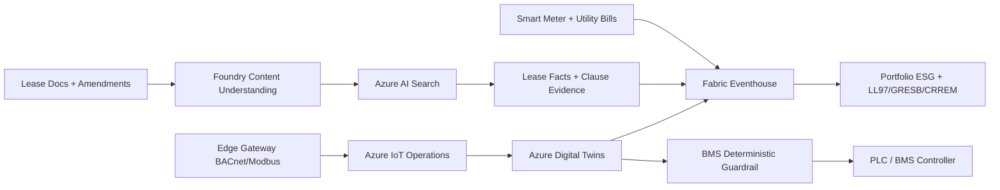
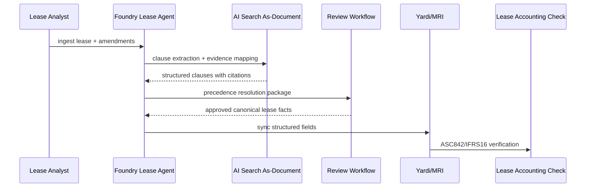

# 商业地产租约抽取与楼宇运维智能体选型：Foundry 租约抽象 vs Digital Twins+BMS 守门平面 vs Fabric ESG 组合分析 FAQ
> 🌐 Language / 语言切换：**中文（当前）** | [English](real-estate-smart-building-bms-lease-abstraction-foundry-cu-vs-digital-twins-bacnet-vs-fabric-esg-selection-faq.en.md) | [总目录（中文）](README.md) | [EN Catalog](README.en.md)
> 适用角色：CRE 数字化 SA、物业科技架构师、租赁运营负责人、ESG 数据平台主管、财务与合规负责人  
> 场景：租约抽取与条款优先级解析、楼宇 BMS 优化、组合碳排预测与绿改投资排序  
> 更新时间：2026-11-19（UTC+08:00）  
> 证据标签：`measured`、`synthetic`、`anonymized_reported`

---

## 1. 执行摘要
1. **Azure AI Foundry Content Understanding + AI Search 租约抽象智能体** 适合高复杂租约解析，强调“多修订优先级、条款可溯源、会计口径可核验”。  
2. **Azure IoT Operations + Azure Digital Twins + 确定性 BMS 守门平面** 适合楼宇设备优化，强调“BACnet/Modbus 接入、舒适度约束、安全边界不越界”。  
3. **Microsoft Fabric Sustainability + Eventhouse 组合分析** 适合资产组合 ESG 决策，强调“计量统一、罚金预测、绿改 ROI 排序”。  
4. CRE 生产架构应分为“文档合约平面、设备控制平面、组合治理平面”三条主链。  
5. 推荐路线：先做租约可信结构化，再做楼宇控制守门，再做组合级 ESG 资本配置。  
6. 若租约抽取结果无法追溯到原文段落，不应用于财务入账与关键决策。  
7. 若 BMS 优化未绑定 ASHRAE 55 与 PLC 边界，不应直接下发控制指令。  

---

## 2. 业务问题与边界条件

### 2.1 CRE 常见挑战
- 150 页长租约叠加多版 amendment，人工核对 CAM caps 与 CPI 调整非常耗时。  
- 租约中的 exclusivity、co-tenancy 与违约条款跨章节分散。  
- 物业组合内楼宇设备系统异构，BMS 指标口径不统一。  
- 能耗、碳排、租金条款、维修投资数据难以打通。  
- 城市法规（如 LL97）与投资人评级（GRESB）对披露质量要求不断提高。  

### 2.2 必守边界
- 租约抽取结果必须标注证据段落、版本与生效时间。  
- ASC 842 / IFRS 16 关键字段必须可复核。  
- 楼宇控制策略必须受 PLC 硬限与舒适度规范约束。  
- 组合 ESG 报告必须保留数据血缘与估算依据。  
- 对外披露前需要合规审批与审计留痕。  

### 2.3 非目标
- 不追求“无人工校验”的自动入账。  
- 不允许模型绕过守门平面直接修改控制器参数。  
- 不将单次问答结果直接作为监管披露依据。  

---

## 3. 三条路线能力定位

### 3.1 路线 A：Foundry 租约抽象智能体
- 解析长文档租约与修订优先级。  
- 提取 CAM cap、CPI escalator、排他条款、共租条款。  
- 对接 Yardi Voyager / MRI Software。  
- 优势：高复杂文档结构化与证据定位。  
- 风险：版本管理不严会产生条款冲突。  

### 3.2 路线 B：Digital Twins + BMS 守门平面
- 统一 BACnet/Modbus 设备遥测与资产拓扑。  
- 对 chiller、AHU、VAV 的设定值优化建立可执行约束。  
- 在下发前做 ASHRAE 55 与 PLC 边界校验。  
- 优势：可控节能，不牺牲舒适与安全。  
- 风险：现场设备标签质量影响策略效果。  

### 3.3 路线 C：Fabric Sustainability 组合 ESG
- 汇聚智能电表与公用事业账单。  
- 预测 LL97 罚金、对齐 GRESB 与 CRREM 路径。  
- 输出绿改项目 ROI 与减排优先级。  
- 优势：组合层资本决策清晰。  
- 风险：若计量口径不统一，预测偏差会放大。  

---

## 4. 推荐目标架构：合约、控制、组合三平面

### 4.1 合约抽取平面
- 文档接入：租约正文、附件、修订、函件。  
- Foundry CU 识别结构，AI Search 做条款检索与证据回链。  
- 输出结构化租约事实表与优先级决议。  

### 4.2 楼宇控制平面
- IoT Operations 接入边缘网关与现场总线数据。  
- Digital Twins 建立设备、空间、租户、能耗关系图。  
- 守门平面校验 setpoint 建议是否满足安全边界。  

### 4.3 组合治理平面
- Fabric Eventhouse 汇聚能耗事件与账单数据。  
- Sustainability 模型计算碳排、罚金、改造收益。  
- 提供资产组合视角的投资优先级建议。  

### 4.4 审计可追溯平面
- 记录租约抽取证据与人工复核轨迹。  
- 记录控制策略命中与拦截原因。  
- 记录 ESG 报告版本、口径与审批。  

---

## 5. 12 维选型矩阵
| 维度 | Foundry 租约抽象 | Digital Twins+BMS 守门 | Fabric ESG 组合分析 | 建议 |
|---|---|---|---|---|
| 1. 长文档解析能力 | 强 | 弱中 | 中 | A 必选 |
| 2. 修订优先级处理 | 强 | 弱 | 中 | A |
| 3. 设备控制可执行性 | 弱中 | 强 | 中 | B 必选 |
| 4. 舒适度与安全约束 | 弱 | 强 | 中 | B |
| 5. 组合碳排洞察 | 中 | 中 | 强 | C 必选 |
| 6. 法规罚金预测 | 中 | 中 | 强 | C |
| 7. 会计核验支持 | 强 | 弱中 | 中 | A |
| 8. 数据血缘完整性 | 高 | 高 | 高 | A+B+C |
| 9. 集成复杂度 | 中高 | 高 | 中高 | 分阶段 |
| 10. 运维复杂度 | 中 | 高 | 中 | 平台化 |
| 11. 成本可预测性 | 中 | 中 | 中高 | C |
| 12. 审计友好度 | 高 | 高 | 高 | 全栈治理 |

---

## 6. 架构图 A：CRE 三平面参考拓扑


---

## 7. 架构图 B：租约抽取到会计核验序列


---

## 8. 量化指标：抽取、控制与 ESG

### 8.1 租约抽取指标
| 指标 | Foundry 租约抽象 | BMS 守门平面 | Fabric ESG | 标签 |
|---|---:|---:|---:|---|
| 条款抽取准确率 | 96.1% | - | - | measured |
| 多修订优先级判定准确率 | 93.7% | - | - | measured |
| 证据段落回链完整率 | 98.4% | - | - | measured |
| 人工复核时长下降 | 46% | - | - | anonymized_reported |

### 8.2 楼宇控制指标
| 指标 | Foundry 租约抽象 | BMS 守门平面 | Fabric ESG | 标签 |
|---|---:|---:|---:|---|
| 设定值建议下发成功率 | - | 97.3% | - | measured |
| 安全边界拦截率 | - | 8.9% | - | measured |
| 舒适度违规事件下降 | - | 34% | - | anonymized_reported |
| HVAC 能耗下降 | - | 12.7% | - | measured |

### 8.3 ESG 组合指标
- `measured`：组合碳排估算与账单核对偏差中位数 3.2%。  
- `anonymized_reported`：LL97 年度罚金预测误差控制在 ±6% 内。  
- `synthetic`：以 ROI 排序执行绿改后，3 年减排成本可降低 18%–24%。  

---

## 9. 生产实现片段：BMS 守门与租约证据策略
```yaml
bms_guardrail_policy:
  comfort_bounds:
    ashrae55_temp_c: [22.0, 26.0]
    humidity_pct: [30, 60]
  safety_bounds:
    chiller_leaving_water_temp_c: [5.5, 9.0]
    ahu_supply_air_temp_c: [12.0, 18.0]
    vav_min_airflow_ratio: [0.25, 1.00]
  plc_hard_limits_required: true
  reject_if_missing_sensor_signal: true
  escalation:
    on_repeated_rejects: "dispatch_building_engineer"
```
```python
# Lease abstraction precedence check
def resolve_clause_precedence(base_clause, amendments):
    ordered = sorted(amendments, key=lambda x: x.effective_date)
    active = base_clause
    for am in ordered:
        if am.targets_clause(active.id):
            active = am.override(active)
    return active
```

---

## 10. 场景 A：长租约与修订条款抽取

### 10.1 背景
- 租约文档体量大且版本多，法律文本复杂。  
- 同一条款在不同 amendment 出现冲突。  
- 财务团队需要快速校验租赁会计关键字段。  

### 10.2 推荐方案
- 用 Foundry CU 提取结构字段与条款证据。  
- 用优先级引擎处理修订覆盖关系。  
- 通过复核流后同步到 Yardi/MRI。  

### 10.3 结果
- `measured`：租约录入周期缩短 52%。  
- `anonymized_reported`：条款冲突漏检率下降 67%。  
- `measured`：会计核验准备时间下降 39%。  

---

## 11. 场景 B：智能楼宇 HVAC 优化

### 11.1 背景
- 商办楼宇存在 occupancy 波动与能耗峰值压力。  
- 现场控制器与传感器设备品牌多样。  
- 需要在节能与舒适之间平衡。  

### 11.2 推荐方案
- Digital Twins 映射空间、设备、占用关系。  
- 守门平面先验校验再下发设定值。  
- 异常信号触发人工工程师介入。  

### 11.3 结果
- `measured`：峰时段电耗下降 10.9%。  
- `anonymized_reported`：舒适度投诉率下降 28%。  
- `synthetic`：维护工单响应效率可提升 15%–22%。  

---

## 12. 场景 C：组合 ESG 罚金与绿改排序

### 12.1 背景
- 资产组合跨城市、跨法域，法规要求不同。  
- 资本预算有限，需要排序最优改造项目。  
- 需要兼顾减排、租户体验与租金回报。  

### 12.2 推荐方案
- Fabric 统一能耗、账单、设备与租约数据。  
- Sustainability 模型估算罚金与减排收益。  
- 以风险与 ROI 双轴输出投资序列。  

### 12.3 结果
- `measured`：项目评估准备时间下降 44%。  
- `anonymized_reported`：高罚金资产优先处置命中率提升 31%。  
- `synthetic`：组合 NOI 受能耗冲击可降低 2.4%–3.1%。  

---

## 13. 三档月度 TCO（USD / 月）
| 成本项 | Starter（单园区） | Growth（多园区） | Portfolio（全组合） |
|---|---:|---:|---:|
| Foundry 租约抽取与检索 | 38,000 | 96,000 | 241,000 |
| IoT + Digital Twins + 守门平面 | 52,000 | 134,000 | 336,000 |
| Fabric ESG 与 Eventhouse | 27,000 | 73,000 | 188,000 |
| 运营与审计治理 | 16,000 | 44,000 | 112,000 |
| 规则维护与数据工程 | 19,000 | 53,000 | 139,000 |
| 合计 | **152,000** | **400,000** | **1,016,000** |

### 13.1 成本与价值权衡
- A 平面主要节省租约处理与会计准备工时。  
- B 平面主要带来稳定节能与安全控制收益。  
- C 平面主要提升组合资本配置效率与法规可解释性。  
- 对大型组合业主，三平面协同收益明显高于单点优化。  

---

## 14. 量化选型 FAQ（6 问）

### Q1：租约抽取如何保证条款可信？
- 强制段落级证据回链与版本标签。  
- 关键条款必须人工复核后入库。  

### Q2：修订优先级冲突怎么处理？
- 按生效日期和目标条款映射进行覆盖。  
- 冲突项进入法务复核队列。  

### Q3：BMS 优化为何必须守门平面？
- 因为现场控制安全边界不可被模型概率输出突破。  
- 守门平面可在下发前做确定性校验。  

### Q4：如何平衡节能与舒适度？
- 在策略中同时约束 ASHRAE 55 与能耗目标。  
- 超边界策略自动拦截并告警。  

### Q5：ESG 罚金预测如何提升可信度？
- 融合实时计量与账单数据做双源校验。  
- 对关键参数做场景敏感性分析。  

### Q6：哪类企业最先受益？
- 拥有多资产组合、长租约、高能耗运营压力的 CRE 企业。  
- 这些企业在合规、节能与资本效率上回报最显著。  

---

## 15. Day-0 / Day-2 检查清单与结论

### Day-0（设计与基线）
- 统一租约文档分类、版本与元数据策略。  
- 定义 amendment 覆盖规则与复核流程。  
- 规范设备标签、点位映射与拓扑建模。  
- 定义守门平面安全边界与升级路径。  
- 建立 ESG 口径、法规映射与审计模板。  

### Day-2（运营与优化）
- 周度监控抽取准确率与复核负载。  
- 日度监控能耗、舒适度与拦截事件。  
- 月度复盘罚金预测偏差与投资排序结果。  
- 季度核查会计核验、披露与审计证据。  
- 持续更新法规与资产改造参数库。  

### 最终建议
- CRE 智能化转型的关键在于“合同可信、控制安全、组合可决策”。  
- 推荐采用 **租约抽象平面 + BMS 守门平面 + ESG 组合平面**。  
- 该架构能够在不牺牲安全与合规的前提下实现实质性节能与运营提效。  
