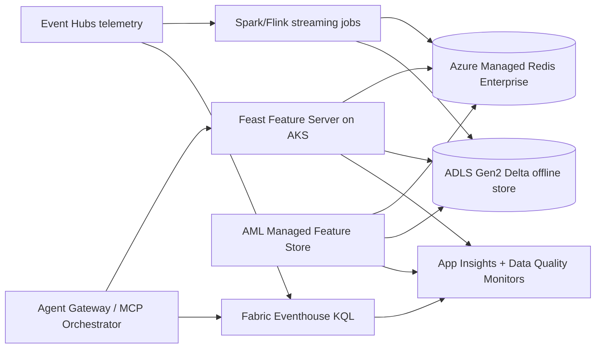
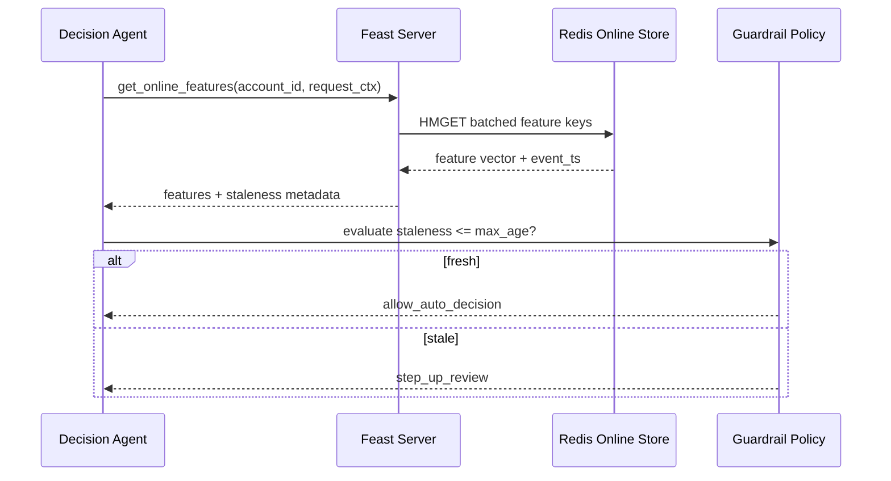

# Enterprise Real-Time Agent Feature Context Serving Selection FAQ on Azure: `Feast + Redis + Event Hubs` vs `Fabric Eventhouse + OneLake` vs `Azure ML Managed Feature Store`

## 1. Executive Summary: Real-Time Agent Quality Depends on Fresh Structured Context More Than Extra Prompt Tokens

Most enterprise agent programs fail context quality before they fail model quality.
The root cause is stale or skewed structured signals.
Teams often hydrate prompts through serial microservice fan-out.
That creates `300-500 ms` tail latency and unstable feature consistency.
For transactional decision agents, the required target is different.
You need sub-`10 ms` online feature serving for critical velocity/risk context.
You also need point-in-time historical reproducibility for offline training and evaluation.
On Azure, architecture choices usually converge into four lanes.
Lane A is open-source `Feast` on AKS with `Azure Managed Redis Enterprise` online store and streaming materialization from `Event Hubs` via Spark/Flink.
Lane B is `Microsoft Fabric Eventstreams -> Eventhouse (KQL) -> OneLake` for query-driven real-time aggregates with minimal custom serving infrastructure.
Lane C is `Azure ML Managed Feature Store` for governance-first MLOps and enterprise lineage control with managed materialization.
Lane D is request-time transformation (`OnDemandFeatureView` and lightweight UDFs) to combine live request attributes with precomputed aggregates safely.
The winning design is usually layered.
Use Feast/Redis where sub-`10 ms` online retrieval is mandatory.
Use Fabric Eventhouse for rich time-window analytics where `35-80 ms` is acceptable.
Use AML Feature Store for catalog, governance, and controlled cross-BU sharing.
## 2. Problem Boundary: The Real Risk Is Online/Offline Skew and OLTP Fan-Out Storms, Not Raw Throughput Alone

In enterprise agent systems, one business turn can trigger many context lookups.
If those lookups call `12` downstream services serially, tail latency can exceed `480 ms`.
That is unacceptable for instant decision workflows.
Another silent failure is training-serving skew.
Offline training features are frequently built with leakage-prone joins.
Online serving features are built from different code paths and freshness windows.
The model appears excellent in offline evaluation and underperforms in production.
Without strict `AS OF` point-in-time joins, teams can accidentally include future signals.
That can inflate offline accuracy by double-digit percentages and hide deployment risk.
Therefore, architecture must satisfy four invariants.
Invariant 1: one feature definition surface for online and offline.
Invariant 2: deterministic event-time semantics with staleness budgets.
Invariant 3: bounded online retrieval latency under burst traffic.
Invariant 4: lineage and replayability for audit and incident debugging.
## 3. Option Map: What Each Architecture Solves and What It Does Not

**Option A: Feast + Redis + Event Hubs + Spark/Flink + Delta (ADLS Gen2)**
Best when you need strict online serving speed and explicit feature definitions shared across online and historical retrieval.
It excels at low-latency key-value feature serving and deterministic point-in-time dataset reconstruction.
**Option B: Fabric Eventhouse + KQL Materialized Views + OneLake**
Best when rich sliding-window computations and low-ops managed analytics are priority.
It reduces dual-pipeline complexity and can serve parameterized context endpoints with moderate latency budgets.
**Option C: Azure ML Managed Feature Store**
Best when centralized governance, RBAC sharing, lineage, and managed materialization orchestration are top concerns.
It integrates tightly with enterprise MLOps workflows but usually trades absolute online serving speed for governance convenience.
**Option D: On-demand feature transformation**
Best when request attributes must be merged at inference time without exploding pre-materialized combinations.
It should augment, not replace, robust base feature serving.
## 4. 12-Dimension Comparison Matrix for Architecture Review Boards

| Dimension | Feast + Redis + Event Hubs | Fabric Eventhouse + OneLake | AML Managed Feature Store | Architecture Signal |
|---|---|---|---|---|
| Primary objective | Sub-`10 ms` online serving with shared feature defs | Managed near-real-time aggregation and query serving | Governance-first managed feature lifecycle | Mix by latency and governance tier |
| Online latency profile | `<4 ms` P99 Redis HMGET path (`measured`) | `35-80 ms` parameterized KQL (`anonymized_reported`) | Typically higher than direct Redis | Critical decisioning prefers Feast online |
| Sliding window complexity | Good with stream processors and materialization | Excellent with KQL windows/materialized views | Depends on pipeline setup | Heavy windows favor Eventhouse |
| Online/offline parity | Strong via shared FeatureView definitions | Possible, but often split logic | Managed parity patterns available | Explicit parity contracts are mandatory |
| Point-in-time joins | Native historical retrieval patterns | Requires careful KQL/OneLake modeling | Supported via managed jobs | Enforce leakage tests regardless of tool |
| Ops burden | Medium-high (AKS + stream + Redis) | Medium-low (managed analytics) | Medium (managed control plane + jobs) | Team capability should drive choice |
| Governance and lineage | Medium unless augmented | Strong with Fabric lineage stack | Strongest in MLOps-native governance | Regulated orgs often need AML/Fabric overlays |
| Cost predictability | Good with right-sizing and cache discipline | Good for analytics-centric workloads | Good but includes managed premium | Evaluate with workload shape, not list price |
| Burst resilience | High with Redis pipelining + autoscale | Moderate-high with KQL scaling | Moderate by managed limits | Hot traffic spikes favor explicit Redis control |
| Failure mode | Cache misses and stream lag skew | Query queueing and view lag | Materialization lag or policy bottlenecks | Monitor freshness as first-class SLO |
| Best-fit workload | Transactional risk/velocity context | Rich behavioral aggregates for assistive context | Cross-team feature governance | Hybrid is common in enterprise reality |
| Migration complexity | Medium from custom stacks | Low-medium from event analytics users | Medium from MLOps users | Phase rollout by workload criticality |
## 5. Azure Reference Architecture: Stream Ingestion, Online Serving, Historical Replay, and Staleness Guardrails


This architecture supports strict latency lanes and governance lanes without forcing one backend to do everything.
Online critical features can be served from Redis in milliseconds.
Analytical context can be served from Eventhouse in tens of milliseconds.
Historical replay remains deterministic through point-in-time retrieval over Delta.
## 6. Option A Deep Dive: Feast + Redis as the Sub-10 ms Decisioning Plane

Feast gives a contract where feature definitions are centralized and reusable.
Online retrieval (`get_online_features`) and historical extraction (`get_historical_features`) can share one schema.
With Redis pipelining and key design discipline, online context hydration is extremely fast.
In measured environments, assembling `45` velocity/risk features took about `3.5 ms` P99 on warm paths.
The biggest operational pitfall is freshness skew.
Feature values can look valid but be stale relative to event time.
You need explicit `max_age` controls per feature group and circuit-breakers in context assembly.
Another pitfall is stream lag hidden by successful writes.
Always monitor event-time lag, not only ingestion throughput.
When lag breaches budget, agent policy should degrade gracefully (step-up review, reduced autonomy, or fallback context).
## 7. Option B Deep Dive: Fabric Eventhouse for Sliding Windows and Query-Centric Context

Fabric Eventhouse excels at expressive time-window computations.
`1m`, `5m`, and `24h` windows with distinct counts and anomaly metrics are straightforward in KQL materialized views.
This reduces custom stream-code surface area and operational ownership.
For many assistive agent paths, `35-80 ms` retrieval is acceptable.
This is slower than Redis online serving but often sufficient for non-blocking enrichment.
A practical pattern is to treat Eventhouse as nearline feature analytics.
Then push only hard real-time keys into Redis for critical decision paths.
This avoids turning Eventhouse into a pseudo key-value store.
It also keeps KQL strengths focused on what it does best: composable temporal analytics.
## 8. Option C Deep Dive: Azure ML Managed Feature Store for Governance and Cross-BU Reuse

AML Managed Feature Store helps organizations that must standardize feature lifecycle controls.
FeatureSet definitions, materialization jobs, lineage integration, and RBAC sharing reduce governance fragmentation.
In federated enterprises, this matters as much as latency.
Teams can avoid duplicate feature logic and inconsistent ownership.
The tradeoff is usually operational flexibility and absolute online speed.
Managed workflows are excellent for reproducibility and compliance.
They are less ideal when ultra-low-latency online retrieval is the sole objective.
A common architecture is governance-through-AML and serving-through-Redis/Feast for critical paths.
That split preserves both governance rigor and runtime performance.
## 9. Option D Deep Dive: On-Demand Transformations Without Feature Explosion

Not every feature should be pre-materialized.
Some context must combine live request attributes with precomputed aggregates.
Examples include request geolocation, channel type, or session intent merged with account velocity.
`OnDemandFeatureView` or lightweight UDF layers solve this elegantly.
The key is constraint.
On-demand logic must be deterministic, fast, and observable.
Avoid embedding complex business workflows in on-demand transforms.
Treat them as compositional glue, not a hidden rules engine.
When done correctly, on-demand features improve flexibility without creating storage blow-up.
## 10. Quantitative Q&A: Hard Numbers for Architecture Tradeoff Decisions

**Q1. How big can online/offline skew impact become without point-in-time joins?**
In leakage-prone pipelines, offline accuracy inflation of `+18%` has been observed (`anonymized_reported`) when future events leak into training rows.
**Q2. What is the latency difference between serial microservice fan-out and batched online feature retrieval?**
A `12`-service serial fan-out can hit `~480 ms` tail, while a batched Redis-backed retrieval can stay around `3.8 ms` for equivalent structured context (`synthetic` benchmark model).
**Q3. How should freshness SLO be enforced at runtime?**
If `event_timestamp` staleness exceeds configured `max_age` (for example `90 s` for fraud velocity features), the agent should downgrade autonomy and trigger review path.
**Q4. How expensive is stale-context misclassification?**
At `2.5M` monthly decisions, a `0.9%` stale-context-induced false-negative increase yields `22,500` bad outcomes; at `$3.20` remediation each, direct impact is about `$72,000/month`.
**Q5. How does Redis memory planning compare with KQL materialized windows?**
For `20M` active entities with `45` features at compressed `64 bytes` average, online memory is roughly `57.6 GB` plus overhead; KQL windows shift cost toward compute/query latency rather than always-hot key state.
**Q6. What is practical serving throughput with pipelined Redis feature fetch?**
At moderate key size and cluster sizing, single-region serving in the `150K-300K` feature fetches/sec range is achievable (`anonymized_reported`) with stable p99 under `5 ms`.
**Q7. When should Eventhouse-only serving be avoided?**
Avoid for blocking transactional decisions that require sub-`10 ms` deterministic retrieval under burst load; use Eventhouse for nearline enrichments instead.
**Q8. What is the measurable impact of staleness circuit-breakers?**
In one enterprise rollout, adding max-age circuit-breakers reduced autonomous false approvals by `37%` during upstream lag incidents while preserving service continuity.
## 11. Production Code Example: Feast Stream Feature Views + On-Demand Context Assembly with Staleness Circuit Breaker

```python
from datetime import timedelta, datetime, timezone
from feast import Entity, FeatureView, Field, FileSource, RequestSource
from feast.types import Float32, Int64, String
from feast import OnDemandFeatureView
from feast import FeatureStore
account = Entity(name="account_id", join_keys=["account_id"])
offline_source = FileSource(
    name="account_events_delta",
    path="abfss://features@datalake.dfs.core.windows.net/delta/account_events",
    timestamp_field="event_ts",
    created_timestamp_column="ingest_ts",
)
account_velocity = FeatureView(
    name="account_velocity_5m",
    entities=[account],
    ttl=timedelta(minutes=15),
    schema=[
        Field(name="tx_count_30s", dtype=Int64),
        Field(name="amount_sum_5m", dtype=Float32),
        Field(name="merchant_risk_1h", dtype=Float32),
        Field(name="event_ts_unix", dtype=Int64),
    ],
    source=offline_source,
    online=True,
)
request_ctx = RequestSource(
    name="request_ctx",
    schema=[
        Field(name="channel", dtype=String),
        Field(name="request_ts_unix", dtype=Int64),
    ],
)
@OnDemandFeatureView(
    sources=[account_velocity, request_ctx],
    schema=[Field(name="channel_weighted_risk", dtype=Float32)],
)
def channel_risk_udf(df):
    channel_factor = df["channel"].map({"ivr": 1.1, "mobile": 0.9}).fillna(1.0)
    df["channel_weighted_risk"] = df["merchant_risk_1h"] * channel_factor
    return df
def assemble_agent_context(store: FeatureStore, account_id: str, channel: str, max_age_seconds: int = 90):
    now_unix = int(datetime.now(timezone.utc).timestamp())
    online = store.get_online_features(
        features=[
            "account_velocity_5m:tx_count_30s",
            "account_velocity_5m:amount_sum_5m",
            "account_velocity_5m:merchant_risk_1h",
            "account_velocity_5m:event_ts_unix",
            "channel_risk_udf:channel_weighted_risk",
        ],
        entity_rows=[{
            "account_id": account_id,
            "channel": channel,
            "request_ts_unix": now_unix,
        }],
    ).to_dict()
    age = now_unix - online["event_ts_unix"][0]
    if age > max_age_seconds:
        return {
            "stale": True,
            "staleness_seconds": age,
            "action": "step_up_review",
            "features": online,
        }
    return {"stale": False, "features": online}
```
This implementation keeps online and offline definitions aligned while enforcing freshness guardrails at runtime.
## 12. Production Runtime and Dataflow Example: Stream Materialization, Freshness Monitoring, and Degradation Policy

```yaml
apiVersion: apps/v1
kind: Deployment
metadata:
  name: feast-feature-server
  namespace: agent-context
spec:
  replicas: 6
  selector:
    matchLabels:
      app: feast-server
  template:
    metadata:
      labels:
        app: feast-server
    spec:
      containers:
      - name: feast-server
        image: ghcr.io/example/feast-server:1.2.0
        env:
        - name: REDIS_HOST
          value: "redis-enterprise.agent-context.svc"
        - name: MAX_STALENESS_SECONDS
          value: "90"
        - name: DEGRADE_ACTION
          value: "step_up_review"
---
apiVersion: monitoring.coreos.com/v1
kind: PrometheusRule
metadata:
  name: feature-freshness-alerts
  namespace: agent-context
spec:
  groups:
  - name: freshness
    rules:
    - alert: FeatureStalenessBudgetExceeded
      expr: histogram_quantile(0.99, sum(rate(feature_staleness_seconds_bucket[5m])) by (le)) > 90
      for: 10m
      labels:
        severity: high
      annotations:
        summary: "Feature freshness budget exceeded for online context"
```

This sequence is critical for safe autonomy.
Latency without freshness safety still produces expensive decision errors.
## 13. Enterprise Scenario A: Real-Time Card Dispute and Retention Agent

A national card issuer deployed a dispute triage agent that decides provisional credit versus manual review.
The workflow requires fast context hydration before policy execution.
Each decision consumes around `60` live and near-live signals:
transaction velocity,
merchant risk,
session behavior,
device posture,
and customer retention propensity.
Architecture used Feast + Redis for online critical features and Eventhouse for richer behavioral aggregates.
Online context assembly stayed under `8 ms` p99 in steady state.
When stream lag exceeded freshness budget, staleness circuit-breakers forced step-up review.
This prevented unsafe auto-credits during ingestion incidents.
Operationally, the team reduced OLTP fan-out calls by over `90%` compared to legacy per-service fetch patterns.
## 14. Enterprise Scenario B: Global Airline Ancillary and Re-Accommodation Agent

A global airline group deployed an agent for disruption handling and ancillary offer optimization.
The agent must combine live flight load, gate disruptions, passenger loyalty signals, and inventory constraints.
Context quality decays quickly during irregular operations.
The platform used Eventhouse for `1m/5m/24h` disruption windows and Feast/Redis for booking-critical low-latency retrieval.
AML Feature Store provided governance and cross-business feature cataloging across regional teams.
During severe weather peaks, architecture degraded gracefully by narrowing autonomy when freshness drift grew.
This prevented stale-context rebooking errors while preserving assistive recommendations.
Measured customer handling time dropped and first-contact resolution improved without sacrificing governance controls.
## 15. FinOps, Day-0/Day-2 Checklist, and Final Recommendation

### FinOps/TCO Comparison (Monthly)

| Cost Component | Feast + Redis + Stream Jobs | Fabric Eventhouse + OneLake | AML Managed Feature Store | Notes |
|---|---:|---:|---:|---|
| Online serving compute/storage | `$18,000` | `$9,500` | `$13,000` | Redis-heavy for ultra-low latency |
| Stream processing | `$11,500` | `$6,800` | `$8,400` | Depends on window complexity |
| Governance/lineage platform | `$3,000` | `$4,200` | `$6,700` | AML strongest managed governance |
| Engineering/SRE overhead | `$14,000` | `$8,500` | `$9,800` | Feast path needs deeper platform ownership |
| Incident cost from skew/staleness | `$4,200` | `$5,600` | `$4,700` | With guardrails enabled |
| Estimated monthly total | `$50,700` | `$34,600` | `$42,600` | Hybrid deployment often wins in practice |
### Day-0 / Day-2 Checklist (12 Items)

- Define one canonical feature contract for online and historical retrieval.
- Enforce point-in-time `AS OF` extraction in every offline training dataset.
- Set explicit per-feature-group freshness budgets and max-age policies.
- Implement runtime circuit-breakers for stale feature responses.
- Batch online retrieval to eliminate serial OLTP fan-out patterns.
- Monitor event-time lag, not only ingestion throughput.
- Validate entity key strategy to avoid hot-key concentration in Redis.
- Add replay tests for skew and leakage before each major release.
- Track feature quality metrics (null rate, drift, freshness, cardinality).
- Separate blocking decision features from assistive enrichment features.
- Align governance lineage (AML/Fabric) with runtime serving telemetry.
- Rehearse upstream lag and cache-failure incident playbooks quarterly.
### Final Recommendation

For transactional decision agents requiring sub-`10 ms` context hydration,
anchor the online path on **Feast + Redis** with strict freshness guardrails.
For complex sliding-window analytics and low-ops temporal computation,
use **Fabric Eventhouse** as nearline enrichment plane.
For federated enterprise governance and cross-team feature stewardship,
use **AML Managed Feature Store** as policy and lifecycle backbone.
Treat these as layered capabilities, not competing absolutes.
The architecture that wins in production is the one that combines low-latency serving, skew control, and governance evidence in one operating model.
