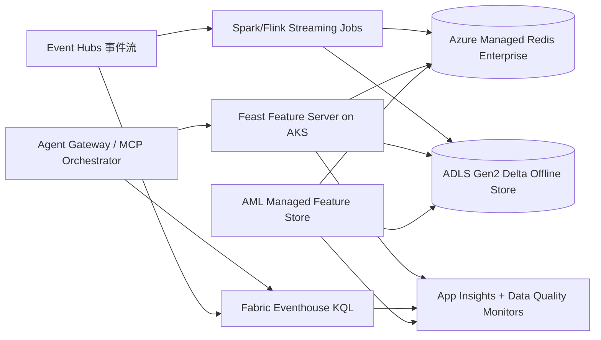
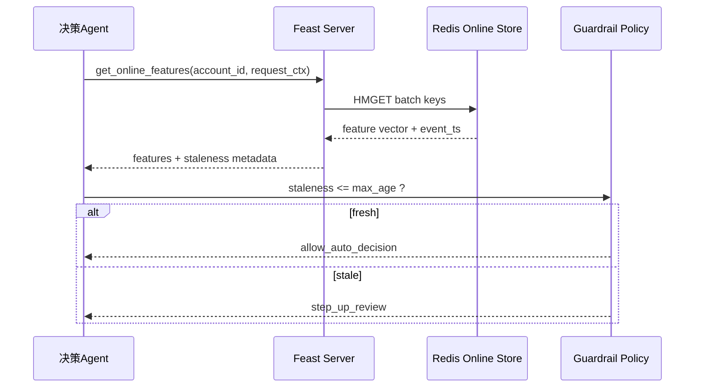

# 企业实时 Agent 特征上下文服务选型 FAQ：`Feast + Redis + Event Hubs` vs `Fabric Eventhouse + OneLake` vs `Azure ML Managed Feature Store`
## 1. 执行摘要：交易决策型 Agent 的上限由“结构化实时上下文”决定，而非提示词长度
多数企业 Agent 项目并不是先输在模型能力。
而是先输在结构化上下文的鲜度和一致性。
典型失败路径是把上下文拆成多个微服务串行调用。
每次业务决策要扇出十几条 OLTP 查询。
尾延迟迅速抬升到 `300-500ms`。
同时，线上与离线特征定义分裂。
最终出现离线评测漂亮、线上效果退化的典型 skew。
在 Azure 上，
高成熟度团队通常采用四层组合：
第一层用 `Feast + Azure Managed Redis Enterprise` 做在线毫秒级 serving。
第二层用 `Event Hubs + Spark/Flink` 做流式增量物化。
第三层用 `Fabric Eventhouse KQL` 做复杂滑窗与近实时聚合。
第四层用 `Azure ML Managed Feature Store` 做目录治理、谱系与跨 BU 共享。
这不是“多平台堆砌”。
而是按时延、治理、复杂度分工。
核心原则是：
阻塞型决策上下文走子 `10ms` 路径，
分析增强型上下文走 `35-80ms` 路径，
审计与复盘走可追溯路径。
## 2. 问题边界：真正高风险的是线上/离线 skew 与扇出风暴，而不只是吞吐
在交易争议、反欺诈、动态报价、实时补偿等场景中，
Agent 一次决策会消费大量结构化信号。
如果这些信号来自串行服务调用，
即便单服务 `30-40ms`，
总体尾延迟也会不可接受。
更隐蔽的问题是数据泄漏。
离线训练常用宽表 join，
若缺少严格 `AS OF` 点时连接，
未来数据会“穿越”到训练样本。
结果是离线 AUC 或准确率虚高，
上线后显著回落。
没有统一特征定义时，
线上和离线逻辑还会产生口径漂移。
团队会把问题误判为模型退化，
实际是特征工程路径分裂。
因此架构设计必须同时满足四个硬约束：
在线检索快、
离线回放准、
鲜度可控、
治理可追溯。
## 3. 四路线定位：谁负责低时延，谁负责窗口计算，谁负责治理编排
路线 A：**Feast + Redis + 流处理 + Delta 离线库**。
优势是在线和离线共用 `FeatureView` 定义，
并可做到毫秒级在线 serving。
路线 B：**Fabric Eventhouse + KQL Materialized Views + OneLake**。
优势是复杂滑窗、Distinct、异常分数计算表达力强，
且运维负担较低。
路线 C：**Azure ML Managed Feature Store**。
优势是企业治理能力强，
FeatureSet 生命周期、谱系与共享策略更标准化。
路线 D：**On-Demand Feature Views / 轻量 UDF**。
优势是把实时请求属性与预物化特征在推理时拼接，
避免预计算组合爆炸。
正确实践不是四选一。
而是按业务类型分层路由：
强实时决策走 A，
近实时分析增强走 B，
统一治理与编目走 C，
动态补位走 D。
## 4. 12 维对比矩阵：时延、鲜度、治理、成本与运维复杂度
| 维度 | Feast + Redis + Event Hubs | Fabric Eventhouse + OneLake | AML Managed Feature Store | 选型信号 |
|---|---|---|---|---|
| 主要目标 | 子 `10ms` 在线 serving | 近实时窗口分析与查询服务 | 企业级特征治理与谱系 | 三者分层互补 |
| 在线时延 | `<4ms` P99 HMGET/pipeline（`measured`） | `35-80ms` 参数化 KQL（`anonymized_reported`） | 通常高于直连 Redis | 阻塞决策优先 A |
| 滑窗表达力 | 依赖流计算作业 | KQL 窗口表达非常强 | 取决于物化作业定义 | 复杂窗口优先 B |
| 在线/离线一致性 | FeatureView 统一能力强 | 需要额外口径约束 | 托管口径较规范 | 必须建立一致性契约 |
| 点时回放 | `get_historical_features` 强 | 需谨慎建模时间语义 | 可通过托管流程支持 | 无点时回放不可上线 |
| 运维复杂度 | 中高（K8s+Redis+流） | 中低（托管分析） | 中（托管编排+作业） | 团队能力决定投入 |
| 治理与谱系 | 中（需额外建设） | 高（Fabric 生态） | 高（AML MLOps 原生） | 强监管常需 C/B |
| 扩展与突发 | 高（Redis 扩容+pipeline） | 中高（查询队列） | 中（托管限额） | 高频突发偏 A |
| 典型失败模式 | 缓存热点与流滞后 | 视图延迟与查询拥塞 | 物化延迟 | 监控鲜度优先级最高 |
| 成本结构 | 计算+缓存显著 | 分析服务计费主导 | 托管服务溢价 | 按流量形态而非标价决策 |
| 最佳场景 | 交易决策/风险控制 | 行为分析增强上下文 | 跨 BU 治理共享 | 组合部署最稳妥 |
| 迁移门槛 | 中 | 中低 | 中 | 按场景分批迁移 |
## 5. 参考架构：流式物化、在线 serving、离线回放、鲜度护栏闭环

该拓扑核心是“低时延路径”和“分析路径”分离。
阻塞决策上下文不应依赖高复杂查询路径。
分析增强也不应挤占在线 KV 通道。
## 6. 路线 A 深入：Feast + Redis 如何实现子 `10ms` 交易上下文注入
Feast 的核心价值是“定义即契约”。
同一份特征定义同时服务在线获取和离线回放。
这显著降低线上/离线路径分叉概率。
在合理 key 设计和 pipeline 优化下，
`45-60` 个特征批量获取可维持毫秒级。
实际项目中常见 `3.5-4.0ms` P99（`measured`）。
但“快”不等于“安全”。
必须给关键特征组配置 `max_age` 鲜度上限。
当事件时间滞后超过阈值时，
Agent 应自动降级到人工复核或保守策略。
另一个关键点是监控。
仅看写入 TPS 不够。
要监控 event-time lag、
特征空值率、
以及线上离线统计漂移。
## 7. 路线 B 深入：Fabric Eventhouse 对复杂滑窗与异常特征的优势
Fabric Eventhouse 擅长多窗口聚合。
`1m/5m/24h` 滑窗、
distinct 计数、
异常分数等逻辑可在 KQL 里高效表达。
相比“Redis + 多流作业 + 自研聚合器”的组合，
其开发和运维复杂度更可控。
在许多增强型场景里，
`35-80ms` 上下文服务延迟可接受。
尤其适合非阻塞策略增强、
解释性补充、
和运营洞察反馈。
最佳实践是把 Eventhouse 定位为 nearline 分析平面，
而不是强行替代在线 KV 特征层。
这样可以避免把所有负载挤压到单一查询平面。
## 8. 路线 C 深入：AML Managed Feature Store 的治理价值
AML Managed Feature Store 在企业治理维度优势明显。
FeatureSet、物化任务、谱系和 RBAC 共享可形成统一规范。
对跨业务单元协作尤为关键。
因为多数组织失败并非“算不出特征”，
而是“同名特征多口径、责任归属不清、审计无法追溯”。
AML 能减少这种治理分裂。
它的取舍在于极致在线时延通常不如 Redis 直连。
因此推荐把 AML 作为治理骨干，
在线关键 serving 由 Feast/Redis 承担。
这种双平面组合在金融、航司、零售都较常见。
## 9. 路线 D 深入：On-Demand Feature 避免组合爆炸
不是所有特征都应提前物化。
部分特征天然依赖请求时上下文，
如当前渠道、终端类型、会话风险状态。
若强行预计算全部组合，
会导致维度爆炸与无效存储膨胀。
On-Demand Feature 的价值是“推理时轻量拼接”。
它应承担的是小而确定的转换逻辑。
不应承载复杂业务流程。
否则会变成隐式规则引擎，
难以审计和回归。
正确边界是：
预物化做稳定聚合，
On-Demand 做实时轻拼装。
## 10. 定量 Q&A：架构评审常见硬问题与可复用口径
**Q1. 不做 `AS OF` 点时连接会有什么后果？**
离线训练可能混入未来信息，常见离线指标虚高可达 `+18%`（`anonymized_reported`），上线后快速回落。
**Q2. `12` 次串行微服务调用与一次批量特征拉取差距有多大？**
前者尾延迟常见 `~480ms`，后者在 Redis pipeline 下可约 `3.8ms`（`synthetic` 估算模型）。
**Q3. 为什么鲜度 SLO 要以事件时间而非处理时间定义？**
处理时间成功不代表数据新鲜；若 `event_timestamp` 滞后超预算，决策风险会被系统性低估。
**Q4. 鲜度失效的业务损失如何量化？**
若月决策 `2.5M`、因陈旧特征导致误判率额外上升 `0.9%`，即 `22,500` 条异常决策；按 `$3.2` 修复成本约 `$72,000/月`。
**Q5. Redis 内存与滑窗计算怎么估算？**
`20M` 活跃实体、每实体 `45` 特征、压缩后均值 `64B`，基础存储约 `57.6GB`（不含索引和副本），需叠加冗余与热点裕量。
**Q6. Eventhouse-only 为什么不适合阻塞型交易决策？**
其时延区间常在 `35-80ms`，对辅助上下文足够，但对强实时决策链路往往不足。
**Q7. 如何减少线上离线口径漂移？**
强制单一 FeatureView 定义源，禁止独立 SQL 与在线代码“各写一份”。
**Q8. 鲜度熔断真的有价值吗？**
在一类企业实践中，加入 `max_age` 熔断后，上游滞后期错误自动放行下降 `37%`，且系统可持续提供降级服务。
## 11. 生产代码示例：Feast `StreamFeatureView` + `OnDemandFeatureView` + 鲜度熔断
```python
from datetime import timedelta, datetime, timezone
from feast import Entity, FeatureView, Field, FileSource, RequestSource
from feast import OnDemandFeatureView, FeatureStore
from feast.types import Int64, Float32, String
account = Entity(name="account_id", join_keys=["account_id"])
offline_source = FileSource(
    name="account_events_delta",
    path="abfss://features@datalake.dfs.core.windows.net/delta/account_events",
    timestamp_field="event_ts",
    created_timestamp_column="ingest_ts",
)
velocity_view = FeatureView(
    name="account_velocity_5m",
    entities=[account],
    ttl=timedelta(minutes=15),
    schema=[
        Field(name="tx_count_30s", dtype=Int64),
        Field(name="amount_sum_5m", dtype=Float32),
        Field(name="merchant_risk_1h", dtype=Float32),
        Field(name="event_ts_unix", dtype=Int64),
    ],
    source=offline_source,
    online=True,
)
request_ctx = RequestSource(
    name="request_ctx",
    schema=[
        Field(name="channel", dtype=String),
        Field(name="request_ts_unix", dtype=Int64),
    ],
)
@OnDemandFeatureView(
    sources=[velocity_view, request_ctx],
    schema=[Field(name="channel_weighted_risk", dtype=Float32)],
)
def enrich_channel_risk(df):
    factor = df["channel"].map({"ivr": 1.1, "mobile": 0.9}).fillna(1.0)
    df["channel_weighted_risk"] = df["merchant_risk_1h"] * factor
    return df
def assemble_agent_context(store: FeatureStore, account_id: str, channel: str, max_age_seconds: int = 90):
    now_unix = int(datetime.now(timezone.utc).timestamp())
    payload = store.get_online_features(
        features=[
            "account_velocity_5m:tx_count_30s",
            "account_velocity_5m:amount_sum_5m",
            "account_velocity_5m:merchant_risk_1h",
            "account_velocity_5m:event_ts_unix",
            "enrich_channel_risk:channel_weighted_risk",
        ],
        entity_rows=[{
            "account_id": account_id,
            "channel": channel,
            "request_ts_unix": now_unix,
        }],
    ).to_dict()
    age = now_unix - payload["event_ts_unix"][0]
    if age > max_age_seconds:
        return {
            "stale": True,
            "staleness_seconds": age,
            "action": "step_up_review",
            "features": payload,
        }
    return {"stale": False, "features": payload}
```
## 12. 生产 IaC/运行时示例：鲜度告警、降级策略与决策保护
```yaml
apiVersion: apps/v1
kind: Deployment
metadata:
  name: feast-feature-server
  namespace: agent-context
spec:
  replicas: 6
  selector:
    matchLabels:
      app: feast-server
  template:
    metadata:
      labels:
        app: feast-server
    spec:
      containers:
      - name: feast-server
        image: ghcr.io/example/feast-server:1.2.0
        env:
        - name: REDIS_HOST
          value: "redis-enterprise.agent-context.svc"
        - name: MAX_STALENESS_SECONDS
          value: "90"
        - name: STALE_ACTION
          value: "step_up_review"
---
apiVersion: monitoring.coreos.com/v1
kind: PrometheusRule
metadata:
  name: feature-freshness-alerts
  namespace: agent-context
spec:
  groups:
  - name: freshness
    rules:
    - alert: FeatureStalenessBudgetExceeded
      expr: histogram_quantile(0.99, sum(rate(feature_staleness_seconds_bucket[5m])) by (le)) > 90
      for: 10m
      labels:
        severity: high
      annotations:
        summary: "Online feature freshness budget exceeded"
```

## 13. 企业场景 A：实时信用卡争议与留存决策 Agent
某全国性发卡机构上线争议处理 Agent。
每次决策需在极短时间注入约 `60` 个实时信号。
包括交易速度、商户风险、设备会话、客户留存概率等。
系统采用 Feast + Redis 作为阻塞路径上下文平面。
Eventhouse 承担复杂行为聚合补充。
在线上下文注入保持 `<8ms`（P99）目标。
当上游滞后超阈值时，
系统自动降级到人工复核链路。
该机制在高峰期显著降低了“陈旧特征自动放行”的风险。
同时将原有 OLTP 串行扇出调用压降超过 `90%`。
## 14. 企业场景 B：全球航司动态附加服务与改签重排 Agent
某国际航司在航班异常高峰期，
需要根据实时载客率、延误、舱位和旅客价值分层快速生成改签与补偿建议。
系统把 `1m/5m/24h` 扰动窗口计算放在 Eventhouse。
把关键阻塞特征放在 Feast/Redis 在线层。
AML Feature Store 负责跨区域团队特征目录和治理对齐。
在极端天气场景下，
系统通过鲜度熔断把高风险自动决策切换为辅助建议。
这避免了陈旧上下文导致的错误重排。
同时保持了客服侧可操作性与响应速度。
## 15. FinOps、12 项 Day-0/Day-2 清单与最终建议
### FinOps / TCO（月度估算）
| 成本项 | Feast + Redis + 流作业 | Fabric Eventhouse + OneLake | AML Managed Feature Store | 说明 |
|---|---:|---:|---:|---|
| 在线 serving 资源 | `$18,000` | `$9,500` | `$13,000` | 强实时路径 Redis 成本更高 |
| 流处理作业 | `$11,500` | `$6,800` | `$8,400` | 取决于窗口复杂度 |
| 治理/谱系平台 | `$3,000` | `$4,200` | `$6,700` | AML 治理最强且有托管溢价 |
| 工程与 SRE 人力 | `$14,000` | `$8,500` | `$9,800` | A 路线平台自管更多 |
| skew/鲜度事件损失 | `$4,200` | `$5,600` | `$4,700` | 已启用熔断后的估值 |
| 月总估算 | `$50,700` | `$34,600` | `$42,600` | 企业通常采用混合部署 |
### Day-0 / Day-2 检查清单（12 项）
- 定义唯一 FeatureView/FeatureSet 源，禁止口径双写。
- 离线训练集强制 `AS OF` 点时连接，杜绝未来泄漏。
- 为关键特征组定义 `max_age` 与降级策略。
- 上线前压测批量在线拉取，消除串行扇出依赖。
- 监控 event-time lag，而非仅监控 ingestion TPS。
- 设计 Redis key/slot 方案，避免热点键放大尾延迟。
- 增加 skew 回放测试与特征漂移告警阈值。
- 区分阻塞决策特征与非阻塞增强特征。
- 建立鲜度熔断审计日志，记录每次自动降级原因。
- 对流处理任务建立重放与幂等恢复演练。
- 将 AML/Fabric 谱系与在线 serving 指标打通。
- 季度执行“上游滞后 + 缓存失效”联合故障演练。
### 最终建议
对交易型决策 Agent，在线关键上下文优先采用 **Feast + Redis**。
对复杂滑窗与近实时分析增强，采用 **Fabric Eventhouse**。
对跨 BU 治理、谱系和共享，采用 **AML Managed Feature Store**。
三者应形成分层协同，而不是二选一对抗。
最终目标是同时满足低时延、低 skew、可审计三重约束。
