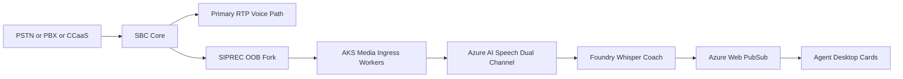
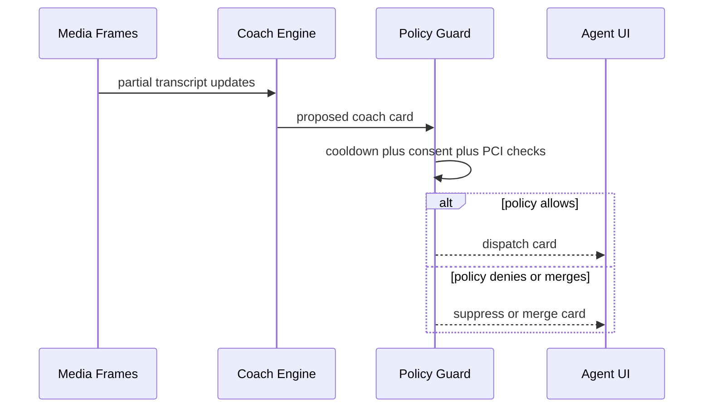

# Enterprise Realtime Contact-Center Whisper-Coach Selection FAQ: SBC SIPREC Stereo Forking vs Cloud CCaaS AudioHook Streaming vs Workstation Sidecar vs Dynamics 365 Native Copilot

> **Audience**: Cloud & AI Solution Architects, contact-center platform owners, telecom/media engineers, compliance officers, QA leaders, and CX operations teams.
> **Primary objective**: Deliver realtime human-agent whisper coaching, live compliance guardrails, and automated after-call work (ACW) across 5,000–50,000 seats without introducing voice-path jitter or single-point call drops.

---

## 1. Executive summary (protect the voice path first, then add AI)

The most expensive failure pattern in agent-assist programs is placing AI inference in the critical voice media path. When that happens:

- inference jitter can degrade call experience,
- AI brownouts can cause call-control side effects,
- compliance pause/resume states become inconsistent between recorder and AI tap.

Recommended routes:

- **Route A**: SBC-level `SIPREC` (`RFC 7866`) out-of-band stereo media fork to dedicated AI pipeline.
- **Route B**: Native cloud CCaaS media streaming (`AudioHook`/`AudioStream`/`ACS`) into governed stream processors.
- **Route C**: Agent-workstation loopback sidecar for rapid pilot onboarding.
- **Route D**: Dynamics 365 Contact Center native realtime Copilot capabilities.

Key recommendation:

- For production at scale, prioritize **A or B** with strict **AI fail-open** policy (AI loss must never drop PSTN calls).
- Use **C** only for controlled pilot acceleration.
- Choose **D** when consolidating on first-party Microsoft contact-center stack for integration speed.

---

## 2. Architecture scope and boundaries

In-scope capabilities:

1. Realtime dual-channel transcription and intent classification.
2. Whisper coach cards and compliance prompt nudges.
3. Automated ACW summarization and disposition assist.
4. PCI/PII pause-resume synchronization across recorder and AI tap.

Out of scope:

- replacing PBX/CCaaS call-control plane,
- placing AI services as prerequisites for RTP session establishment.

---

## 3. Route definitions (A/B/C/D)

### Route A — SBC SIPREC out-of-band stereo media forking

Design:

- Media is copied at SBC/recording boundary, not inline in primary call path.
- RX/TX channels remain physically separated, maximizing attribution fidelity.
- Compatible with legacy and mixed estates (Avaya, Cisco, SIP trunks, hybrid migrations).

Strengths:

- strong voice-path isolation,
- high compliance-grade speaker attribution,
- zero direct dependency of call setup on AI stack.

Trade-offs:

- RTP/firewall/SBC configuration overhead,
- dedicated media-ingress scalability engineering.

### Route B — Cloud CCaaS native WebSocket media streaming

Design:

- consume platform-native stereo frames and metadata events,
- route through ACA/AKS stream processors to Speech + model coach pipeline.

Strengths:

- faster integration velocity,
- less telephony-edge plumbing compared with SIPREC forks.

Trade-offs:

- provider-specific event semantics and quota models,
- cross-vendor portability can be lower than Route A.

### Route C — Agent workstation loopback sidecar

Design:

- desktop companion captures tab+mic or OS audio loopback,
- forwards to APIM-governed AI path.

Strengths:

- minimal telephony change,
- useful two-week pilot path.

Trade-offs:

- endpoint CPU and mute-state blind spots,
- VDI/Citrix audio-redirection edge cases,
- weaker enterprise-scale operational consistency.

### Route D — Dynamics 365 Contact Center native realtime copilot

Design:

- integrated transcription, live guidance, sentiment, and ACW flows in one control plane.

Strengths:

- lower integration friction for Microsoft-first stack,
- unified governance and analytics model.

Trade-offs:

- migration and coexistence planning required for heterogeneous incumbent CCaaS estates.

---

## 4. Twelve-dimension comparison matrix

| Dimension | Route A SIPREC | Route B CCaaS stream | Route C sidecar | Route D D365 native |
|---|---|---|---|---|
| Voice-path isolation | Very high | High | Medium | High |
| Stereo attribution certainty | Very high | High | Medium | High |
| Integration speed | Medium | High | Very high | High |
| Legacy estate compatibility | High | Medium-high | Medium | Medium |
| Telephony edge complexity | High | Medium | Low | Low-medium |
| Endpoint risk dependency | Low | Low | High | Low |
| Compliance-state synchronization | High | Medium-high | Medium | High |
| Operations complexity | Medium-high | Medium | Medium-high | Medium |
| Cost elasticity | Medium | High | Medium | Medium-high |
| AI fail-open robustness | High | High | Medium | High |
| Long-term scalability | High | High | Medium-low | High |
| Recommendation | large mixed estates | cloud-native multi-vendor | pilot acceleration only | first-party consolidation |

---

## 5. Quantitative model foundation

### 5.1 Glass-to-glass coach card latency

`L_total = L_chunk + L_stt_partial + L_rag + L_reason + L_push`

Target:

`L_total < 800 ms` at p95.

### 5.2 Concurrent seat cost model

`C_seat = C_speech + C_model + C_stream + C_ops`

### 5.3 Card-throttle envelope

`R_card = min(R_raw, R_cooldown_cap, R_risk_cap)`

---

## 6. Q1 — How to keep realtime coach-card latency below 800 ms

Illustrative budget split:

- `L_chunk`: 80–120 ms
- `L_stt_partial`: 120–220 ms
- `L_rag + L_reason`: 250–350 ms
- `L_push + render`: 80–140 ms

Typical combined range:

- `530–830 ms` baseline window

Control levers:

- incremental partial-STT reasoning rather than full-utterance waits,
- rules-first fast path before expensive model call,
- client incremental card rendering instead of full panel rerender.

---

## 7. Q2 — Stereo RX/TX channels vs mono diarization for compliance attribution

Stereo dual-channel:

- deterministic speaker separation by design,
- near-zero confusion in ownership attribution for mandated disclosures.

Mono diarization:

- overlapping speech and noisy channels increase attribution error,
- compliance dispute arbitration becomes less deterministic.

Recommendation:

- For regulated disclosures and audit replay, Route A/B dual-channel paths are strongly preferred.

---

## 8. Q3 — Preventing cognitive overload from coach-card floods

Problem:

- Real-time engines can generate too many prompts during volatile conversations.

Mitigation policy:

- cooldown windows by card class,
- semantic merge windows for similar hints,
- priority preemption for legal or fraud-critical events,
- stage-aware gating (verification, objection handling, closure).

Suggested limits:

- normal mode: <= 1 card per 15 seconds
- high-risk mode: burst allowed, then auto-downshift after 30 seconds

---

## 9. Q4 — Consent and PCI/PII pause-resume synchronization across recorder and AI tap

Failure mode:

- recorder pauses but AI tap continues ingesting sensitive utterances.

Required controls:

1. single consent and PCI state bus,
2. synchronized enforcement on recorder and AI stream processors,
3. immutable audit trail of pause/resume transitions with timestamps.

Engineering target:

- state propagation delay in sub-second range across all active call legs.

---

## 10. Q5 — Per-seat streaming cost math at 10,000 concurrent calls

Common architectures compared:

- Speech + tiered SLM/GPT-mini path
- Realtime audio model path

Trade-off:

- tiered approach usually improves cost elasticity,
- realtime end-to-end models can simplify logic but cost/latency variance must be tightly monitored.

Governance advice:

- classify intent classes and map each class to model route by business value and latency SLO.

---

## 11. Q6 — Fail-open media-fork isolation so AI brownouts drop zero PSTN calls

Non-negotiable rule:

- AI stack cannot be in call-control critical chain.

Implementation:

- out-of-band media fork only,
- hard timeout fallback to silent/no-card mode,
- deterministic rules fallback for critical compliance alerts where possible.

Operational metric:

- `P(call_drop_due_to_ai) = 0`

---

## 12. Mermaid topology — Route A SIPREC out-of-band architecture



---

## 13. Mermaid sequence — card cooldown and compliance gating



---

## 14. Production block 1 — stereo frame demux with conversation binding (Python)

```python
def demux_stereo_frame(frame: bytes, metadata: dict):
    channel = metadata.get("channel")  # rx / tx
    conversation_id = metadata.get("conversationId")
    if channel not in {"rx", "tx"}:
        return None
    return {
        "conversation_id": conversation_id,
        "channel": channel,
        "audio": frame,
        "timestamp": metadata.get("timestamp"),
    }


def bind_agent_identity(cti_record: dict):
    return {
        "conversation_id": cti_record["conversationId"],
        "entra_oid": cti_record["agentOid"],
        "queue_id": cti_record.get("queueId"),
    }
```

---

## 15. Production block 2 — cooldown and dispatch policy (YAML)

```yaml
whisperCoachDispatcher:
  cooldown:
    normalSeconds: 15
    highRiskSeconds: 5
  mergeWindowSeconds: 8
  maxCardsPerMinute: 6
  compliance:
    pauseOnPciMode: true
    pauseOnNoConsent: true
  fallback:
    aiTimeoutAction: silent_no_card
    preserveVoicePath: true
  prioritization:
    legalDisclosure: highest
    fraudRisk: high
    empathyNudge: medium
```

---

## 16. Enterprise scenario A — tier-1 retail banking collections and mortgage-modification compliance coaching

Business requirement:

- mandatory disclosure scripts must be delivered and acknowledged,
- deviations must be detected in-session, not after call.

Architecture recommendation:

- mixed-estate banks: Route A for deterministic media isolation and attribution fidelity,
- Microsoft-stack consolidation tracks: Route D where migration program allows.

Expected outcomes:

- lower disclosure miss rates,
- improved ACW completion quality and audit readiness.

---

## 17. Enterprise scenario B — global telco 15,000-seat retention and troubleshooting operation

Business requirement:

- realtime technical troubleshooting suggestions under heavy concurrency,
- no impact to primary call quality during surge conditions.

Architecture recommendation:

- cloud-native regions: Route B with strict AI fail-open and brownout governance,
- legacy regions: Route A interop bridge until migration completes.

Expected outcomes:

- reduced average handle time,
- reduced manual ACW burden,
- stable call continuity during load spikes.

---

## 18. Three-year TCO comparison (illustrative)

| Cost category (3 years) | Route A | Route B | Route C | Route D |
|---|---:|---:|---:|---:|
| Media ingress and stream processing | $2.0M | $1.5M | $1.1M | $1.4M |
| STT and model inference | $3.2M | $3.0M | $2.7M | $2.9M |
| Operations and compliance governance | $1.1M | $0.9M | $1.2M | $0.8M |
| Integration and rollout cost | $1.4M | $1.0M | $0.6M | $0.9M |
| **Total 3-year TCO** | **$7.7M** | **$6.4M** | **$5.6M** | **$6.0M** |

Interpretation:

- Route C is often cheapest for pilot speed but weaker as long-term enterprise baseline.
- Route A has strongest cross-vendor determinism and compliance confidence at higher integration cost.
- Route B and D are often best balanced in cloud-forward operations.

---

## 19. Day-0 / Day-1 / Day-2 rollout checklist

### Day-0 (design)

- Declare strict separation between voice path and AI path.
- Define card priority classes, cooldown logic, and compliance state machine.
- Define fail-open and fallback expectations as explicit SLO policy.

### Day-1 (pilot and canary)

- Start with limited queues and dual-channel validation.
- Validate `<800ms` p95 card latency and card relevance.
- Drill PCI/consent pause-resume propagation.

### Day-2 (scale)

- Expand regionally with concurrency-aware model routing.
- Tune cost controls by intent class and call type.
- Operationalize audit replay and quality scorecards.

---

## 20. Five-step selection guide (Good fit vs Not for)

1. **Protect primary voice continuity first**.
2. **Select media tap strategy second** (SIPREC, AudioHook, sidecar, native).
3. **Define cognitive guardrails** (cooldown, merge, priority).
4. **Synchronize compliance state** across recorder and AI tap.
5. **Guarantee fail-open behavior** where AI loss cannot break calls.

**Good fit**:

- large and regulated contact centers with realtime coaching and compliance pressure.

**Not for**:

- offline-only QA analytics workloads with no realtime assist requirement.

---

## 21. Final recommendation

- Choose **Route A** for heterogeneous legacy estates needing deterministic media isolation.
- Choose **Route B** for modern cloud CCaaS estates prioritizing integration speed and elasticity.
- Use **Route C** as a controlled pilot bridge, not default long-term production baseline.
- Choose **Route D** when consolidating on Dynamics 365 Contact Center as strategic platform.

---

## 22. Anti-patterns to eliminate pre-production

1. Inline AI dependency in call-control path.
2. No cooldown policy, resulting in operator prompt fatigue.
3. Unsynchronized PCI pause-resume between recorder and AI stream.
4. No fail-open fallback path under AI brownouts.
5. No speaker-attribution validation in regulated scripts.

---

## 23. Sources and data-label note

This FAQ is an architecture-selection guide. Quantitative values are planning examples and must be recalibrated with organization-specific traffic, model pricing, and operational telemetry.

- `RFC 7866` SIPREC references and major CCaaS media streaming interface documentation.
- Azure Speech, Azure Web PubSub, APIM governance, and Foundry model runtime references.
- Contact-center compliance public guidance for consent recording and PCI/PII handling.
- Retrieval date for the above references: `2026-11-15`.
- Sample quantitative labels in this document: `anonymized_reported`.

---

## 24. Evidence package recommendation for governance

For each pilot or production incident drill, archive:

- route and policy versions,
- call/media correlation IDs,
- card-dispatch and suppression decisions,
- consent and PCI state transitions,
- fail-open and fallback activation records,
- business KPI deltas by queue and campaign.

A one-click evidence package dramatically improves regulator and internal-audit response time.

---

## 25. Risk register and SLO mapping recommendations

Treat realtime agent-assist as four coupled risk domains:

1. **Voice continuity risk** — AI subsystem failures must never break active calls.
   Suggested metrics: `P(call_drop_due_to_ai)`, RTP jitter delta, packet-loss delta.
2. **Guidance quality risk** — false-positive and false-negative coach events both create business and compliance drag.
   Suggested metrics: coach precision/recall and critical-alert false-positive rate.
3. **Compliance synchronization risk** — recorder and AI tap pause-resume divergence creates legal exposure.
   Suggested metrics: consent-sync p95 and PCI pause mismatch count.
4. **Operations and cost risk** — concurrency spikes can destabilize latency and spend.
   Suggested metrics: cost per concurrent call, p95 card latency, fallback route ratio.

Baseline SLO examples:

- `p95_card_latency < 800 ms`
- `P(call_drop_due_to_ai) = 0`
- `consent_sync_latency_p95 < 500 ms`
- `critical_coach_false_positive < 3%`
