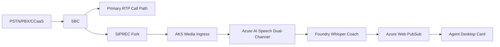
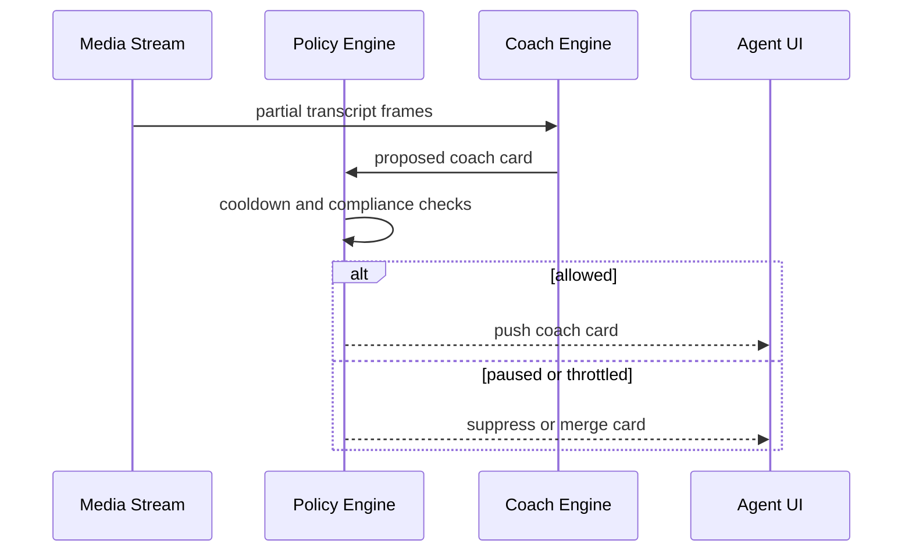

# 企业实时联络中心 Whisper-Coach 选型 FAQ：SIPREC/SBC 双声道旁路 vs CCaaS AudioHook 流媒体 vs 桌面 Sidecar vs Dynamics 365 原生能力

> **适用对象**：Cloud & AI Solution Architect、联络中心平台架构师、语音平台工程团队、合规与质检团队。
> **核心问题**：在 5,000~50,000 座席规模下，实现实时坐席辅助、合规提示和自动 ACW，同时确保语音主通路不受抖动或单点故障影响。

---

## 1. 执行摘要（先保语音主通路，再叠加 AI 能力）

实时坐席辅助系统最常见误区是把 AI 推理链路串进语音主通道，导致：

- AI 抖动影响通话体验；
- AI 侧故障导致电话链路异常；
- 合规暂停/恢复与录音系统不同步。

四路线概览：

- **Route A**：SBC `SIPREC`（`RFC 7866`）旁路双声道 RTP 复制到独立 AI 流水线。
- **Route B**：CCaaS 原生 WebSocket 音频流（AudioHook/AudioStream/ACS）。
- **Route C**：坐席工作站 Loopback Sidecar（零电信改造试点快路）。
- **Route D**：Dynamics 365 Contact Center 原生实时 Copilot。

核心建议：

- 生产大规模优先考虑 **A 或 B**，并要求 **AI fail-open（AI 崩溃不掉 PSTN 通话）**；
- 快速验证阶段可用 **C**，但要明确 VDI/终端控制边界；
- 已统一到微软联络中心栈时可优先 **D** 以缩短整合周期。

---

## 2. 架构问题边界

目标能力通常同时包括：

1. 实时转写 + 意图识别；
2. 话术/合规提醒（whisper coach）；
3. 质检标签与会后 ACW 自动摘要；
4. 合规控制（PCI/PII pause/resume、录音同频同步）。

非目标：

- 直接替代 PBX/CCaaS 核心呼叫控制；
- 在 AI 链路中承担主 RTP 会话协商。

---

## 3. 四条架构路线定义（A/B/C/D）

### Route A：SBC 层 SIPREC 双声道旁路

特点：

- 从 SBC/录音边界旁路复制媒体；
- RX/TX 双声道物理分离，归因最清晰；
- 与 Avaya/Cisco/Genesys/NICE 等遗留环境兼容性强。

优点：

- 对主通话链路“零内联依赖”；
- AI 故障不影响电话建立与保持。

挑战：

- SBC/RTP 防火墙与网络打点配置较重；
- 媒体接入集群需可扩缩与低抖动。

### Route B：CCaaS 原生 WebSocket Audio Streaming

特点：

- 平台原生输出音频帧和会话元数据；
- 省去 SIPREC/SBC 侧复杂网络改造；
- 可快速绑定 conversationId 与坐席屏幕上下文。

优点：

- 集成速度快；
- 多云 CCaaS 新栈适配便利。

挑战：

- 受制于各 CCaaS 的事件模型和限额策略；
- 供应商差异会影响跨平台复用度。

### Route C：坐席桌面 Sidecar 音频捕获

特点：

- 无需改 PBX/CCaaS，2 周可出试点；
- 通过 WASAPI/WebRTC 捕获做本地前处理。

优点：

- 启动门槛低，适合 PoC。

挑战：

- 终端 CPU/静音状态/VDI 音频重定向会引入盲点；
- 设备异构导致稳定性差异大。

### Route D：Dynamics 365 Contact Center 原生实时 Copilot

特点：

- 通话、转写、建议回复、ACW 一体化；
- 一方能力栈运维一致性较高。

优点：

- 集成与治理链路短；
- 开箱策略与报表能力较完整。

挑战：

- 与非微软 CCaaS 的既有能力映射需评估；
- 历史系统迁移成本要单独核算。

---

## 4. 12 维度对比矩阵

| 维度 | Route A SIPREC | Route B CCaaS AudioHook | Route C Sidecar | Route D D365 Native |
|---|---|---|---|---|
| 语音主链路隔离 | 极高 | 高 | 中 | 高 |
| 双声道归因精度 | 极高 | 高 | 中 | 高 |
| 上线速度 | 中 | 高 | 极高 | 高 |
| 多平台兼容 | 高 | 中高 | 中 | 中 |
| 网络改造复杂度 | 高 | 中 | 低 | 中低 |
| 终端依赖风险 | 低 | 低 | 高 | 低 |
| 合规同步可控性 | 高 | 中高 | 中 | 高 |
| 运维复杂度 | 中高 | 中 | 中高 | 中 |
| 成本弹性 | 中 | 高 | 中 | 中高 |
| AI fail-open能力 | 高 | 高 | 中 | 高 |
| 长期可扩展 | 高 | 高 | 中低 | 高 |
| 推荐结论 | 大规模稳态首选 | 云化快速扩展首选 | 快速试点通道 | 微软一体化优先 |

---

## 5. 关键公式与预算框架

### 5.1 端到端卡片延迟预算

`L_total = L_chunk + L_stt_partial + L_rag + L_reason + L_push`

目标：`L_total < 800ms`

### 5.2 成本模型（并发）

`Cost_concurrent = C_speech + C_model + C_stream + C_ops`

### 5.3 提示节流保护

`R_card = min(R_raw, R_cap_by_agent)`

---

## 6. Q1：玻璃到玻璃 `<800ms` 延迟预算如何拆

建议预算：

- `L_chunk`（帧聚合）= 80~120ms
- `L_stt_partial` = 120~220ms
- `L_rag + L_reason` = 250~350ms
- `L_push`（Web PubSub + UI render）= 80~140ms

合计目标：

- 正常负载下 `530~830ms`，需通过限流与缓存把 P95 控制在 `<800ms`。

优化点：

- partial transcript 增量推理；
- 规则命中快路绕开重模型；
- 前端卡片增量渲染而非整卡刷新。

---

## 7. Q2：双声道 RX/TX vs 单声道 diarization 的归因误差

双声道方案：

- 客户与坐席物理分离，归因混淆率接近零。

单声道 diarization：

- 在噪声、重叠讲话场景下，归因误差显著升高。

工程结论：

- 对合规追责与脚本执行核查，优先使用可提供双声道的 A/B 路线。

---

## 8. Q3：如何防止坐席每 3 秒被提示淹没

策略：

- 认知冷却窗（cooldown）；
- 同类提示合并；
- 高危提示优先级抢占；
- 会话阶段感知（开场/核验/异议处理/收尾）。

量化目标：

- 普通时段 `<= 1` 条/15 秒；
- 高风险事件可临时突破，但需在 30 秒内自动降频。

---

## 9. Q4：双方同意录音与 PCI/PII pause-resume 同步

问题：

- 录音系统暂停了，但 AI tap 未暂停，会形成合规漏洞。

控制点：

1. 统一 consent/PCI 状态总线；
2. 同步作用于录音器与 AI tap；
3. 状态变更必须可审计回放。

约束：

- pause/resume 状态传播延迟应控制在数百毫秒内。

---

## 10. Q5：10,000 并发通话下每座席成本模型

对比路径：

- `Speech + SLM/GPT-4.1-mini` 分级；
- `Realtime Audio Model` 一体路径。

经验：

- 分级路径在稳定场景成本更可控；
- 一体路径在复杂多轮实时推理时体验更好但成本波动更大。

建议：

- 先按业务价值对通话类型分层，再绑定模型策略。

---

## 11. Q6：AI 集群 brownout 时如何做到 `0` PSTN 掉话

原则：

- AI 链路必须旁路于主呼叫控制路径；
- AI 服务不可成为通话建立/保持前置依赖。

机制：

- fail-open：AI 超时只影响提示卡，不影响通话；
- 回退：默认静默 + 规则提示快路；
- 可观测：明确“掉提示不掉电话”SLO。

---

## 12. Mermaid：Route A SIPREC 旁路拓扑



---

## 13. Mermaid：提示冷却与合规闸控时序



---

## 14. 生产代码片段 1：双声道帧解复用与会话绑定（Python）

```python
def demux_stereo_frame(frame_bytes: bytes, metadata: dict):
    channel = metadata.get("channel")  # rx / tx
    conversation_id = metadata.get("conversationId")
    if channel not in {"rx", "tx"}:
        return None
    return {
        "conversation_id": conversation_id,
        "channel": channel,
        "pcm": frame_bytes,
        "ts": metadata.get("timestamp"),
    }
```

---

## 15. 生产代码片段 2：提示冷却调度器（YAML）

```yaml
coachDispatcher:
  cooldown:
    normalSeconds: 15
    highRiskSeconds: 5
  mergeWindowSeconds: 8
  maxCardsPerMinute: 6
  compliance:
    pauseOnPci: true
    pauseOnNoConsent: true
  fallback:
    aiTimeoutAction: silent_no_card
    keepVoicePathUntouched: true
```

---

## 16. 企业场景 A：零售银行催收与按揭重组合规教练

需求：

- 必须在关键披露语句缺失时即时提醒；
- 全程可追溯“提示是否触达、坐席是否响应”。

建议路线：

- 核心生产采用 Route A 或 D；
- 对跨平台混合中心采用 A，统一旁路治理；
- 对微软栈集中中心采用 D 提升交付速度。

收益：

- 合规漏报率下降，ACW 摘要质量提升。

---

## 17. 企业场景 B：全球电信 15,000 座席留存与故障排障

需求：

- 技术问题诊断提示必须低延迟；
- 高峰时不允许主通话质量下降。

建议路线：

- 云化中心采用 Route B + Brownout 控制；
- 复杂遗留区域通过 Route A 对齐。

收益：

- 坐席平均处理时长缩短，ACW 时间降低。

---

## 18. 三年 TCO（示例）

| 成本项（3y） | Route A | Route B | Route C | Route D |
|---|---:|---:|---:|---:|
| 媒体接入与流处理 | $2.0M | $1.5M | $1.1M | $1.4M |
| STT + 推理成本 | $3.2M | $3.0M | $2.7M | $2.9M |
| 运维与合规治理 | $1.1M | $0.9M | $1.2M | $0.8M |
| 集成与改造成本 | $1.4M | $1.0M | $0.6M | $0.9M |
| **总计（3y）** | **$7.7M** | **$6.4M** | **$5.6M** | **$6.0M** |

解读：

- C 试点最省但生产稳态风险高；
- A 稳定性最好但接入改造成本最高；
- B 与 D 往往在云化中心性价比较高。

---

## 19. Day-0 / Day-1 / Day-2 清单

### Day-0（设计）

- 明确语音主通路与 AI 通路隔离边界；
- 定义提示优先级、冷却窗与合规状态机；
- 定义 fail-open 行为与观测指标。

### Day-1（灰度）

- 小流量接入双声道/音频流；
- 验证 `<800ms` 卡片延迟与提示命中；
- 演练 PCI pause/resume 同步。

### Day-2（规模化）

- 分区域扩容与负载分层；
- 优化模型路由与成本策略；
- 固化审计报表与回放机制。

---

## 20. 五步选型（Good fit / Not for）

1. **先确认语音主链路不可受 AI 影响**。
2. **再选媒体采集层**（SIPREC、AudioHook、Sidecar、原生平台）。
3. **定义提示治理**（冷却窗、合并、优先级）。
4. **定义合规同步**（录音与 AI tap 同步 pause/resume）。
5. **定义 fail-open 与回退**（AI 失败不掉话）。

**Good fit**：

- 大中型联络中心、强合规行业、实时辅导需求明确场景。

**Not for**：

- 无实时语音链路、仅离线质检分析场景。

---

## 21. 最终建议

- 多平台遗留环境优先 **Route A**；
- 现代 CCaaS 云化中心优先 **Route B**；
- 快速试点可短期使用 **Route C**，但不建议作为长期主路线；
- 微软联络中心集中建设可优先 **Route D**。

---

## 22. 来源与数据标签

> 本文为架构选型方法文档，公式与成本示例用于工程估算，需以组织内压测与账单复算。

- `RFC 7866` SIPREC、主流 CCaaS 媒体流公开接口文档、Azure Speech/Foundry/Web PubSub 官方文档：访问日期 `2026-11-15`。
- 联络中心合规（同意录音、PCI/PII）公开规范资料：访问日期 `2026-11-15`。
- 示例量化标签：`anonymized_reported`。

---

## 25. 风险登记与SLO/SLA映射建议

建议把实时坐席辅助平台风险拆成四类并绑定可观测指标：

1. **语音连续性风险**：任何 AI 子系统失效不得造成通话中断。
   - 指标：`P(call_drop_due_to_ai)`、`RTP packet-loss delta`、`jitter delta`。
2. **提示质量风险**：误提示和漏提示同时影响业务与合规。
   - 指标：`coach_precision`、`coach_recall`、`false_critical_alert_rate`。
3. **合规同步风险**：录音暂停与 AI tap 暂停不一致。
   - 指标：`consent_sync_latency`、`pci_pause_mismatch_count`。
4. **运营可用性风险**：峰值并发下成本和延迟失控。
   - 指标：`cost_per_concurrent_call`、`p95_card_latency`、`model_fallback_ratio`。

SLO 建议示例：

- `p95_card_latency < 800ms`
- `call_drop_due_to_ai = 0`
- `consent_sync_latency_p95 < 500ms`
- `critical_coach_false_positive < 3%`

---

## 26. 典型实施节奏（12 周）

### 阶段 1（第 1-2 周）：基础打桩

- 接通媒体旁路或 AudioHook 流；
- 打通 conversationId 与座席身份映射；
- 建立最小可观测链路（延迟、错误、吞吐、成本）。

### 阶段 2（第 3-6 周）：小流量策略闭环

- 上线 cooldown + 提示合并策略；
- 上线 PCI/PII 同步 pause-resume；
- 对 3~5 个典型业务场景做人工比对评估。

### 阶段 3（第 7-10 周）：扩容与故障演练

- 扩展到多队列/多技能组；
- 做 AI brownout、网络抖动、模型超时演练；
- 验证 fail-open 策略和回退策略。

### 阶段 4（第 11-12 周）：规模发布与运营移交

- 建立值班手册、回放审计包导出模板；
- 建立周度质量复盘（提示价值/误报/漏报）；
- 建立月度 FinOps 复盘（模型路由、并发成本、缓存命中）。

---

## 27. 架构师落地建议（避免“先模型后流程”）

实时坐席辅助并不是单纯模型项目，而是“语音系统 + 业务流程 + 合规控制 + 运营体系”的联合工程。推荐顺序：

1. 先完成语音链路与合规状态机设计；
2. 再定义提示策略与人机协同节奏；
3. 最后再做模型优化和成本调优。

如果反过来，常见结果是：

- 模型分数好看但业务采纳率低；
- 坐席抱怨提示打扰且无法解释；
- 合规审计发现关键状态不同步。

因此，架构评审必须把“可解释可追责”作为与“模型效果”同级的验收门槛。

---

## 28. 运营看板最小字段（建议）

为避免后期“看得到总量，看不到根因”，建议按队列、技能组、模型路由、地区四维做切片，并至少保留以下字段：

- 通话级：`conversationId`、`agentOid`、路由路径（A/B/C/D）、合规状态轨迹；
- 模型级：提示触发原因、模型版本、回退命中、生成时延；
- 体验级：卡片触达率、采纳率、忽略率、重复提示率；
- 成本级：每并发通话成本、每坐席小时成本、峰值弹性成本。

这些字段直接决定后续是否能完成“质量提升、成本优化、合规审计”三件事的闭环。

