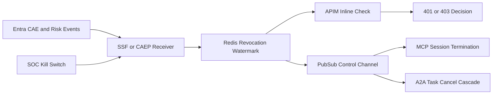
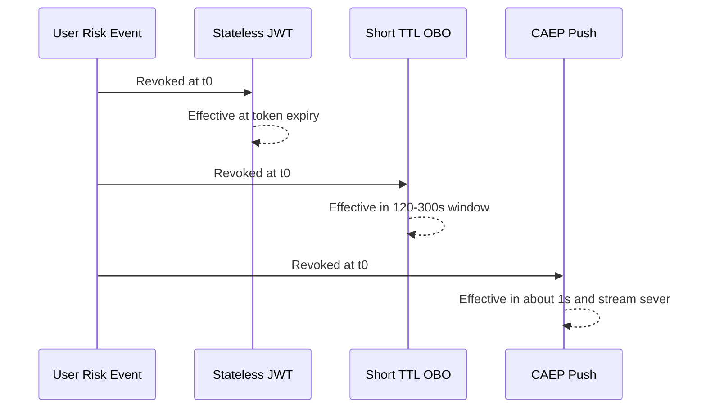

# Enterprise Real-Time MCP/A2A Token Revocation and Continuous Access Evaluation Selection FAQ (CAE+SSF Push vs Short-TTL OBO vs RFC7662 Introspection)
> Topic ID: #469
> Section: 3.3 AI Gateway, MCP Governance, and Cross-Organization A2A Federation
> Audience: enterprise IAM teams, API gateway teams, MCP/A2A platform engineers, SOC and compliance governance teams
> Goal: shrink long-session revocation blind windows to seconds and terminate in-flight streaming channels deterministically

## 1) Production problem: long-running agents break the one-time JWT validation assumption
Classic API architectures validate a token once per request and proceed.
That model fails when MCP and A2A sessions last `20–90` minutes.
Connections can stay open via `SSE` while background task trees continue executing.
If offboarding, PIM expiration, risk escalation, or emergency SOC kill-switch occurs, policy must take effect mid-session.
If systems wait for token expiry only, revoked principals retain meaningful execution windows.
Long autonomous workflows turn minute-level blind spots into material risk.

## 2) Why persistent streaming channels bypass normal gateway controls
Most gateway authorization checks run during HTTP handshake.
After handshake, many streaming transports do not re-evaluate auth per event frame.
As a result, policy changes can block new requests while existing streams continue.
This creates a split-brain security posture: front-door deny with back-channel allow.
Revocation architecture must therefore handle both new-request rejection and active-stream termination.

## 3) Four architecture paths
Pattern A: `Entra CAE + OpenID SSF/CAEP` event push into `APIM + Redis` revocation watermarks plus `Mcp-Session-Id` sever and A2A cascade cancel.
Pattern B: ultra-short `OBO` token leases (`120–300s`) that reduce blind windows without push fabric.
Pattern C: per-call `RFC 7662` introspection or phantom token pattern at gateway edge.
Pattern D: static JWT signature validation with no active-stream kill path.

## 4) Twelve-dimension comparison matrix
| Dimension | Pattern A (CAE+SSF push) | Pattern B (short TTL OBO) | Pattern C (RFC7662 introspection) | Pattern D (anti-pattern) |
|---|---|---|---|---|
| Revocation propagation latency | Low | Medium | Low | High |
| Per-call added latency | Low | Low | Medium-high | Low |
| IdP RPS amplification | Low | High | Medium-high | Low |
| Mid-stream termination capability | High | Low | Medium | Low |
| Multi-hop A2A cascade cancel | High | Medium | Medium | Low |
| IdP outage resilience | High | Medium | Low | Medium |
| Implementation complexity | Medium-high | Low | Medium | Low |
| Compliance explainability | High | Medium | High | Low |
| Gateway retrofit effort | Medium | Low | Medium | Low |
| Cost controllability | High | Medium | Medium | Low |
| False-block rollback control | Medium-high | Medium | Medium | Low |
| Enterprise recommendation | Primary | Transitional | Edge complement | Disallow |

## 5) Pattern A: CAE+SSF event-driven revocation with stream sever (primary)
This path turns security events into real-time gateway control actions.
Entra risk, PIM, offboarding, and SOC kill events are normalized through an SSF or CAEP receiver.
Revocation watermarks are written to Redis and queried inline by APIM with sub-millisecond overhead.
The same event publishes stream-control messages for MCP session termination and A2A subtree cancellation.
New requests and existing streams converge under one revocation transaction.
This is the most complete zero-trust control plane for long-running autonomous agents.

## 6) Pattern B: short TTL OBO leases (transitional low-complexity path)
Short-lived tokens are easy to reason about and quick to deploy.
They reduce blind windows from hours to minutes.
However, they increase token issuance volume dramatically under concurrency.
At scale, token refresh traffic can become a reliability and cost concern.
They also cannot actively sever in-flight streams unless additional control channels are added.

## 7) Pattern C: RFC7662 per-call introspection (external boundary path)
Introspection provides near-immediate state authority for each call.
It is often useful at partner-facing trust boundaries.
The trade-off is synchronous dependency on the introspection endpoint for every request.
Latency increases and availability coupling become architectural constraints.
Streaming channels still require side-channel checks or heartbeat-driven termination logic.

## 8) Pattern D: anti-pattern checklist
Relying only on static JWT signature checks for long sessions.
No revocation watermark lookup using `iat_before` style policy.
No active session index, which prevents precise stream termination.
No parent-child cancellation propagation for A2A delegated tasks.
These omissions produce predictable audit findings and incident amplification.

## 9) Mermaid: end-to-end revocation and active-stream termination architecture


## 10) Mermaid: post-compromise exposure timeline comparison


## 11) Quantitative Q1-Q6 formulas and thresholds
Q1: rogue-call exposure count.
`N_rogue = floor(T_revoke_p99 / T_step)`.
Q2: short-TTL IdP amplification.
`RPS_idp = N_agents / TTL_token`.
Q3: watermark memory footprint.
`Mem ~= N_events * bytes_per_event` with TTL bounded to max token lifetime.
Q4: clock-skew guard.
Use `iat <= revoked_before + skew`, with `skew=2s` as a practical baseline.
Q5: gateway degradation policy.
Fail-close for high-risk write paths and policy-controlled fail-open for low-risk read paths with elevated audit logging.
Q6: cancellation fan-out latency.
`T_cancel_tree = T_publish + T_fanout + T_ack`, target in low seconds.

## 12) Production code block 1: APIM revocation and CAE challenge policy (XML)
```xml
<inbound>
  <base />
  <validate-jwt header-name="Authorization" failed-validation-httpcode="401">
    <openid-config url="https://login.microsoftonline.com/{tenant}/.well-known/openid-configuration" />
    <required-claims>
      <claim name="aud">
        <value>api://agent-gateway</value>
      </claim>
    </required-claims>
  </validate-jwt>
  <set-variable name="oid" value="@(context.Principal?.Claims.GetValueOrDefault("oid",""))" />
  <set-variable name="iat" value="@(context.Principal?.Claims.GetValueOrDefault("iat","0"))" />
  <send-request mode="new" response-variable-name="revocationResp" timeout="0.05">
    <set-url>@($"https://redis-check.internal/revoked/{context.Variables["oid"]}")</set-url>
    <set-method>GET</set-method>
  </send-request>
  <choose>
    <when condition="@((int)context.Variables.GetValueOrDefault("revocationResp.status",200) == 409)">
      <return-response>
        <set-status code="401" reason="Unauthorized" />
        <set-header name="WWW-Authenticate" exists-action="override">
          <value>Bearer error="insufficient_claims"</value>
        </set-header>
      </return-response>
    </when>
  </choose>
</inbound>
```

## 13) Production code block 2: SSF/CAEP SET receiver service (Python)
```python
import json
import time
import redis
from fastapi import FastAPI, Request, HTTPException

app = FastAPI()
r = redis.Redis(host="redis.internal", port=6379, decode_responses=True)

@app.post("/events/set")
async def receive_set(request: Request):
    body = await request.json()
    sub = body.get("sub")
    event_time = int(body.get("iat", time.time()))
    if not sub:
        raise HTTPException(status_code=400, detail="missing sub")
    key = f"revoked:sub:{sub}"
    r.set(key, event_time, ex=5400)
    session_id = body.get("mcp_session_id")
    if session_id:
        r.publish("mcp:session:terminate", json.dumps({"session_id": session_id}))
    task_id = body.get("a2a_task_id")
    if task_id:
        r.publish("a2a:task:cancel", json.dumps({"task_id": task_id}))
    return {"ok": True}
```

## 14) Production code block 3: MCP SSE termination middleware (Python/FastAPI)
```python
import asyncio
import json
import redis.asyncio as redis
from fastapi import FastAPI
from sse_starlette.sse import EventSourceResponse

app = FastAPI()
r = redis.Redis(host="redis.internal", port=6379, decode_responses=True)
active_sessions = {}

@app.get("/stream/{session_id}")
async def stream(session_id: str):
    stop_event = asyncio.Event()
    active_sessions[session_id] = stop_event

    async def event_gen():
        while not stop_event.is_set():
            yield {"event": "tick", "data": "alive"}
            await asyncio.sleep(1)

    return EventSourceResponse(event_gen())

async def terminate_listener():
    pubsub = r.pubsub()
    await pubsub.subscribe("mcp:session:terminate")
    async for msg in pubsub.listen():
        if msg["type"] != "message":
            continue
        payload = json.loads(msg["data"])
        sid = payload.get("session_id")
        if sid in active_sessions:
            active_sessions[sid].set()
```

## 15) Enterprise scenarios and three-tier three-year TCO
### 15.1 Scenario A: global investment-bank autonomous operations platform
The platform ran long-lived MCP tool chains and delegated A2A tasks at large scale.
Historically, revocation from offboarding and role expiry often waited for token rollover windows.
Pattern A introduced event-driven revocation and active stream sever into one control plane.
Measured propagation moved from minute-level behavior to second-level behavior.
APIM overhead remained sub-millisecond and met strict latency budgets.
The architecture passed audit requirements for emergency agent kill-switch capability.
### 15.2 Scenario B: payer-provider healthcare authorization network
Partner edge zones used introspection-style token authority.
Internal zones used CAEP watermark push for lower overhead and faster stream control.
This dual pattern balanced partner interoperability with internal performance needs.
Consent withdrawal events could cancel in-flight task trees across hops.
The model reduced post-revocation exposure while preserving partner integration flexibility.
### 15.3 Three-tier TCO
| Tier | Concurrent agent scale | Recommended combination | Three-year blended TCO |
|---|---:|---|---:|
| Tier-1 | 2,000 | A primary + B transitional | `$2.6M` |
| Tier-2 | 8,000 | A primary + C partner edge | `$7.8M` |
| Tier-3 | 20,000 | A core + C edge + B selective fallback | `$18.9M` |
### 15.4 Fine-grained architecture implementation points
Start by defining a complete event-source catalog before implementing downstream controls.
Separate response semantics for challenge, deny, and hard-terminate outcomes to improve operator clarity.
Maintain an active session index so revocation events can target concrete stream handles.
Design watermark TTL and compaction rules to match maximum token lifetimes without unbounded growth.
Carry correlation identifiers in A2A tasks so parent revocation can cancel descendants precisely.
Validate event-order guarantees across regions to avoid temporary policy divergence.
If read-only fail-open paths are allowed, bind them to strict audit and alert elevation.
Prepare explicit Redis and IdP maintenance playbooks with risk-tiered gateway behavior.
Security drills should test both new-call denial and in-flight stream termination latency.
Audit exports should include full revocation timelines rather than summary counters only.
Require all MCP services to implement a standard termination hook contract.
Roll out policy changes with tenant-aware canaries to contain false-block blast radius.
Track propagation delay, false blocks, missed blocks, and stream-sever delay as core KPIs.
Constrain kill-switch execution permissions with approval workflow and traceability controls.
Regression tests should include HR, PIM, and SOC integration contract changes.
Define a revocation-effectiveness SLO so control quality is measured, not assumed.
Document ownership boundaries for event generation, watermark storage, stream termination, and post-incident review.
Quarterly governance reviews should include both production incidents and simulated exercises.
### 15.5 Day-0 / Day-1 / Day-2 engineering runbook (18 actions)
Day-0: map offboarding, PIM, risk, and SOC kill-switch event sources.
Day-0: define signed event schema and validation rules.
Day-0: define Redis watermark key model and TTL policy.
Day-0: define APIM 401 challenge versus 403 terminate semantics.
Day-0: define MCP session index and A2A correlation strategy.
Day-0: define fail-open versus fail-close policy tiers.
Day-1: deploy SET receiver and validate signature verification pipeline.
Day-1: deploy APIM inline revocation checks with dashboards.
Day-1: deploy MCP stream sever and A2A cascade cancel channels.
Day-1: run offboarding, PIM expiry, and risk-escalation revocation drills.
Day-1: run Redis degradation and IdP outage drills.
Day-1: publish end-to-end revocation observability dashboard.
Day-2: review weekly propagation latency and anomaly samples.
Day-2: sample weekly in-flight stream termination success rate.
Day-2: review monthly false-block and miss-block rates and tune policies.
Day-2: review monthly cross-region ordering consistency.
Day-2: review quarterly kill-switch real-event and drill outcomes.
Day-2: refresh quarterly playbooks and audit evidence packs.

Sources (fetched 2026-11-27):
- Microsoft Entra Continuous Access Evaluation: https://learn.microsoft.com/entra/identity/conditional-access/concept-continuous-access-evaluation
- OpenID Shared Signals Framework: https://openid.net/specs/openid-sharedsignals-framework-1_0.html
- OpenID CAEP: https://openid.net/specs/openid-caep-specification-1_0.html
- RFC 8417 Security Event Token: https://www.rfc-editor.org/rfc/rfc8417
- RFC 7662 Token Introspection: https://www.rfc-editor.org/rfc/rfc7662
- Azure API Management policy reference: https://learn.microsoft.com/azure/api-management/api-management-howto-policies
- Azure Managed Redis overview: https://learn.microsoft.com/azure/redis/overview
