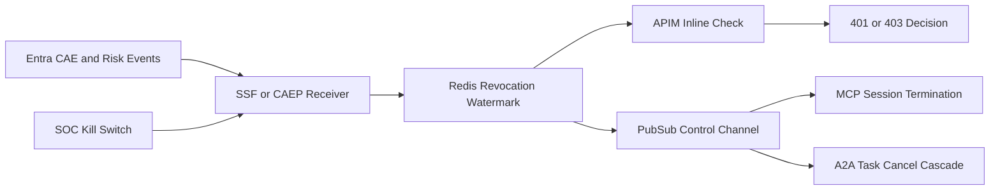
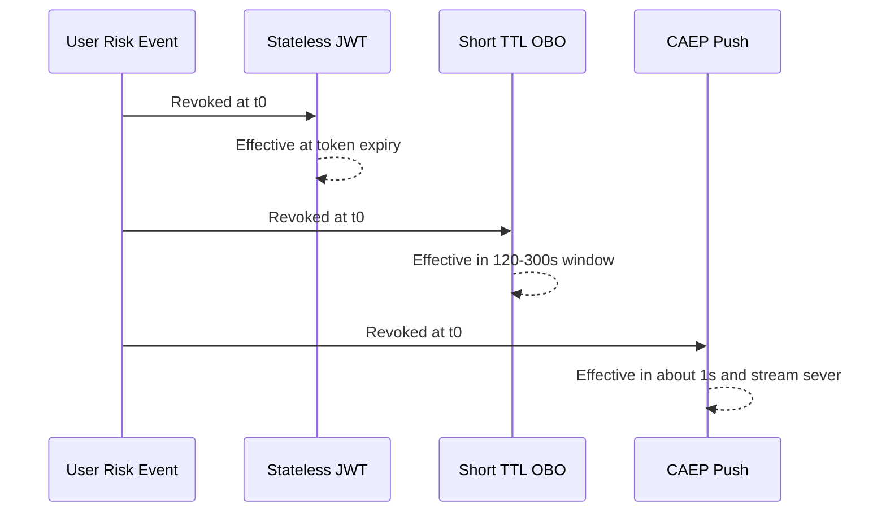

# 企业实时 MCP/A2A 令牌撤销与连续访问评估选型 FAQ（CAE+SSF 推送撤销 vs 短 TTL OBO vs RFC7662 内省）
> Topic ID: #469
> Section: 3.3 AI 网关、MCP 工具治理与跨组织 A2A 协议（AI Gateway, MCP Governance & Cross-Org A2A）
> Audience: 企业 IAM 团队、API 网关团队、MCP/A2A 平台工程团队、SOC 与合规治理团队
> Goal: 将长会话智能体系统的“中途撤销盲窗”缩短到秒级并支持正在进行的流式连接即时切断

## 1）生产问题：长会话智能体打破“JWT 一次验签即可放心运行”的假设
传统 Web API 常把访问令牌验证视为一次性动作。
请求到达时验签通过，即可放行到业务逻辑。
但在 MCP 与 A2A 场景中，会话经常持续 `20–90` 分钟。
连接可能是持续的 `SSE`，也可能是多跳后台任务树。
当账号离职、PIM 角色过期、风险提升或 SOC 发出紧急停机指令时，系统必须“中途失效”而不是“下次请求再失效”。
如果仍沿用纯静态 JWT 逻辑，就会形成长时间可被滥用的安全空窗。

## 2）为何持久流连接会绕过常规网关策略
网关通常在 HTTP 握手阶段执行授权策略。
握手成功后，很多流式通道不会在每个事件帧重复鉴权。
这意味着后续策略变更无法自动作用到已建立连接。
即便新请求已经被拦截，旧连接仍可能持续读取事件或调用工具。
因此，撤销机制必须同时覆盖“新请求拒绝”和“旧会话切断”两条路径。

## 3）四类架构路径总览
Pattern A：`Entra CAE + OpenID SSF/CAEP` 事件推送到 `APIM + Redis` 水位线，并联动 `Mcp-Session-Id` 流断开与 A2A 级联取消。
Pattern B：超短 TTL `OBO` 租约（`120–300s`）降低盲窗，不建设事件推送面。
Pattern C：每次调用走 `RFC 7662` 内省或幻影令牌模式，以同步查询换取更快撤销生效。
Pattern D：纯静态 JWT 验签 + 长连接无中途断流策略。

## 4）十二维对比矩阵
| 维度 | Pattern A（CAE+SSF 推送） | Pattern B（短 TTL OBO） | Pattern C（RFC7662 内省） | Pattern D（反模式） |
|---|---|---|---|---|
| 撤销传播延迟 | 低 | 中 | 低 | 高 |
| 单次调用额外时延 | 低 | 低 | 中高 | 低 |
| IdP RPS 压力 | 低 | 高 | 中高 | 低 |
| 中途流断开能力 | 高 | 低 | 中 | 低 |
| 多跳 A2A 级联取消 | 高 | 中 | 中 | 低 |
| IdP 故障韧性 | 高 | 中 | 低 | 中 |
| 复杂度 | 中高 | 低 | 中 | 低 |
| 合规可解释性 | 高 | 中 | 高 | 低 |
| 对现有网关改造量 | 中 | 低 | 中 | 低 |
| 成本可控性 | 高 | 中 | 中 | 低 |
| 误拦截可回滚性 | 中高 | 中 | 中 | 低 |
| 推荐结论 | 企业主路径 | 过渡方案 | 外部边界补充 | 禁用 |

## 5）Pattern A：CAE+SSF 事件驱动撤销与会话切断（企业主路径）
该模式核心是把“安全事件”变成“可实时执行的网关控制平面”。
Entra 风险、PIM、离职事件或 SOC kill-switch 经 SSF/CAEP Receiver 转换成标准撤销信号。
信号写入 Redis 水位线后，APIM 以亚毫秒查询完成拒绝判定。
同一事件还会广播到 MCP/A2A 运行时，触发活跃会话断开与任务树取消。
这样新请求与旧连接在同一个撤销事务下同时收敛。
该方案兼顾低延迟、强治理与可审计性，是长会话智能体体系的零信任基线。

## 6）Pattern B：短 TTL OBO（过渡与低复杂度方案）
短 TTL 思路简单，靠频繁换发令牌缩短失效窗口。
部署成本低，改造也轻量。
但代价是 IdP `/token` 流量会随并发显著放大。
在大规模多代理并发下，令牌刷新本身会成为瓶颈或抖动源。
更关键的是，窗口仍是分钟级，无法做到秒级主动切断。

## 7）Pattern C：RFC7662 内省（外部边界可选方案）
内省模式把令牌状态判定外包给授权服务器。
优势是撤销几乎即时可见，特别适合外部合作方边界。
缺点是每次调用都引入网络往返与可用性依赖。
若内省端点抖动，网关策略会面临 fail-open 与 fail-close 的艰难取舍。
同时它对持久 SSE 连接仍需额外心跳检查或控制通道补齐。

## 8）Pattern D：反模式清单
仅做 `validate-jwt`，不做 `iat_before` 或会话状态比对。
不维护活动会话索引，无法定位并切断在途连接。
将 A2A 子任务视为独立执行体，不支持上游撤销级联取消。
把撤销生效完全寄托在下一次令牌续期。
这些做法在审计和实战攻防中都会暴露明显缺口。

## 9）Mermaid：端到端撤销与断流架构


## 10）Mermaid：撤销暴露时间线对比


## 11）Q1-Q6 量化公式与阈值
Q1：潜在越权调用次数。
`N_rogue = floor(T_revoke_p99 / T_step)`。
Q2：短 TTL 的 IdP 放大量。
`RPS_idp = N_agents / TTL_token`。
Q3：撤销水位线内存占用。
`Mem ~= N_events * bytes_per_event`，按 TTL 到期自动回收。
Q4：时钟偏差保护。
撤销判断应采用 `iat <= revoked_before + skew`，建议 `skew=2s`。
Q5：网关降级策略。
高风险写操作 fail-close，低风险只读操作可按策略 fail-open 并强审计。
Q6：多跳取消时延。
`T_cancel_tree = T_publish + T_fanout + T_ack`，目标控制在秒级。

## 12）生产代码块 1：APIM 撤销检查与 CAE 挑战（XML）
```xml
<inbound>
  <base />
  <validate-jwt header-name="Authorization" failed-validation-httpcode="401">
    <openid-config url="https://login.microsoftonline.com/{tenant}/.well-known/openid-configuration" />
    <required-claims>
      <claim name="aud">
        <value>api://agent-gateway</value>
      </claim>
    </required-claims>
  </validate-jwt>
  <set-variable name="oid" value="@(context.Principal?.Claims.GetValueOrDefault("oid",""))" />
  <set-variable name="iat" value="@(context.Principal?.Claims.GetValueOrDefault("iat","0"))" />
  <send-request mode="new" response-variable-name="revocationResp" timeout="0.05">
    <set-url>@($"https://redis-check.internal/revoked/{context.Variables["oid"]}")</set-url>
    <set-method>GET</set-method>
  </send-request>
  <choose>
    <when condition="@((int)context.Variables.GetValueOrDefault("revocationResp.status",200) == 409)">
      <return-response>
        <set-status code="401" reason="Unauthorized" />
        <set-header name="WWW-Authenticate" exists-action="override">
          <value>Bearer error="insufficient_claims"</value>
        </set-header>
      </return-response>
    </when>
  </choose>
</inbound>
```

## 13）生产代码块 2：SSF/CAEP SET 接收器（Python）
```python
import json
import time
import redis
from fastapi import FastAPI, Request, HTTPException

app = FastAPI()
r = redis.Redis(host="redis.internal", port=6379, decode_responses=True)

@app.post("/events/set")
async def receive_set(request: Request):
    body = await request.json()
    sub = body.get("sub")
    event_time = int(body.get("iat", time.time()))
    if not sub:
        raise HTTPException(status_code=400, detail="missing sub")
    key = f"revoked:sub:{sub}"
    r.set(key, event_time, ex=5400)
    session_id = body.get("mcp_session_id")
    if session_id:
        r.publish("mcp:session:terminate", json.dumps({"session_id": session_id}))
    task_id = body.get("a2a_task_id")
    if task_id:
        r.publish("a2a:task:cancel", json.dumps({"task_id": task_id}))
    return {"ok": True}
```

## 14）生产代码块 3：MCP SSE 中间件断流（Python/FastAPI）
```python
import asyncio
import json
import redis.asyncio as redis
from fastapi import FastAPI
from sse_starlette.sse import EventSourceResponse

app = FastAPI()
r = redis.Redis(host="redis.internal", port=6379, decode_responses=True)
active_sessions = {}

@app.get("/stream/{session_id}")
async def stream(session_id: str):
    stop_event = asyncio.Event()
    active_sessions[session_id] = stop_event

    async def event_gen():
        while not stop_event.is_set():
            yield {"event": "tick", "data": "alive"}
            await asyncio.sleep(1)

    return EventSourceResponse(event_gen())

async def terminate_listener():
    pubsub = r.pubsub()
    await pubsub.subscribe("mcp:session:terminate")
    async for msg in pubsub.listen():
        if msg["type"] != "message":
            continue
        payload = json.loads(msg["data"])
        sid = payload.get("session_id")
        if sid in active_sessions:
            active_sessions[sid].set()
```

## 15）企业场景与三档三年 TCO
### 15.1 场景 A：全球投行自动化研究与交易中台
平台承载大量长会话 MCP 工具调用与后台 A2A 任务。
过去离职与权限过期撤销经常延迟到下一次令牌轮换才生效。
引入 Pattern A 后，风险事件秒级进入网关与运行时控制面。
在审计抽样中，撤销传播从分钟级降到秒级，且可证明在途连接已被切断。
同时 APIM 调用开销维持在亚毫秒量级，对业务时延影响可控。
### 15.2 场景 B：跨机构医疗授权网络
外部合作边界采用内省模式保证伙伴侧令牌状态一致。
内部核心网络采用 CAEP 推送水位线以降低调用链时延。
双策略组合让跨组织合规与内部性能要求都得到满足。
当患者授权撤回发生时，任务树可级联取消，减少敏感数据继续流动风险。
### 15.3 三档三年 TCO
| 档位 | 并发代理规模 | 推荐组合 | 三年综合 TCO |
|---|---:|---|---:|
| Tier-1 | 2,000 | A 主路径 + B 过渡 | `$2.6M` |
| Tier-2 | 8,000 | A 主路径 + C 外部边界 | `$7.8M` |
| Tier-3 | 20,000 | A 全面主路径 + C 伙伴边界 + B 局部兜底 | `$18.9M` |
### 15.4 架构落地细粒度工程要点
先把撤销事件源清单定义完整，再设计下游执行动作，避免只接入一半信号导致策略盲区。
网关策略建议显式区分“风险升高挑战”与“强制终止”，两者返回码和补救路径要清晰可观测。
对于长连接，务必维护会话索引与控制通道，否则事件到了也找不到要断开的连接对象。
撤销水位线应设计 TTL 与压缩策略，既保证覆盖最大令牌寿命，也避免无界增长。
A2A 级联取消要携带关联标识，确保父任务撤销时可以精确定位子任务而不是全量误杀。
多区域部署时应验证撤销事件复制顺序，避免主备区事件乱序导致短暂策略不一致。
如果业务中存在只读查询路径，可定义受控 fail-open 规则，同时提升审计等级与告警等级。
IdP 或 Redis 维护窗口需要预案，建议通过只读降级与写操作封禁组合控制风险。
安全演练不应只测新请求拒绝，还要测“在途连接切断”与“后台任务停止”的实际时延。
审计报告建议直接展示撤销事件链路时间戳，形成可追溯证据而非口头说明。
开发规范中应要求 MCP 服务暴露会话终止钩子，避免每个团队自行实现导致行为不一致。
在策略上线节奏上，先灰度高风险租户，再扩展全量，能够显著降低误拦截冲击面。
指标体系至少包含撤销传播时延、误拦截率、漏拦截率与连接切断时延四项核心指标。
紧急 kill-switch 的执行权限必须最小化并双人审批，防止误操作引发大面积业务中断。
与 HR/PIM/SOC 系统的接口变更要纳入回归测试，保证事件契约变化不会悄然失效。
平台治理层可设立“撤销生效 SLO”，把安全控制从最佳实践提升为可考核目标。
团队协作时应定义“谁发事件、谁存水位线、谁断连接、谁审计复盘”的责任边界。
季度复盘建议覆盖真实事件与演练事件双样本，持续优化撤销策略和执行路径。
建议在平台门户中暴露“单用户撤销轨迹视图”，让安全团队可直接查看某个主体从事件触发到连接切断的全过程时间戳。
如果企业同时使用多个身份源，先建立统一主体映射表再做撤销下发，否则同一用户在不同系统中的标识不一致会导致漏拦截。
对于高价值工具调用，可增加一次“会话健康探针”二次校验，避免异常长连接在边缘情况下逃逸撤销策略。
当出现批量风险提升事件时，应支持按租户、按业务线、按工具域分层撤销，避免全局一刀切引发不必要业务中断。
建议将撤销事件分为硬终止与软挑战两级策略，前者用于明确违规与高风险，后者用于可恢复风险与补充认证场景。
在故障注入计划中，除了模拟 Redis 不可达，也应模拟消息总线延迟抖动，验证断流广播在异常网络下的稳定性。
对于跨区域部署，可采用区域本地写入加全局异步复制模式，并通过版本号保证后写事件不会被旧事件覆盖。
撤销系统上线初期可启用影子判定模式，先记录“本应拦截”事件再逐步切到强拦截，降低首次上线风险。
若平台存在第三方 MCP 工具供应商，应要求其支持标准会话终止回调接口，否则撤销策略会在边界处失效。
为了减少误操作，应给 kill-switch 动作附加最短冷却时间与人工确认窗，防止连续触发造成级联业务波动。
审计台账建议同时记录“触发来源、执行路径、落地结果、人工介入点”，形成闭环证据而非单点日志。
可以建立撤销演练评分机制，把传播时延、切断成功率、误拦截率作为固定评分项，推动各团队持续改进。
对外部合作方场景，推荐约定统一撤销 SLA 并纳入合同条款，确保合作边界的安全响应能力可被约束。
网关发布流程中应包含撤销策略回归测试，特别是 claims-challenge 格式与客户端兼容性，避免升级后交互失效。
长期规划可将撤销控制平面与风险引擎联动，实现“风险升高自动收紧策略、风险恢复自动放宽策略”的自适应闭环。
### 15.5 Day-0 / Day-1 / Day-2 工程运行清单（18 项）
Day-0：梳理离职、PIM、风险提升、SOC kill-switch 事件源。
Day-0：定义撤销事件统一 schema 与签名校验规则。
Day-0：定义 Redis 水位线键模型与 TTL 策略。
Day-0：定义 APIM 的 401 挑战与 403 终止语义。
Day-0：定义 MCP 会话索引与 A2A 关联标识规则。
Day-0：定义 fail-open/fail-close 业务分级策略。
Day-1：上线 SET 接收器并联调事件签名验证。
Day-1：上线 APIM 撤销查询策略与告警指标。
Day-1：上线 MCP 断流通道与 A2A 取消通道。
Day-1：执行离职、PIM 过期、风险提升三类撤销演练。
Day-1：执行 Redis 故障与 IdP 降级演练。
Day-1：发布撤销链路可观测仪表盘。
Day-2：每周复核撤销传播时延与异常样本。
Day-2：每周抽样校验在途连接切断成功率。
Day-2：每月复核误拦截/漏拦截并调参。
Day-2：每月复核多区域事件一致性。
Day-2：季度复盘 kill-switch 实战与演练结果。
Day-2：季度更新策略手册与审计证据包。

来源（抓取日期 2026-11-27）：
- Microsoft Entra Continuous Access Evaluation: https://learn.microsoft.com/entra/identity/conditional-access/concept-continuous-access-evaluation
- OpenID Shared Signals Framework: https://openid.net/specs/openid-sharedsignals-framework-1_0.html
- OpenID CAEP: https://openid.net/specs/openid-caep-specification-1_0.html
- RFC 8417 Security Event Token: https://www.rfc-editor.org/rfc/rfc8417
- RFC 7662 Token Introspection: https://www.rfc-editor.org/rfc/rfc7662
- Azure API Management policy reference: https://learn.microsoft.com/azure/api-management/api-management-howto-policies
- Azure Managed Redis overview: https://learn.microsoft.com/azure/redis/overview
