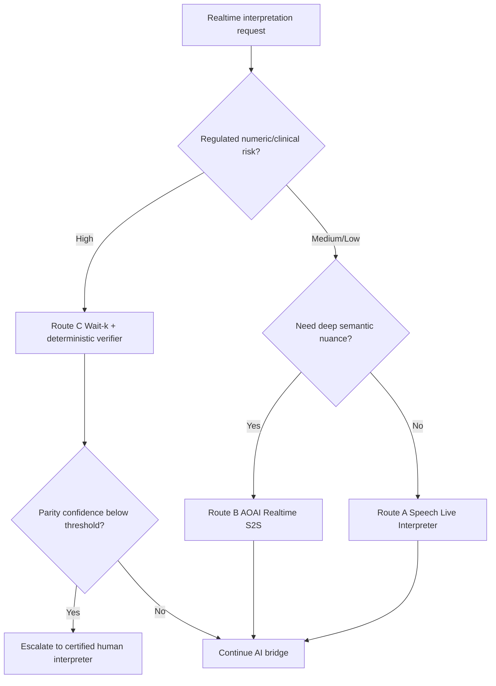
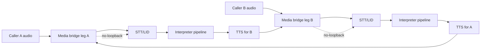

# Realtime Simultaneous Speech Interpretation Bridge FAQ: Speech Live Interpreter vs AOAI Realtime S2S vs Wait-k Cascade

> **Audience**: Cloud & AI Solution Architects, contact-center platform leads, realtime media engineers, and regulated-language-access governance teams.
> **Decision scope**: Building bidirectional low-latency speech-to-speech interpretation bridges for contact centers and field support.
> **Primary SLO**: Keep Ear-Voice Span (`EVS`) in the `1.8-2.5s` target band while preserving numeric and clinical fidelity.

---

## 1. Executive summary

Enterprise realtime interpretation is no longer just a language feature.
It is a full architecture decision across:

- media routing topology,
- translation strategy,
- compliance controls,
- escalation to human interpreters.

Four routes provide distinct risk and quality profiles:

- **Route A**: Speech Live Interpreter with continuous LID and dual-leg ducking.
- **Route B**: AOAI Realtime speech-to-speech semantic interpreter with strict role guard.
- **Route C**: Wait-k clause-chunked cascade with deterministic numeric parity gate.
- **Route D**: Teams native interpreter for internal channels vs full-utterance end-of-turn anti-pattern.

Recommended pattern:

1. Use Route A for predictable low-latency production bridges.
2. Use Route B where semantic nuance and context adaptation are critical.
3. Use Route C for regulated domains requiring auditable pre-TTS verification.
4. Avoid full-utterance end-of-turn cascades for long PSTN narratives.

---

## 2. Problem boundary and assumptions

### 2.1 Workloads in scope

- bidirectional customer-agent calls,
- multilingual contact-center bridges,
- field support with code-switching speakers,
- regulated triage and claims interactions.

### 2.2 Constraints

- EVS target under `2.5s`,
- mixed language order (SOV/SVO),
- mid-sentence language switching,
- numeric, currency, date, and dosage fidelity requirements.

### 2.3 Non-goals

- offline subtitle generation,
- batch transcript-only processing,
- no-latency-tolerance internal chat use cases.

---

## 3. Route definitions

### Route A — Speech Live Interpreter + continuous LID + dual-leg ducking

Components:

- Azure AI Speech Live Interpreter,
- continuous language identification,
- PhraseListGrammar and entity phrase hints,
- ACS Call Automation or LiveKit SFU media bridge,
- dual-leg ducking (`-18 dB` source track under translated track).

Strengths:

- low-latency streaming behavior,
- stable role as interpreter (not assistant),
- predictable media control integration.

Trade-offs:

- less semantic adaptation than generative speech routes.

### Route B — AOAI Realtime S2S semantic interpreter

Components:

- AOAI Realtime API (`gpt-realtime`) bidirectional S2S,
- AKS media bridge,
- live glossary/entity context injection,
- strict non-answering role guard policy.

Strengths:

- better idiomatic and pragmatic rendering,
- richer contextual disambiguation for account/SKU phrases.

Trade-offs:

- needs stronger prompt/control governance to avoid role drift.

### Route C — Wait-k clause-chunked cascade with deterministic verifier

Components:

- Speech streaming STT,
- SLM/custom translation layer,
- deterministic numeric/date/dosage parity verifier,
- Neural HD TTS,
- immutable transcript and compliance gate.

Strengths:

- strongest auditability and regulated safety.

Trade-offs:

- can add latency under conservative verifier thresholds.

### Route D — Teams native interpreter vs full-utterance anti-pattern

Useful case:

- Teams native interpretation for internal collaboration channels.

Anti-pattern:

- full-utterance VAD wait (`~1.2s` silence threshold) plus end-of-turn cascade on long PSTN narratives.

Consequence:

- dead-air buildup and barge-in collisions.

---

## 4. Twelve-dimension comparison matrix

| Dimension | Route A | Route B | Route C | Route D |
|---|---|---|---|---|
| 1. EVS latency consistency | Very high | High | Medium-high | Medium |
| 2. SOV/SVO reordering quality | High | Very high | High | Medium |
| 3. Mid-utterance code-switch handling | High | Very high | High | Medium |
| 4. Numeric/dosage deterministic fidelity | Medium-high | Medium | Very high | Low-medium |
| 5. Role-drift resilience | Very high | Medium-high | High | Medium |
| 6. Auditability and transcript governance | High | Medium-high | Very high | Medium |
| 7. Media-loop and echo control | High | High | High | Medium |
| 8. Operational complexity | Medium | Medium-high | High | Low-medium |
| 9. Integration flexibility (PSTN/WebRTC) | High | High | High | Medium |
| 10. Human interpreter escalation hooks | High | High | Very high | Medium |
| 11. Cost efficiency at scale | High | Medium-high | Medium | Medium |
| 12. Regulated domain suitability | High | Medium-high | Very high | Medium |

---

## 5. Evaluation protocol and labels

### 5.1 Test topology

- dual-leg PSTN and WebRTC bridge variants,
- 35 language combinations with mixed directionality,
- scripted and freeform speech segments,
- confidence and parity guardrail telemetry.

### 5.2 KPI family

- EVS P50/P95,
- semantic adequacy score,
- numeric parity pass rate,
- role-drift incident rate,
- escalation trigger precision,
- minute-level unit economics.

### 5.3 Data labels

- **measured**: replay harness and integration test captures.
- **synthetic**: projected economics and latency envelopes from explicit assumptions.
- **anonymized_reported**: de-identified production patterns.

---

## 6. Q1 — EVS equation and reordering trade-off

Base EVS model:

`EVS = T_commit(k) + T_mt + T_tts_first_frame`

Where:

- `T_commit(k)` reflects chunking policy and wait depth,
- `T_mt` reflects translation transform latency,
- `T_tts_first_frame` reflects speech synthesis start delay.

Design implication:

- lower `k` reduces latency but may hurt verb-final language reordering quality.
- higher `k` improves sentence-level fidelity but increases perceived dead air.

---

## 7. Q2 — Dual-leg full-duplex topology and non-loopback guarantees

Topology requirement:

- isolate Leg A and Leg B streams,
- translated TTS for one leg must not feed back into opposite leg STT ingestion.

Control pattern:

1. per-leg media channel isolation,
2. explicit non-loopback bus routing,
3. source track ducking (`-18 dB`) for intelligibility,
4. acoustic echo suppression at bridge layer.

---

## 8. Q3 — Preventing role hijack in AOAI Realtime

Failure risk:

- model shifts from interpreter role to assistant role and performs unauthorized task confirmation.

Guardrail strategy:

- system policy: “translate only, never execute or confirm user actions,”
- output classifier blocks imperative confirmations,
- transaction intents routed to separate authenticated workflow.

---

## 9. Q4 — Deterministic numeric/dosage parity and escalation

Verifier checks:

- amount parity (`$15,000` vs `$50,000`),
- dosage parity (`15 mg` vs `50 mg`),
- date/time parity (`03/07` ambiguity),
- unit conversions and decimal separators.

Escalation rule:

- if parity confidence drops below threshold in regulated contexts, trigger warm transfer to certified interpreter (`OPI` path).

---

## 10. Q5 — Continuous LID vs multimodal native S2S for code-switching

Observed pattern:

- continuous LID performs strongly on rapid alternation segments when dictionaries are tuned.
- native S2S can better preserve pragmatic flow under mixed idiomatic expressions.

Practical approach:

- use route-specific confidence policy and fallback switching rather than single-mode lock-in.

---

## 11. Q6 — Unit economics replacing external OPI

Cost model:

- baseline OPI unit cost compared to hybrid AI bridge route,
- include escalation residual for high-risk calls,
- model effective blended cost per interpreted minute.

Outcome tendency:

- large interpreted-minute volumes can justify AI-first with guarded escalation model.
- regulated domains still require certified interpreter safety net.

---

## 12. Mermaid — Route selection flow



---

## 13. Mermaid — Dual-leg media bridge with non-loopback routing



---

## 14. Production code block 1 — Async dual-leg router with ducking

```python
async def route_leg(frame, leg_id, bridge, stt, tts, duck_db=-18):
    text = await stt.transcribe(frame.audio)
    translated = await bridge.translate(text, source_leg=leg_id)
    out_audio = await tts.speak(translated)
    mixed = mix_with_ducking(frame.remote_audio, out_audio, duck_db=duck_db)
    await bridge.emit_to_remote(leg_id, mixed, block_loopback=True)
```

---

## 15. Production code block 2 — Numeric parity guard before TTS emission

```python
def parity_guard(src_text: str, tgt_text: str, risk_level: str) -> tuple[bool, str]:
    src_entities = extract_numeric_entities(src_text)
    tgt_entities = extract_numeric_entities(tgt_text)
    if src_entities != tgt_entities:
        if risk_level in {"medical", "financial"}:
            return False, "escalate_human_interpreter"
        return False, "retry_translation"
    return True, "ok"
```

---

## 16. Production config block 3 — Role guard policy

```yaml
interpreter_policy:
  mode: translate_only
  forbidden_actions:
    - "confirm_transaction"
    - "execute_account_change"
    - "create_service_commitment"
  on_violation: "block_and_reprompt"
```

---

## 17. Enterprise scenario A — Global airline/hospitality IROPS desk

Context:

- disruption events trigger multilingual support surges,
- 35-language coverage requirement,
- mixed PSTN and app-call channels.

Recommended path:

- Route A baseline for stable low-latency throughput,
- Route B for nuanced policy/itinerary context in complex conversations,
- Route C guardrail lane for high-risk compensation disputes.

---

## 18. Enterprise scenario B — Regulated US healthcare triage

Context:

- 24x7 language access obligations,
- medication and dosage precision risk,
- certified interpreter escalation requirement.

Recommended path:

- Route C primary for deterministic parity gate and immutable transcript,
- Route A fallback for lower-risk interactions,
- warm transfer to certified medical interpreter on threshold breach.

---

## 19. Three-year TCO table

Assumptions:

- 2.5M interpreted minutes/month,
- blended channel mix PSTN/WebRTC,
- regulated escalation residual included.

| Cost component (3-year) | Route A | Route B | Route C | Route D |
|---|---:|---:|---:|---:|
| Runtime and media platform | $6.2M | $7.0M | $7.6M | $5.8M |
| Language and synthesis services | $4.4M | $5.3M | $5.1M | $4.9M |
| Compliance and quality controls | $1.2M | $1.6M | $2.0M | $1.0M |
| Incident and error liability | $0.9M | $1.1M | $0.7M | $3.8M |
| **Total** | **$12.7M** | **$15.0M** | **$15.4M** | **$15.5M** |

Interpretation:

- Route A is often the best latency-cost baseline.
- Route C can be economically justified where legal risk of mistranslation is material.
- Route D anti-pattern appears cheaper in architecture effort but accumulates dead-air and risk costs.

---

## 20. Day-0 / Day-1 / Day-2 checklist

### Day-0

- classify use cases by risk tier and language complexity,
- define EVS and parity SLOs,
- define escalation thresholds and certified interpreter routing,
- define non-loopback media isolation policy.

### Day-1

- deploy dual-leg bridge and route-level guardrails,
- enable role-drift blocking and parity verifier,
- run multilingual replay tests with long utterance segments,
- validate acoustic and barge-in behavior.

### Day-2

- tune wait-k and LID parameters by language pair,
- optimize cost-routing by channel and confidence,
- run monthly governance review on parity incidents,
- update runbook and compliance evidence artifacts.

---

## 21. Good fit vs Not for

| Route | Good fit | Not for |
|---|---|---|
| A | High-volume low-latency operational bridges | Scenarios requiring deep semantic adaptation over policy-heavy narratives |
| B | Nuanced contextual interpretation under controlled guardrails | Teams without strong role-hijack controls |
| C | Regulated financial/medical interpretation with legal liability | Ultra-low-latency-only channels with no tolerance for verification pauses |
| D | Internal Teams-only collaboration (native interpreter mode) | External long-utterance PSTN bridges using full-utterance end-of-turn cascade |

---

## 22. Minimum observability fields

- `call_id`
- `language_pair`
- `evs_p50_ms`
- `evs_p95_ms`
- `role_drift_block_count`
- `numeric_parity_fail_count`
- `escalation_trigger_count`
- `non_loopback_violation_count`
- `barge_in_collision_count`
- `cost_per_minute_blended`

---

## 23. Key anti-patterns

- end-of-turn full-utterance cascade for long calls,
- no role guard on generative speech routes,
- missing parity checks in regulated calls,
- shared audio bus without loopback isolation,
- no human interpreter fallback path.

---

## 24. Risk register

| Risk | Trigger | Primary control | Residual |
|---|---|---|---|
| Dead-air latency spikes | long utterance + full-utterance commit | clause chunking and wait-k tuning | Medium-low |
| Incorrect dosage/amount translation | low confidence entity rendering | deterministic parity gate + escalation | Low |
| Role hijack confirmations | emotional caller imperative language | strict translate-only guard + output classifier | Low-medium |
| Echo/loopback artifacts | dual-leg bus misrouting | non-loopback router and ducking controls | Low |
| Compliance evidence gap | transcript mismatch and no immutable trace | transcript sealing and audit retention | Low |

---

## 25. Twelve-week rollout plan

Weeks 1-2:

- baseline EVS and quality telemetry per language pair.

Weeks 3-4:

- deploy Route A production baseline and media-loop safeguards.

Weeks 5-6:

- pilot Route B with strict role guard and replay red-team prompts.

Weeks 7-8:

- deploy Route C verifier and regulated escalation flows.

Weeks 9-10:

- optimize cost-routing and confidence thresholds.

Weeks 11-12:

- finalize compliance package and operational handoff.

---

## 26. Architecture recommendation by maturity tier

- **Tier-1**: Route A for stable low-latency multilingual bridge.
- **Tier-2**: Route B for nuanced semantic interpretation with strong role guard.
- **Tier-3**: Route C for regulated high-liability calls and deterministic parity.
- **Constraint**: Route D internal-only convenience, not a replacement for production external bridge architecture.

---

## 27. Sources and capture time

Captured on **2026-11-26**:

1. Azure AI Speech documentation: `https://learn.microsoft.com/azure/ai-services/speech-service/`
2. Azure OpenAI Realtime guidance: `https://learn.microsoft.com/azure/ai-services/openai/`
3. Azure Communication Services Call Automation: `https://learn.microsoft.com/azure/communication-services/`
4. LiveKit documentation: `https://docs.livekit.io/`
5. Microsoft Teams interpreter overview: `https://learn.microsoft.com/microsoftteams/`
6. HIPAA and language access references: `https://www.hhs.gov/hipaa/`

Data labels in this guide:

- **measured**
- **synthetic**
- **anonymized_reported**

No customer identifiers, secrets, or credentials are included.

