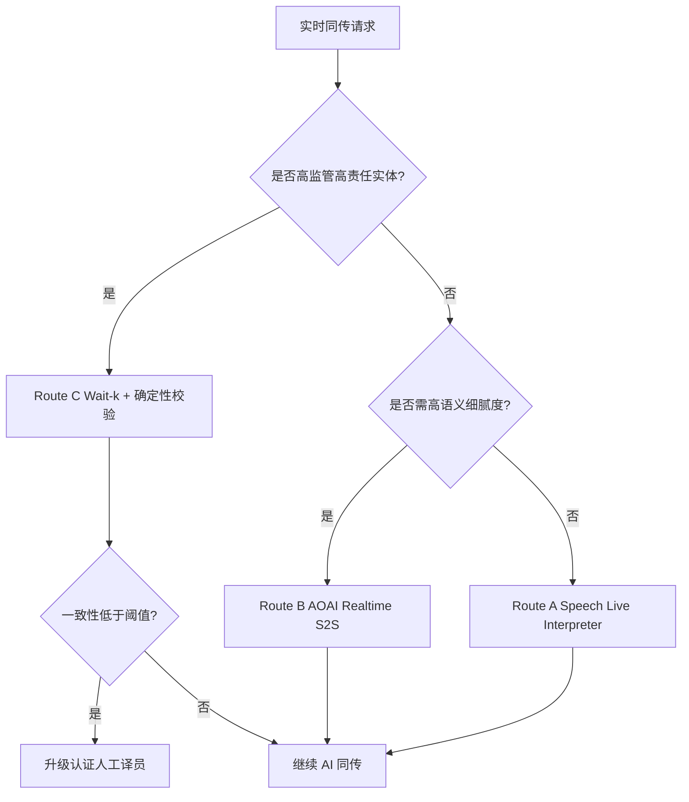
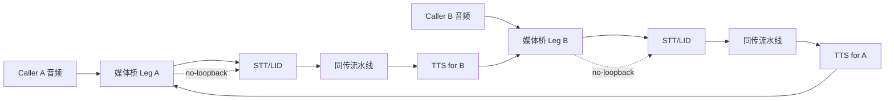

# 实时双向同传语音桥选型 FAQ：Speech Live Interpreter vs AOAI Realtime S2S vs Wait-k Cascade

> **面向角色**：Cloud & AI Solution Architect、联络中心平台负责人、实时媒体工程团队、强监管语言服务治理团队。
> **决策范围**：构建跨语言实时双向语音同传桥（联络中心/现场支持），在低延迟与高保真之间平衡。
> **核心指标**：将耳语延迟跨度 `EVS` 控制在 `1.8-2.5s`，并保障数字、币种、日期、剂量等关键实体一致性。

---

## 1. 执行摘要

企业级实时同传不是单点语音能力，而是全链路架构能力：

- 媒体桥拓扑，
- 翻译策略与上下文注入，
- 合规门禁与可审计记录，
- 人工译员升级闭环。

四条路线各自适配不同业务边界：

- **Route A**：Speech Live Interpreter + 连续 LID + 双路 ducking。
- **Route B**：AOAI Realtime S2S 语义同传 + 严格角色护栏。
- **Route C**：Wait-k 分句级级联 + 数字/剂量确定性校验。
- **Route D**：Teams 内置同传（内部会议）与全句等待级联反模式对照。

总体建议：

1. 大规模低延迟生产桥优先 Route A。
2. 语义细腻度与情绪表达要求高时引入 Route B。
3. 医疗/金融等高责任场景优先 Route C。
4. 避免长 PSTN 叙述走全句等待端到端级联。

在企业生产落地中，建议将“同传准确率、关键实体一致性、会话时延、人工升级率、审计证据完整性”作为同一套发布门禁指标，避免仅以平均延迟做单指标优化，导致上线后在合规场景出现不可接受的业务风险与责任暴露，并引入分层回滚策略。

---

## 2. 问题边界与前提

### 2.1 适用场景

- 客服/支持双向通话同传，
- 跨语种联络中心桥接，
- 现场支持与故障处理对话，
- 强监管双语分诊与理赔场景。

### 2.2 关键约束

- EVS 目标 `<2.5s`，
- SOV/SVO 语序差异（如日语/德语到英语），
- 句中 code-switch，
- 数字/币种/日期/剂量高保真。

### 2.3 不在本篇范围

- 离线字幕批处理，
- 纯文本会后整理，
- 无实时要求的内部聊天场景。

---

## 3. 路线定义

### Route A — Speech Live Interpreter + 连续 LID + 双路 Ducking

组件：

- Azure AI Speech Live Interpreter，
- Continuous Language Identification，
- PhraseListGrammar 与实体短语增强，
- ACS Call Automation 或 LiveKit SFU 媒体桥，
- 双路音频 Ducking（原声 `-18 dB`）。

优势：

- 低延迟稳定，
- 角色漂移风险低（更偏翻译器而非回答器），
- 媒体控制可预测。

代价：

- 对复杂语义重写能力弱于生成式 S2S。

### Route B — AOAI Realtime S2S 语义同传

组件：

- AOAI Realtime（`gpt-realtime`）双向语音模型，
- AKS 媒体桥，
- 实时术语/实体上下文注入，
- translate-only 角色护栏。

优势：

- 语义与语用表达能力强，
- 对账户/SKU 等上下文歧义处理更好。

代价：

- 需更强护栏避免“翻译器变助理”漂移。

### Route C — Wait-k 分句级级联 + 确定性校验门

组件：

- Speech Streaming STT，
- SLM/自定义翻译层，
- 数字/日期/剂量一致性校验器，
- Neural HD TTS，
- 不可变转录与合规门禁。

优势：

- 审计可解释性最强，
- 对高责任实体错误最可控。

代价：

- 在保守阈值下会增加一定时延。

### Route D — Teams 内置同传与反模式对照

可用边界：

- 内部会议协作可直接用 Teams 同传能力。

反模式：

- 面向外部 PSTN 长叙述仍采用“全句等待 + 端点级联”。

后果：

- 死气时延明显，插话冲突增多。

---

## 4. 12 维度对比矩阵

| 维度 | Route A | Route B | Route C | Route D |
|---|---|---|---|---|
| 1. EVS 稳定性 | 很高 | 高 | 中高 | 中 |
| 2. 语序重排质量 | 高 | 很高 | 高 | 中 |
| 3. 句中 code-switch 处理 | 高 | 很高 | 高 | 中 |
| 4. 数字/剂量确定性 | 中高 | 中 | 很高 | 低-中 |
| 5. 角色漂移抑制 | 很高 | 中高 | 高 | 中 |
| 6. 审计可追溯性 | 高 | 中高 | 很高 | 中 |
| 7. 音频回环抑制 | 高 | 高 | 高 | 中 |
| 8. 运维复杂度 | 中 | 中高 | 高 | 低-中 |
| 9. PSTN/WebRTC 适配性 | 高 | 高 | 高 | 中 |
| 10. 人工译员升级能力 | 高 | 高 | 很高 | 中 |
| 11. 规模化成本效率 | 高 | 中高 | 中 | 中 |
| 12. 强监管适配度 | 高 | 中高 | 很高 | 中 |

---

## 5. 评测方法与标签

### 5.1 测试拓扑

- 双路 PSTN 与 WebRTC 桥接，
- 35 个语言组合与双向翻译，
- 规则脚本 + 自由表达混合语料，
- 护栏、置信度与一致性全量观测。

### 5.2 主指标

- EVS P50/P95，
- 语义充分性评分，
- 数字一致性通过率，
- 角色漂移事件率，
- 升级触发准确率，
- 分钟级单位经济性。

### 5.3 数据标签

- **measured**：回放与联调实测。
- **synthetic**：基于明确假设的推导。
- **anonymized_reported**：脱敏生产模式数据。

---

## 6. Q1：EVS 方程与语序重排权衡

基础方程：

`EVS = T_commit(k) + T_mt + T_tts_first_frame`

解释：

- `T_commit(k)` 受分句与等待策略影响，
- `T_mt` 为翻译变换耗时，
- `T_tts_first_frame` 为首帧发声耗时。

结论：

- 降低 `k` 可减时延，但可能降低日语/德语等动词后置语序翻译质量；
- 提高 `k` 提升句法完整度，但会拉高用户体感延迟。

---

## 7. Q2：双路全双工拓扑如何避免回环

要求：

- Leg A 与 Leg B 必须音频隔离，
- 一侧 TTS 绝不能回灌到对侧 STT。

控制要点：

1. 每路独立媒体总线，
2. 非回灌路由标记，
3. 原声 `-18 dB` ducking，
4. 桥接层回声抑制。

---

## 8. Q3：如何防止 AOAI Realtime 角色劫持

风险：

- 用户激动语句触发模型从“翻译”漂移到“执行确认”。

治理：

- 系统策略强制 translate-only，
- 输出分类器拦截执行型确认语，
- 交易动作转入独立鉴权工作流。

---

## 9. Q4：数字/日期/剂量确定性校验与人工升级

校验对象：

- 金额（`$15,000` vs `$50,000`），
- 剂量（`15 mg` vs `50 mg`），
- 日期时间（`03/07` 歧义），
- 单位与小数点格式。

升级规则：

- 医疗/金融高风险会话中，若一致性置信度低于阈值则热转接认证译员。

---

## 10. Q5：code-switch 场景下 Continuous LID 与原生 S2S 取舍

经验观察：

- 连续 LID 在快速语种切换且术语稳定时表现优；
- 原生 S2S 在语义连贯和语用表达上通常更自然。

实践建议：

- 采用“按置信度动态切换”的组合策略，而非单一路线锁死。

---

## 11. Q6：替代第三方 OPI 的单位经济性模型

模型：

- 以 OPI 分钟成本为对照，
- 叠加 AI 路线与人工升级残留成本，
- 计算 blended cost per interpreted minute。

结论倾向：

- 大规模分钟量下，AI 优先 + 护栏升级路径可显著优化成本；
- 强监管场景仍必须保留认证译员兜底。

---

## 12. Mermaid：路线选择决策流



---

## 13. Mermaid：双路媒体桥非回灌拓扑



---

## 14. 生产代码块 1：双路异步路由与 Ducking

```python
async def route_leg(frame, leg_id, bridge, stt, tts, duck_db=-18):
    text = await stt.transcribe(frame.audio)
    translated = await bridge.translate(text, source_leg=leg_id)
    out_audio = await tts.speak(translated)
    mixed = mix_with_ducking(frame.remote_audio, out_audio, duck_db=duck_db)
    await bridge.emit_to_remote(leg_id, mixed, block_loopback=True)
```

---

## 15. 生产代码块 2：TTS 前数字一致性校验

```python
def parity_guard(src_text: str, tgt_text: str, risk_level: str) -> tuple[bool, str]:
    src_entities = extract_numeric_entities(src_text)
    tgt_entities = extract_numeric_entities(tgt_text)
    if src_entities != tgt_entities:
        if risk_level in {"medical", "financial"}:
            return False, "escalate_human_interpreter"
        return False, "retry_translation"
    return True, "ok"
```

---

## 16. 生产配置块 3：角色护栏策略

```yaml
interpreter_policy:
  mode: translate_only
  forbidden_actions:
    - "confirm_transaction"
    - "execute_account_change"
    - "create_service_commitment"
  on_violation: "block_and_reprompt"
```

---

## 17. 企业场景 A：全球航旅 IROPS 多语联动

场景：

- 天气扰动触发多语支持洪峰，
- 35 语种覆盖，
- PSTN 与 App 通话并行。

建议：

- Route A 作为高并发低延迟基线，
- Route B 处理复杂语义争议，
- Route C 作为高风险赔付对话保护层。

---

## 18. 企业场景 B：美国医疗网络 24×7 双语分诊

场景：

- 语言服务合规要求，
- 用药剂量与病历叙述高责任，
- 必须支持认证医疗译员升级。

建议：

- Route C 为主线，
- Route A 处理低风险会话，
- 触发阈值时热转接人工医疗译员。

---

## 19. 三年 TCO 示例

假设：

- 每月 250 万同传分钟，
- PSTN/WebRTC 混合渠道，
- 包含监管升级残留成本。

| 三年成本项 | Route A | Route B | Route C | Route D |
|---|---:|---:|---:|---:|
| 运行时与媒体平台 | $6.2M | $7.0M | $7.6M | $5.8M |
| 语音识别/翻译/合成 | $4.4M | $5.3M | $5.1M | $4.9M |
| 合规与质量治理 | $1.2M | $1.6M | $2.0M | $1.0M |
| 事故与责任损失 | $0.9M | $1.1M | $0.7M | $3.8M |
| **总计** | **$12.7M** | **$15.0M** | **$15.4M** | **$15.5M** |

解读：

- Route A 往往是时延/成本平衡最优基线；
- 高责任实体场景下 Route C 的合规价值可覆盖其额外成本；
- Route D 表面简单，但长对话延迟与风险成本更高。

---

## 20. Day-0 / Day-1 / Day-2 清单

### Day-0

- 按风险等级与语种复杂度分层，
- 定义 EVS 与一致性阈值，
- 定义人工升级策略与值守路径，
- 定义双路非回灌媒体策略。

### Day-1

- 上线双路媒体桥与核心护栏，
- 启用角色漂移拦截与一致性校验，
- 运行长叙述多语回放测试，
- 验证回声与插话体验。

### Day-2

- 依据语种对调优 wait-k/LID 参数，
- 按置信度优化成本路由，
- 月度复盘一致性异常与升级命中，
- 固化运行手册与审计证据模板。

---

## 21. Good fit vs Not for

| 路线 | Good fit | Not for |
|---|---|---|
| Route A | 大规模低延迟多语桥接 | 需要高度语义重写且上下文复杂的特殊场景 |
| Route B | 高语义细腻度与上下文适配 | 没有角色护栏能力的团队 |
| Route C | 医疗/金融等高责任同传 | 纯极致低时延且无法容忍校验停顿的场景 |
| Route D | 内部会议同传便捷通道 | 外部长叙述 PSTN 同传主链路 |

---

## 22. 最小可观测字段

- `call_id`
- `language_pair`
- `evs_p50_ms`
- `evs_p95_ms`
- `role_drift_block_count`
- `numeric_parity_fail_count`
- `escalation_trigger_count`
- `non_loopback_violation_count`
- `barge_in_collision_count`
- `cost_per_minute_blended`

---

## 23. 需要避免的反模式

- 长通话仍走全句等待端点级联，
- 生成式路由无角色护栏，
- 高风险会话缺失实体一致性校验，
- 双路媒体总线无回灌隔离，
- 不提供人工译员升级兜底。

---

## 24. 风险登记

| 风险 | 触发条件 | 主控制措施 | 残余 |
|---|---|---|---|
| 死气时延上升 | 长叙述 + 全句等待 | 分句策略与 wait-k 调优 | 中低 |
| 剂量/金额翻译错误 | 实体低置信度 | 确定性一致性校验 + 升级 | 低 |
| 角色漂移确认错误 | 激烈指令语句 | translate-only + 输出拦截 | 中低 |
| 回声/回灌问题 | 双路路由混线 | non-loopback + ducking | 低 |
| 审计证据不足 | 转录不可追溯 | 不可变转录归档 | 低 |

---

## 25. 12 周推进计划

第 1-2 周：

- 建立语言对 EVS 与质量基线。

第 3-4 周：

- 上线 Route A 与媒体回灌防护。

第 5-6 周：

- 试点 Route B 并引入角色红队回放。

第 7-8 周：

- 部署 Route C 一致性门禁与升级闭环。

第 9-10 周：

- 优化成本路由与置信度策略。

第 11-12 周：

- 完成合规证据包与运维交接。

---

## 26. 分层建议

- **Tier-1**：Route A 作为实时同传生产基线。
- **Tier-2**：Route B 补足语义细腻度并强化护栏。
- **Tier-3**：Route C 面向高责任会话与合规优先场景。
- **约束**：Route D 仅内部会议便捷能力，不替代外部生产桥。

---

## 27. 参考来源与抓取时间

抓取时间：**2026-11-26**

1. Azure AI Speech：`https://learn.microsoft.com/azure/ai-services/speech-service/`
2. Azure OpenAI：`https://learn.microsoft.com/azure/ai-services/openai/`
3. Azure Communication Services：`https://learn.microsoft.com/azure/communication-services/`
4. LiveKit：`https://docs.livekit.io/`
5. Microsoft Teams 解释频道：`https://learn.microsoft.com/microsoftteams/`
6. HIPAA 资料：`https://www.hhs.gov/hipaa/`

本指南使用的数据标签：

- **measured**
- **synthetic**
- **anonymized_reported**

本文不包含客户可识别数据、凭据或密钥。

