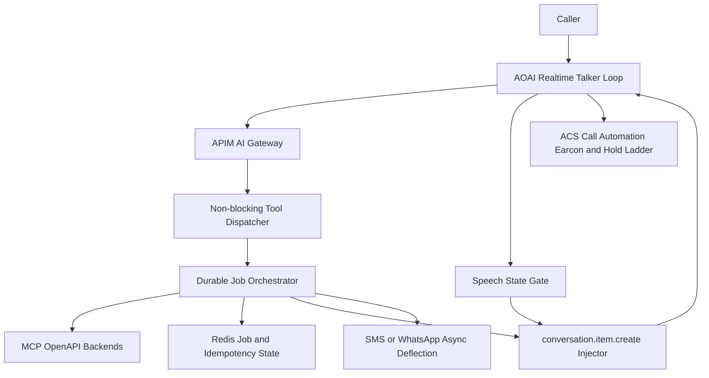
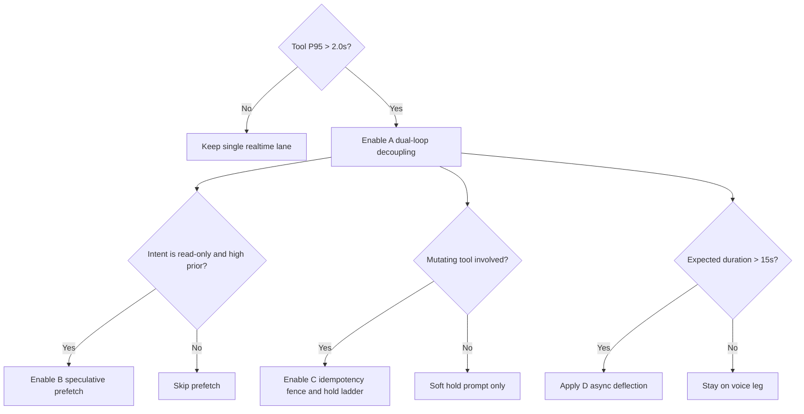
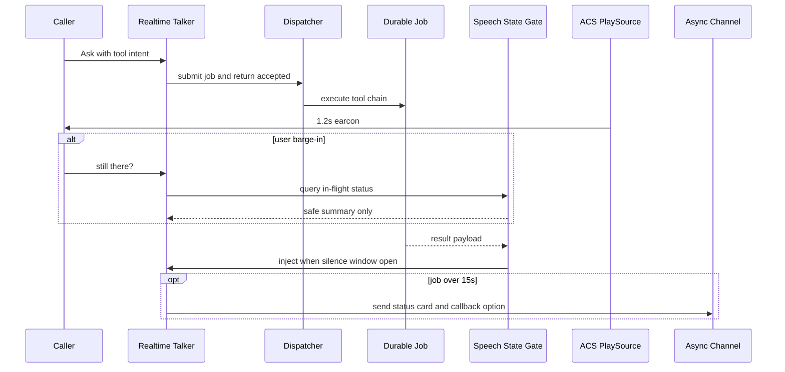

# Enterprise realtime voice-agent slow-tool latency masking selection FAQ: dual-loop Talker/Thinker vs speculative prefetch vs ACS async bridge

> 🌐 **Language Switch**: [中文](./realtime-voice-agent-slow-tool-latency-masking-dual-loop-talker-thinker-aoai-realtime-vs-speculative-prefetch-vs-acs-async-bridge-selection-faq.md) | **English (current)**
> **Audience**: Cloud & AI Solution Architects, voice platform teams, contact-center engineering, MCP tool platform owners, and FinOps teams.
> **Problem Context**: Tool-free voice demos can stay under `<400ms`, but production tool calls create `2.5s–30s` dead-air gaps.
## 1. Why production voice agents create dead-air windows

Demo paths usually validate streaming speech only and avoid slow enterprise systems.
When tool latency exceeds `~2.0s`, callers say “hello?” and trigger VAD `speech_started` conflicts.

Without turn-state fencing, `function_call_output` can be overwritten or replayed by interruption turns.
For mutating APIs, replay can trigger duplicate booking, payment, or fraud actions.

Meanwhile Realtime audio tokens continue burning during silence, turning wait time into direct cost leakage.
The core architectural objective is not only faster models, but decoupled slow-tool execution with safe reinjection.

## 2. Four failure chains and early warning signals
Failure chain one is dead-air-driven hang-up when no feedback is heard after `>2.0s`.

Failure chain two is VAD interruption races causing duplicate mutating calls.
Failure chain three is speculative miss amplification that inflates backend QPS.

Failure chain four is long-running tool lock-in that keeps expensive voice legs open for low-value waiting.
Core telemetry should include dead-air ratio, barge-in conflict rate, idempotency-lock collisions, and audio token/min.

## 3. Reference architecture: decoupled Fast-Talker and Slow-Thinker loops


The Talker loop maintains conversational continuity and must return `accepted + job_id` within `<30ms`.
The Thinker loop handles slow reasoning and tool chains asynchronously without blocking voice turns.

Result reinjection must pass a speech-state gate and only occur when neither side is speaking.
## 4. Architecture A: dual-loop Fast-Talker / Slow-Thinker

Architecture A keeps Realtime voice as frontline UX and moves heavy tool work out of band.
Callers hear immediate progress instead of silence while slow operations continue in the background.

The supervisor can run on MAF, Durable, or lightweight reasoning workers focused on tool orchestration.
The key challenge is intent drift; stale job results must be cancelled or superseded safely.

A practical consistency key is `root_turn_id + job_id + intent_version`.
## 5. Architecture B: ANI and partial-transcript speculative prefetch (read-only)

Architecture B uses ANI, account profile, and early ASR fragments to prefetch read-only data.
Typical targets include CRM profile snapshots, ticket history, and read-only RAG candidates.

When hit, a `2.8s` backend lookup can become a `<15ms` Redis cache read.
The downside is wasted QPS from false-positive intent speculation (`1.2x–1.8x` overhead).

B must enforce `readOnlyHint=true` and never pre-execute mutating operations.
## 6. Architecture C: ACS tiered hold pacing plus idempotent tool fencing

Architecture C uses `ACS PlaySource` earcons and comfort prompts at `1.2s / 4.5s / 10s`.
This keeps users engaged with near-zero LLM token cost while tools are still running.

In parallel, Redis idempotency locks ensure only one in-flight mutation per business key.
When users interrupt with “still there?”, the system returns status only and suppresses duplicate writes.

C requires careful brand and UX tuning so hold pacing sounds deliberate rather than robotic.
## 7. Architecture D: async deflection for `>15s` SLA operations

Architecture D deflects very long tasks to asynchronous channels and closes or parks the voice leg.
Callers receive ACS SMS/WhatsApp status cards or scheduled callback windows.

This dramatically reduces idle audio-token burn and caller frustration for back-office workflows.
The design requires verifiable status artifacts bound to the original voice session ID.

In regulated sectors, async messages must use strict data minimization to avoid sensitive leakage.
## 8. Quantitative formulas: hang-up risk, prefetch value, audio-token burn

Dead-air hang-up probability can be approximated as `P_drop = 1 - exp(-k * max(0, silence_s - 2.0))`.
`k` is calibrated from call logs and often falls in `0.28–0.46` by workload.

Speculative value can be modeled as `Gain = hit_rate * saved_latency - miss_rate * extra_qps_penalty`.
If `Gain <= 0`, tighten trigger criteria or increase intent-confidence thresholds.

Realtime audio cost approximation is `Cost_audio = minutes * token_rate_per_min * price_per_token`.
Async deflection savings approximation is `Saving = diverted_minutes * token_rate_per_min * price_per_token`.

## 9. 12-dimension enterprise comparison matrix
| Dimension | A Dual-loop decoupling | B Speculative prefetch | C ACS hold plus idempotency fence | D Async deflection |
|---|---|---|---|---|
| Dead-air mitigation | High | Medium-High | High | Highest for long tasks |
| Mutating-tool safety | High | Low (read-only) | Highest | High |
| Conversational continuity | High | Medium-High | Medium-High | Medium |
| Slow-tool tolerance | High | Medium | Medium-High | Highest |
| Backend QPS control | Medium-High | Medium-Low | High | High |
| Implementation complexity | High | Medium | Medium | Medium-High |
| State-consistency governance | High | Medium | Medium-High | Medium |
| Audio-token cost control | High | Medium | High | Highest |
| Channel extensibility | Medium | Medium | Medium | High |
| Compliance traceability | High | Medium-High | High | High |
| Best-fit workload | mixed tool chains at scale | high-hit read-only contexts | high-risk mutable tools | long back-office workflows |
| Not-for workload | ultra-simple FAQ hotline | write-heavy transactional paths | no ACS capability at all | strict real-time closure transactions |

## 10. Decision flow: dual-loop first, then prefetch, then async deflection


Most teams stabilize fastest with A+C first, then add B selectively, then apply D for long-tail tasks.


## 11. Production artifacts: async dispatcher and speech-state-gated reinjection
```python
import asyncio
import json
import time
from dataclasses import dataclass
from redis.asyncio import Redis

@dataclass
class SpeechState:
    caller_speaking: bool = False
    agent_speaking: bool = False
    last_state_ts: float = 0.0
class ToolDispatcher:
    def __init__(self, redis: Redis):
        self.redis = redis

    async def submit(self, root_turn_id: str, intent_version: int, payload: dict) -> str:
        job_id = f"job:{root_turn_id}:{intent_version}:{int(time.time()*1000)}"
        await self.redis.hset(job_id, mapping={"status": "accepted", "payload": json.dumps(payload)})
        return job_id
    async def run_mutation_once(self, idem_key: str, coro):
        lock_key = f"idem:{idem_key}"
        if not await self.redis.set(lock_key, "1", ex=120, nx=True):
            return {"status": "duplicate_suppressed"}
        try:
            result = await coro()
            return {"status": "ok", "result": result}
        finally:
            await self.redis.delete(lock_key)

class RealtimeInjector:
    def __init__(self, speech_state: SpeechState):
        self.speech_state = speech_state
    async def inject_when_safe(self, ws, conversation_id: str, content: str):
        while self.speech_state.caller_speaking or self.speech_state.agent_speaking:
            await asyncio.sleep(0.05)
        event = {
            "type": "conversation.item.create",
            "conversation_id": conversation_id,
            "item": {"type": "message", "role": "assistant", "content": [{"type": "text", "text": content}]},
        }
        await ws.send(json.dumps(event))
        await ws.send(json.dumps({"type": "response.create"}))
```

```xml
<policies>
  <inbound>
    <base />
    <set-header name="x-job-accepted" exists-action="override"><value>true</value></set-header>
    <rate-limit-by-key calls="1200" renewal-period="60" counter-key="@(context.Subscription.Id + "-voice-tools")" />
    <set-variable name="toolReadOnly" value="@(context.Request.Headers.GetValueOrDefault("x-readonly","false"))" />
    <choose>
      <when condition="@(context.Variables.GetValueOrDefault<string>("toolReadOnly") != "true" && context.Request.Headers.ContainsKey("x-speculative"))">
        <return-response>
          <set-status code="400" reason="Speculative writes are forbidden" />
        </return-response>
      </when>
    </choose>
  </inbound>
  <backend><base /></backend>
  <outbound><base /></outbound>
</policies>
```
```yaml
hold_ladder:
  t_1_2s:
    action: play_earcon
    text: "Processing now, thank you for waiting."
  t_4_5s:
    action: play_earcon
    text: "Still working on it, you can add more details."
  t_10s:
    action: offer_async
    text: "This is taking longer, I can send a status card and arrange a callback."
```

## 12. Scenario KPI outcomes: SaaS support and healthcare eligibility hotline
Scenario A is a multi-tenant SaaS billing support center with `120k` daily calls and fraud checks.

After A+C rollout, dead-air ratio dropped from `18.4%` to `4.1%` and duplicate charge incidents fell by `93%`.
With selective B rollout, read-only prefetch hit rate reached `61%` and perceived wait time dropped by `1.7s`.

Scenario B is a healthcare eligibility hotline with many `>15s` insurer checks and low caller wait tolerance.
With D enabled, long-task on-call minutes dropped by `42%`, with strict privacy-minimized status messaging.

| KPI | Baseline single-loop | A+C | A+B+C | A+B+C+D |
|---|---:|---:|---:|---:|
| Dead-air `>2s` ratio | `18.4%` | `4.1%` | `3.6%` | `2.9%` |
| Barge-in conflict rate | `7.8%` | `2.7%` | `2.5%` | `2.3%` |
| Duplicate mutation events / 100k calls | `29` | `2` | `2` | `1` |
| Average audio token/min | `14,200` | `10,900` | `9,700` | `8,100` |
| Caller hang-up rate | `12.6%` | `8.4%` | `7.9%` | `6.8%` |
### 3-year TCO (1M / 5M / 10M annual calls)

| Path | 1M calls/year | 5M calls/year | 10M calls/year | 3-year total |
|---|---:|---:|---:|---:|
| Baseline single-loop | `$3.90M` | `$16.80M` | `$31.20M` | `$51.90M` |
| A dual-loop | `$3.42M` | `$14.90M` | `$27.60M` | `$45.92M` |
| A+B dual-loop plus prefetch | `$3.36M` | `$14.10M` | `$26.40M` | `$43.86M` |
| A+C dual-loop plus fencing | `$3.20M` | `$13.70M` | `$25.70M` | `$42.60M` |
| A+B+C+D full pattern | `$3.05M` | `$12.80M` | `$23.90M` | `$39.75M` |
## 13. Day-0 / Day-1 / Day-2 rollout checklist

### Day-0
1. Classify tool catalog by read/write behavior and define idempotency business keys.

2. Define dual-loop event contract with `root_turn_id / job_id / intent_version`.
3. Define speech-state gate conditions for safe and blocked reinjection windows.

4. Configure ACS `1.2s / 4.5s / 10s` hold ladder with approved brand copy.
5. Configure Redis idempotency lock TTL and collision alert thresholds.

### Day-1
1. Launch A+C as minimum safe path to eliminate duplicate mutation risk first.

2. Canary B for high-prior read-only intents and monitor QPS overhead versus hit value.
3. Build dashboards for dead-air, barge-in conflicts, and duplicate suppression.

4. Enable D for `>15s` tool chains and validate SMS/WhatsApp delivery success.
5. Complete privacy-minimization audit for recording, transcript, and async status content.

### Day-2
1. Tune trigger thresholds by tenant and workload profile.

2. Feed drift samples into evaluation sets to reduce false prefetch and stale reinjection.
3. Add budget guardrails using audio token/min and call-value tiers.

4. Sync async completion outcomes into CRM for end-to-end SLA tracking.
5. Reassess Good fit/Not for boundaries weekly to prevent architecture drift.

## 14. Quantitative Q&A (Q1~Q6)
### Q1: Why prioritize dual-loop before speculative prefetch?

Dual-loop removes blocking from the voice critical path, which is root-cause mitigation.
Prefetch is probabilistic acceleration and cannot replace structural decoupling.

### Q2: When should prefetch be disabled?
Disable when intent volatility is high, mutation ratio is high, or QPS penalty exceeds latency savings.

A practical guardrail is to disable if `hit_rate < 35%` under material backend cost.
### Q3: How do we verify idempotency fencing effectiveness?

Track duplicate-suppressed counts and business duplicate incidents together.
If duplicates persist, business key granularity is likely insufficient.

### Q4: When should async deflection be applied?
Apply when expected tool duration exceeds `15s` and business policy allows non-realtime closure.

For strict real-time transactions, keep the voice leg and strengthen hold pacing instead.
### Q5: How should audio-token budgets be set?

Set target `token/min` caps by scenario value, then back-calculate acceptable silent minutes and deflection ratio.
Budget policy should optimize value-adjusted outcomes, not token minimization alone.

### Q6: How do we balance natural UX with auditability?
Keep natural conversational handling in Talker while routing high-risk commitments through controlled gates.

Record `who/when/state` on each reinjection event to preserve forensic traceability.
## 15. Good fit / Not for and runtime alert dictionary

**Good fit**
- Tool-latency distribution has long tails with P95 above `2s`.
- Workloads require both conversational continuity and mutation safety.
- Platform already has ACS and Redis-grade state services.

**Not for**
- Ultra-light FAQ hotlines with almost no tool calls.
- Legacy systems without usable idempotency business keys.
- Organizations without async notification and callback operations.

**Runtime alert dictionary**
- `ALERT_DEAD_AIR_P95_OVER_2S`: silence window exceeds threshold, inspect loop-blocking path.
- `ALERT_DUPLICATE_MUTATION`: idempotency fence failure or missing business key.
- `ALERT_PREFETCH_QPS_WASTE`: speculative trigger too broad, tighten filters.
- `ALERT_ASYNC_DELIVERY_FAIL`: async card delivery failed, closure reliability at risk.
- `ALERT_INJECTION_STATE_VIOLATION`: reinjection attempted while someone is speaking.
