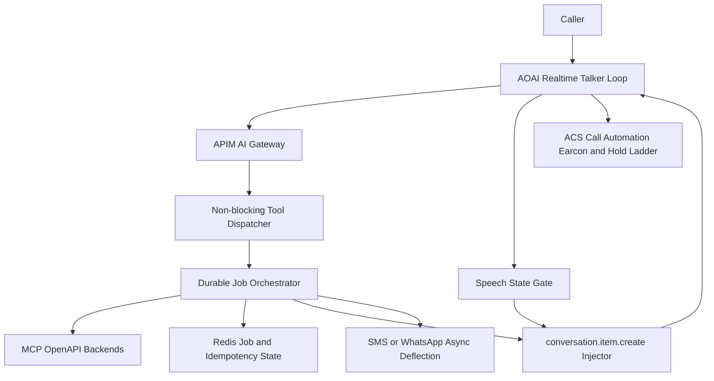
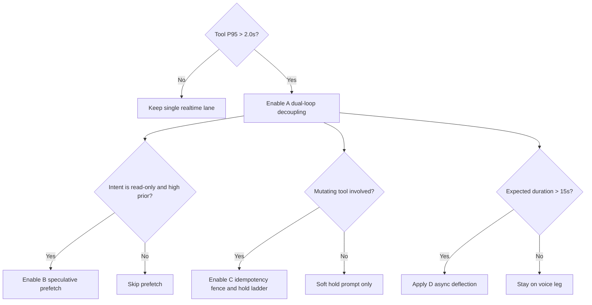
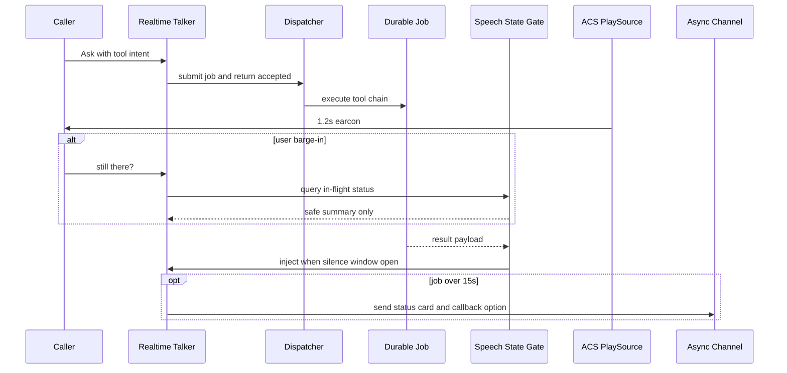

# 企业实时语音 Agent 慢工具延迟掩蔽选型 FAQ：双环 Talker/Thinker vs 预测预取 vs ACS 异步桥接

> 🌐 **Language Switch**：**中文（当前）** | [English](./realtime-voice-agent-slow-tool-latency-masking-dual-loop-talker-thinker-aoai-realtime-vs-speculative-prefetch-vs-acs-async-bridge-selection-faq.en.md)
> **适用对象**：Cloud & AI Solution Architect、语音平台、联络中心、MCP 工具平台与 FinOps 团队。
> **问题背景**：语音 Agent 在无工具调用时可稳定 `<400ms` 转折，但接入慢后端后会出现 `2.5s–30s` 静默断层。
## 1. 为什么语音 Agent 在生产环境会出现“死寂空窗”

演示环境常只验证对话回声与流式 token，不覆盖 SAP、FHIR、D365、反欺诈等慢工具。
当工具时延超过 `~2.0s`，用户会说“还在吗”，触发 VAD `speech_started` 与并发轮次冲突。

如果运行时没有状态门控，`function_call_output` 会被后续语音打断覆盖或重复触发。
对可变更工具而言，重复调用会放大账务与订单风险，且导致不可逆业务副作用。

语音链路还会持续消耗 Realtime 音频 token，静默等待本身就是成本泄漏。
因此核心不是“更快模型”，而是“把慢工具从语音主回路解耦并可审计地回注结果”。

## 2. 四类常见故障链与早期信号
故障链一是死寂触发挂断，PSTN 用户在连续 `>2.0s` 无反馈时快速流失。

故障链二是 VAD 抢占导致双写，出现同一订单重复提交与重复扣款。
故障链三是 speculative 误命中，读请求预取失真造成后端 QPS 被白白放大。

故障链四是长耗时工具占线，`>15s` 任务拖垮 Realtime 成本并降低坐席接续效率。
关键监测指标应包括 dead-air 比例、barge-in 冲突率、幂等锁碰撞率与音频 token/min。

## 3. 参考架构：Fast-Talker 与 Slow-Thinker 双环解耦


Talker 回路负责自然交互与槽位补齐，必须在 `<30ms` 返回 `accepted + job_id`。
Thinker 回路负责慢推理与慢工具，允许秒级到分钟级执行，但不得阻塞 Talker。

结果回注必须通过 speech-state gate，仅在双方都不说话时发 `conversation.item.create`。
## 4. Architecture A：Dual-Loop Fast-Talker / Slow-Thinker

A 架构以 Realtime 语音前台承接互动，把重工具调用转入 OOB Supervisor。
优势是用户始终感知到“系统在响应”，而不是“系统在卡住”。

Supervisor 可由 MAF、Durable 或轻量推理模型承载，专注工具编排与结果裁剪。
关键约束是 intent 变更时要做 job-cancel 或 supersede，避免旧结果回注污染新意图。

A 的状态一致性建议采用 `root_turn_id + job_id + intent_version` 三元键。
## 5. Architecture B：ANI + 部分转写预测预取（只读）

B 在呼叫建立时用 ANI、账户画像与早期 ASR 片段触发只读查询预热。
典型预热对象是 CRM 概览、工单历史、只读 RAG 摘要与知识库命中候选。

在命中场景中，原始 `2.8s` 查询可被 `Redis` 热缓存压到 `<15ms`。
B 的风险是误判意图导致无效预取，带来 `1.2x–1.8x` 后端额外 QPS。

因此 B 必须硬性限制 `readOnlyHint=true`，严禁预执行任何写操作工具。
## 6. Architecture C：ACS Earcon 分级占位 + 幂等工具围栏

C 使用 `ACS PlaySource` 在 `1.2s / 4.5s / 10s` 阶梯点位播放占位耳标与安抚短句。
该模式可零 LLM token 成本维持在场感，防止“死寂”触发二次打断。

同时以 Redis 幂等锁保护可变更工具，保证同一业务键仅有一个 in-flight 执行。
当用户说“还在吗”时只返回状态摘要，不重复发起 payment/booking/fraud 写请求。

C 的边界是耳标节奏必须与品牌语音一致，否则会造成机械化体验。
## 7. Architecture D：`>15s` 异步转移（票据 + 外呼回连）

D 将超长 SLA 任务切到异步信道，结束或暂停语音腿，保留可追踪工单。
用户可收到 ACS SMS/WhatsApp 状态卡，或预约回拨时间窗口。

该模式显著降低长时占线 token 成本，并减少用户对“等待”的心理损耗。
D 的前提是状态卡必须可验真、可追踪，且与语音会话 id 对齐。

对于金融与医疗场景，异步通知内容必须最小暴露，避免敏感字段外泄。
## 8. 定量公式：死寂挂断、预取命中与音频成本

死寂挂断概率可近似 `P_drop = 1 - exp(-k * max(0, silence_s - 2.0))`。
其中 `k` 可由历史呼叫拟合，不同业务线可在 `0.28–0.46` 区间。

预测预取有效收益可写作 `Gain = hit_rate * saved_latency - miss_rate * extra_qps_penalty`。
若 `Gain <= 0`，应收缩预取触发器或提高意图置信阈值。

Realtime 音频成本近似 `Cost_audio = minutes * token_rate_per_min * price_per_token`。
异步转移节省近似 `Saving = diverted_minutes * token_rate_per_min * price_per_token`。

## 9. 12 维企业比较矩阵（中文）
| 维度 | A 双环解耦 | B 预测预取 | C ACS 占位+幂等围栏 | D 异步转移 |
|---|---|---|---|---|
| 死寂缓解能力 | 高 | 中高 | 高 | 最高（长任务） |
| 可变更工具安全性 | 高 | 低（仅只读） | 最高 | 高 |
| 用户连续对话体验 | 高 | 中高 | 中高 | 中 |
| 对慢工具的容忍度 | 高 | 中 | 中高 | 最高 |
| 后端 QPS 控制 | 中高 | 中低 | 高 | 高 |
| 平台实现复杂度 | 高 | 中 | 中 | 中高 |
| 状态一致性治理难度 | 高 | 中 | 中高 | 中 |
| 音频 token 成本控制 | 高 | 中 | 高 | 最高 |
| 渠道扩展性（SMS/WA） | 中 | 中 | 中 | 高 |
| 合规与审计可追溯性 | 高 | 中高 | 高 | 高 |
| 最佳适配场景 | 大规模工具混合 | 高命中只读查询 | 高风险写工具 | 超长耗时流程 |
| 不适合场景 | 简单 FAQ 热线 | 高写入型场景 | 完全无 ACS 能力 | 必须实时闭环的秒级交易 |

## 10. 决策流：何时双环、何时预取、何时异步


落地顺序通常是先做 A 与 C，再以数据证据扩展 B，最后引入 D 处理超长流程。


## 11. 生产级代码片段：异步调度与语音状态门控回注
```python
import asyncio
import json
import time
from dataclasses import dataclass
from redis.asyncio import Redis

@dataclass
class SpeechState:
    caller_speaking: bool = False
    agent_speaking: bool = False
    last_state_ts: float = 0.0
class ToolDispatcher:
    def __init__(self, redis: Redis):
        self.redis = redis

    async def submit(self, root_turn_id: str, intent_version: int, payload: dict) -> str:
        job_id = f"job:{root_turn_id}:{intent_version}:{int(time.time()*1000)}"
        await self.redis.hset(job_id, mapping={"status": "accepted", "payload": json.dumps(payload)})
        return job_id
    async def run_mutation_once(self, idem_key: str, coro):
        lock_key = f"idem:{idem_key}"
        if not await self.redis.set(lock_key, "1", ex=120, nx=True):
            return {"status": "duplicate_suppressed"}
        try:
            result = await coro()
            return {"status": "ok", "result": result}
        finally:
            await self.redis.delete(lock_key)

class RealtimeInjector:
    def __init__(self, speech_state: SpeechState):
        self.speech_state = speech_state
    async def inject_when_safe(self, ws, conversation_id: str, content: str):
        while self.speech_state.caller_speaking or self.speech_state.agent_speaking:
            await asyncio.sleep(0.05)
        event = {
            "type": "conversation.item.create",
            "conversation_id": conversation_id,
            "item": {"type": "message", "role": "assistant", "content": [{"type": "text", "text": content}]},
        }
        await ws.send(json.dumps(event))
        await ws.send(json.dumps({"type": "response.create"}))
```

```xml
<policies>
  <inbound>
    <base />
    <set-header name="x-job-accepted" exists-action="override"><value>true</value></set-header>
    <rate-limit-by-key calls="1200" renewal-period="60" counter-key="@(context.Subscription.Id + "-voice-tools")" />
    <set-variable name="toolReadOnly" value="@(context.Request.Headers.GetValueOrDefault("x-readonly","false"))" />
    <choose>
      <when condition="@(context.Variables.GetValueOrDefault<string>("toolReadOnly") != "true" && context.Request.Headers.ContainsKey("x-speculative"))">
        <return-response>
          <set-status code="400" reason="Speculative writes are forbidden" />
        </return-response>
      </when>
    </choose>
  </inbound>
  <backend><base /></backend>
  <outbound><base /></outbound>
</policies>
```
```yaml
hold_ladder:
  t_1_2s:
    action: play_earcon
    text: "正在处理中，请稍候。"
  t_4_5s:
    action: play_earcon
    text: "我仍在处理，您也可以继续补充信息。"
  t_10s:
    action: offer_async
    text: "该请求耗时较长，可转短信状态卡并稍后回拨。"
```

## 12. 场景 KPI：SaaS 语音支持与医疗保险核验热线
场景一是多租户 SaaS 计费支持中心，日均 `120k` 呼叫，慢工具主要为账单与反欺诈校验。

采用 A+C 后，死寂占比从 `18.4%` 降到 `4.1%`，重复扣费事件下降 `93%`。
再引入 B，只读预取命中率达到 `61%`，P95 工具等待感知时长下降 `1.7s`。

场景二是医疗保险核验热线，存在大量 `>15s` 后台核验，用户容忍等待低。
引入 D 后，长任务占线分钟下降 `42%`，但必须强化状态卡用词合规与隐私最小化。

| KPI 指标 | 基线单环 | A+C | A+B+C | A+B+C+D |
|---|---:|---:|---:|---:|
| Dead-air `>2s` 占比 | `18.4%` | `4.1%` | `3.6%` | `2.9%` |
| Barge-in 冲突率 | `7.8%` | `2.7%` | `2.5%` | `2.3%` |
| 重复写操作事件/10万通 | `29` | `2` | `2` | `1` |
| 平均音频 token/min | `14,200` | `10,900` | `9,700` | `8,100` |
| 用户主动挂断率 | `12.6%` | `8.4%` | `7.9%` | `6.8%` |
### 三年 TCO（100万 / 500万 / 1000万 年呼叫量）

| 路径 | 100万 calls/year | 500万 calls/year | 1000万 calls/year | 三年总成本 |
|---|---:|---:|---:|---:|
| 基线单环 | `$3.90M` | `$16.80M` | `$31.20M` | `$51.90M` |
| A 双环 | `$3.42M` | `$14.90M` | `$27.60M` | `$45.92M` |
| A+B 双环+预取 | `$3.36M` | `$14.10M` | `$26.40M` | `$43.86M` |
| A+C 双环+围栏 | `$3.20M` | `$13.70M` | `$25.70M` | `$42.60M` |
| A+B+C+D 全组合 | `$3.05M` | `$12.80M` | `$23.90M` | `$39.75M` |
## 13. Day-0 / Day-1 / Day-2 落地清单

### Day-0
1. 定义慢工具目录与读写分类，标记 `readOnlyHint` 与幂等业务键。

2. 设计双环事件模型，固化 `root_turn_id / job_id / intent_version` 关联键。
3. 定义 speech-state gate 条件，明确可回注窗口与禁注窗口。

4. 配置 ACS `1.2s / 4.5s / 10s` 占位节奏与品牌文案。
5. 建立 Redis 幂等锁 TTL 与冲突告警阈值。

### Day-1
1. 上线 A+C 最小可用路径，先把重复写操作风险压到可控区间。

2. 对只读高命中意图灰度 B 预取，实时监控额外 QPS 与命中收益。
3. 建立 dead-air、barge-in、duplicate-suppressed 三类核心仪表盘。

4. 对 `>15s` 工具链引入 D 异步转移，并验证短信/WhatsApp 到达率。
5. 完成录音、转写、状态卡的最小化隐私审计。

### Day-2
1. 按租户与场景细分阈值，动态调整预取触发与占位节奏。

2. 将异常样本回灌评估集，持续优化误预取与误回注。
3. 引入成本预算护栏，按音频 token/min 与呼叫价值进行分层路由。

4. 把异步闭环结果接入 CRM，形成可追踪 SLA 与回访链路。
5. 每周复盘 Good fit/Not for 边界，防止场景漂移导致架构退化。

## 14. 六个量化问答（Q1~Q6）
### Q1: 为什么先做双环而不是先上预测预取？

因为双环直接切断慢工具对语音主回路的阻塞，是根因治理。
预取只是概率优化，不能替代阻塞隔离。

### Q2: 何时不该启用预取？
当意图不稳定、写操作比例高或命中收益低于额外 QPS 成本时不应启用。

经验上若 `hit_rate < 35%` 且 `extra_qps_penalty` 偏高，应立即收缩。
### Q3: 如何判断幂等围栏是否生效？

看 duplicate-suppressed 计数与重复业务事件是否同步下降。
若冲突率下降但重复写仍存在，说明业务键设计不完整。

### Q4: 何时触发异步转移更合适？
当预测工具耗时 `>15s` 且用户价值允许非实时闭环时应触发。

对于强实时交易语义，仍需保留语音腿并增强占位策略。
### Q5: 音频 token 成本应该如何设预算？

先按场景定义目标 `token/min` 上限，再倒推出可接受的静默分钟与异步转移比例。
预算应与转化价值联动，而不是单独追求 token 最小。

### Q6: 如何平衡体验与合规可审计性？
把自然对话放在 Talker，把高风险承诺放在可追溯模板与门控路径。

同时对每次回注记录 `who/when/state`，形成可复盘证据链。
## 15. Good fit / Not for 与运行告警字典

**Good fit**
- 工具时延分布长尾明显（P95 高于 `2s`）且呼叫量大。
- 需要同时控制重复写风险与语音连续体验。
- 已具备 ACS 与 Redis 等基础平台能力。

**Not for**
- 纯 FAQ 问答且几乎无工具调用的超轻场景。
- 无法提供幂等业务键的遗留系统直写场景。
- 组织尚未准备异步通知与回拨运营流程。

**运行告警字典**
- `ALERT_DEAD_AIR_P95_OVER_2S`：死寂窗口超阈值，优先检查双环阻塞点。
- `ALERT_DUPLICATE_MUTATION`：幂等围栏失效或业务键缺失。
- `ALERT_PREFETCH_QPS_WASTE`：预取误命中过高，需收缩触发器。
- `ALERT_ASYNC_DELIVERY_FAIL`：异步状态卡送达失败，影响闭环可信度。
- `ALERT_INJECTION_STATE_VIOLATION`：在 speaking 状态回注，需检查 gate 逻辑。
