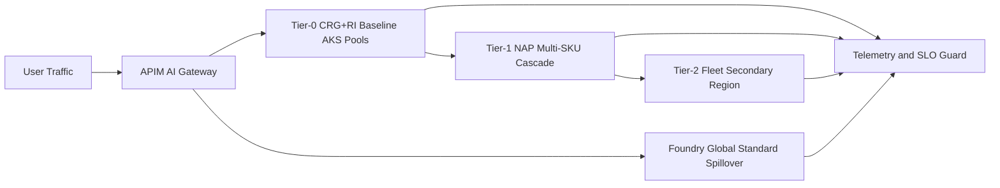
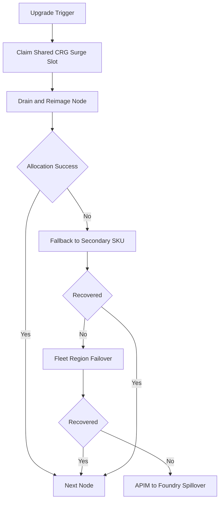

# Enterprise Regional GPU Stockout Resilience and Capacity Assurance Selection FAQ (CRG+AKS Binding vs Multi-SKU Cascade vs Foundry Spillover)
> Topic ID: #465
> Section: 3.8 Autonomous Cloud Ops, Multi-Region BCDR, and Enterprise Landing Zones
> Audience: platform SRE teams, AKS/GPU platform owners, and FinOps capacity planners
> Goal: sustain predictable capacity and cost under `AllocationFailed` and regional stockout events

## 1) Production problem: RI is not physical capacity assurance
Many teams assume `1Y/3Y RI` or Savings Plan means GPUs are physically held for them.
This mistake stays hidden during calm periods.
It surfaces during failovers, zone pressure, patch windows, and seasonal spikes.
Typical errors include `AllocationFailed` and `OverconstrainedZonalAllocationRequest`.
At that moment billing discount still applies, but physical GPU slots are unavailable.
If `AKS maxSurge > 0` without surge capacity, rolling upgrades can stall.
If topology is pinned to one SKU in one zone, fallback options collapse.
If no spillover path exists, queue timeouts propagate to users.
This is the classic mismatch of high billing certainty and low capacity certainty.

## 2) Why discount entitlement and physical assurance must be separated
RI/Savings Plans are mainly pricing constructs and do not reserve rack slots.
CRG (Capacity Reservation Group) reserves physical slots first, then workloads claim them.
When AKS nodepools bind to `capacityReservationGroupID`, scheduling can land on reserved slots.
Discount design and capacity design must therefore run in parallel.
Recommended baseline is CRG+RI for steady floor, with elastic cascade and spillover for peaks.

## 3) Four architecture paths
Pattern A: `CRG + capacityReservationGroupID + RI` stacking for steady floor and upgrade surge safety.
Pattern B: `AKS NAP/Karpenter` multi-SKU cascade with `Fleet` cross-region burst handling.
Pattern C: `APIM` queue and error triggers to `Foundry Global Standard` overflow.
Pattern D: anti-pattern (treating RI as physical reserve, single zone/single SKU, no surge, no overflow).

## 4) Twelve-dimension comparison matrix
| Dimension | Pattern A (CRG floor) | Pattern B (multi-SKU cascade) | Pattern C (Foundry overflow) | Pattern D (anti-pattern) |
|---|---|---|---|---|
| Physical slot certainty | High | Medium | High (managed pool) | Low |
| Upgrade `maxSurge` safety | High | Medium-high | High | Low |
| `AllocationFailed` recovery latency | Medium | Medium | Low | High |
| SKU heterogeneity tolerance | Medium | High | Medium | Low |
| Cross-region failover RTO | Medium | High | High | Low |
| Steady-state cost efficiency | High (RI stacked) | Medium-high | Medium | Low |
| Peak elasticity efficiency | Medium | High | High | Low |
| Runtime profile governance complexity | Medium | High | Medium | Low |
| Operational complexity | Medium | High | Medium | Low but fragile |
| Compliance/audit posture | High | High | High | Low |
| Three-year TCO controllability | High | High | Medium-high | Low |
| Enterprise recommendation | Tier-0 primary | Elastic primary | Stockout bridge primary | Avoid |

## 5) Pattern A: CRG floor with RI overlay (Tier-0 primary)
Reserve `P50–P70` zonal GPU floor for critical regions.
Bind AKS GPU nodepools directly to `capacityReservationGroupID`.
Reserve shared surge slots for rolling upgrades.
Overlay `1Y/3Y RI` to reduce unit cost on occupied reserved slots.
This design maximizes upgrade continuity and baseline availability.
Its value is moving risk from runtime chaos to planned capacity engineering.

## 6) Pattern B: multi-SKU cascade plus Fleet burst (elastic primary)
Define ordered fallback pools: `H200/H100 -> A100 -> L40S`.
Maintain per-SKU runtime profiles for parallelism and quantization.
Use NAP/Karpenter weighted pools for deterministic fallback order.
Use Fleet to shift demand into secondary region during primary stockouts.
Success criteria must include quality and SLO, not only scheduling success.
Fallback needs validated KV memory budgets and health probes.

## 7) Pattern C: APIM to Foundry spillover bridge (stockout bridge primary)
Trigger spillover on queue-depth, wait-latency, or error thresholds.
Avoid waiting for VM allocation, node boot, and large weight pulls.
Route requests to Foundry Global Standard within sub-second policy windows.
Use this to bridge short stockouts and sudden burst factors.
This is a bridge path, not a long-term substitute for core AKS floor.

## 8) Pattern D: anti-pattern checklist
Treating RI as physical capacity reservation.
Single-region single-zone single-SKU lock-in.
Using `maxSurge` without surge capacity reserves.
Counting Spot GPU as DR-guaranteed capacity.
These patterns look efficient at low load and fail together at high load.

## 9) Mermaid: tiered capacity assurance topology


## 10) Mermaid: upgrade and stockout self-healing state machine


## 11) Quantitative Q1-Q6 formulas and thresholds
Q1: CRG cost decomposition.
`C_crg = C_occ + C_idle`, where idle windows dominate waste risk.
Q2: optimal floor fraction.
`f* = argmin(E[C_idle] + E[C_spill] + E[P_stockout])`.
Q3: shared surge slot sizing.
Across `K` clusters, `S_shared >= ceil(max_concurrent_upgrades)`.
Q4: SKU fallback feasibility.
`M_weights + M_kv(fallback) <= 0.90 * VRAM_total`.
Q5: cold-gap definition.
`T_gap = T_alloc + T_boot + T_weight_stream`; Pattern C bridges this gap.
Q6: Spot DR constraint.
In DR guarantee math, `Capacity_dr = OnDemand + Reserved`; Spot weight is `0`.

## 12) Production code block 1: Bicep CRG and AKS binding
```bicep
param location string = 'eastus2'
param crgName string = 'gpu-crg-core'
param reservationName string = 'h100-floor'
param skuName string = 'Standard_ND96isr_H100_v5'
param capacity int = 12

resource crg 'Microsoft.Compute/capacityReservationGroups@2023-09-01' = {
  name: crgName
  location: location
  properties: {}
}

resource reservation 'Microsoft.Compute/capacityReservationGroups/capacityReservations@2023-09-01' = {
  name: '${crg.name}/${reservationName}'
  location: location
  sku: {
    name: skuName
    capacity: capacity
  }
  properties: {
    virtualMachinesAllocated: 0
  }
}

resource aksPool 'Microsoft.ContainerService/managedClusters/agentPools@2024-01-01' = {
  name: 'aks-prod/gpu-h100'
  properties: {
    vmSize: skuName
    count: 10
    mode: 'User'
    capacityReservationGroupID: crg.id
  }
}
```

## 13) Production code block 2: multi-SKU NAP cascade and runtime profile map
```yaml
apiVersion: karpenter.sh/v1
kind: NodePool
metadata:
  name: gpu-priority-h100
spec:
  weight: 100
  template:
    spec:
      requirements:
        - key: node.kubernetes.io/instance-type
          operator: In
          values: ["Standard_ND96isr_H100_v5"]
---
apiVersion: karpenter.sh/v1
kind: NodePool
metadata:
  name: gpu-priority-a100
spec:
  weight: 80
  template:
    spec:
      requirements:
        - key: node.kubernetes.io/instance-type
          operator: In
          values: ["Standard_NC96ads_A100_v4","Standard_NC48ads_A100_v4"]
---
apiVersion: apps/v1
kind: Deployment
metadata:
  name: vllm-router
spec:
  template:
    spec:
      containers:
        - name: runtime
          image: ghcr.io/example/vllm:latest
          env:
            - name: GPU_PROFILE_MAP
              value: "H100:tp=8,quant=fp8;A100:tp=4,quant=awq"
```

## 14) Production code block 3: stockout telemetry controller (Python/KQL)
```python
def should_spill_to_foundry(queue_depth, p95_wait_ms, alloc_failed_rate):
    return queue_depth > 120 or p95_wait_ms > 1800 or alloc_failed_rate > 0.02

def choose_crg_floor(p50_load, p70_load, budget_level):
    if budget_level == "strict":
        return p50_load
    if budget_level == "balanced":
        return p70_load
    return int((p50_load + p70_load) / 2)

def controller_tick(metrics):
    crg_floor = choose_crg_floor(metrics["p50"], metrics["p70"], metrics["budget"])
    spill = should_spill_to_foundry(
        metrics["queue_depth"],
        metrics["p95_wait_ms"],
        metrics["alloc_failed_rate"],
    )
    return {"crg_floor": crg_floor, "spillover": spill}
```

## 15) Enterprise scenarios and three-tier three-year TCO
### 15.1 Scenario A: global commerce and logistics
Primary region hit `OverconstrainedZonalAllocationRequest` during pre-peak security patching.
Pattern A floor plus shared surge slots removed upgrade stalls.
Pattern C overflow bridge reduced queue spikes under burst windows.
Black Friday window maintained `99.98%` availability.
### 15.2 Scenario B: regulated healthcare triage platform
Primary region faced a `14-hour` GPU stockout event.
Pattern B multi-SKU cascade with Fleet secondary region sustained service.
Capacity failover remained below `<75s`.
Compared with static full-peak over-provisioning, three-year TCO dropped by about `24%`.
### 15.3 Three-tier TCO
| Tier | Peak GPU demand | Recommended combination | Three-year blended TCO |
|---|---:|---|---:|
| Tier-1 | 40 GPUs | A + C | `$3.2M` |
| Tier-2 | 120 GPUs | A + B + C | `$9.6M` |
| Tier-3 | 320 GPUs | A floor + B elasticity + C bridge | `$24.4M` |
### 15.4 Fine-grained implementation considerations
During CRG design, size guaranteed floor by non-interruptible business windows instead of average daily load.
Track zonal SKU availability and historical stockout frequency as first-class planning inputs.
Model `maxSurge`, `maxUnavailable`, and shared surge slots together so upgrades remain capacity-safe.
Pre-validate quality, throughput, VRAM, and parallelism behavior for every fallback SKU profile.
Bind Fleet failover with latency budgets and data-residency boundaries, not only raw recovery speed.
Use APIM overflow rules that combine queue depth, tail wait, error rate, and traffic criticality.
Evaluate CRG idle cost and spillover premium cost together rather than optimizing either in isolation.
Publish separate utilization ledgers for reserved floor, fallback tiers, and managed overflow tiers.
Retain event-level evidence for every stockout incident, including trigger chain and mitigation latency.
Enforce a capacity-policy approval gate with simulation evidence and rollback plan.
Use low-risk traffic first to validate fallback behavior before opening high-value transaction classes.
Run pre-window reheating and slot-claim drills before patch windows and promotional peaks.
Keep SKU-specific runtime templates synchronized with model releases to avoid hidden OOM regressions.
Exercise compound-failure scenarios that include stockout, quota pressure, and burst concurrency together.
Define clear role boundaries across platform, business, compliance, and finance owners.
Report availability, recovery latency, upgrade completion, and unit economics in one review surface.
Capture each incident as reusable runbook knowledge for faster future mitigation.
Revisit SKU lifecycle and regional supply trends quarterly to pre-empt replacement shocks.
### 15.5 Day-0 / Day-1 / Day-2 engineering runbook (18 actions)
Day-0: define business-critical `TTFT/TPOT` and availability SLOs.
Day-0: identify Tier-0 regions, zones, and mandatory GPU SKUs.
Day-0: size CRG floor ratio and shared surge strategy.
Day-0: complete `capacityReservationGroupID` binding plan.
Day-0: build SKU fallback runtime profile map.
Day-0: set Fleet failover and failback thresholds.
Day-1: deploy Pattern A and verify upgrade continuity.
Day-1: deploy Pattern B and stress-test fallback quality and latency.
Day-1: deploy Pattern C and verify APIM spillover and recovery logic.
Day-1: publish unified `AllocationFailed`, queue, and spillover dashboards.
Day-1: exclude Spot GPU from DR-guarantee capacity math.
Day-1: validate primary-secondary region weights and guardrails.
Day-2: replay upgrade drills weekly and review surge-slot pressure.
Day-2: recalibrate fallback SKU quality/cost curves weekly.
Day-2: review CRG idle cost and Foundry overflow cost monthly.
Day-2: review stockout incidents and mitigation latency monthly.
Day-2: run quarterly compound-failure drills (stockout + patch + peak).
Day-2: refresh capacity playbook and audit evidence quarterly.

Sources (fetched 2026-11-27):
- Capacity Reservation Groups: https://learn.microsoft.com/azure/virtual-machines/capacity-reservation-overview
- AKS node pool capacity reservation binding: https://learn.microsoft.com/azure/aks/
- Azure API Management AI Gateway: https://learn.microsoft.com/azure/api-management/ai-gateway-overview
- Azure AI Foundry model deployment guidance: https://learn.microsoft.com/azure/ai-foundry/
