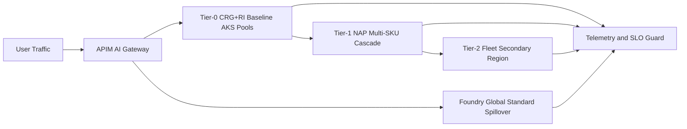
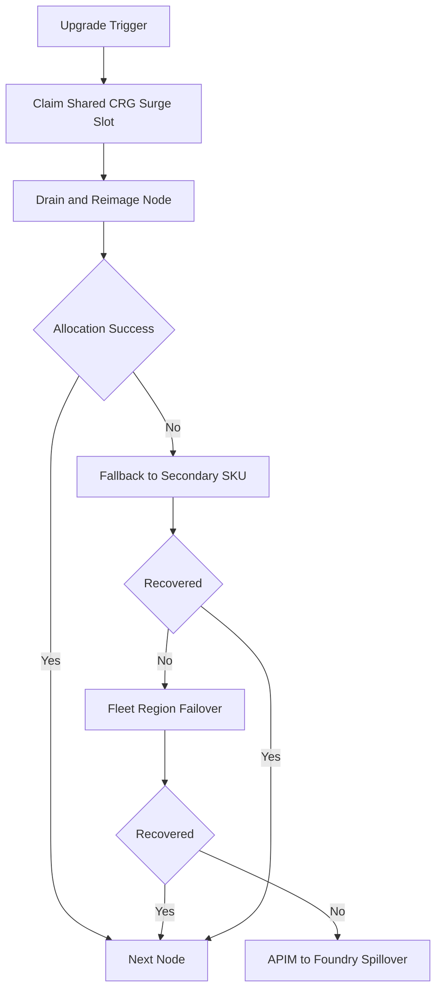

# 企业区域 GPU 缺货韧性与容量保障选型 FAQ（CRG+AKS 绑定 vs 多 SKU 级联 vs Foundry 溢出）
> Topic ID: #465
> Section: 3.8 智能云运维 AIOps、多区域容灾韧性与企业 Landing Zone
> Audience: 平台 SRE、AKS/GPU 平台团队、容量治理与 FinOps 决策团队
> Goal: 在 `AllocationFailed` 与区域缺货条件下维持连续可用算力与可控成本

## 1）生产问题：RI 不是物理容量保障
很多团队将 `1Y/3Y RI` 或 Savings Plan 误认为“物理 GPU 已占位”。
这在日常低压运行时不容易暴露问题。
一旦进入区域故障、分区迁移、补丁升级或季节洪峰，风险会集中爆发。
典型错误信号包括 `AllocationFailed` 与 `OverconstrainedZonalAllocationRequest`。
这类错误出现时，账单折扣仍在，但节点无法申请到实际 GPU。
如果 `AKS maxSurge > 0` 且没有可用 surge 容量，滚动升级会卡死。
如果单 SKU 单可用区绑定过强，替代路径几乎不存在。
如果没有跨区域或托管推理溢出，用户请求将直接排队超时。
这就是“账单确定性高、容量确定性低”的典型失配。

## 2）为何必须区分“折扣权利”和“物理保障”
RI/Savings Plan 主要影响计费价格，不影响物理槽位占用。
CRG（Capacity Reservation Group）才是“先占位后使用”的物理保障机制。
当 CRG 与 AKS nodepool 绑定后，节点调度能优先落在预占槽位。
因此“折扣策略”和“容量策略”必须并行设计，而不是相互替代。
推荐做法是：基础稳态用 CRG+RI 叠加，弹性洪峰用多 SKU 与溢出桥接。

## 3）四类架构路径总览
Pattern A：`CRG + capacityReservationGroupID + RI` 叠加，保证稳态与升级 surge 基座。
Pattern B：`AKS NAP/Karpenter` 多 SKU 级联 + `Fleet` 跨区域突发承接。
Pattern C：`APIM` 队列深度触发到 `Foundry Global Standard` 的亚秒溢出。
Pattern D：反模式（把 RI 当容量保障、单区单 SKU、无 surge、无溢出）。

## 4）十二维对比矩阵
| 维度 | Pattern A（CRG 基座） | Pattern B（多 SKU 级联） | Pattern C（Foundry 溢出） | Pattern D（反模式） |
|---|---|---|---|---|
| 物理槽位确定性 | 高 | 中 | 高（托管池） | 低 |
| 升级 `maxSurge` 安全性 | 高 | 中高 | 高 | 低 |
| `AllocationFailed` 恢复时延 | 中 | 中 | 低 | 高 |
| SKU 异构容忍度 | 中 | 高 | 中 | 低 |
| 多区域容灾 RTO | 中 | 高 | 高 | 低 |
| 稳态成本效率 | 高（叠加 RI） | 中高 | 中 | 低 |
| 峰值弹性效率 | 中 | 高 | 高 | 低 |
| 引擎参数治理复杂度 | 中 | 高 | 中 | 低 |
| 运营复杂度 | 中 | 高 | 中 | 低（但脆弱） |
| 合规与审计 | 高 | 高 | 高 | 低 |
| 三年 TCO 可控性 | 高 | 高 | 中高 | 低 |
| 推荐结论 | Tier-0 主路径 | 弹性主路径 | 缺货桥接主路径 | 禁用 |

## 5）Pattern A：CRG 基座 + RI 叠加（Tier-0 主路径）
先在关键区域关键可用区预留 `P50–P70` 稳态 GPU 槽位。
再把 AKS GPU nodepool 显式绑定到对应 `capacityReservationGroupID`。
为滚动升级预留共享 surge 槽位，避免补丁窗口资源争抢。
在成本层叠加 `1Y/3Y RI`，使已预留槽位享受折扣。
该模式对“持续可用”和“升级连续性”最有效。
其核心价值是把“容量风险”从运行时移到规划阶段。

## 6）Pattern B：多 SKU 级联 + Fleet 跨区域突发（弹性主路径）
定义优先级队列：`H200/H100 -> A100 -> L40S`。
为每个 SKU 维护独立的推理参数与并行策略模板。
通过 NAP/Karpenter 让调度器按优先级逐级回退。
当主区域缺货时，Fleet 将请求分摊到次区域。
关键点不是“能跑就行”，而是“回退后仍满足 SLO 与质量”。
因此必须绑定模型量化、并行度、KV 预算与健康探针。

## 7）Pattern C：APIM 到 Foundry 的溢出桥接（缺货桥接主路径）
当 AKS 队列深度、排队时延或错误率跨阈值时触发溢出。
无须等待 GPU VM 申请、节点启动和权重拉取完成。
在 `200ms` 级别内把请求导向 Foundry Global Standard。
该模式适合“突发放大”和“短时缺货”双重场景。
它不是长期替代本地集群，而是把冷启动缺口补平。

## 8）Pattern D：反模式清单
把 RI 当成容量保障，忽视物理槽位预留。
单区域单可用区单 SKU 锁死拓扑。
升级时使用 `maxSurge` 但没有 surge 容量池。
把 Spot GPU 算进容灾保障容量。
这些做法在平峰可运行，在高压窗口会同时失效。

## 9）Mermaid：分层容量保障拓扑


## 10）Mermaid：升级与缺货自愈状态机


## 11）Q1-Q6 量化公式与阈值
Q1：CRG 成本分解。
`C_crg = C_occ + C_idle`，其中 `C_idle` 由空置时段与单价决定。
Q2：最优基座比例。
`f* = argmin(E[C_idle] + E[C_spill] + E[P_stockout])`。
Q3：共享 surge 槽位规模。
跨 `K` 集群共享时，`S_shared >= ceil(max_concurrent_upgrades)`。
Q4：SKU 回退可行性。
`M_weights + M_kv(fallback) <= 0.90 * VRAM_total`。
Q5：冷启动缺口。
`T_gap = T_alloc + T_boot + T_weight_stream`，由 Pattern C 负责桥接。
Q6：Spot 容灾约束。
容灾保障容量计算中 `Capacity_dr = OnDemand + Reserved`，`Spot` 权重必须为 `0`。

## 12）生产代码块 1：Bicep CRG + AKS 绑定
```bicep
param location string = 'eastus2'
param crgName string = 'gpu-crg-core'
param reservationName string = 'h100-floor'
param skuName string = 'Standard_ND96isr_H100_v5'
param capacity int = 12

resource crg 'Microsoft.Compute/capacityReservationGroups@2023-09-01' = {
  name: crgName
  location: location
  properties: {}
}

resource reservation 'Microsoft.Compute/capacityReservationGroups/capacityReservations@2023-09-01' = {
  name: '${crg.name}/${reservationName}'
  location: location
  sku: {
    name: skuName
    capacity: capacity
  }
  properties: {
    virtualMachinesAllocated: 0
  }
}

resource aksPool 'Microsoft.ContainerService/managedClusters/agentPools@2024-01-01' = {
  name: 'aks-prod/gpu-h100'
  properties: {
    vmSize: skuName
    count: 10
    mode: 'User'
    capacityReservationGroupID: crg.id
  }
}
```

## 13）生产代码块 2：多 SKU NAP 级联与运行时映射
```yaml
apiVersion: karpenter.sh/v1
kind: NodePool
metadata:
  name: gpu-priority-h100
spec:
  weight: 100
  template:
    spec:
      requirements:
        - key: node.kubernetes.io/instance-type
          operator: In
          values: ["Standard_ND96isr_H100_v5"]
---
apiVersion: karpenter.sh/v1
kind: NodePool
metadata:
  name: gpu-priority-a100
spec:
  weight: 80
  template:
    spec:
      requirements:
        - key: node.kubernetes.io/instance-type
          operator: In
          values: ["Standard_NC96ads_A100_v4","Standard_NC48ads_A100_v4"]
---
apiVersion: apps/v1
kind: Deployment
metadata:
  name: vllm-router
spec:
  template:
    spec:
      containers:
        - name: runtime
          image: ghcr.io/example/vllm:latest
          env:
            - name: GPU_PROFILE_MAP
              value: "H100:tp=8,quant=fp8;A100:tp=4,quant=awq"
```

## 14）生产代码块 3：缺货遥测控制器（Python/KQL）
```python
def should_spill_to_foundry(queue_depth, p95_wait_ms, alloc_failed_rate):
    return queue_depth > 120 or p95_wait_ms > 1800 or alloc_failed_rate > 0.02

def choose_crg_floor(p50_load, p70_load, budget_level):
    if budget_level == "strict":
        return p50_load
    if budget_level == "balanced":
        return p70_load
    return int((p50_load + p70_load) / 2)

def controller_tick(metrics):
    crg_floor = choose_crg_floor(metrics["p50"], metrics["p70"], metrics["budget"])
    spill = should_spill_to_foundry(
        metrics["queue_depth"],
        metrics["p95_wait_ms"],
        metrics["alloc_failed_rate"],
    )
    return {"crg_floor": crg_floor, "spillover": spill}
```

## 15）企业场景与三档三年 TCO
### 15.1 场景 A：全球电商与物流平台
主区域在预峰补丁期间触发 `OverconstrainedZonalAllocationRequest`。
采用 Pattern A 基座与共享 surge 后，升级不再阻塞。
叠加 Pattern C 后，突发窗口排队峰值显著下降。
黑五窗口保持 `99.98%` 可用性。
### 15.2 场景 B：受监管医疗文档分诊平台
主区域连续 `14` 小时 GPU 缺货。
通过 Pattern B 多 SKU 级联与 Fleet 次区域承接维持服务。
失败切换时间控制在 `<75s`。
相较静态全量过配，三年 TCO 降低约 `24%`。
### 15.3 三档三年 TCO
| 档位 | 峰值 GPU 需求 | 推荐组合 | 三年综合 TCO |
|---|---:|---|---:|
| Tier-1 | 40 卡 | A + C | `$3.2M` |
| Tier-2 | 120 卡 | A + B + C | `$9.6M` |
| Tier-3 | 320 卡 | A 基座 + B 主弹性 + C 桥接 | `$24.4M` |
### 15.4 架构落地细粒度工程要点
在 CRG 设计阶段，应先按“业务不可中断窗口”而不是“平均日负载”来定义必须保障的最小连续算力，以避免升级与故障叠加时出现容量断崖。
在可用区分布上，应显式记录每个 SKU 的区级可得性与历史缺货频度，避免把“逻辑上可部署”误判为“运行时可申请”。
在 AKS 升级策略中，应将 `maxSurge`、`maxUnavailable` 与共享 surge 槽位联动建模，确保每次升级都能在容量守恒条件下完成。
在多 SKU 回退链路中，应预先验证模型精度、吞吐、显存占用和并行参数，避免故障时临时回退导致质量不可控。
在 Fleet 跨区域策略中，应配置业务权重、延迟预算与数据合规边界，防止单纯追求恢复速度而违反驻留约束。
在 APIM 溢出策略中，应把排队时延、错误率和请求优先级联合判定，避免低价值流量挤占高价值流量的桥接通道。
在成本治理上，应将 CRG 空置成本与溢出溢价成本并列审视，而不是只关注任意单项成本最小化。
在运行观测上，应分别统计“保障容量命中率”“回退容量命中率”“托管溢出命中率”，形成可解释的容量使用账本。
在容量审计上，应保留每次缺货事件的触发条件、路由决策、恢复时长和业务影响，支持季度级复盘与策略迭代。
在平台治理上，应建立“容量策略变更审批门”，强制提供仿真证据、回滚路径和高峰窗口验证结果。
在灰度发布阶段，应优先让低风险流量验证回退链路，待稳定后再逐步放开高价值事务，降低错误放大风险。
在节点镜像更新窗口，应提前执行预热与占位演练，验证在缺货条件下升级仍能连续推进而非长时间等待。
在模型版本切换时，应同步更新各 SKU 的推理参数模板，避免新模型在回退节点上出现隐性 OOM 或吞吐断崖。
在故障演练计划中，应覆盖“主区缺货+次区限额+托管溢出上升”三重场景，保证极端条件下仍有可执行降级路径。
在跨团队协作上，应明确平台、业务、合规、财务四方的职责边界，确保容量决策不是单部门局部最优。
在 SLA 汇报中，应同时展示可用性、恢复时长、升级完成率和单位成本，避免单指标优化掩盖系统性风险。
在容量学习闭环中，应把每次事件经验沉淀为模板化 runbook，缩短新团队接管与复制最佳实践的周期。
在长期规划中，应定期评估 SKU 生命周期与区域供给变化，提前调整回退链与储备策略，降低突发替换成本。
在组织协同层面，应把容量保障策略纳入年度技术治理目标，以“可持续可验证”方式推进跨业务统一标准，避免各自为战造成策略碎片化。
在成本核算层面，应针对不同业务优先级建立分层预算池，将关键业务的保障容量与普通业务的弹性容量分开核算，提升预算透明度与治理精度。
在应急响应层面，应预先定义“升级阻塞、缺货扩散、溢出失效、跨区退化”四类事件剧本，并绑定对应的自动化修复动作与人工升级路径。
在平台演进层面，应持续跟踪新一代 GPU SKU、网络拓扑与驱动生态变化，及时验证旧策略在新硬件上的可迁移性，降低技术债积累风险。
在模型治理层面，应将推理框架版本、量化策略、并行参数与容量策略进行联动管理，确保性能结论与模型版本强一致，不出现错配上线。
在服务分级层面，应建立严格的服务等级划分，把“必须保障连续性”的路径与“允许延迟退化”的路径分离处理，避免统一策略拖累整体效率。
在指标体系层面，应把可用性、恢复时长、升级完成率、错误预算消耗和单位成本统一到一个可追踪仪表盘，支持管理层快速做出平衡决策。
在复盘机制层面，应强制每次重大缺货事件输出“根因树、决策树、修复树”三件套文档，沉淀组织可复用的工程知识而非仅停留在即时修复。
在交付流程层面，应把容量保障验证前置到发布流程，将“容量可得性验收”与“功能验收、性能验收、安全验收”并列，提升上线质量基线。
在多区域策略层面，应建立“主区恢复优先级”与“次区常态承接比例”双策略，避免长期全量压在次区导致隐性成本上升与风险倒置。
在财务对齐层面，应定期向预算方展示“保障容量投入换来的中断损失降低”量化结果，确保容量投资决策获得持续支持并可被审计解释。
在人才建设层面，应把 GPU 缺货韧性设计、CRG 实战、回退策略验证、溢出桥接治理纳入平台工程培训体系，形成稳定的组织能力护城河。
在战略治理层面，应建立年度容量保障路线图，明确每季度要验证的区域、SKU、升级场景、故障组合与预算边界，确保技术演进与业务增长节奏同步。
### 15.5 Day-0 / Day-1 / Day-2 工程运行清单（18 项）
Day-0：定义关键业务流的 `TTFT/TPOT` 与可用性 SLO。
Day-0：识别必须保障的 Tier-0 区域、可用区与 GPU SKU。
Day-0：设计 `CRG` 基座比例与共享 surge 策略。
Day-0：完成 `capacityReservationGroupID` 与 nodepool 绑定方案。
Day-0：建立 SKU 回退的并行度与量化参数映射表。
Day-0：定义 Fleet 跨区域流量切换阈值与回切阈值。
Day-1：部署 Pattern A 并验证升级窗口不中断。
Day-1：部署 Pattern B 并压测多 SKU 级联时延与成功率。
Day-1：部署 Pattern C 并验证 APIM 溢出判定与恢复逻辑。
Day-1：建立 `AllocationFailed`、`queue_wait`、`spillover_rate` 统一看板。
Day-1：把 Spot GPU 从容灾保障容量模型中剔除。
Day-1：完成主备区域权重与限流策略联调。
Day-2：每周回放升级演练并核对 surge 槽位占用趋势。
Day-2：每周校准回退 SKU 的模型质量与成本曲线。
Day-2：每月复盘 CRG 空置成本与 Foundry 溢出成本。
Day-2：每月复盘区域缺货事件的触发链与处置耗时。
Day-2：季度演练“主区缺货 + 升级并发 + 峰值洪峰”复合故障。
Day-2：季度更新容量决策手册与审计证据包。

来源（抓取日期 2026-11-27）：
- Capacity Reservation Groups: https://learn.microsoft.com/azure/virtual-machines/capacity-reservation-overview
- AKS node pool capacity reservation binding: https://learn.microsoft.com/azure/aks/
- Azure API Management AI Gateway: https://learn.microsoft.com/azure/api-management/ai-gateway-overview
- Azure AI Foundry model deployment guidance: https://learn.microsoft.com/azure/ai-foundry/
