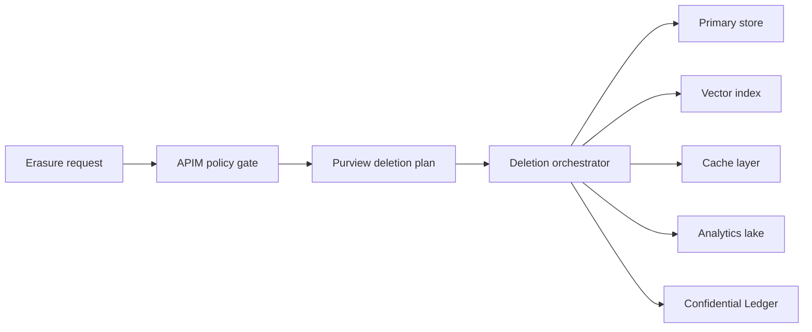
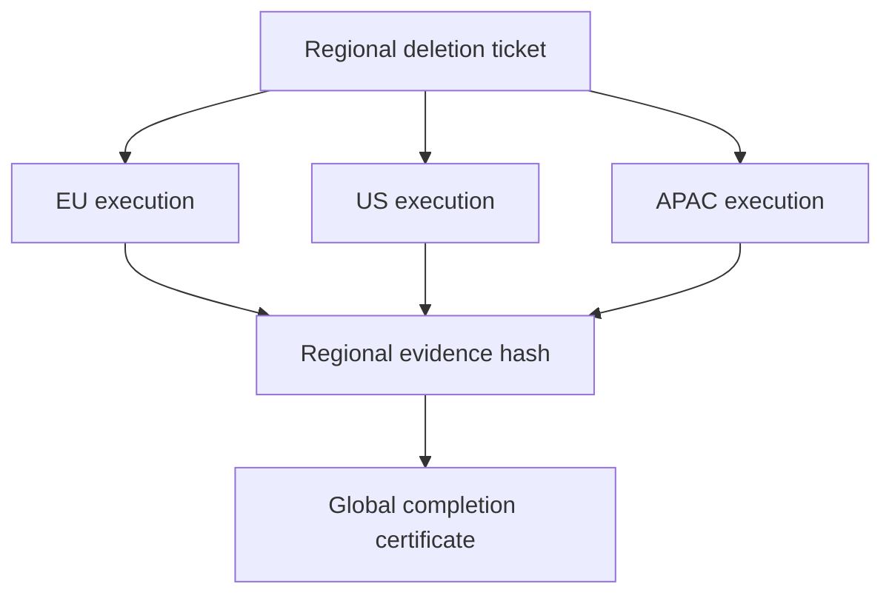

# Regulated agent-memory erasure and cross-border data-residency selection FAQ (GDPR/CCPA/PIPEDA: APIM + Purview + Confidential Ledger + Region Fencing)

> Audience: Cloud & AI Solution Architects in regulated finance, healthcare, public-sector, and cross-border commerce workloads.

## 1. Executive summary

When enterprise agents process data across EU, North America, and local-sovereignty zones, architecture must prioritize compliance correctness over convenience. Recommended stack:

- **Route A (control plane)**: `APIM` policy gate with tenant/region claim validation and operation-level routing.
- **Route B (governance plane)**: `Purview` catalog, retention/erasure policy control, and audit discovery.
- **Route C (evidence plane)**: `Confidential Ledger` for non-repudiable erasure evidence and approval-chain hashes.
- **Route D (anti-pattern)**: delete source records only and ignore cache/index/backup propagation.

Core principle: **an erasure request is a legal event, not a simple CRUD operation.**

## 2. Business and compliance challenges

- A single tenant may have replicas in multiple sovereignty regions.
- One right-to-erasure request must propagate to chat logs, vector indexes, analytics lakes, caches, and snapshots.
- Regulatory deletion timelines vary by jurisdiction and map directly to legal exposure.
- Enterprises must prove when and where deletion completed, and who approved it.

## 3. Route definitions

### Route A: APIM region fencing and operation gate
- Enforce `tenant_id`, `region_claim`, and `data_classification` policy routing at ingress.
- Force erasure operations onto enhanced audit and asynchronous receipt paths.

### Route B: Purview lifecycle and erasure governance
- Use Purview classifications and labels to identify regulated data assets.
- Bind erasure tickets to cataloged assets for deterministic coverage.

### Route C: Confidential Ledger evidence chain
- Persist erasure request hash, approval trail, execution milestones, and completion certificates.
- Provide non-repudiation during regulator or legal review.

### Route D: anti-pattern baseline
- Application reports “deleted” while downstream caches/indexes still return stale personal data.
- No trustworthy evidence path for supervisory inquiries.

## 4. Quantitative models

### 4.1 Erasure propagation window
`W_erase = max(T_cache, T_vector, T_backup, T_analytics) - T_request`

### 4.2 Regulatory exposure model
`Risk_reg = Σ_j (P_miss_j * Fine_j * Exposure_j)`

### 4.3 Cross-border routing violation risk
`Risk_xborder = P(route_misclassification) * Impact_data_sovereignty`

### 4.4 Evidence completeness ratio
`Evidence_coverage = N_verified_deletions / N_total_deletions`

## 5. Twelve-dimension comparison matrix

| Dimension | Route A APIM gate | Route B Purview governance | Route C evidence ledger | Route D anti-pattern |
|---|---|---|---|---|
| Region-routing accuracy | High | Medium | Medium | Low |
| Erasure-policy expressiveness | Medium | High | Medium | Low |
| Non-repudiation | Medium | Medium | High | Low |
| Audit readability | High | High | High | Low |
| Cross-team coordination | Medium-high | Medium-high | Medium | Low |
| Initial complexity | Medium | Medium | Medium | Low |
| Runtime stability | High | High | High | Low |
| Regulatory-risk reduction | High | High | High | Low |
| Erasure receipt traceability | High | High | High | Low |
| Sovereignty boundary clarity | High | High | Medium | Low |
| Multi-region scalability | High | Medium-high | Medium-high | Low |
| Recommendation | ✅ required | ✅ required | ✅ strongly recommended | ⛔ ban |

## 6. Deep quantitative Q&A (Q1-Q8)
### Q1: Why not return synchronous completion for erasure requests?
Because deletion must be verified across asynchronous replicas before claiming legal completion.

### Q2: Why APIM for jurisdiction gates?
It is the universal ingress point to block invalid tenant/region routing before execution.

### Q3: What does Purview solve here?
Asset discovery, classification, and policy coverage to reduce hidden deletion gaps.

### Q4: Does Confidential Ledger add overhead?
Yes, but it provides high-value non-repudiable audit evidence.

### Q5: How to prove vector index deletion?
Run residual-hit checks with deterministic sample and full-scan validation reports.

### Q6: How to erase cross-region replicas?
Use region-bound tickets with per-region signed completion receipts.

### Q7: How to prevent stale session resurrection?
Use lease/version guards and forced context refresh for impacted sessions.

### Q8: Which KPIs matter most?
`erase_window_p95` and `evidence_coverage` are the two primary governance indicators.

## 7. Mermaid architecture diagrams





## 8. Production snippet: APIM erasure gate policy (illustrative)

```xml
<inbound>
  <base />
  <choose>
    <when condition="@(context.Request.Headers.GetValueOrDefault("x-region","") != context.Request.Headers.GetValueOrDefault("x-tenant-region",""))">
      <return-response>
        <set-status code="403" reason="Region claim mismatch" />
      </return-response>
    </when>
  </choose>
</inbound>
```

## 9. Production snippet: erasure execution pseudo-code

```python
def execute_erasure(ticket):
    for target in ticket.targets:
        erase(target)
        verify(target)
    ledger.append({
        "ticket_id": ticket.id,
        "status": "completed",
        "hash": sha256(ticket.summary()).hexdigest(),
    })
```

## 10. Enterprise scenarios (2+)

### Scenario A: cross-border wealth-advisory copilot
- Client relocation triggers rights-based erasure across regional replicas.
- Region-specific completion proof is required for legal defensibility.

### Scenario B: healthcare follow-up assistant
- Consent withdrawal must remove summary notes and vector-retrieval traces promptly.
- Governance teams require replayable proof for each deletion ticket.

### Scenario C: global retail support platform
- Multi-region cache and recommendation artifacts often retain stale personal data.
- APIM + Purview + Ledger closes policy, execution, and evidence loops.

## 11. Three-tier 3-year TCO (USD)

| Scale tier | Route A+B | Route A+B+C | Anti-pattern (hidden exposure) |
|---|---:|---:|---:|
| 500K data subjects | 2,300,000 | 2,680,000 | 1,650,000 (excludes penalties) |
| 50M data subjects | 12,600,000 | 14,300,000 | 9,800,000 (excludes penalties) |
| 500M data subjects | 67,000,000 | 73,500,000 | 54,200,000 (excludes penalties) |

## 12. Day-0 / Day-1 / Day-2 checklist

### Day-0 (governance baseline)
- define erasure SLA, jurisdiction boundaries, evidence schema, and approval accountability.

### Day-1 (implementation rollout)
- integrate APIM gates, Purview policies, erasure orchestration, and evidence ledger writes.

### Day-2 (operations and audit)
- sample-check erasure windows, regional receipt ratios, residual index hits, and audit replay pass rates.

## 13. Good fit vs Not for

### ✅ Good fit
- Regulated, cross-border workloads processing personally identifiable data.
- Enterprises with explicit legal obligations for provable erasure completion.

### ⛔ Not for
- Temporary PoCs without personal-data handling obligations.
- Teams without governance, audit, and data-lifecycle ownership.

## 14. Five-step rollout guide
1. Define tenant + jurisdiction claims and APIM gate policies.
2. Model data assets and erasure policies in Purview.
3. Implement asynchronous erasure orchestration with regional receipts.
4. Persist evidence hashes in Confidential Ledger.
5. Continuously tune erasure windows and evidence completeness via drills.

## 15. Core KPIs
- `erase_window_p95_minutes`
- `xborder_route_violation_rate`
- `evidence_coverage`
- `vector_residual_hit_rate`
- `audit_replay_pass_rate`

## 16. Final recommendation
For regulated enterprises, Route A+B is the minimum baseline, Route C is a high-value compliance hardening layer, and Route D should be explicitly prohibited.
