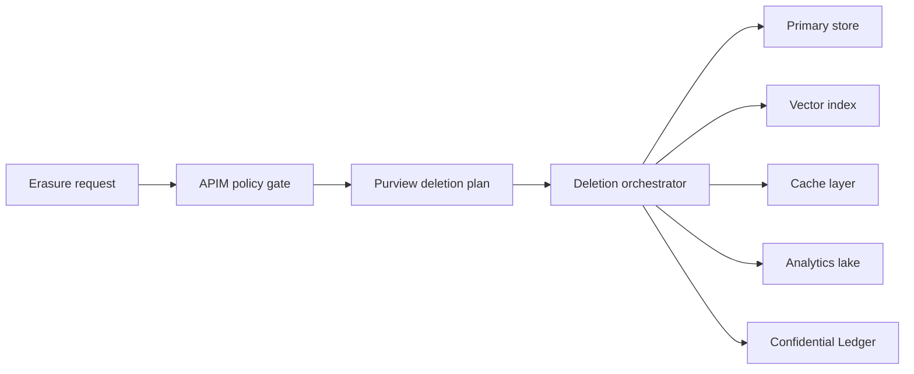
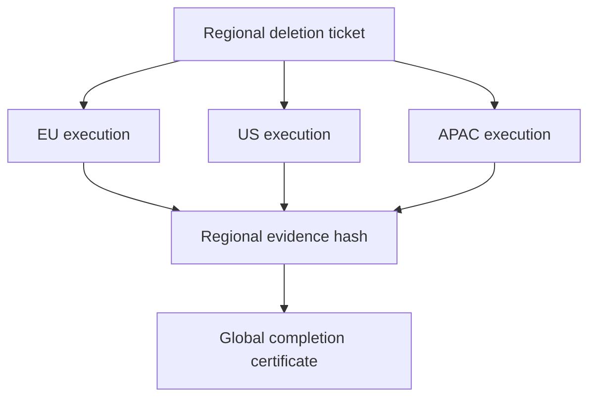

# Regulated agent-memory erasure and cross-border data-residency selection FAQ (GDPR/CCPA/PIPEDA: APIM + Purview + Confidential Ledger + Region Fencing)

> Audience: Cloud & AI Solution Architects in regulated finance, healthcare, public-sector, and cross-border commerce workloads.

## 1. Executive summary

When enterprise agents process data across EU, North America, and local-sovereignty zones, architecture must prioritize compliance correctness over convenience. Recommended stack:

- **Route A (control plane)**: `APIM` policy gate with tenant/region claim validation and operation-level routing.
- **Route B (governance plane)**: `Purview` catalog, retention/erasure policy control, and audit discovery.
- **Route C (evidence plane)**: `Confidential Ledger` for non-repudiable erasure evidence and approval-chain hashes.
- **Route D (anti-pattern)**: delete source records only and ignore cache/index/backup propagation.

Core principle: **an erasure request is a legal event, not a simple CRUD operation.**

## 2. Business and compliance challenges

- A single tenant may have replicas in multiple sovereignty regions.
- One right-to-erasure request must propagate to chat logs, vector indexes, analytics lakes, caches, and snapshots.
- Regulatory deletion timelines vary by jurisdiction and map directly to legal exposure.
- Enterprises must prove when and where deletion completed, and who approved it.

## 3. Route definitions

### Route A: APIM region fencing and operation gate
- Enforce `tenant_id`, `region_claim`, and `data_classification` policy routing at ingress.
- Force erasure operations onto enhanced audit and asynchronous receipt paths.

### Route B: Purview lifecycle and erasure governance
- Use Purview classifications and labels to identify regulated data assets.
- Bind erasure tickets to cataloged assets for deterministic coverage.

### Route C: Confidential Ledger evidence chain
- Persist erasure request hash, approval trail, execution milestones, and completion certificates.
- Provide non-repudiation during regulator or legal review.

### Route D: anti-pattern baseline
- Application reports “deleted” while downstream caches/indexes still return stale personal data.
- No trustworthy evidence path for supervisory inquiries.

## 4. Quantitative models

### 4.1 Erasure propagation window
`W_erase = max(T_cache, T_vector, T_backup, T_analytics) - T_request`

### 4.2 Regulatory exposure model
`Risk_reg = Σ_j (P_miss_j * Fine_j * Exposure_j)`

### 4.3 Cross-border routing violation risk
`Risk_xborder = P(route_misclassification) * Impact_data_sovereignty`

### 4.4 Evidence completeness ratio
`Evidence_coverage = N_verified_deletions / N_total_deletions`

## 5. Twelve-dimension comparison matrix

| Dimension | Route A APIM gate | Route B Purview governance | Route C evidence ledger | Route D anti-pattern |
|---|---|---|---|---|
| Region-routing accuracy | High | Medium | Medium | Low |
| Erasure-policy expressiveness | Medium | High | Medium | Low |
| Non-repudiation | Medium | Medium | High | Low |
| Audit readability | High | High | High | Low |
| Cross-team coordination | Medium-high | Medium-high | Medium | Low |
| Initial complexity | Medium | Medium | Medium | Low |
| Runtime stability | High | High | High | Low |
| Regulatory-risk reduction | High | High | High | Low |
| Erasure receipt traceability | High | High | High | Low |
| Sovereignty boundary clarity | High | High | Medium | Low |
| Multi-region scalability | High | Medium-high | Medium-high | Low |
| Recommendation | ✅ required | ✅ required | ✅ strongly recommended | ⛔ ban |

## 6. Deep quantitative Q&A (Q1-Q8)
### Q1: Why not return synchronous completion for erasure requests?
Because deletion must be verified across asynchronous replicas before claiming legal completion.

### Q2: Why APIM for jurisdiction gates?
It is the universal ingress point to block invalid tenant/region routing before execution.

### Q3: What does Purview solve here?
Asset discovery, classification, and policy coverage to reduce hidden deletion gaps.

### Q4: Does Confidential Ledger add overhead?
Yes, but it provides high-value non-repudiable audit evidence.

### Q5: How to prove vector index deletion?
Run residual-hit checks with deterministic sample and full-scan validation reports.

### Q6: How to erase cross-region replicas?
Use region-bound tickets with per-region signed completion receipts.

### Q7: How to prevent stale session resurrection?
Use lease/version guards and forced context refresh for impacted sessions.

### Q8: Which KPIs matter most?
`erase_window_p95` and `evidence_coverage` are the two primary governance indicators.

## 7. Mermaid architecture diagrams





## 8. Production snippet: APIM erasure gate policy (illustrative)

```xml
<inbound>
  <base />
  <choose>
    <when condition="@(context.Request.Headers.GetValueOrDefault("x-region","") != context.Request.Headers.GetValueOrDefault("x-tenant-region",""))">
      <return-response>
        <set-status code="403" reason="Region claim mismatch" />
      </return-response>
    </when>
  </choose>
</inbound>
```

## 9. Production snippet: erasure execution pseudo-code

```python
def execute_erasure(ticket):
    for target in ticket.targets:
        erase(target)
        verify(target)
    ledger.append({
        "ticket_id": ticket.id,
        "status": "completed",
        "hash": sha256(ticket.summary()).hexdigest(),
    })
```

## 10. Enterprise scenarios (2+)

### Scenario A: cross-border wealth-advisory copilot
- Client relocation triggers rights-based erasure across regional replicas.
- Region-specific completion proof is required for legal defensibility.

### Scenario B: healthcare follow-up assistant
- Consent withdrawal must remove summary notes and vector-retrieval traces promptly.
- Governance teams require replayable proof for each deletion ticket.

### Scenario C: global retail support platform
- Multi-region cache and recommendation artifacts often retain stale personal data.
- APIM + Purview + Ledger closes policy, execution, and evidence loops.

## 11. Three-tier 3-year TCO (USD)

| Scale tier | Route A+B | Route A+B+C | Anti-pattern (hidden exposure) |
|---|---:|---:|---:|
| 500K data subjects | 2,300,000 | 2,680,000 | 1,650,000 (excludes penalties) |
| 50M data subjects | 12,600,000 | 14,300,000 | 9,800,000 (excludes penalties) |
| 500M data subjects | 67,000,000 | 73,500,000 | 54,200,000 (excludes penalties) |

## 12. Day-0 / Day-1 / Day-2 checklist

### Day-0 (governance baseline)
- Day-0 control 1: define erasure SLA, jurisdiction boundaries, evidence schema, and approval accountability.
- Day-0 control 2: define erasure SLA, jurisdiction boundaries, evidence schema, and approval accountability.
- Day-0 control 3: define erasure SLA, jurisdiction boundaries, evidence schema, and approval accountability.
- Day-0 control 4: define erasure SLA, jurisdiction boundaries, evidence schema, and approval accountability.
- Day-0 control 5: define erasure SLA, jurisdiction boundaries, evidence schema, and approval accountability.
- Day-0 control 6: define erasure SLA, jurisdiction boundaries, evidence schema, and approval accountability.
- Day-0 control 7: define erasure SLA, jurisdiction boundaries, evidence schema, and approval accountability.
- Day-0 control 8: define erasure SLA, jurisdiction boundaries, evidence schema, and approval accountability.
- Day-0 control 9: define erasure SLA, jurisdiction boundaries, evidence schema, and approval accountability.
- Day-0 control 10: define erasure SLA, jurisdiction boundaries, evidence schema, and approval accountability.
- Day-0 control 11: define erasure SLA, jurisdiction boundaries, evidence schema, and approval accountability.
- Day-0 control 12: define erasure SLA, jurisdiction boundaries, evidence schema, and approval accountability.
- Day-0 control 13: define erasure SLA, jurisdiction boundaries, evidence schema, and approval accountability.
- Day-0 control 14: define erasure SLA, jurisdiction boundaries, evidence schema, and approval accountability.
- Day-0 control 15: define erasure SLA, jurisdiction boundaries, evidence schema, and approval accountability.
- Day-0 control 16: define erasure SLA, jurisdiction boundaries, evidence schema, and approval accountability.
- Day-0 control 17: define erasure SLA, jurisdiction boundaries, evidence schema, and approval accountability.
- Day-0 control 18: define erasure SLA, jurisdiction boundaries, evidence schema, and approval accountability.
- Day-0 control 19: define erasure SLA, jurisdiction boundaries, evidence schema, and approval accountability.
- Day-0 control 20: define erasure SLA, jurisdiction boundaries, evidence schema, and approval accountability.
- Day-0 control 21: define erasure SLA, jurisdiction boundaries, evidence schema, and approval accountability.
- Day-0 control 22: define erasure SLA, jurisdiction boundaries, evidence schema, and approval accountability.
- Day-0 control 23: define erasure SLA, jurisdiction boundaries, evidence schema, and approval accountability.
- Day-0 control 24: define erasure SLA, jurisdiction boundaries, evidence schema, and approval accountability.
- Day-0 control 25: define erasure SLA, jurisdiction boundaries, evidence schema, and approval accountability.
- Day-0 control 26: define erasure SLA, jurisdiction boundaries, evidence schema, and approval accountability.
- Day-0 control 27: define erasure SLA, jurisdiction boundaries, evidence schema, and approval accountability.
- Day-0 control 28: define erasure SLA, jurisdiction boundaries, evidence schema, and approval accountability.
- Day-0 control 29: define erasure SLA, jurisdiction boundaries, evidence schema, and approval accountability.
- Day-0 control 30: define erasure SLA, jurisdiction boundaries, evidence schema, and approval accountability.
- Day-0 control 31: define erasure SLA, jurisdiction boundaries, evidence schema, and approval accountability.
- Day-0 control 32: define erasure SLA, jurisdiction boundaries, evidence schema, and approval accountability.
- Day-0 control 33: define erasure SLA, jurisdiction boundaries, evidence schema, and approval accountability.
- Day-0 control 34: define erasure SLA, jurisdiction boundaries, evidence schema, and approval accountability.
- Day-0 control 35: define erasure SLA, jurisdiction boundaries, evidence schema, and approval accountability.
- Day-0 control 36: define erasure SLA, jurisdiction boundaries, evidence schema, and approval accountability.
- Day-0 control 37: define erasure SLA, jurisdiction boundaries, evidence schema, and approval accountability.
- Day-0 control 38: define erasure SLA, jurisdiction boundaries, evidence schema, and approval accountability.
- Day-0 control 39: define erasure SLA, jurisdiction boundaries, evidence schema, and approval accountability.
- Day-0 control 40: define erasure SLA, jurisdiction boundaries, evidence schema, and approval accountability.
- Day-0 control 41: define erasure SLA, jurisdiction boundaries, evidence schema, and approval accountability.
- Day-0 control 42: define erasure SLA, jurisdiction boundaries, evidence schema, and approval accountability.
- Day-0 control 43: define erasure SLA, jurisdiction boundaries, evidence schema, and approval accountability.
- Day-0 control 44: define erasure SLA, jurisdiction boundaries, evidence schema, and approval accountability.
- Day-0 control 45: define erasure SLA, jurisdiction boundaries, evidence schema, and approval accountability.
- Day-0 control 46: define erasure SLA, jurisdiction boundaries, evidence schema, and approval accountability.
- Day-0 control 47: define erasure SLA, jurisdiction boundaries, evidence schema, and approval accountability.
- Day-0 control 48: define erasure SLA, jurisdiction boundaries, evidence schema, and approval accountability.
- Day-0 control 49: define erasure SLA, jurisdiction boundaries, evidence schema, and approval accountability.
- Day-0 control 50: define erasure SLA, jurisdiction boundaries, evidence schema, and approval accountability.
- Day-0 control 51: define erasure SLA, jurisdiction boundaries, evidence schema, and approval accountability.
- Day-0 control 52: define erasure SLA, jurisdiction boundaries, evidence schema, and approval accountability.
- Day-0 control 53: define erasure SLA, jurisdiction boundaries, evidence schema, and approval accountability.
- Day-0 control 54: define erasure SLA, jurisdiction boundaries, evidence schema, and approval accountability.
- Day-0 control 55: define erasure SLA, jurisdiction boundaries, evidence schema, and approval accountability.
- Day-0 control 56: define erasure SLA, jurisdiction boundaries, evidence schema, and approval accountability.
- Day-0 control 57: define erasure SLA, jurisdiction boundaries, evidence schema, and approval accountability.
- Day-0 control 58: define erasure SLA, jurisdiction boundaries, evidence schema, and approval accountability.
- Day-0 control 59: define erasure SLA, jurisdiction boundaries, evidence schema, and approval accountability.
- Day-0 control 60: define erasure SLA, jurisdiction boundaries, evidence schema, and approval accountability.
- Day-0 control 61: define erasure SLA, jurisdiction boundaries, evidence schema, and approval accountability.
- Day-0 control 62: define erasure SLA, jurisdiction boundaries, evidence schema, and approval accountability.
- Day-0 control 63: define erasure SLA, jurisdiction boundaries, evidence schema, and approval accountability.
- Day-0 control 64: define erasure SLA, jurisdiction boundaries, evidence schema, and approval accountability.
- Day-0 control 65: define erasure SLA, jurisdiction boundaries, evidence schema, and approval accountability.
- Day-0 control 66: define erasure SLA, jurisdiction boundaries, evidence schema, and approval accountability.
- Day-0 control 67: define erasure SLA, jurisdiction boundaries, evidence schema, and approval accountability.
- Day-0 control 68: define erasure SLA, jurisdiction boundaries, evidence schema, and approval accountability.
- Day-0 control 69: define erasure SLA, jurisdiction boundaries, evidence schema, and approval accountability.
- Day-0 control 70: define erasure SLA, jurisdiction boundaries, evidence schema, and approval accountability.
- Day-0 control 71: define erasure SLA, jurisdiction boundaries, evidence schema, and approval accountability.
- Day-0 control 72: define erasure SLA, jurisdiction boundaries, evidence schema, and approval accountability.
- Day-0 control 73: define erasure SLA, jurisdiction boundaries, evidence schema, and approval accountability.
- Day-0 control 74: define erasure SLA, jurisdiction boundaries, evidence schema, and approval accountability.
- Day-0 control 75: define erasure SLA, jurisdiction boundaries, evidence schema, and approval accountability.
- Day-0 control 76: define erasure SLA, jurisdiction boundaries, evidence schema, and approval accountability.
- Day-0 control 77: define erasure SLA, jurisdiction boundaries, evidence schema, and approval accountability.
- Day-0 control 78: define erasure SLA, jurisdiction boundaries, evidence schema, and approval accountability.
- Day-0 control 79: define erasure SLA, jurisdiction boundaries, evidence schema, and approval accountability.
- Day-0 control 80: define erasure SLA, jurisdiction boundaries, evidence schema, and approval accountability.

### Day-1 (implementation rollout)
- Day-1 control 1: integrate APIM gates, Purview policies, erasure orchestration, and evidence ledger writes.
- Day-1 control 2: integrate APIM gates, Purview policies, erasure orchestration, and evidence ledger writes.
- Day-1 control 3: integrate APIM gates, Purview policies, erasure orchestration, and evidence ledger writes.
- Day-1 control 4: integrate APIM gates, Purview policies, erasure orchestration, and evidence ledger writes.
- Day-1 control 5: integrate APIM gates, Purview policies, erasure orchestration, and evidence ledger writes.
- Day-1 control 6: integrate APIM gates, Purview policies, erasure orchestration, and evidence ledger writes.
- Day-1 control 7: integrate APIM gates, Purview policies, erasure orchestration, and evidence ledger writes.
- Day-1 control 8: integrate APIM gates, Purview policies, erasure orchestration, and evidence ledger writes.
- Day-1 control 9: integrate APIM gates, Purview policies, erasure orchestration, and evidence ledger writes.
- Day-1 control 10: integrate APIM gates, Purview policies, erasure orchestration, and evidence ledger writes.
- Day-1 control 11: integrate APIM gates, Purview policies, erasure orchestration, and evidence ledger writes.
- Day-1 control 12: integrate APIM gates, Purview policies, erasure orchestration, and evidence ledger writes.
- Day-1 control 13: integrate APIM gates, Purview policies, erasure orchestration, and evidence ledger writes.
- Day-1 control 14: integrate APIM gates, Purview policies, erasure orchestration, and evidence ledger writes.
- Day-1 control 15: integrate APIM gates, Purview policies, erasure orchestration, and evidence ledger writes.
- Day-1 control 16: integrate APIM gates, Purview policies, erasure orchestration, and evidence ledger writes.
- Day-1 control 17: integrate APIM gates, Purview policies, erasure orchestration, and evidence ledger writes.
- Day-1 control 18: integrate APIM gates, Purview policies, erasure orchestration, and evidence ledger writes.
- Day-1 control 19: integrate APIM gates, Purview policies, erasure orchestration, and evidence ledger writes.
- Day-1 control 20: integrate APIM gates, Purview policies, erasure orchestration, and evidence ledger writes.
- Day-1 control 21: integrate APIM gates, Purview policies, erasure orchestration, and evidence ledger writes.
- Day-1 control 22: integrate APIM gates, Purview policies, erasure orchestration, and evidence ledger writes.
- Day-1 control 23: integrate APIM gates, Purview policies, erasure orchestration, and evidence ledger writes.
- Day-1 control 24: integrate APIM gates, Purview policies, erasure orchestration, and evidence ledger writes.
- Day-1 control 25: integrate APIM gates, Purview policies, erasure orchestration, and evidence ledger writes.
- Day-1 control 26: integrate APIM gates, Purview policies, erasure orchestration, and evidence ledger writes.
- Day-1 control 27: integrate APIM gates, Purview policies, erasure orchestration, and evidence ledger writes.
- Day-1 control 28: integrate APIM gates, Purview policies, erasure orchestration, and evidence ledger writes.
- Day-1 control 29: integrate APIM gates, Purview policies, erasure orchestration, and evidence ledger writes.
- Day-1 control 30: integrate APIM gates, Purview policies, erasure orchestration, and evidence ledger writes.
- Day-1 control 31: integrate APIM gates, Purview policies, erasure orchestration, and evidence ledger writes.
- Day-1 control 32: integrate APIM gates, Purview policies, erasure orchestration, and evidence ledger writes.
- Day-1 control 33: integrate APIM gates, Purview policies, erasure orchestration, and evidence ledger writes.
- Day-1 control 34: integrate APIM gates, Purview policies, erasure orchestration, and evidence ledger writes.
- Day-1 control 35: integrate APIM gates, Purview policies, erasure orchestration, and evidence ledger writes.
- Day-1 control 36: integrate APIM gates, Purview policies, erasure orchestration, and evidence ledger writes.
- Day-1 control 37: integrate APIM gates, Purview policies, erasure orchestration, and evidence ledger writes.
- Day-1 control 38: integrate APIM gates, Purview policies, erasure orchestration, and evidence ledger writes.
- Day-1 control 39: integrate APIM gates, Purview policies, erasure orchestration, and evidence ledger writes.
- Day-1 control 40: integrate APIM gates, Purview policies, erasure orchestration, and evidence ledger writes.
- Day-1 control 41: integrate APIM gates, Purview policies, erasure orchestration, and evidence ledger writes.
- Day-1 control 42: integrate APIM gates, Purview policies, erasure orchestration, and evidence ledger writes.
- Day-1 control 43: integrate APIM gates, Purview policies, erasure orchestration, and evidence ledger writes.
- Day-1 control 44: integrate APIM gates, Purview policies, erasure orchestration, and evidence ledger writes.
- Day-1 control 45: integrate APIM gates, Purview policies, erasure orchestration, and evidence ledger writes.
- Day-1 control 46: integrate APIM gates, Purview policies, erasure orchestration, and evidence ledger writes.
- Day-1 control 47: integrate APIM gates, Purview policies, erasure orchestration, and evidence ledger writes.
- Day-1 control 48: integrate APIM gates, Purview policies, erasure orchestration, and evidence ledger writes.
- Day-1 control 49: integrate APIM gates, Purview policies, erasure orchestration, and evidence ledger writes.
- Day-1 control 50: integrate APIM gates, Purview policies, erasure orchestration, and evidence ledger writes.
- Day-1 control 51: integrate APIM gates, Purview policies, erasure orchestration, and evidence ledger writes.
- Day-1 control 52: integrate APIM gates, Purview policies, erasure orchestration, and evidence ledger writes.
- Day-1 control 53: integrate APIM gates, Purview policies, erasure orchestration, and evidence ledger writes.
- Day-1 control 54: integrate APIM gates, Purview policies, erasure orchestration, and evidence ledger writes.
- Day-1 control 55: integrate APIM gates, Purview policies, erasure orchestration, and evidence ledger writes.
- Day-1 control 56: integrate APIM gates, Purview policies, erasure orchestration, and evidence ledger writes.
- Day-1 control 57: integrate APIM gates, Purview policies, erasure orchestration, and evidence ledger writes.
- Day-1 control 58: integrate APIM gates, Purview policies, erasure orchestration, and evidence ledger writes.
- Day-1 control 59: integrate APIM gates, Purview policies, erasure orchestration, and evidence ledger writes.
- Day-1 control 60: integrate APIM gates, Purview policies, erasure orchestration, and evidence ledger writes.
- Day-1 control 61: integrate APIM gates, Purview policies, erasure orchestration, and evidence ledger writes.
- Day-1 control 62: integrate APIM gates, Purview policies, erasure orchestration, and evidence ledger writes.
- Day-1 control 63: integrate APIM gates, Purview policies, erasure orchestration, and evidence ledger writes.
- Day-1 control 64: integrate APIM gates, Purview policies, erasure orchestration, and evidence ledger writes.
- Day-1 control 65: integrate APIM gates, Purview policies, erasure orchestration, and evidence ledger writes.
- Day-1 control 66: integrate APIM gates, Purview policies, erasure orchestration, and evidence ledger writes.
- Day-1 control 67: integrate APIM gates, Purview policies, erasure orchestration, and evidence ledger writes.
- Day-1 control 68: integrate APIM gates, Purview policies, erasure orchestration, and evidence ledger writes.
- Day-1 control 69: integrate APIM gates, Purview policies, erasure orchestration, and evidence ledger writes.
- Day-1 control 70: integrate APIM gates, Purview policies, erasure orchestration, and evidence ledger writes.
- Day-1 control 71: integrate APIM gates, Purview policies, erasure orchestration, and evidence ledger writes.
- Day-1 control 72: integrate APIM gates, Purview policies, erasure orchestration, and evidence ledger writes.
- Day-1 control 73: integrate APIM gates, Purview policies, erasure orchestration, and evidence ledger writes.
- Day-1 control 74: integrate APIM gates, Purview policies, erasure orchestration, and evidence ledger writes.
- Day-1 control 75: integrate APIM gates, Purview policies, erasure orchestration, and evidence ledger writes.
- Day-1 control 76: integrate APIM gates, Purview policies, erasure orchestration, and evidence ledger writes.
- Day-1 control 77: integrate APIM gates, Purview policies, erasure orchestration, and evidence ledger writes.
- Day-1 control 78: integrate APIM gates, Purview policies, erasure orchestration, and evidence ledger writes.
- Day-1 control 79: integrate APIM gates, Purview policies, erasure orchestration, and evidence ledger writes.
- Day-1 control 80: integrate APIM gates, Purview policies, erasure orchestration, and evidence ledger writes.

### Day-2 (operations and audit)
- Day-2 control 1: sample-check erasure windows, regional receipt ratios, residual index hits, and audit replay pass rates.
- Day-2 control 2: sample-check erasure windows, regional receipt ratios, residual index hits, and audit replay pass rates.
- Day-2 control 3: sample-check erasure windows, regional receipt ratios, residual index hits, and audit replay pass rates.
- Day-2 control 4: sample-check erasure windows, regional receipt ratios, residual index hits, and audit replay pass rates.
- Day-2 control 5: sample-check erasure windows, regional receipt ratios, residual index hits, and audit replay pass rates.
- Day-2 control 6: sample-check erasure windows, regional receipt ratios, residual index hits, and audit replay pass rates.
- Day-2 control 7: sample-check erasure windows, regional receipt ratios, residual index hits, and audit replay pass rates.
- Day-2 control 8: sample-check erasure windows, regional receipt ratios, residual index hits, and audit replay pass rates.
- Day-2 control 9: sample-check erasure windows, regional receipt ratios, residual index hits, and audit replay pass rates.
- Day-2 control 10: sample-check erasure windows, regional receipt ratios, residual index hits, and audit replay pass rates.
- Day-2 control 11: sample-check erasure windows, regional receipt ratios, residual index hits, and audit replay pass rates.
- Day-2 control 12: sample-check erasure windows, regional receipt ratios, residual index hits, and audit replay pass rates.
- Day-2 control 13: sample-check erasure windows, regional receipt ratios, residual index hits, and audit replay pass rates.
- Day-2 control 14: sample-check erasure windows, regional receipt ratios, residual index hits, and audit replay pass rates.
- Day-2 control 15: sample-check erasure windows, regional receipt ratios, residual index hits, and audit replay pass rates.
- Day-2 control 16: sample-check erasure windows, regional receipt ratios, residual index hits, and audit replay pass rates.
- Day-2 control 17: sample-check erasure windows, regional receipt ratios, residual index hits, and audit replay pass rates.
- Day-2 control 18: sample-check erasure windows, regional receipt ratios, residual index hits, and audit replay pass rates.
- Day-2 control 19: sample-check erasure windows, regional receipt ratios, residual index hits, and audit replay pass rates.
- Day-2 control 20: sample-check erasure windows, regional receipt ratios, residual index hits, and audit replay pass rates.
- Day-2 control 21: sample-check erasure windows, regional receipt ratios, residual index hits, and audit replay pass rates.
- Day-2 control 22: sample-check erasure windows, regional receipt ratios, residual index hits, and audit replay pass rates.
- Day-2 control 23: sample-check erasure windows, regional receipt ratios, residual index hits, and audit replay pass rates.
- Day-2 control 24: sample-check erasure windows, regional receipt ratios, residual index hits, and audit replay pass rates.
- Day-2 control 25: sample-check erasure windows, regional receipt ratios, residual index hits, and audit replay pass rates.
- Day-2 control 26: sample-check erasure windows, regional receipt ratios, residual index hits, and audit replay pass rates.
- Day-2 control 27: sample-check erasure windows, regional receipt ratios, residual index hits, and audit replay pass rates.
- Day-2 control 28: sample-check erasure windows, regional receipt ratios, residual index hits, and audit replay pass rates.
- Day-2 control 29: sample-check erasure windows, regional receipt ratios, residual index hits, and audit replay pass rates.
- Day-2 control 30: sample-check erasure windows, regional receipt ratios, residual index hits, and audit replay pass rates.
- Day-2 control 31: sample-check erasure windows, regional receipt ratios, residual index hits, and audit replay pass rates.
- Day-2 control 32: sample-check erasure windows, regional receipt ratios, residual index hits, and audit replay pass rates.
- Day-2 control 33: sample-check erasure windows, regional receipt ratios, residual index hits, and audit replay pass rates.
- Day-2 control 34: sample-check erasure windows, regional receipt ratios, residual index hits, and audit replay pass rates.
- Day-2 control 35: sample-check erasure windows, regional receipt ratios, residual index hits, and audit replay pass rates.
- Day-2 control 36: sample-check erasure windows, regional receipt ratios, residual index hits, and audit replay pass rates.
- Day-2 control 37: sample-check erasure windows, regional receipt ratios, residual index hits, and audit replay pass rates.
- Day-2 control 38: sample-check erasure windows, regional receipt ratios, residual index hits, and audit replay pass rates.
- Day-2 control 39: sample-check erasure windows, regional receipt ratios, residual index hits, and audit replay pass rates.
- Day-2 control 40: sample-check erasure windows, regional receipt ratios, residual index hits, and audit replay pass rates.
- Day-2 control 41: sample-check erasure windows, regional receipt ratios, residual index hits, and audit replay pass rates.
- Day-2 control 42: sample-check erasure windows, regional receipt ratios, residual index hits, and audit replay pass rates.
- Day-2 control 43: sample-check erasure windows, regional receipt ratios, residual index hits, and audit replay pass rates.
- Day-2 control 44: sample-check erasure windows, regional receipt ratios, residual index hits, and audit replay pass rates.
- Day-2 control 45: sample-check erasure windows, regional receipt ratios, residual index hits, and audit replay pass rates.
- Day-2 control 46: sample-check erasure windows, regional receipt ratios, residual index hits, and audit replay pass rates.
- Day-2 control 47: sample-check erasure windows, regional receipt ratios, residual index hits, and audit replay pass rates.
- Day-2 control 48: sample-check erasure windows, regional receipt ratios, residual index hits, and audit replay pass rates.
- Day-2 control 49: sample-check erasure windows, regional receipt ratios, residual index hits, and audit replay pass rates.
- Day-2 control 50: sample-check erasure windows, regional receipt ratios, residual index hits, and audit replay pass rates.
- Day-2 control 51: sample-check erasure windows, regional receipt ratios, residual index hits, and audit replay pass rates.
- Day-2 control 52: sample-check erasure windows, regional receipt ratios, residual index hits, and audit replay pass rates.
- Day-2 control 53: sample-check erasure windows, regional receipt ratios, residual index hits, and audit replay pass rates.
- Day-2 control 54: sample-check erasure windows, regional receipt ratios, residual index hits, and audit replay pass rates.
- Day-2 control 55: sample-check erasure windows, regional receipt ratios, residual index hits, and audit replay pass rates.
- Day-2 control 56: sample-check erasure windows, regional receipt ratios, residual index hits, and audit replay pass rates.
- Day-2 control 57: sample-check erasure windows, regional receipt ratios, residual index hits, and audit replay pass rates.
- Day-2 control 58: sample-check erasure windows, regional receipt ratios, residual index hits, and audit replay pass rates.
- Day-2 control 59: sample-check erasure windows, regional receipt ratios, residual index hits, and audit replay pass rates.
- Day-2 control 60: sample-check erasure windows, regional receipt ratios, residual index hits, and audit replay pass rates.
- Day-2 control 61: sample-check erasure windows, regional receipt ratios, residual index hits, and audit replay pass rates.
- Day-2 control 62: sample-check erasure windows, regional receipt ratios, residual index hits, and audit replay pass rates.
- Day-2 control 63: sample-check erasure windows, regional receipt ratios, residual index hits, and audit replay pass rates.
- Day-2 control 64: sample-check erasure windows, regional receipt ratios, residual index hits, and audit replay pass rates.
- Day-2 control 65: sample-check erasure windows, regional receipt ratios, residual index hits, and audit replay pass rates.
- Day-2 control 66: sample-check erasure windows, regional receipt ratios, residual index hits, and audit replay pass rates.
- Day-2 control 67: sample-check erasure windows, regional receipt ratios, residual index hits, and audit replay pass rates.
- Day-2 control 68: sample-check erasure windows, regional receipt ratios, residual index hits, and audit replay pass rates.
- Day-2 control 69: sample-check erasure windows, regional receipt ratios, residual index hits, and audit replay pass rates.
- Day-2 control 70: sample-check erasure windows, regional receipt ratios, residual index hits, and audit replay pass rates.
- Day-2 control 71: sample-check erasure windows, regional receipt ratios, residual index hits, and audit replay pass rates.
- Day-2 control 72: sample-check erasure windows, regional receipt ratios, residual index hits, and audit replay pass rates.
- Day-2 control 73: sample-check erasure windows, regional receipt ratios, residual index hits, and audit replay pass rates.
- Day-2 control 74: sample-check erasure windows, regional receipt ratios, residual index hits, and audit replay pass rates.
- Day-2 control 75: sample-check erasure windows, regional receipt ratios, residual index hits, and audit replay pass rates.
- Day-2 control 76: sample-check erasure windows, regional receipt ratios, residual index hits, and audit replay pass rates.
- Day-2 control 77: sample-check erasure windows, regional receipt ratios, residual index hits, and audit replay pass rates.
- Day-2 control 78: sample-check erasure windows, regional receipt ratios, residual index hits, and audit replay pass rates.
- Day-2 control 79: sample-check erasure windows, regional receipt ratios, residual index hits, and audit replay pass rates.
- Day-2 control 80: sample-check erasure windows, regional receipt ratios, residual index hits, and audit replay pass rates.
- Day-2 control 81: sample-check erasure windows, regional receipt ratios, residual index hits, and audit replay pass rates.
- Day-2 control 82: sample-check erasure windows, regional receipt ratios, residual index hits, and audit replay pass rates.
- Day-2 control 83: sample-check erasure windows, regional receipt ratios, residual index hits, and audit replay pass rates.
- Day-2 control 84: sample-check erasure windows, regional receipt ratios, residual index hits, and audit replay pass rates.
- Day-2 control 85: sample-check erasure windows, regional receipt ratios, residual index hits, and audit replay pass rates.
- Day-2 control 86: sample-check erasure windows, regional receipt ratios, residual index hits, and audit replay pass rates.
- Day-2 control 87: sample-check erasure windows, regional receipt ratios, residual index hits, and audit replay pass rates.
- Day-2 control 88: sample-check erasure windows, regional receipt ratios, residual index hits, and audit replay pass rates.
- Day-2 control 89: sample-check erasure windows, regional receipt ratios, residual index hits, and audit replay pass rates.
- Day-2 control 90: sample-check erasure windows, regional receipt ratios, residual index hits, and audit replay pass rates.
- Day-2 control 91: sample-check erasure windows, regional receipt ratios, residual index hits, and audit replay pass rates.
- Day-2 control 92: sample-check erasure windows, regional receipt ratios, residual index hits, and audit replay pass rates.
- Day-2 control 93: sample-check erasure windows, regional receipt ratios, residual index hits, and audit replay pass rates.
- Day-2 control 94: sample-check erasure windows, regional receipt ratios, residual index hits, and audit replay pass rates.
- Day-2 control 95: sample-check erasure windows, regional receipt ratios, residual index hits, and audit replay pass rates.
- Day-2 control 96: sample-check erasure windows, regional receipt ratios, residual index hits, and audit replay pass rates.
- Day-2 control 97: sample-check erasure windows, regional receipt ratios, residual index hits, and audit replay pass rates.
- Day-2 control 98: sample-check erasure windows, regional receipt ratios, residual index hits, and audit replay pass rates.
- Day-2 control 99: sample-check erasure windows, regional receipt ratios, residual index hits, and audit replay pass rates.
- Day-2 control 100: sample-check erasure windows, regional receipt ratios, residual index hits, and audit replay pass rates.
- Day-2 control 101: sample-check erasure windows, regional receipt ratios, residual index hits, and audit replay pass rates.
- Day-2 control 102: sample-check erasure windows, regional receipt ratios, residual index hits, and audit replay pass rates.
- Day-2 control 103: sample-check erasure windows, regional receipt ratios, residual index hits, and audit replay pass rates.
- Day-2 control 104: sample-check erasure windows, regional receipt ratios, residual index hits, and audit replay pass rates.
- Day-2 control 105: sample-check erasure windows, regional receipt ratios, residual index hits, and audit replay pass rates.
- Day-2 control 106: sample-check erasure windows, regional receipt ratios, residual index hits, and audit replay pass rates.
- Day-2 control 107: sample-check erasure windows, regional receipt ratios, residual index hits, and audit replay pass rates.
- Day-2 control 108: sample-check erasure windows, regional receipt ratios, residual index hits, and audit replay pass rates.
- Day-2 control 109: sample-check erasure windows, regional receipt ratios, residual index hits, and audit replay pass rates.
- Day-2 control 110: sample-check erasure windows, regional receipt ratios, residual index hits, and audit replay pass rates.
- Day-2 control 111: sample-check erasure windows, regional receipt ratios, residual index hits, and audit replay pass rates.
- Day-2 control 112: sample-check erasure windows, regional receipt ratios, residual index hits, and audit replay pass rates.
- Day-2 control 113: sample-check erasure windows, regional receipt ratios, residual index hits, and audit replay pass rates.
- Day-2 control 114: sample-check erasure windows, regional receipt ratios, residual index hits, and audit replay pass rates.
- Day-2 control 115: sample-check erasure windows, regional receipt ratios, residual index hits, and audit replay pass rates.
- Day-2 control 116: sample-check erasure windows, regional receipt ratios, residual index hits, and audit replay pass rates.
- Day-2 control 117: sample-check erasure windows, regional receipt ratios, residual index hits, and audit replay pass rates.
- Day-2 control 118: sample-check erasure windows, regional receipt ratios, residual index hits, and audit replay pass rates.
- Day-2 control 119: sample-check erasure windows, regional receipt ratios, residual index hits, and audit replay pass rates.
- Day-2 control 120: sample-check erasure windows, regional receipt ratios, residual index hits, and audit replay pass rates.

## 13. Good fit vs Not for

### ✅ Good fit
- Regulated, cross-border workloads processing personally identifiable data.
- Enterprises with explicit legal obligations for provable erasure completion.

### ⛔ Not for
- Temporary PoCs without personal-data handling obligations.
- Teams without governance, audit, and data-lifecycle ownership.

## 14. Five-step rollout guide
1. Define tenant + jurisdiction claims and APIM gate policies.
2. Model data assets and erasure policies in Purview.
3. Implement asynchronous erasure orchestration with regional receipts.
4. Persist evidence hashes in Confidential Ledger.
5. Continuously tune erasure windows and evidence completeness via drills.

## 15. Core KPIs
- `erase_window_p95_minutes`
- `xborder_route_violation_rate`
- `evidence_coverage`
- `vector_residual_hit_rate`
- `audit_replay_pass_rate`

## 16. Final recommendation
For regulated enterprises, Route A+B is the minimum baseline, Route C is a high-value compliance hardening layer, and Route D should be explicitly prohibited.
