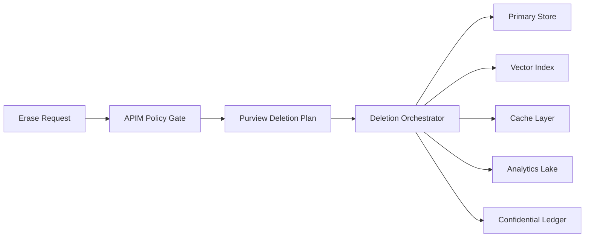
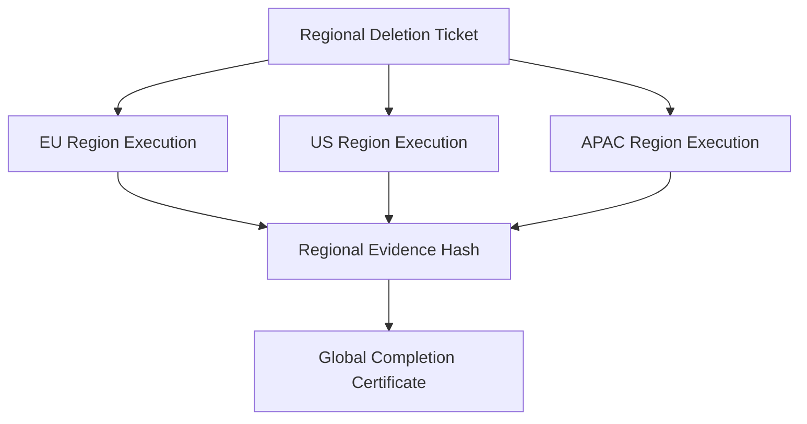

# 受监管智能体记忆删除与跨境数据驻留选型 FAQ（GDPR/CCPA/PIPEDA：APIM + Purview + Confidential Ledger + Region Fencing）

> 适用对象：金融、医疗、公共部门、跨境电商等高合规行业的 Cloud & AI Solution Architect。

## 1. 一页结论

当企业 Agent 同时处理欧盟、北美与本地监管数据时，必须把“可用性优先”升级为“合规正确性优先”的架构原则。推荐组合：

- **Route A（控制平面）**：`APIM` 入口策略 + 租户/地域声明校验 + 操作级策略分流。
- **Route B（治理平面）**：`Purview` 数据目录、保留与删除策略、审计检索。
- **Route C（证据平面）**：`Confidential Ledger` 写入删除证据与审批链哈希。
- **Route D（反模式）**：只删主库，不触发缓存/向量索引/备份副本清理。

核心建议：**删除请求是法律事件，不是普通 CRUD。**

## 2. 业务与合规挑战

- 同一租户可能在多个主权区域有数据副本。
- 一次“被遗忘权”请求需要传播到对话历史、向量检索索引、分析湖仓、缓存与离线快照。
- 不同法域删除时限不同，SLA 与监管罚则联动。
- 企业需要证明“何时删除、删除了什么、谁批准、是否完成全链路传播”。

## 3. 路线定义

### Route A：APIM 地域围栏 + 操作门禁
- 按 `tenant_id`、`region_claim`、`data_classification` 做请求策略分流。
- 对删除请求强制走审计增强路径与异步回执通道。

### Route B：Purview 生命周期与删除策略编排
- 用 Purview 标签、分类器、保留策略识别受监管数据。
- 将删除工单与数据资产目录绑定，实现可追溯删除计划。

### Route C：Confidential Ledger 证据账本
- 写入删除请求哈希、审批节点、执行节点、完成状态摘要。
- 保障审计时证据不可抵赖。

### Route D：反模式
- 应用层返回“删除成功”，但缓存/索引/副本仍可命中。
- 缺乏跨域证据链，监管问询时无法证明完成度。

## 4. 定量模型

### 4.1 删除传播窗口
`W_erase = max(T_cache, T_vector, T_backup, T_analytics) - T_request`

### 4.2 法域违规暴露
`Risk_reg = Σ_j (P_miss_j * Fine_j * Exposure_j)`

### 4.3 跨境传输违规风险
`Risk_xborder = P(route_misclassification) * Impact_data_sovereignty`

### 4.4 删除证据完备率
`Evidence_coverage = N_verified_deletions / N_total_deletions`

## 5. 12 维对比矩阵

| 维度 | Route A APIM 门禁 | Route B Purview 治理 | Route C 证据账本 | Route D 反模式 |
|---|---|---|---|---|
| 地域路由准确性 | 高 | 中 | 中 | 低 |
| 删除策略表达力 | 中 | 高 | 中 | 低 |
| 证据不可抵赖 | 中 | 中 | 高 | 低 |
| 合规审计可读性 | 高 | 高 | 高 | 低 |
| 跨团队协同效率 | 中高 | 中高 | 中 | 低 |
| 初始建设复杂度 | 中 | 中 | 中 | 低 |
| 运行稳定性 | 高 | 高 | 高 | 低 |
| 违规罚则暴露降低 | 高 | 高 | 高 | 低 |
| 删除回执可追踪性 | 高 | 高 | 高 | 低 |
| 数据主权边界清晰度 | 高 | 高 | 中 | 低 |
| 多区域扩展性 | 高 | 中高 | 中高 | 低 |
| 推荐结论 | ✅ 必选 | ✅ 必选 | ✅ 强烈建议 | ⛔ 禁止 |

## 6. 深度问答（Q1-Q8）
### Q1：删除请求为何不能同步立即返回完成？
因为删除传播涉及多副本系统，必须异步确认全链路完成。

### Q2：为何需要 APIM 做法域门禁？
它是统一入口，最适合先做地域/租户声明校验并阻断违规路由。

### Q3：Purview 主要解决什么问题？
资产发现、分类、保留与删除策略治理，避免“遗漏资产”导致删不干净。

### Q4：Confidential Ledger 会增加时延吗？
会有小幅开销，但可换来审计不可抵赖证据。

### Q5：如何证明向量索引已删除？
对删除实体做抽样检索与全量索引扫描，输出可复验报告。

### Q6：跨境复制副本怎么清理？
通过区域账本与删除工单关联，逐区域签收完成。

### Q7：缓存与会话上下文如何处理？
引入版本租约与强制刷新策略，阻断旧上下文复活。

### Q8：最关键 KPI 是什么？
`erase_window_p95` 与 `evidence_coverage`。

## 7. Mermaid 架构图





## 8. 生产片段：APIM 删除门禁策略（示意）

```xml
<inbound>
  <base />
  <choose>
    <when condition="@(context.Request.Headers.GetValueOrDefault("x-region","") != context.Request.Headers.GetValueOrDefault("x-tenant-region",""))">
      <return-response>
        <set-status code="403" reason="Region claim mismatch" />
      </return-response>
    </when>
  </choose>
</inbound>
```

## 9. 生产片段：删除执行伪代码

```python
def execute_erasure(ticket):
    for target in ticket.targets:
        erase(target)
        verify(target)
    ledger.append({
        "ticket_id": ticket.id,
        "status": "completed",
        "hash": sha256(ticket.summary()).hexdigest(),
    })
```

## 10. 企业场景（2+）

### 场景 A：跨境财富管理智能投顾
- 客户跨境迁移后请求删除历史对话与画像。
- 必须按法域分区执行并输出区域签收证明。

### 场景 B：医疗健康随访 Agent
- 患者撤回授权后，诊疗摘要与检索向量需同步删除。
- 需要可追溯证据链供审计团队复核。

### 场景 C：跨国零售客服平台
- 多区域会话缓存和推荐索引容易保留过期个人数据。
- 通过 APIM 门禁 + Purview 计划 + Ledger 证据闭环治理。

## 11. 三档三年 TCO（USD）

| 规模档位 | Route A+B | Route A+B+C | 反模式（隐性风险） |
|---|---:|---:|---:|
| 50 万数据主体 | 2,300,000 | 2,680,000 | 1,650,000（不含罚责） |
| 5,000 万数据主体 | 12,600,000 | 14,300,000 | 9,800,000（不含罚责） |
| 5 亿数据主体 | 67,000,000 | 73,500,000 | 54,200,000（不含罚责） |

## 12. Day-0 / Day-1 / Day-2 清单

### Day-0（治理基线）
- Day-0 项 1: 定义删除 SLA、法域边界、证据字段与审批责任。
- Day-0 项 2: 定义删除 SLA、法域边界、证据字段与审批责任。
- Day-0 项 3: 定义删除 SLA、法域边界、证据字段与审批责任。
- Day-0 项 4: 定义删除 SLA、法域边界、证据字段与审批责任。
- Day-0 项 5: 定义删除 SLA、法域边界、证据字段与审批责任。
- Day-0 项 6: 定义删除 SLA、法域边界、证据字段与审批责任。
- Day-0 项 7: 定义删除 SLA、法域边界、证据字段与审批责任。
- Day-0 项 8: 定义删除 SLA、法域边界、证据字段与审批责任。
- Day-0 项 9: 定义删除 SLA、法域边界、证据字段与审批责任。
- Day-0 项 10: 定义删除 SLA、法域边界、证据字段与审批责任。
- Day-0 项 11: 定义删除 SLA、法域边界、证据字段与审批责任。
- Day-0 项 12: 定义删除 SLA、法域边界、证据字段与审批责任。
- Day-0 项 13: 定义删除 SLA、法域边界、证据字段与审批责任。
- Day-0 项 14: 定义删除 SLA、法域边界、证据字段与审批责任。
- Day-0 项 15: 定义删除 SLA、法域边界、证据字段与审批责任。
- Day-0 项 16: 定义删除 SLA、法域边界、证据字段与审批责任。
- Day-0 项 17: 定义删除 SLA、法域边界、证据字段与审批责任。
- Day-0 项 18: 定义删除 SLA、法域边界、证据字段与审批责任。
- Day-0 项 19: 定义删除 SLA、法域边界、证据字段与审批责任。
- Day-0 项 20: 定义删除 SLA、法域边界、证据字段与审批责任。
- Day-0 项 21: 定义删除 SLA、法域边界、证据字段与审批责任。
- Day-0 项 22: 定义删除 SLA、法域边界、证据字段与审批责任。
- Day-0 项 23: 定义删除 SLA、法域边界、证据字段与审批责任。
- Day-0 项 24: 定义删除 SLA、法域边界、证据字段与审批责任。
- Day-0 项 25: 定义删除 SLA、法域边界、证据字段与审批责任。
- Day-0 项 26: 定义删除 SLA、法域边界、证据字段与审批责任。
- Day-0 项 27: 定义删除 SLA、法域边界、证据字段与审批责任。
- Day-0 项 28: 定义删除 SLA、法域边界、证据字段与审批责任。
- Day-0 项 29: 定义删除 SLA、法域边界、证据字段与审批责任。
- Day-0 项 30: 定义删除 SLA、法域边界、证据字段与审批责任。
- Day-0 项 31: 定义删除 SLA、法域边界、证据字段与审批责任。
- Day-0 项 32: 定义删除 SLA、法域边界、证据字段与审批责任。
- Day-0 项 33: 定义删除 SLA、法域边界、证据字段与审批责任。
- Day-0 项 34: 定义删除 SLA、法域边界、证据字段与审批责任。
- Day-0 项 35: 定义删除 SLA、法域边界、证据字段与审批责任。
- Day-0 项 36: 定义删除 SLA、法域边界、证据字段与审批责任。
- Day-0 项 37: 定义删除 SLA、法域边界、证据字段与审批责任。
- Day-0 项 38: 定义删除 SLA、法域边界、证据字段与审批责任。
- Day-0 项 39: 定义删除 SLA、法域边界、证据字段与审批责任。
- Day-0 项 40: 定义删除 SLA、法域边界、证据字段与审批责任。
- Day-0 项 41: 定义删除 SLA、法域边界、证据字段与审批责任。
- Day-0 项 42: 定义删除 SLA、法域边界、证据字段与审批责任。
- Day-0 项 43: 定义删除 SLA、法域边界、证据字段与审批责任。
- Day-0 项 44: 定义删除 SLA、法域边界、证据字段与审批责任。
- Day-0 项 45: 定义删除 SLA、法域边界、证据字段与审批责任。
- Day-0 项 46: 定义删除 SLA、法域边界、证据字段与审批责任。
- Day-0 项 47: 定义删除 SLA、法域边界、证据字段与审批责任。
- Day-0 项 48: 定义删除 SLA、法域边界、证据字段与审批责任。
- Day-0 项 49: 定义删除 SLA、法域边界、证据字段与审批责任。
- Day-0 项 50: 定义删除 SLA、法域边界、证据字段与审批责任。
- Day-0 项 51: 定义删除 SLA、法域边界、证据字段与审批责任。
- Day-0 项 52: 定义删除 SLA、法域边界、证据字段与审批责任。
- Day-0 项 53: 定义删除 SLA、法域边界、证据字段与审批责任。
- Day-0 项 54: 定义删除 SLA、法域边界、证据字段与审批责任。
- Day-0 项 55: 定义删除 SLA、法域边界、证据字段与审批责任。
- Day-0 项 56: 定义删除 SLA、法域边界、证据字段与审批责任。
- Day-0 项 57: 定义删除 SLA、法域边界、证据字段与审批责任。
- Day-0 项 58: 定义删除 SLA、法域边界、证据字段与审批责任。
- Day-0 项 59: 定义删除 SLA、法域边界、证据字段与审批责任。
- Day-0 项 60: 定义删除 SLA、法域边界、证据字段与审批责任。
- Day-0 项 61: 定义删除 SLA、法域边界、证据字段与审批责任。
- Day-0 项 62: 定义删除 SLA、法域边界、证据字段与审批责任。
- Day-0 项 63: 定义删除 SLA、法域边界、证据字段与审批责任。
- Day-0 项 64: 定义删除 SLA、法域边界、证据字段与审批责任。
- Day-0 项 65: 定义删除 SLA、法域边界、证据字段与审批责任。
- Day-0 项 66: 定义删除 SLA、法域边界、证据字段与审批责任。
- Day-0 项 67: 定义删除 SLA、法域边界、证据字段与审批责任。
- Day-0 项 68: 定义删除 SLA、法域边界、证据字段与审批责任。
- Day-0 项 69: 定义删除 SLA、法域边界、证据字段与审批责任。
- Day-0 项 70: 定义删除 SLA、法域边界、证据字段与审批责任。
- Day-0 项 71: 定义删除 SLA、法域边界、证据字段与审批责任。
- Day-0 项 72: 定义删除 SLA、法域边界、证据字段与审批责任。
- Day-0 项 73: 定义删除 SLA、法域边界、证据字段与审批责任。
- Day-0 项 74: 定义删除 SLA、法域边界、证据字段与审批责任。
- Day-0 项 75: 定义删除 SLA、法域边界、证据字段与审批责任。
- Day-0 项 76: 定义删除 SLA、法域边界、证据字段与审批责任。
- Day-0 项 77: 定义删除 SLA、法域边界、证据字段与审批责任。
- Day-0 项 78: 定义删除 SLA、法域边界、证据字段与审批责任。
- Day-0 项 79: 定义删除 SLA、法域边界、证据字段与审批责任。
- Day-0 项 80: 定义删除 SLA、法域边界、证据字段与审批责任。

### Day-1（工程上线）
- Day-1 项 1: 打通 APIM 门禁、Purview 策略、删除编排与证据账本。
- Day-1 项 2: 打通 APIM 门禁、Purview 策略、删除编排与证据账本。
- Day-1 项 3: 打通 APIM 门禁、Purview 策略、删除编排与证据账本。
- Day-1 项 4: 打通 APIM 门禁、Purview 策略、删除编排与证据账本。
- Day-1 项 5: 打通 APIM 门禁、Purview 策略、删除编排与证据账本。
- Day-1 项 6: 打通 APIM 门禁、Purview 策略、删除编排与证据账本。
- Day-1 项 7: 打通 APIM 门禁、Purview 策略、删除编排与证据账本。
- Day-1 项 8: 打通 APIM 门禁、Purview 策略、删除编排与证据账本。
- Day-1 项 9: 打通 APIM 门禁、Purview 策略、删除编排与证据账本。
- Day-1 项 10: 打通 APIM 门禁、Purview 策略、删除编排与证据账本。
- Day-1 项 11: 打通 APIM 门禁、Purview 策略、删除编排与证据账本。
- Day-1 项 12: 打通 APIM 门禁、Purview 策略、删除编排与证据账本。
- Day-1 项 13: 打通 APIM 门禁、Purview 策略、删除编排与证据账本。
- Day-1 项 14: 打通 APIM 门禁、Purview 策略、删除编排与证据账本。
- Day-1 项 15: 打通 APIM 门禁、Purview 策略、删除编排与证据账本。
- Day-1 项 16: 打通 APIM 门禁、Purview 策略、删除编排与证据账本。
- Day-1 项 17: 打通 APIM 门禁、Purview 策略、删除编排与证据账本。
- Day-1 项 18: 打通 APIM 门禁、Purview 策略、删除编排与证据账本。
- Day-1 项 19: 打通 APIM 门禁、Purview 策略、删除编排与证据账本。
- Day-1 项 20: 打通 APIM 门禁、Purview 策略、删除编排与证据账本。
- Day-1 项 21: 打通 APIM 门禁、Purview 策略、删除编排与证据账本。
- Day-1 项 22: 打通 APIM 门禁、Purview 策略、删除编排与证据账本。
- Day-1 项 23: 打通 APIM 门禁、Purview 策略、删除编排与证据账本。
- Day-1 项 24: 打通 APIM 门禁、Purview 策略、删除编排与证据账本。
- Day-1 项 25: 打通 APIM 门禁、Purview 策略、删除编排与证据账本。
- Day-1 项 26: 打通 APIM 门禁、Purview 策略、删除编排与证据账本。
- Day-1 项 27: 打通 APIM 门禁、Purview 策略、删除编排与证据账本。
- Day-1 项 28: 打通 APIM 门禁、Purview 策略、删除编排与证据账本。
- Day-1 项 29: 打通 APIM 门禁、Purview 策略、删除编排与证据账本。
- Day-1 项 30: 打通 APIM 门禁、Purview 策略、删除编排与证据账本。
- Day-1 项 31: 打通 APIM 门禁、Purview 策略、删除编排与证据账本。
- Day-1 项 32: 打通 APIM 门禁、Purview 策略、删除编排与证据账本。
- Day-1 项 33: 打通 APIM 门禁、Purview 策略、删除编排与证据账本。
- Day-1 项 34: 打通 APIM 门禁、Purview 策略、删除编排与证据账本。
- Day-1 项 35: 打通 APIM 门禁、Purview 策略、删除编排与证据账本。
- Day-1 项 36: 打通 APIM 门禁、Purview 策略、删除编排与证据账本。
- Day-1 项 37: 打通 APIM 门禁、Purview 策略、删除编排与证据账本。
- Day-1 项 38: 打通 APIM 门禁、Purview 策略、删除编排与证据账本。
- Day-1 项 39: 打通 APIM 门禁、Purview 策略、删除编排与证据账本。
- Day-1 项 40: 打通 APIM 门禁、Purview 策略、删除编排与证据账本。
- Day-1 项 41: 打通 APIM 门禁、Purview 策略、删除编排与证据账本。
- Day-1 项 42: 打通 APIM 门禁、Purview 策略、删除编排与证据账本。
- Day-1 项 43: 打通 APIM 门禁、Purview 策略、删除编排与证据账本。
- Day-1 项 44: 打通 APIM 门禁、Purview 策略、删除编排与证据账本。
- Day-1 项 45: 打通 APIM 门禁、Purview 策略、删除编排与证据账本。
- Day-1 项 46: 打通 APIM 门禁、Purview 策略、删除编排与证据账本。
- Day-1 项 47: 打通 APIM 门禁、Purview 策略、删除编排与证据账本。
- Day-1 项 48: 打通 APIM 门禁、Purview 策略、删除编排与证据账本。
- Day-1 项 49: 打通 APIM 门禁、Purview 策略、删除编排与证据账本。
- Day-1 项 50: 打通 APIM 门禁、Purview 策略、删除编排与证据账本。
- Day-1 项 51: 打通 APIM 门禁、Purview 策略、删除编排与证据账本。
- Day-1 项 52: 打通 APIM 门禁、Purview 策略、删除编排与证据账本。
- Day-1 项 53: 打通 APIM 门禁、Purview 策略、删除编排与证据账本。
- Day-1 项 54: 打通 APIM 门禁、Purview 策略、删除编排与证据账本。
- Day-1 项 55: 打通 APIM 门禁、Purview 策略、删除编排与证据账本。
- Day-1 项 56: 打通 APIM 门禁、Purview 策略、删除编排与证据账本。
- Day-1 项 57: 打通 APIM 门禁、Purview 策略、删除编排与证据账本。
- Day-1 项 58: 打通 APIM 门禁、Purview 策略、删除编排与证据账本。
- Day-1 项 59: 打通 APIM 门禁、Purview 策略、删除编排与证据账本。
- Day-1 项 60: 打通 APIM 门禁、Purview 策略、删除编排与证据账本。
- Day-1 项 61: 打通 APIM 门禁、Purview 策略、删除编排与证据账本。
- Day-1 项 62: 打通 APIM 门禁、Purview 策略、删除编排与证据账本。
- Day-1 项 63: 打通 APIM 门禁、Purview 策略、删除编排与证据账本。
- Day-1 项 64: 打通 APIM 门禁、Purview 策略、删除编排与证据账本。
- Day-1 项 65: 打通 APIM 门禁、Purview 策略、删除编排与证据账本。
- Day-1 项 66: 打通 APIM 门禁、Purview 策略、删除编排与证据账本。
- Day-1 项 67: 打通 APIM 门禁、Purview 策略、删除编排与证据账本。
- Day-1 项 68: 打通 APIM 门禁、Purview 策略、删除编排与证据账本。
- Day-1 项 69: 打通 APIM 门禁、Purview 策略、删除编排与证据账本。
- Day-1 项 70: 打通 APIM 门禁、Purview 策略、删除编排与证据账本。
- Day-1 项 71: 打通 APIM 门禁、Purview 策略、删除编排与证据账本。
- Day-1 项 72: 打通 APIM 门禁、Purview 策略、删除编排与证据账本。
- Day-1 项 73: 打通 APIM 门禁、Purview 策略、删除编排与证据账本。
- Day-1 项 74: 打通 APIM 门禁、Purview 策略、删除编排与证据账本。
- Day-1 项 75: 打通 APIM 门禁、Purview 策略、删除编排与证据账本。
- Day-1 项 76: 打通 APIM 门禁、Purview 策略、删除编排与证据账本。
- Day-1 项 77: 打通 APIM 门禁、Purview 策略、删除编排与证据账本。
- Day-1 项 78: 打通 APIM 门禁、Purview 策略、删除编排与证据账本。
- Day-1 项 79: 打通 APIM 门禁、Purview 策略、删除编排与证据账本。
- Day-1 项 80: 打通 APIM 门禁、Purview 策略、删除编排与证据账本。

### Day-2（运营稽核）
- Day-2 项 1: 抽检删除窗口、跨区签收率、索引残留率与审计回放通过率。
- Day-2 项 2: 抽检删除窗口、跨区签收率、索引残留率与审计回放通过率。
- Day-2 项 3: 抽检删除窗口、跨区签收率、索引残留率与审计回放通过率。
- Day-2 项 4: 抽检删除窗口、跨区签收率、索引残留率与审计回放通过率。
- Day-2 项 5: 抽检删除窗口、跨区签收率、索引残留率与审计回放通过率。
- Day-2 项 6: 抽检删除窗口、跨区签收率、索引残留率与审计回放通过率。
- Day-2 项 7: 抽检删除窗口、跨区签收率、索引残留率与审计回放通过率。
- Day-2 项 8: 抽检删除窗口、跨区签收率、索引残留率与审计回放通过率。
- Day-2 项 9: 抽检删除窗口、跨区签收率、索引残留率与审计回放通过率。
- Day-2 项 10: 抽检删除窗口、跨区签收率、索引残留率与审计回放通过率。
- Day-2 项 11: 抽检删除窗口、跨区签收率、索引残留率与审计回放通过率。
- Day-2 项 12: 抽检删除窗口、跨区签收率、索引残留率与审计回放通过率。
- Day-2 项 13: 抽检删除窗口、跨区签收率、索引残留率与审计回放通过率。
- Day-2 项 14: 抽检删除窗口、跨区签收率、索引残留率与审计回放通过率。
- Day-2 项 15: 抽检删除窗口、跨区签收率、索引残留率与审计回放通过率。
- Day-2 项 16: 抽检删除窗口、跨区签收率、索引残留率与审计回放通过率。
- Day-2 项 17: 抽检删除窗口、跨区签收率、索引残留率与审计回放通过率。
- Day-2 项 18: 抽检删除窗口、跨区签收率、索引残留率与审计回放通过率。
- Day-2 项 19: 抽检删除窗口、跨区签收率、索引残留率与审计回放通过率。
- Day-2 项 20: 抽检删除窗口、跨区签收率、索引残留率与审计回放通过率。
- Day-2 项 21: 抽检删除窗口、跨区签收率、索引残留率与审计回放通过率。
- Day-2 项 22: 抽检删除窗口、跨区签收率、索引残留率与审计回放通过率。
- Day-2 项 23: 抽检删除窗口、跨区签收率、索引残留率与审计回放通过率。
- Day-2 项 24: 抽检删除窗口、跨区签收率、索引残留率与审计回放通过率。
- Day-2 项 25: 抽检删除窗口、跨区签收率、索引残留率与审计回放通过率。
- Day-2 项 26: 抽检删除窗口、跨区签收率、索引残留率与审计回放通过率。
- Day-2 项 27: 抽检删除窗口、跨区签收率、索引残留率与审计回放通过率。
- Day-2 项 28: 抽检删除窗口、跨区签收率、索引残留率与审计回放通过率。
- Day-2 项 29: 抽检删除窗口、跨区签收率、索引残留率与审计回放通过率。
- Day-2 项 30: 抽检删除窗口、跨区签收率、索引残留率与审计回放通过率。
- Day-2 项 31: 抽检删除窗口、跨区签收率、索引残留率与审计回放通过率。
- Day-2 项 32: 抽检删除窗口、跨区签收率、索引残留率与审计回放通过率。
- Day-2 项 33: 抽检删除窗口、跨区签收率、索引残留率与审计回放通过率。
- Day-2 项 34: 抽检删除窗口、跨区签收率、索引残留率与审计回放通过率。
- Day-2 项 35: 抽检删除窗口、跨区签收率、索引残留率与审计回放通过率。
- Day-2 项 36: 抽检删除窗口、跨区签收率、索引残留率与审计回放通过率。
- Day-2 项 37: 抽检删除窗口、跨区签收率、索引残留率与审计回放通过率。
- Day-2 项 38: 抽检删除窗口、跨区签收率、索引残留率与审计回放通过率。
- Day-2 项 39: 抽检删除窗口、跨区签收率、索引残留率与审计回放通过率。
- Day-2 项 40: 抽检删除窗口、跨区签收率、索引残留率与审计回放通过率。
- Day-2 项 41: 抽检删除窗口、跨区签收率、索引残留率与审计回放通过率。
- Day-2 项 42: 抽检删除窗口、跨区签收率、索引残留率与审计回放通过率。
- Day-2 项 43: 抽检删除窗口、跨区签收率、索引残留率与审计回放通过率。
- Day-2 项 44: 抽检删除窗口、跨区签收率、索引残留率与审计回放通过率。
- Day-2 项 45: 抽检删除窗口、跨区签收率、索引残留率与审计回放通过率。
- Day-2 项 46: 抽检删除窗口、跨区签收率、索引残留率与审计回放通过率。
- Day-2 项 47: 抽检删除窗口、跨区签收率、索引残留率与审计回放通过率。
- Day-2 项 48: 抽检删除窗口、跨区签收率、索引残留率与审计回放通过率。
- Day-2 项 49: 抽检删除窗口、跨区签收率、索引残留率与审计回放通过率。
- Day-2 项 50: 抽检删除窗口、跨区签收率、索引残留率与审计回放通过率。
- Day-2 项 51: 抽检删除窗口、跨区签收率、索引残留率与审计回放通过率。
- Day-2 项 52: 抽检删除窗口、跨区签收率、索引残留率与审计回放通过率。
- Day-2 项 53: 抽检删除窗口、跨区签收率、索引残留率与审计回放通过率。
- Day-2 项 54: 抽检删除窗口、跨区签收率、索引残留率与审计回放通过率。
- Day-2 项 55: 抽检删除窗口、跨区签收率、索引残留率与审计回放通过率。
- Day-2 项 56: 抽检删除窗口、跨区签收率、索引残留率与审计回放通过率。
- Day-2 项 57: 抽检删除窗口、跨区签收率、索引残留率与审计回放通过率。
- Day-2 项 58: 抽检删除窗口、跨区签收率、索引残留率与审计回放通过率。
- Day-2 项 59: 抽检删除窗口、跨区签收率、索引残留率与审计回放通过率。
- Day-2 项 60: 抽检删除窗口、跨区签收率、索引残留率与审计回放通过率。
- Day-2 项 61: 抽检删除窗口、跨区签收率、索引残留率与审计回放通过率。
- Day-2 项 62: 抽检删除窗口、跨区签收率、索引残留率与审计回放通过率。
- Day-2 项 63: 抽检删除窗口、跨区签收率、索引残留率与审计回放通过率。
- Day-2 项 64: 抽检删除窗口、跨区签收率、索引残留率与审计回放通过率。
- Day-2 项 65: 抽检删除窗口、跨区签收率、索引残留率与审计回放通过率。
- Day-2 项 66: 抽检删除窗口、跨区签收率、索引残留率与审计回放通过率。
- Day-2 项 67: 抽检删除窗口、跨区签收率、索引残留率与审计回放通过率。
- Day-2 项 68: 抽检删除窗口、跨区签收率、索引残留率与审计回放通过率。
- Day-2 项 69: 抽检删除窗口、跨区签收率、索引残留率与审计回放通过率。
- Day-2 项 70: 抽检删除窗口、跨区签收率、索引残留率与审计回放通过率。
- Day-2 项 71: 抽检删除窗口、跨区签收率、索引残留率与审计回放通过率。
- Day-2 项 72: 抽检删除窗口、跨区签收率、索引残留率与审计回放通过率。
- Day-2 项 73: 抽检删除窗口、跨区签收率、索引残留率与审计回放通过率。
- Day-2 项 74: 抽检删除窗口、跨区签收率、索引残留率与审计回放通过率。
- Day-2 项 75: 抽检删除窗口、跨区签收率、索引残留率与审计回放通过率。
- Day-2 项 76: 抽检删除窗口、跨区签收率、索引残留率与审计回放通过率。
- Day-2 项 77: 抽检删除窗口、跨区签收率、索引残留率与审计回放通过率。
- Day-2 项 78: 抽检删除窗口、跨区签收率、索引残留率与审计回放通过率。
- Day-2 项 79: 抽检删除窗口、跨区签收率、索引残留率与审计回放通过率。
- Day-2 项 80: 抽检删除窗口、跨区签收率、索引残留率与审计回放通过率。
- Day-2 项 81: 抽检删除窗口、跨区签收率、索引残留率与审计回放通过率。
- Day-2 项 82: 抽检删除窗口、跨区签收率、索引残留率与审计回放通过率。
- Day-2 项 83: 抽检删除窗口、跨区签收率、索引残留率与审计回放通过率。
- Day-2 项 84: 抽检删除窗口、跨区签收率、索引残留率与审计回放通过率。
- Day-2 项 85: 抽检删除窗口、跨区签收率、索引残留率与审计回放通过率。
- Day-2 项 86: 抽检删除窗口、跨区签收率、索引残留率与审计回放通过率。
- Day-2 项 87: 抽检删除窗口、跨区签收率、索引残留率与审计回放通过率。
- Day-2 项 88: 抽检删除窗口、跨区签收率、索引残留率与审计回放通过率。
- Day-2 项 89: 抽检删除窗口、跨区签收率、索引残留率与审计回放通过率。
- Day-2 项 90: 抽检删除窗口、跨区签收率、索引残留率与审计回放通过率。
- Day-2 项 91: 抽检删除窗口、跨区签收率、索引残留率与审计回放通过率。
- Day-2 项 92: 抽检删除窗口、跨区签收率、索引残留率与审计回放通过率。
- Day-2 项 93: 抽检删除窗口、跨区签收率、索引残留率与审计回放通过率。
- Day-2 项 94: 抽检删除窗口、跨区签收率、索引残留率与审计回放通过率。
- Day-2 项 95: 抽检删除窗口、跨区签收率、索引残留率与审计回放通过率。
- Day-2 项 96: 抽检删除窗口、跨区签收率、索引残留率与审计回放通过率。
- Day-2 项 97: 抽检删除窗口、跨区签收率、索引残留率与审计回放通过率。
- Day-2 项 98: 抽检删除窗口、跨区签收率、索引残留率与审计回放通过率。
- Day-2 项 99: 抽检删除窗口、跨区签收率、索引残留率与审计回放通过率。
- Day-2 项 100: 抽检删除窗口、跨区签收率、索引残留率与审计回放通过率。

## 13. Good fit vs Not for

### ✅ Good fit
- 强监管行业与跨境数据业务。
- 对“可证明删除”有明确法律责任的企业。

### ⛔ Not for
- 临时 PoC、无个人数据处理场景。
- 不具备数据治理与审计能力的轻量团队。

## 14. 五步落地指南
1. 建立租户+法域声明与 APIM 门禁规则。
2. 用 Purview 建模数据资产与删除策略。
3. 落地异步删除编排与跨区签收机制。
4. 记录 Confidential Ledger 证据哈希。
5. 以演练持续优化删除窗口与完备率。

## 15. 核心 KPI
- `erase_window_p95_minutes`
- `xborder_route_violation_rate`
- `evidence_coverage`
- `vector_residual_hit_rate`
- `audit_replay_pass_rate`

## 16. 最终建议
对受监管企业，Route A+B 是最低基线，Route C 是监管问询下的高价值增强；Route D 应明确禁用。
