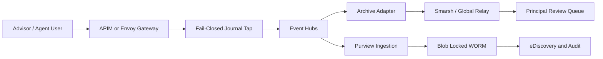
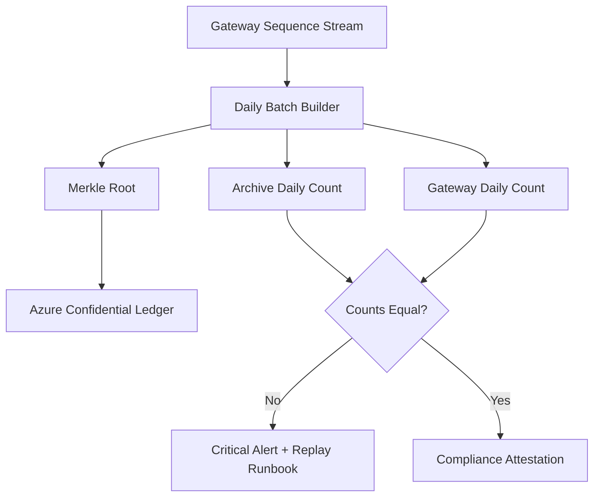

# Regulated AI Communications Recordkeeping Selection FAQ (SEC 17a-4 / FINRA 3110: Purview WORM vs Smarsh/Global Relay Tap vs Pre-Send Hold)

> Audience: broker-dealer, wealth, asset-management, and derivatives compliance/platform teams operating regulated enterprise AI agents.
>
> Decision objective: capture prompts, retrieval evidence, tool payloads, reasoning summaries, and client-facing outputs as supervisory-grade books-and-records with completeness proof, retention immutability, and principal review workflows.

## 1. Executive summary

In regulated financial services, AI agent conversations are not “just telemetry.”

They are regulated communication records when used for client advice, recommendations, pricing support, or supervisory workflows.

Regulators do not only ask whether records exist.

They ask whether records are:

- complete,
- immutable for required retention periods,
- discoverable under legal hold,
- and supervised under documented principal oversight controls.

A common failure pattern is to rely on mutable observability logs as if they were books-and-records evidence.

That pattern fails under enforcement-grade scrutiny.

This guide compares four routes:

- **Route A**: Microsoft Purview native communications compliance stack + locked immutable WORM retention.
- **Route B**: fail-closed APIM/Envoy journal tap to Event Hubs and existing broker-dealer archive platforms (Smarsh/Global Relay), with Confidential Ledger completeness proof.
- **Route C**: risk-tiered supervisory gate (pre-send principal hold for high-risk external communications, post-send asynchronous sampling for lower-risk internal workflows).
- **Route D**: anti-pattern baseline treating App Insights/Log Analytics or fire-and-forget logging as compliant recordkeeping.

Recommended policy:

1. choose Route A when Microsoft-native compliance operations dominate,
2. choose Route B when archive unification with legacy channels is mandatory,
3. layer Route C on top of A or B to balance supervisory rigor and business latency,
4. prohibit Route D in architecture governance.

## 2. Regulatory requirement mapping scope

### 2.1 Rules in focus

This architecture addresses implementation obligations associated with:

- `SEC Rule 17a-4(f)`,
- `FINRA Rule 3110` and related supervisory expectations,
- `CFTC 1.31`,
- `MiFID II Article 16(7)`.

### 2.2 Agent record envelope scope

A practical minimum envelope should include:

- prompt and role context,
- retrieval chunk hashes and reference IDs,
- tool-call payload summaries and outputs,
- model identifier and serving version,
- policy/guardrail verdict metadata,
- client-facing output artifact references,
- optional encrypted reasoning summary where policy permits.

### 2.3 Completeness definition

Completeness is not “we have logs.”

Completeness means:

- sequence continuity,
- no silent drop,
- traceable ingestion and archival acknowledgment,
- reproducible reconciliation evidence.

## 3. Route definitions

### 3.1 Route A: Purview native stack + locked immutable WORM retention

Core components:

- Purview Communication Compliance supervisory workflows,
- Purview retention and legal-hold governance,
- eDiscovery Premium retrieval and case workflows,
- Azure Blob locked immutability (or approved audit-trail alternatives).

Strengths:

- native integration with M365 communication channels,
- mature supervisory queue and reviewer assignment model,
- strong legal hold and downstream eDiscovery alignment.

Trade-offs:

- custom agent envelope mapping requires data-contract design,
- cross-channel normalization may need integration glue for non-Microsoft channels.

### 3.2 Route B: fail-closed gateway journaling tap to existing archive plane

Core components:

- APIM/Envoy journaling tap with fail-closed acknowledgment behavior,
- Event Hubs durable buffer and replay lane,
- Smarsh/Global Relay archival adapter,
- Azure Confidential Ledger daily Merkle-root attestation.

Strengths:

- unified supervision alongside Bloomberg IB, Teams, email, and approved chat channels,
- leverages existing archive operating model and reviewer workflows,
- explicit sequence reconciliation supports “no silent loss” attestations.

Trade-offs:

- higher integration engineering and schema governance load,
- ongoing replay/reconciliation operations required.

### 3.3 Route C: risk-tiered supervisory gate

Core policy:

- pre-send principal hold for high-risk external communications (retail recommendations, promissory language, suitability-sensitive language),
- post-send asynchronous supervisory sampling for lower-risk internal/institutional workflows.

Objective:

- preserve compliance rigor where risk is highest,
- keep internal productivity and low-latency experiences viable.

### 3.4 Route D: anti-pattern baseline

Symptoms:

- mutable workspace logging used as primary record system,
- no supervisory review queue or principal sign-off chain,
- asynchronous logging without durable ack and without sequence reconciliation.

Result:

- weak defensibility under audit or enforcement,
- inability to prove completeness or retention immutability,
- elevated legal and regulatory exposure.

## 4. Quantitative engineering models

### 4.1 Seven-year compressed retention footprint (`S_7yr`)

Definitions:

- `N_turn_day`: regulated turn count per day,
- `B_turn_raw`: raw bytes per envelope,
- `r_comp`: compression ratio,
- `Y`: retention years (typically 7).

Model:

`S_7yr = N_turn_day × 365 × Y × B_turn_raw × r_comp`

Extend with:

- multimodal attachment factors,
- index and metadata amplification factor,
- replication and legal-hold reserve margin.

### 4.2 Fail-closed journal ACK overhead (`ΔL_ack`)

Definitions:

- `L_base`: baseline response latency without journaling guarantee,
- `L_journal`: response latency with durable journal ack gate.

Model:

`ΔL_ack = L_journal - L_base`

Targeting guidance:

- maintain very low overhead for low-risk internal workflows,
- accept larger overhead for high-risk external workflows where supervisory certainty is mandatory.

### 4.3 Supervisory workload and false-positive model

Definitions:

- `p_sample`: sampling ratio,
- `N_msg`: candidate communication volume,
- `FPR`: false-positive rate.

Estimates:

- `N_review = p_sample × N_msg`,
- `N_fp = FPR × N_review`.

Governance implication:

- optimize classifier/rules to reduce `N_fp`,
- preserve required risk coverage and reviewer capacity stability.

### 4.4 Completeness reconciliation hard constraint

Definitions:

- `N_gateway_day`: daily sequence count emitted by gateway journaling,
- `N_archive_day`: daily sequence count accepted by archive destination.

Constraint:

`N_gateway_day == N_archive_day`

If false:

- raise critical alert,
- trigger replay runbook,
- produce reconciliation exception evidence for compliance review.

## 5. Twelve-dimension comparison matrix

| Dimension | Route A Purview WORM | Route B Tap+Archive+Ledger | Route C Risk-Tier Gate | Route D Anti-Pattern |
|---|---|---|---|---|
| Regulatory fit | High | High | Medium-high | Low |
| Immutability posture | High | High | Depends on base | Low |
| Supervisory workflow maturity | High | High | High | Low |
| Integration complexity | Medium | High | Medium-high | Low |
| Unified supervision pane | Medium | High | Medium | Low |
| Completeness proof strength | Medium-high | Very high | Medium | Low |
| Legacy archive compatibility | Medium | Very high | Medium | Low |
| User-latency impact | Medium | Medium | Tunable | Low (non-compliant) |
| Cost predictability | Medium-high | Medium | Medium-high | Misleading |
| Replay/audit forensics | High | High | Medium-high | Low |
| Operational burden | Medium | High | Medium | Low |
| Recommendation | ✅ | ✅ | ✅ (overlay) | ⛔ |

## 6. Deep quantitative Q&A (Q1 to Q6)

### Q1: How should seven-year storage be budgeted realistically?

Do not budget text only.

Budget should include:

- envelope payload,
- attachment references and derived evidence objects,
- indexing overhead,
- legal-hold expansion reserves.

Quarterly recalibration of `N_turn_day` and attachment mix is recommended.

### Q2: Does fail-closed journaling make the business flow unusably slow?

Not necessarily.

Use Route C tiering:

- high-risk external paths: strict fail-closed with principal hold,
- lower-risk internal paths: durable post-send journaling with reconciliation.

This preserves compliance boundaries without flattening all flows to worst-case latency.

### Q3: Why add Merkle-root attestation when archive platforms already acknowledge ingest?

Because ingest acknowledgment alone does not prove end-to-end completeness integrity at day-close.

Merkle-root anchoring provides:

- tamper-evident aggregate proof,
- fast dispute resolution for missing sequence ranges,
- stronger defensibility during investigations.

### Q4: How should FINRA 3110 sampling be tuned operationally?

Treat sampling as risk-weighted, not flat.

Examples:

- suitability-sensitive retail language: high sampling or pre-send hold,
- low-risk internal research notes: lower sampling with trigger-based escalation.

Objective:

- maximize risk coverage per reviewer hour.

### Q5: Why is observability logging alone insufficient for books-and-records?

Observability systems optimize for diagnostics.

Books-and-records systems require:

- immutability guarantees,
- supervisory workflow controls,
- legal hold and discovery-grade retrieval,
- completeness attestation and replay evidence.

Without these, evidentiary posture is weak.

### Q6: How do we prove “zero silent drop” to internal audit?

You need all three:

1. monotonic gateway sequence with no unexplained gaps,
2. matching archive-side accepted sequence counts,
3. immutable daily reconciliation and exception evidence.

Any missing layer reduces defensibility.

## 7. Reference architecture diagram (Mermaid)





## 8. Production example: APIM fail-closed journaling policy

```xml
<policies>
  <inbound>
    <base />
    <set-variable name="journalEnvelope" value="@{
        return new JObject(
          new JProperty(""seq"", context.RequestId.ToString()),
          new JProperty(""ts"", DateTime.UtcNow.ToString(""o"")),
          new JProperty(""model_id"", context.Variables.GetValueOrDefault<string>(""model-id"", ""unknown"")),
          new JProperty(""prompt_hash"", context.Variables.GetValueOrDefault<string>(""prompt-hash"", ""na"")),
          new JProperty(""output_hash"", context.Variables.GetValueOrDefault<string>(""output-hash"", ""na""))
        ).ToString();
    }" />
    <send-request mode="new" response-variable-name="journalAck" timeout="8" ignore-error="false">
      <set-url>https://journal-gateway.internal/ingest</set-url>
      <set-method>POST</set-method>
      <set-header name="Content-Type" exists-action="override">
        <value>application/json</value>
      </set-header>
      <set-body>@((string)context.Variables["journalEnvelope"])</set-body>
    </send-request>
    <choose>
      <when condition="@(((IResponse)context.Variables["journalAck"]).StatusCode != 202)">
        <return-response>
          <set-status code="503" reason="JournalingUnavailable" />
          <set-body>{ "error": "fail-closed journaling gate triggered" }</set-body>
        </return-response>
      </when>
    </choose>
  </inbound>
  <backend><base /></backend>
  <outbound><base /></outbound>
  <on-error><base /></on-error>
</policies>
```

## 9. Production example: locked immutability Bicep

```bicep
resource archiveStorage 'Microsoft.Storage/storageAccounts@2023-05-01' = {
  name: 'stregcompliance001'
  location: resourceGroup().location
  sku: {
    name: 'Standard_GRS'
  }
  kind: 'StorageV2'
  properties: {
    allowBlobPublicAccess: false
    minimumTlsVersion: 'TLS1_2'
    supportsHttpsTrafficOnly: true
  }
}

resource container 'Microsoft.Storage/storageAccounts/blobServices/containers@2023-05-01' = {
  name: '${archiveStorage.name}/default/journal-archive'
  properties: {
    publicAccess: 'None'
    immutableStorageWithVersioning: {
      enabled: true
    }
  }
}

resource immutability 'Microsoft.Storage/storageAccounts/blobServices/containers/immutabilityPolicies@2023-05-01' = {
  name: '${archiveStorage.name}/default/journal-archive/default'
  properties: {
    immutabilityPeriodSinceCreationInDays: 2555
    allowProtectedAppendWrites: true
    allowProtectedAppendWritesAll: true
    state: 'Locked'
  }
}
```

## 10. Enterprise scenarios (2+)

### Scenario A: global broker-dealer wealth-advisor communication copilot

Requirements:

- supervise externally facing advisor drafts,
- retain complete communication context for required periods,
- support principal sign-off and legal hold.

Recommended route:

- Route A as foundational supervision/retention plane,
- Route C pre-send hold for high-risk external messaging.

Outcome:

- strong supervisory chain for client communications,
- easier case reconstruction for audit and legal review.

### Scenario B: institutional derivatives desk pricing/research copilot (CFTC + MiFID context)

Requirements:

- high-volume intraday internal dialogs,
- selective external disclosures requiring strict review,
- compatibility with existing compliance archive operations.

Recommended route:

- Route B for unified archival and sequence-proof completeness,
- Route C to reserve pre-send hold for high-risk external publication events.

Outcome:

- archive consolidation with existing channels,
- measurable no-silent-loss evidence.

### Scenario C: multinational investment research collaboration

Requirements:

- heavy internal collaboration across regions,
- strict controls for external client publication,
- multi-jurisdiction policy alignment and retention governance.

Recommended route:

- post-send sampling for internal collaboration,
- pre-send hold for external publication,
- common envelope schema with jurisdiction-aware policy profiles.

Outcome:

- balanced productivity and supervision,
- clearer cross-region audit evidence.

## 11. Three-tier TCO (3-year and 7-year) for regulated seat scales

| Regulated seat scale | Route A 3-year | Route A 7-year | Route B 3-year | Route B 7-year | Route C Increment 3-year | Route C Increment 7-year |
|---|---:|---:|---:|---:|---:|---:|
| 500 | 1,950,000 | 4,120,000 | 2,340,000 | 4,980,000 | 420,000 | 930,000 |
| 5,000 | 13,800,000 | 29,600,000 | 16,900,000 | 35,900,000 | 2,850,000 | 6,300,000 |
| 25,000 | 58,700,000 | 125,400,000 | 72,500,000 | 151,300,000 | 11,900,000 | 26,800,000 |

Interpretation:

- Route A is often cost-balanced in Microsoft-centric governance estates,
- Route B is attractive where existing archive platforms are strategic and already funded,
- Route C is not a replacement archive plane; it is a supervisory-latency control layer.

## 12. Day-0 / Day-1 / Day-2 execution checklist

### Day-0

- finalize regulated record envelope schema,
- define books-and-records vs observability boundary explicitly,
- select primary archive route (A or B),
- define sequence-id strategy and reconciliation controls.

### Day-1

- deploy minimum fail-closed journaling path,
- stand up principal review queue workflows,
- deploy high-risk communication classifiers and policy gates,
- produce daily reconciliation reports with exception alerting.

### Day-2

- automate Merkle attestation and evidence export,
- scale multi-channel supervision dashboards,
- implement replay and exception closure runbooks,
- tune policy profiles by jurisdiction and communication channel.

## 13. Good fit vs Not for

### ✅ Good fit

- firms subject to SEC/FINRA/CFTC/MiFID communication recordkeeping requirements,
- organizations requiring auditable supervision and retention immutability,
- institutions using AI agents in client-facing advisory or regulated research workflows.

### ⛔ Not for

- teams that treat mutable observability logs as compliance records,
- organizations with no principal review chain or sign-off controls,
- environments unwilling to operate reconciliation and replay discipline.

## 14. Operational KPIs and governance alerts

Recommended KPIs:

- `journal_ack_p95_ms`,
- `reconciliation_diff_count`,
- `supervisory_queue_backlog`,
- `false_positive_rate`,
- `presend_hold_release_time`,
- `record_replay_success_rate`,
- `attestation_publish_delay`.

Alert guidance:

1. any non-zero `reconciliation_diff_count` should trigger critical escalation,
2. sustained `journal_ack_p95_ms` degradation requires route-capacity and policy-latency review without bypassing fail-closed controls,
3. sustained supervisory backlog growth requires sampling and staffing rebalancing,
4. false-positive drift requires classifier and rule recalibration with governance sign-off.

## 15. Final recommendation

### 15.1 Default implementation posture

- Microsoft-first compliance operations: Route A + Route C,
- archive-consolidation priority with established third-party stack: Route B + Route C,
- explicit policy prohibition of Route D in architecture standards.

### 15.2 Risk-minimization principles

- prove completeness before optimizing reviewer throughput,
- enforce fail-closed boundaries before latency exceptions,
- run sequence reconciliation before advanced analytics claims.

### 15.3 One-sentence conclusion

In regulated AI communications, compliance maturity is not “we captured logs,” but “for every regulated turn we can prove creation, delivery, immutable retention, supervisory review path, and replayable evidence with no silent loss.”

