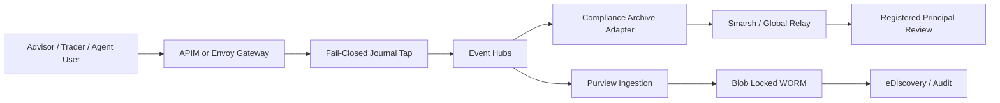
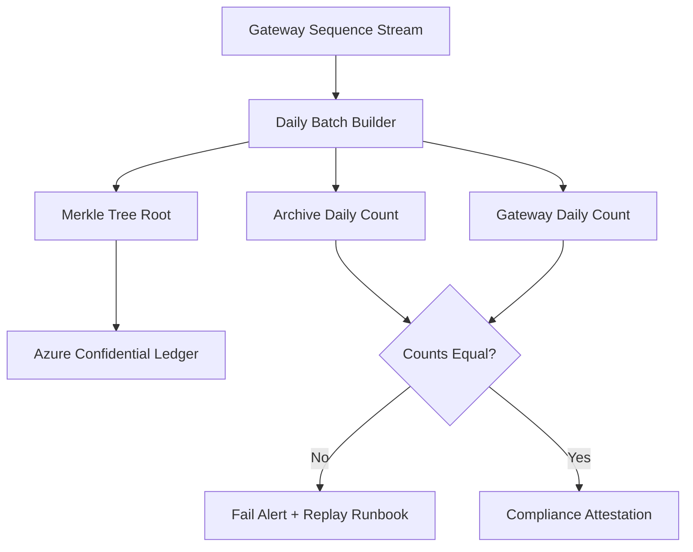

# 受监管 AI 通讯留痕与审阅归档选型 FAQ（SEC 17a-4 / FINRA 3110：Purview WORM vs Smarsh/Global Relay Tap vs Pre-Send Hold）

> 适用对象：券商、投顾、资管、衍生品交易与合规科技团队中的 Cloud & AI Solution Architect、CCO 办公室、记录管理负责人。
>
> 决策问题：如何把企业 AI Agent 的提示词、检索引用、工具调用与对客输出纳入可审计、可监督、可长期留存的监管记录体系，且不牺牲业务时效。

## 1. 执行摘要

在金融监管语境下，AI Agent 不只是“模型输出”。

它本质上是新的沟通与决策通道。

监管关注点包括：

- 记录是否完整。
- 留存是否不可篡改。
- 监督是否可执行。
- 回溯是否可证明。

如果企业仅把 Agent 日志写入可变分析系统（如常规遥测工作区），则无法满足“账簿记录”标准。

本指南比较四条路线：

- Route A：Purview 原生监督与保留栈 + Blob Locked Immutable WORM。
- Route B：APIM/Envoy Fail-Closed Journaling Tap -> Event Hubs -> Smarsh/Global Relay，并以 Confidential Ledger 做完整性证明。
- Route C：风险分层监督门（高风险外发 Pre-Send Principal Hold，低风险内研 Post-Send 抽样）。
- Route D：将 App Insights/Log Analytics 或 fire-and-forget 异步日志当合规记录的反模式。

结论：

1. 若组织以 Microsoft 合规栈为主，Route A 可最快落地。
2. 若已存在 Smarsh/Global Relay 统一监督中台，Route B 可降低迁移阻力并统一“单窗监督”。
3. Route C 是业务效率与监管强度的关键平衡器，适合在 A/B 之上叠加。
4. Route D 必须在治理策略中显式禁止。

## 2. 监管要求映射边界

### 2.1 覆盖法规

本方案关注以下规则要求的工程映射：

- `SEC Rule 17a-4(f)`：不可改写留存与可检索性。
- `FINRA Rule 3110`：监督体系与抽检执行。
- `CFTC 1.31`：记录保管与可重建性。
- `MiFID II Art. 16(7)`：投资服务通信记录要求。

### 2.2 Agent 记录对象范围

建议最小记录单元（Record Envelope）包括：

- `prompt`（用户输入与系统补充上下文）。
- `retrieved_chunk_hashes`（RAG 证据哈希）。
- `tool_calls`（MCP/API 调用载荷摘要）。
- `model_id` 与版本。
- `reasoning_summary`（允许的合规摘要，不含敏感原文时可加密封存）。
- `client_facing_output`（对客输出正文）。

### 2.3 “完整性”定义

在工程上，“完整”不是“有日志”。

而是：

- 序列连续。
- 不丢不重。
- 可校验来源与时间。
- 可证明监管保留策略生效。

## 3. 路线定义

### 3.1 Route A：Purview 原生监督与保留栈

组成：

- Purview Communication Compliance 监督队列。
- Data Lifecycle Management 保留策略。
- eDiscovery Premium 检索与法务保全。
- Azure Blob Locked Immutable WORM 或审计轨替代模式。

优势：

- 与 M365 通信面整合度高。
- 监督队列与抽样策略可在同一治理域配置。
- 对法律保留（legal hold）支持成熟。

挑战：

- 对自建 Agent 自定义字段需做标准化映射。
- 多系统异构记录统一视图需要额外数据契约。

### 3.2 Route B：Fail-Closed Journaling Tap 到既有合规归档

组成：

- APIM 或 Envoy 出口 Tap（Fail-Closed ACK）。
- Event Hubs 作为缓冲与回放总线。
- Smarsh / Global Relay 归档接口。
- Azure Confidential Ledger 记录每日 Merkle 完整性证明。

优势：

- 可与 Bloomberg IB、Teams、WhatsApp、Email 共用监督面板。
- 对已投入的券商归档平台友好。
- 通过序列对账可显式证明“零静默丢失”。

挑战：

- 需要严格消息 schema 与版本治理。
- 需额外维护对账与重放工具链。

### 3.3 Route C：风险分层监督门

策略：

- 对高风险外发内容执行 Pre-Send Principal Hold。
- 对内部研究型交互执行 Post-Send 抽样监督。
- 通过分类器与策略引擎决定门禁级别。

目标：

- 高风险场景保证先审后发。
- 低风险场景保持低时延体验。

### 3.4 Route D：反模式

典型行为：

- 仅保留可变工作区日志。
- 异步日志 fire-and-forget，不做 ACK 和对账。
- 无监督工作流与 Principal 签核链路。

风险：

- 记录不完整或不可证明完整。
- 监管审查时无法重构关键信息链条。
- 对“离线/漏记”缺乏检测能力。

## 4. 关键工程量化模型

### 4.1 七年压缩留存容量模型 `S_7yr`

定义：

- `N_turn_day`：每日平均受监管会话轮次。
- `B_turn_raw`：单轮原始字节。
- `r_comp`：压缩率（压缩后占比）。
- `Y`：留存年限（7）。

公式：

`S_7yr = N_turn_day × 365 × Y × B_turn_raw × r_comp`

扩展项：

- 多模态附件指数放大系数。
- 索引与审计元数据附加比例。

### 4.2 Fail-Closed ACK 延迟模型 `ΔL_ack`

定义：

- `L_base`：无留痕时业务时延。
- `L_journal`：写入 journaling tap + durable ack 时延。

增量：

`ΔL_ack = L_journal - L_base`

实践目标：

- 内部协作场景控制在 `< 15 ms`。
- 对客高风险场景允许更高 `ΔL_ack` 以换取零丢失边界。

### 4.3 监督抽样覆盖与误报工作量

定义：

- `p_sample`：抽样比例。
- `FPR`：误报率。
- `N_msg`：消息数。

估算：

- 抽样量 `N_review = p_sample × N_msg`
- 误报工作量 `N_fp = FPR × N_review`

调优目标：

- 在满足 FINRA 监督覆盖前提下降低 `N_fp`。
- 保障 Registered Principal 审阅队列不失控。

### 4.4 完整性对账约束

定义：

- `N_gateway_day`：网关生成序列总数。
- `N_archive_day`：归档系统入库序列总数。

约束：

`N_gateway_day == N_archive_day`

若不相等：

- 触发强告警。
- 启动补偿回放。
- 出具差异证明与根因分析。

## 5. 12 维对比矩阵

| 维度 | Route A Purview WORM | Route B Tap+Archive+Ledger | Route C 风险分层监督门 | Route D 反模式 |
|---|---|---|---|---|
| 监管适配度 | 高 | 高 | 中高 | 低 |
| 留存不可篡改 | 高 | 高 | 依赖底层 | 低 |
| 监督工作流成熟度 | 高 | 高 | 高 | 低 |
| 集成复杂度 | 中 | 高 | 中高 | 低 |
| 统一监督窗能力 | 中 | 高 | 中 | 低 |
| 序列完整性证明 | 中 | 极高 | 中 | 低 |
| 外部归档兼容性 | 中 | 极高 | 中 | 低 |
| 业务时延影响 | 中 | 中 | 可调 | 低（但不合规） |
| 成本可控性 | 中高 | 中 | 中高 | 表面低 |
| 审计可回放性 | 高 | 高 | 中高 | 低 |
| 运营复杂度 | 中 | 高 | 中 | 低 |
| 推荐等级 | ✅ | ✅ | ✅（叠加） | ⛔ |

## 6. 深度量化问答（Q1~Q6）

### Q1：七年留存容量如何估算并做预算？

先估算文本与结构化字段，再叠加附件索引。

建议按“基础留存 + 审计索引 + 证据副本”三层预算。

并按季度复算 `N_turn_day` 与压缩率变化。

### Q2：Fail-Closed 是否会显著拖慢前台响应？

不是绝对。

关键在于：

- 仅对高风险外发路径启用强同步 ACK。
- 低风险内部路径采用异步但可对账模式。

通过 Route C 分层后，可将监管强度与时延目标同时满足。

### Q3：为什么需要 Merkle 完整性证明？

原因：

- 传统“写成功日志”无法证明全量完整。
- Merkle 根可对每日批次做不可抵赖证明。
- 在争议与审计场景可快速定位缺口批次。

### Q4：抽样比例应如何设定？

建议按风险等级动态采样：

- 零售外发、收益承诺、投顾建议：高采样或全量预审。
- 内部研究与草稿：中低采样 + 关键词触发增量采样。

目标是“覆盖风险而非平均覆盖”。

### Q5：App Insights/Log Analytics 为什么不能单独承担合规留存？

因为它们定位是可观测分析系统。

常见问题包括：

- 字段截断。
- 保留可变策略。
- 缺乏 Principal 监督签核流程。

因此可作为运营遥测，不可替代账簿记录主系统。

### Q6：如何证明“零静默丢失”？

需要三层证据：

1. 网关序列号连续。
2. 归档侧序列号连续。
3. 每日对账 `N_gateway == N_archive` 并有不可篡改证明记录。

缺一不可。

## 7. 架构图（Mermaid）





## 8. 生产配置示例：APIM Fail-Closed Journaling

```xml
<policies>
  <inbound>
    <base />
    <set-variable name="journalEnvelope" value="@{
        return new JObject(
          new JProperty(""seq"", context.RequestId.ToString()),
          new JProperty(""ts"", DateTime.UtcNow.ToString(""o"")),
          new JProperty(""model_id"", context.Variables.GetValueOrDefault<string>(""model-id"", ""unknown"")),
          new JProperty(""prompt_hash"", context.Variables.GetValueOrDefault<string>(""prompt-hash"", ""na"")),
          new JProperty(""output_hash"", context.Variables.GetValueOrDefault<string>(""output-hash"", ""na""))
        ).ToString();
    }" />
    <send-request mode="new" response-variable-name="journalAck" timeout="8" ignore-error="false">
      <set-url>https://journal-gateway.internal/ingest</set-url>
      <set-method>POST</set-method>
      <set-header name="Content-Type" exists-action="override">
        <value>application/json</value>
      </set-header>
      <set-body>@((string)context.Variables["journalEnvelope"])</set-body>
    </send-request>
    <choose>
      <when condition="@(((IResponse)context.Variables["journalAck"]).StatusCode != 202)">
        <return-response>
          <set-status code="503" reason="JournalingUnavailable" />
          <set-body>{ "error": "fail-closed journaling gate triggered" }</set-body>
        </return-response>
      </when>
    </choose>
  </inbound>
  <backend><base /></backend>
  <outbound><base /></outbound>
  <on-error><base /></on-error>
</policies>
```

## 9. 生产配置示例：Locked Immutability Bicep

```bicep
resource archiveStorage 'Microsoft.Storage/storageAccounts@2023-05-01' = {
  name: 'stregcompliance001'
  location: resourceGroup().location
  sku: {
    name: 'Standard_GRS'
  }
  kind: 'StorageV2'
  properties: {
    allowBlobPublicAccess: false
    minimumTlsVersion: 'TLS1_2'
    supportsHttpsTrafficOnly: true
  }
}

resource container 'Microsoft.Storage/storageAccounts/blobServices/containers@2023-05-01' = {
  name: '${archiveStorage.name}/default/journal-archive'
  properties: {
    publicAccess: 'None'
    immutableStorageWithVersioning: {
      enabled: true
    }
  }
}

resource immutability 'Microsoft.Storage/storageAccounts/blobServices/containers/immutabilityPolicies@2023-05-01' = {
  name: '${archiveStorage.name}/default/journal-archive/default'
  properties: {
    immutabilityPeriodSinceCreationInDays: 2555
    allowProtectedAppendWrites: true
    allowProtectedAppendWritesAll: true
    state: 'Locked'
  }
}
```

## 10. 企业场景方案（2+）

### 场景 A：全球券商财富顾问对客沟通 Copilot

需求：

- 覆盖邮件、Teams、移动端沟通草稿。
- 对收益承诺、适当性陈述进行重点监督。
- Principal 需具备签核可追溯链条。

推荐：

- Route A（Purview）作为基础监督与保留。
- Route C 对高风险外发启用 Pre-Send Hold。

收益：

- 审阅流程与保留策略统一。
- 关键对客内容先审后发，降低处罚风险。

### 场景 B：机构衍生品交易台 Agent（CFTC/MiFID）

需求：

- 大量盘中问答与报价辅助。
- 对外沟通必须可重建上下文。
- 与既有归档系统统一视图。

推荐：

- Route B 对接 Smarsh/Global Relay。
- Ledger 完整性证明用于日终对账。
- Route C 仅对外发高风险语句加门禁。

收益：

- 不破坏现有合规运营体系。
- 可量化证明“无静默丢失”。

### 场景 C：跨区域投研协作与合规抽检

需求：

- 内部研究协作高频。
- 对外发布低频但高风险。
- 跨区域法规口径差异管理。

推荐：

- 内部流程走 Post-Send 抽样。
- 对外发布走 Pre-Send Principal Hold。
- 统一记录 schema 支撑多法域检索。

## 11. 三档座席规模 TCO（3 年 / 7 年）

| 规模（受监管座席） | Route A 3年 | Route A 7年 | Route B 3年 | Route B 7年 | Route C 增量 3年 | Route C 增量 7年 |
|---|---:|---:|---:|---:|---:|---:|
| 500 | 1,950,000 | 4,120,000 | 2,340,000 | 4,980,000 | 420,000 | 930,000 |
| 5,000 | 13,800,000 | 29,600,000 | 16,900,000 | 35,900,000 | 2,850,000 | 6,300,000 |
| 25,000 | 58,700,000 | 125,400,000 | 72,500,000 | 151,300,000 | 11,900,000 | 26,800,000 |

解读：

- 纯 Purview 路线在微软栈深度组织中成本与运营平衡较好。
- 已有第三方归档投资的大型机构常选择 Route B 以复用既有能力。
- Route C 是监管强度与业务时效的可调旋钮，而非独立替代方案。

## 12. Day-0 / Day-1 / Day-2 清单

### Day-0

- 明确记录对象清单与字段级数据契约。
- 定义“监管记录”与“运营遥测”边界。
- 选择 Route A 或 Route B 作为主记录平面。
- 设计序列号策略与对账规则。

### Day-1

- 部署最小可用 journaling pipeline。
- 打通 Principal 审阅队列。
- 上线高风险语句分类器与门禁策略。
- 建立日终对账报表与差异告警。

### Day-2

- 引入 Merkle 完整性证明自动化。
- 扩展多渠道统一监督看板。
- 建立回放补偿和监管演练机制。
- 按法规区域细化保留周期与访问策略。

## 13. Good fit vs Not for

### ✅ Good fit

- 受 SEC/FINRA/CFTC/MiFID 约束的金融机构。
- 需要可证明留痕完整性与监督执行的组织。
- 已将 Agent 输出纳入对客沟通场景的企业。

### ⛔ Not for

- 将“可观测日志”误认为“合规记录”的团队。
- 无法提供 Principal 审阅链路的流程。
- 不愿维护序列对账与补偿回放机制的组织。

## 14. 运营 KPI 与治理告警

建议监控：

- `journal_ack_p95_ms`
- `reconciliation_diff_count`
- `supervisory_queue_backlog`
- `false_positive_rate`
- `presend_hold_release_time`
- `record_replay_success_rate`

告警建议：

1. `reconciliation_diff_count > 0` 立即升级 P1。
2. `journal_ack_p95_ms` 超阈值触发降级策略评估，但不得绕过 fail-closed。
3. `supervisory_queue_backlog` 持续上升时动态调整采样与人力编排。
4. `false_positive_rate` 超阈值时回训分类器并复核规则漂移。

## 15. 最终建议

### 15.1 默认落地路径

- Microsoft 栈为主：Route A + Route C。
- 已有第三方归档中心：Route B + Route C。
- 全部场景均需禁止 Route D。

### 15.2 风险最小化原则

- 先保证“可证明完整”，再优化“审阅效率”。
- 先定义 fail-closed 边界，再讨论低时延例外。
- 先做序列对账，再做高级智能抽样。

### 15.3 一句话结论

在受监管金融 AI 通讯场景里，真正可通过审查的系统不是“写了日志”，而是“对每一条记录的产生、送达、留存、监督、回放都能给出可验证证据链”。

