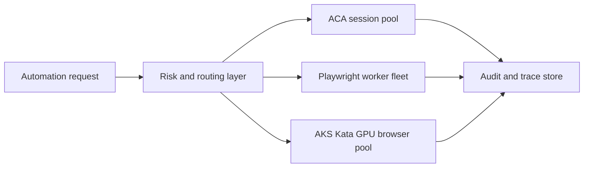
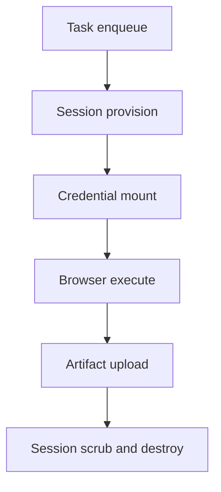

# Enterprise remote-browser/CUA sandbox-isolation selection FAQ (ACA Sessions vs Playwright workers vs AKS Kata GPU browser pool)

> Audience: Cloud & AI Solution Architects, agent platform engineers, enterprise automation teams, and security/compliance owners.

## 1. Executive summary

Production browser automation must move beyond “script works” to “isolated, recoverable, auditable, and scalable execution.” Recommended strategy:

- **Route A**: `ACA Dynamic Sessions` lightweight stateless browser session pools (elasticity and low ops).
- **Route B**: `Playwright Worker Fleet` on AKS/VMSS for high-throughput task orchestration.
- **Route C**: `AKS Kata + GPU browser` for high-risk and rich-media rendering workloads.
- **Route D**: run browser processes inside core business API containers (anti-pattern).

## 2. Core risks

- Untrusted web pages can attempt resource abuse or side-channel behaviors.
- Browser crashes/leaks can collapse shared nodes and cascade failures.
- Weak tenant/session isolation can expose credentials across tenants.
- Missing audit traces break accountability for autonomous actions.

## 3. Route definitions

### Route A: ACA session pools
- One short-lived isolated session per task with automated teardown.
- Best for medium-risk form automation and DOM extraction.

### Route B: Playwright worker fleet
- Queue-driven workers execute high-volume browser tasks in parallel.
- Best for large-scale deterministic automation throughput.

### Route C: AKS Kata + GPU browser pool
- Hardened isolation for high-risk pages and graphics-heavy scenarios.
- Best for visual workloads and high-risk external page interactions.

### Route D: anti-pattern baseline
- Browsers embedded in business API pods couple workload and failure domains.
- Shared credentials/cache/download paths eliminate audit boundaries.

## 4. Quantitative models

### 4.1 Concurrency capacity
`Q_capacity = N_nodes * sessions_per_node * util_factor`

### 4.2 Cold-start latency effect
`P95_total = P95_queue + P95_cold_start + P95_exec`

### 4.3 Isolation risk exposure
`Risk_isolation = P_escape * Impact_cross_tenant`

### 4.4 Unit task cost
`Cost_task = (infra_cost + egress_cost + ops_cost) / completed_tasks`

## 5. Twelve-dimension comparison matrix

| Dimension | Route A ACA sessions | Route B Playwright fleet | Route C AKS Kata+GPU | Route D anti-pattern |
|---|---|---|---|---|
| Startup speed | High | Medium-high | Medium | Low |
| Throughput ceiling | Medium | High | Medium | Low |
| Hard isolation strength | Medium | Medium | High | Low |
| Rich-media rendering | Medium | Medium-high | High | Low |
| Ops complexity | Low | Medium | High | Low (short-term) |
| Multi-tenant security | Medium-high | Medium | High | Low |
| Cost controllability | High | Medium-high | Medium | Low |
| Audit traceability | Medium-high | High | High | Low |
| Auto scaling | High | High | Medium | Low |
| Failure containment | High | Medium-high | High | Low |
| Session cleanup efficiency | High | Medium | Medium | Low |
| Recommendation | ✅ default | ✅ high-throughput | ✅ high-risk | ⛔ |

## 6. Deep quantitative Q&A (Q1-Q8)
### Q1: When should ACA sessions be preferred?
When elasticity and low operational overhead are primary and task risk is moderate.

### Q2: What is the core value of Playwright fleet?
High parallel throughput and efficient resource use for batch-style browser workloads.

### Q3: When is Kata+GPU worth the cost?
When isolation risk and rendering complexity justify premium infrastructure.

### Q4: Why avoid browsers in business API containers?
It couples security/failure domains and amplifies blast radius.

### Q5: How should credential isolation be implemented?
Per-task short-lived tokens, isolated storage scopes, and post-run scrubbing.

### Q6: How to control download risk?
Sandbox download paths and enforce malware/content scanning gates.

### Q7: How should session cleanup be triggered?
TTL, memory threshold, and end-of-task signals in combination.

### Q8: Most critical KPIs?
Task success rate, P95 execution, isolation incident rate, and unit cost.

## 7. Mermaid architecture diagrams





## 8. Production snippet: risk-based routing pseudo-code

```python
def route(task):
    if task.risk == "high" or task.needs_gpu:
        return "kata_gpu"
    if task.batch_size > 1000:
        return "playwright_fleet"
    return "aca_session"
```

## 9. Production snippet: session recycle policy skeleton

```yaml
session_lifecycle:
  ttl_minutes: 20
  max_memory_mb: 2048
  scrub_paths: ["/tmp", "/downloads", "/profile"]
```

## 10. Enterprise scenarios (2+)

### Scenario A: e-commerce back-office bulk operations
- Large deterministic page operations favor Route B throughput profile.

### Scenario B: financial compliance browser inspections
- High-risk pages and sensitive credentials favor Route C isolation model.

### Scenario C: customer-support knowledge capture and ticket linkage
- Medium-scale high-elasticity workloads fit Route A session pools.

## 11. Three-tier 3-year TCO (USD)

| Scale tier | Route A | Route B | Route C | Anti-pattern (hidden loss) |
|---|---:|---:|---:|---:|
| 1M tasks/month | 2,000,000 | 2,350,000 | 3,100,000 | 1,500,000 (incident loss excluded) |
| 10M tasks/month | 9,500,000 | 10,800,000 | 14,500,000 | 7,100,000 (incident loss excluded) |
| 50M tasks/month | 44,000,000 | 48,500,000 | 63,000,000 | 34,800,000 (incident loss excluded) |

## 12. Day-0 / Day-1 / Day-2 checklist

### Day-0 (architecture and boundaries)
- define task-tiering, isolation boundaries, credential model, and audit schema.

### Day-1 (engineering deployment)
- implement routing layer, session pools, artifact channels, and teardown automation.

### Day-2 (operations governance)
- monitor success rate, isolation incidents, cost trends, and capacity tuning signals.

## 13. Good fit vs Not for

### ✅ Good fit
- Multi-tenant browser automation and CUA production environments.
- Enterprises requiring isolation, security controls, and auditability.

### ⛔ Not for
- One-off local scripts and temporary single-user tooling.
- Small experiments without compliance and audit obligations.

## 14. Five-step rollout guide
1. Define risk tiers and routing contracts.
2. Separate browser execution plane from core API plane.
3. Enforce per-session credential isolation and scrubbing.
4. Build task-level audit trails and replayability.
5. Load-test continuously and optimize throughput/cost.

## 15. Core KPIs
- `task_success_rate`
- `p95_exec_seconds`
- `session_escape_incidents`
- `cost_per_task`
- `session_recycle_latency`

## 16. Final recommendation
Use Route A as default baseline, Route B for high-throughput tiers, Route C for high-risk/high-rendering tasks, and ban Route D.
