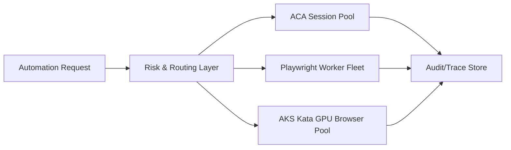
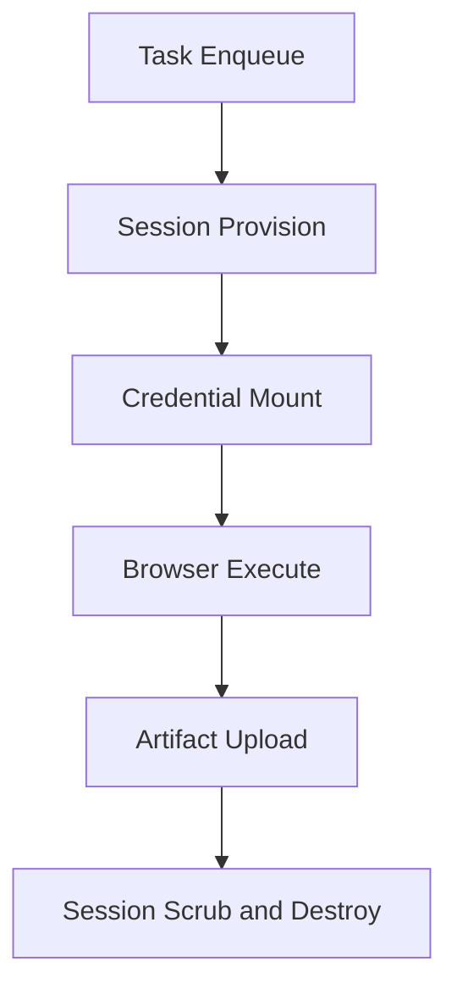

# 企业远程浏览器/CUA 沙箱隔离选型 FAQ（ACA Sessions vs Playwright Workers vs AKS Kata GPU Browser）

> 适用对象：Cloud & AI Solution Architect、Agent 平台工程、企业自动化与合规安全团队。

## 1. 执行摘要

企业级 CUA（Computer-Use Agent）与浏览器自动化一旦进入生产，必须把“脚本能跑”升级为“可隔离、可回收、可审计、可扩缩容”。推荐三路并行策略：

- **Route A**：`ACA Dynamic Sessions` 轻量无状态浏览器会话池（快速弹性、低运维）。
- **Route B**：`Playwright Worker Fleet`（AKS/VMSS）高并发脚本编排（吞吐优先）。
- **Route C**：`AKS Kata + GPU Browser` 强隔离富媒体渲染（高风险页面与视觉任务）。
- **Route D**：主业务容器直接开浏览器进程（反模式）。

## 2. 核心风险

- 不可信网页脚本可尝试侧信道或资源滥用。
- 浏览器崩溃/泄漏导致单节点雪崩，拖垮业务请求。
- 多租户凭据与会话隔离不足引发跨租户污染。
- 无统一审计导致自动化行为不可追溯。

## 3. 路线定义

### Route A：ACA Sessions 浏览器会话池
- 每次任务分配独立短生命周期会话容器。
- 适合中低风险网页自动化、表单填报、DOM 抽取。

### Route B：Playwright Worker Fleet
- 将脚本任务队列化，Worker 批量拉取执行。
- 适合高吞吐批处理与大规模 RPA 式浏览器任务。

### Route C：AKS Kata + GPU Browser
- 以硬隔离运行高风险页面与重渲染任务。
- 适合视频流、Canvas 密集、视觉识别增强场景。

### Route D：反模式
- 业务 API 进程内嵌浏览器实例，任务失败与业务崩溃耦合。
- 凭据、缓存、下载目录混用，审计不可追踪。

## 4. 定量模型

### 4.1 会话并发容量
`Q_capacity = N_nodes * sessions_per_node * util_factor`

### 4.2 冷启动对延迟影响
`P95_total = P95_queue + P95_cold_start + P95_exec`

### 4.3 隔离风险暴露
`Risk_isolation = P_escape * Impact_cross_tenant`

### 4.4 单任务单位成本
`Cost_task = (infra_cost + egress_cost + ops_cost) / completed_tasks`

## 5. 12 维对比矩阵

| 维度 | Route A ACA Sessions | Route B Playwright Fleet | Route C AKS Kata+GPU | Route D 反模式 |
|---|---|---|---|---|
| 启动速度 | 高 | 中高 | 中 | 低 |
| 吞吐能力 | 中 | 高 | 中 | 低 |
| 强隔离能力 | 中 | 中 | 高 | 低 |
| 富媒体渲染 | 中 | 中高 | 高 | 低 |
| 运维复杂度 | 低 | 中 | 高 | 低（短期） |
| 多租户安全 | 中高 | 中 | 高 | 低 |
| 成本可控性 | 高 | 中高 | 中 | 低 |
| 审计可追溯 | 中高 | 高 | 高 | 低 |
| 自动扩缩容 | 高 | 高 | 中 | 低 |
| 失败隔离 | 高 | 中高 | 高 | 低 |
| 回收效率 | 高 | 中 | 中 | 低 |
| 推荐结论 | ✅ 默认 | ✅ 高吞吐 | ✅ 高风险任务 | ⛔ |

## 6. 深度问答（Q1-Q8）
### Q1：什么时候优先 ACA Sessions？
对快速弹性和低运维要求高，且任务风险中等时。

### Q2：Playwright Fleet 的最大价值？
在大规模并发任务下可显著提高吞吐与资源利用率。

### Q3：Kata+GPU 何时值得？
当页面风险高或视觉渲染复杂，且隔离优先级高于成本。

### Q4：为何不能把浏览器放业务容器里？
故障与安全边界耦合，容易单点放大。

### Q5：如何做凭据隔离？
每任务短期令牌+独立存储域+执行后擦除。

### Q6：如何控制下载风险？
下载目录沙箱化并强制恶意文件扫描。

### Q7：如何设置自动回收？
按会话 TTL、内存阈值与任务结束信号三重回收。

### Q8：最关键 KPI？
任务成功率、P95、隔离事件率、单位任务成本。

## 7. Mermaid 架构图





## 8. 生产片段：风险路由伪代码

```python
def route(task):
    if task.risk == "high" or task.needs_gpu:
        return "kata_gpu"
    if task.batch_size > 1000:
        return "playwright_fleet"
    return "aca_session"
```

## 9. 生产片段：会话回收策略（示意）

```yaml
session_lifecycle:
  ttl_minutes: 20
  max_memory_mb: 2048
  scrub_paths: ["/tmp", "/downloads", "/profile"]
```

## 10. 企业场景（2+）

### 场景 A：电商商家后台批量运营
- 大量规则化页面操作，优先 Route B。

### 场景 B：金融合规模拟巡检
- 高风险站点与敏感凭据，优先 Route C。

### 场景 C：客服知识抓取与工单联动
- 中等规模任务+高弹性需求，优先 Route A。

## 11. 三档三年 TCO（USD）

| 规模档位 | Route A | Route B | Route C | 反模式（隐性损失） |
|---|---:|---:|---:|---:|
| 100 万任务/月 | 2,000,000 | 2,350,000 | 3,100,000 | 1,500,000（不含事故） |
| 1,000 万任务/月 | 9,500,000 | 10,800,000 | 14,500,000 | 7,100,000（不含事故） |
| 5,000 万任务/月 | 44,000,000 | 48,500,000 | 63,000,000 | 34,800,000（不含事故） |

## 12. Day-0 / Day-1 / Day-2 清单

### Day-0（架构与边界）
- 定义任务分级、隔离边界、凭据模型与审计字段。

### Day-1（工程部署）
- 建立路由层、会话池、工件回传与自动回收机制。

### Day-2（运营治理）
- 监控任务成功率、隔离事件、成本与容量趋势并调优。

## 13. Good fit vs Not for

### ✅ Good fit
- 多租户浏览器自动化与 CUA 生产化场景。
- 对隔离、安全和审计有明确要求的企业。

### ⛔ Not for
- 单机脚本临时工具。
- 无审计合规要求的小规模实验。

## 14. 五步落地指南
1. 建立风险分级与路由策略。
2. 分离浏览器执行平面与业务 API 平面。
3. 强制会话级凭据隔离与执行后擦除。
4. 建立任务级审计轨迹与回放。
5. 持续压测并优化吞吐与成本。

## 15. 核心 KPI
- `task_success_rate`
- `p95_exec_seconds`
- `session_escape_incidents`
- `cost_per_task`
- `session_recycle_latency`

## 16. 最终建议
以 Route A 做普适基线，Route B 承担高并发，Route C 处理高风险/高渲染任务，Route D 禁止。
