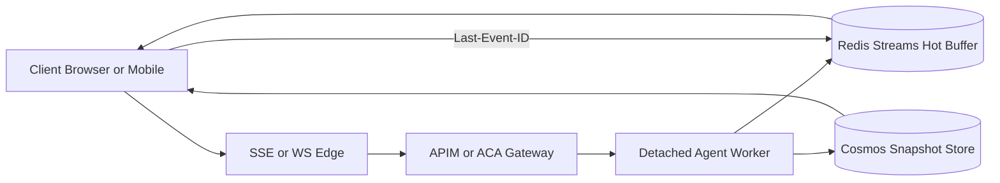
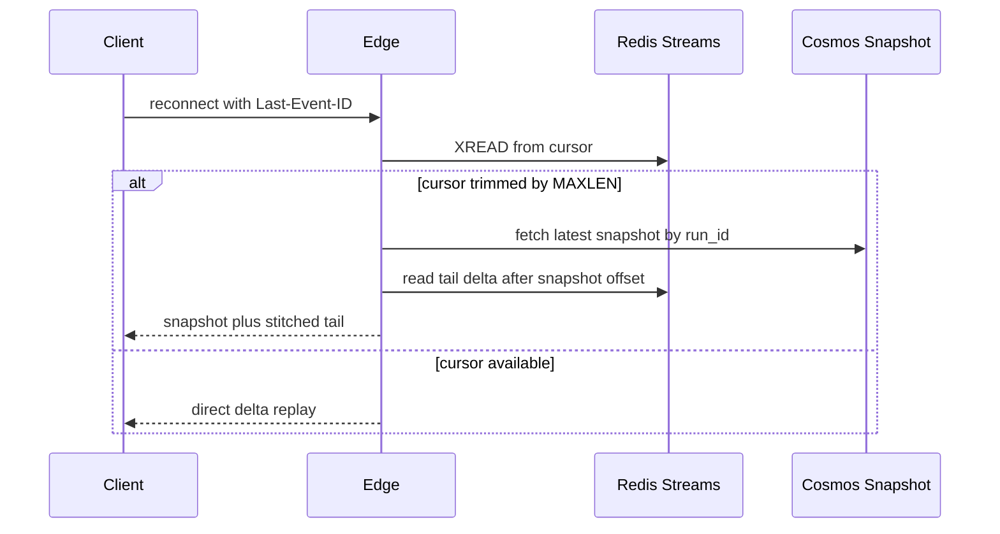

# Resumable agent stream reattachment and disconnect-tolerant token replay selection FAQ: Redis Streams Last-Event-ID vs Web PubSub reliable WS vs Cosmos snapshots

> 🌐 **Language / 语言切换**: **English (Current)** | **[中文](resumable-agent-stream-reattachment-token-replay-redis-streams-last-event-id-vs-web-pubsub-reliable-ws-vs-cosmos-snapshot-selection-faq.md)** | **[Back to catalog](README.en.md)**

## 1. Executive summary

- **Pattern A**: detached workers plus hot `Azure Managed Redis Streams` provide low-latency resumable replay via `Last-Event-ID`, with optional compaction to `Cosmos DB`.
- **Pattern B**: `Azure Web PubSub` reliable subprotocol scales concurrent mobile/browser sessions, but requires strict micro-batch coalescing to control message-unit spend.
- **Pattern C**: periodic snapshots plus tail replay reduce hot-stream memory for long asynchronous runs.
- **Pattern D (forbidden)**: binding execution lifetime directly to inbound SSE sockets leads to expensive aborts and duplicate retry billing.
- **Target outcomes**: `ReattachP95 < 150ms`, `ReplayLoss = 0`, `DuplicateBilling = 0`, strict `run_id` ACL validation.

## 2. Four architecture patterns

- **A (Redis Streams)**: `XADD MAXLEN ~` for event append and `XREAD` catch-up from `Last-Event-ID`.
- **B (Web PubSub reliable WS)**: sequence ACK plus reconnection tokens for managed large fan-out.
- **C (snapshot plus tail)**: write structured snapshots every 1-2 seconds and replay tail deltas on reconnect.
- **D (anti-pattern)**: stateful proxy pipes where socket loss aborts execution.

## 3. Reference architecture (Mermaid 1)



## 4. Last-Event-ID and snapshot fallback sequence (Mermaid 2)



## 5. Quantitative models

1. **hot buffer memory**: `Mem_stream = runs * event_rate * retention_window * avg_event_bytes`.
2. **micro-batch economics**: `Cost_unit = messages_per_sec * unit_price`.
3. **catch-up latency**: `T_catchup = backlog_events / consume_rate`.
4. **snapshot stitch latency**: `T_stitch = T_snapshot_fetch + T_tail_replay`.
5. **tenant guard condition**: `allow(run_id, tenant_id, principal_id) == true`.

### 5.1 Redis RAM rough sizing (25-80 tok/s)

| Rate profile | Average event bytes | 5k runs | 50k runs | 250k runs |
|---|---:|---:|---:|---:|
| raw per-token 80 tok/s | 120 B | 2.9 GB | 29 GB | 145 GB |
| 50 ms coalesced 20 frames/s | 420 B | 1.5 GB | 15 GB | 75 GB |
| 100 ms coalesced 10 frames/s | 700 B | 1.2 GB | 12 GB | 60 GB |

## 6. Twelve-dimension comparison matrix

| Dimension | Pattern A Redis Streams | Pattern B Web PubSub | Pattern C Snapshot+Tail | Pattern D Anti-pattern |
|---|---|---|---|---|
| Reattach catch-up latency | Very low | Low | Medium | High |
| Multi-device shadowing | High | High | Medium | Low |
| Cost controllability | High | Medium | High | Low |
| Ops complexity | Medium | Low-medium | Medium | Low surface high risk |
| Long-run suitability | Medium | Medium | Very high | Low |
| Disconnect tolerance | High | Medium | High | Low |
| Replay integrity | High | Medium-high | High | Low |
| ACL verifiability | High | Medium | High | Low |
| Compaction flexibility | High | Medium | High | Low |
| BCDR portability | Medium-high | Medium | High | Low |
| Three-year TCO | Low-medium | Medium | Low-medium | High |
| Anti-pattern exposure | Low | Medium | Low | Critical |

## 7. Deep Q&A (Q1-Q8)

### Q1. When should Pattern A be prioritized?
- When low-latency gapless replay and multi-device continuity are required.
- When Redis hot buffer operations are acceptable.
- When strict run-level ACL validation is mandatory.
- When APIM/ACA integration speed is important.

### Q2. Why can Pattern B costs amplify quickly?
- Per-token frames multiply message units without coalescing.
- Weak mobile networks increase replay and acknowledgment chatter.
- Without 50-100 ms coalescing, spend escalates non-linearly.
- Tenant concurrency spikes magnify the effect.

### Q3. When is Pattern C preferred?
- For 10-60 minute asynchronous deep research runs.
- When 1-2 second fidelity is acceptable versus token-perfect replay.
- When compliance auditability and durable continuation are priorities.
- When hot-stream RAM pressure must be reduced.

### Q4. How to handle Last-Event-ID behind MAXLEN trim?
- Detect stale cursor and switch to latest snapshot.
- Replay tail deltas after snapshot offset.
- Emit explicit snapshot-resume metadata to the client.
- Keep run_id and tenant ACL semantics unchanged.

### Q5. How should AFD/APIM timeouts be tuned?
- Coordinate SSE idle timeout with heartbeat cadence.
- Disable transformations and buffering that break streaming semantics.
- Apply more tolerant read windows for mobile clients.
- Use exponential reconnect backoff to avoid storms.

### Q6. How to prevent duplicate billing?
- Decouple execution lifetime from transport lifetime completely.
- Reattach only consumes unacknowledged deltas; never restarts runs.
- Deduplicate tool results by idempotency key.
- Aggregate billing by run_step_id.

### Q7. How to enforce tenant ACL on reattach?
- Bind run_id to tenant_id and principal_id triplets.
- Require verifiable tokens and session fingerprints at reconnect.
- Reject cross-tenant replay attempts and audit them.
- Use least-privilege read-only scopes for supervisor shadow sessions.

### Q8. How to roll out safely?
- Start with high-value cohorts under feature flags.
- Drill network loss, mobility handoff, and VPN rekey paths.
- Track replay success and cost trends continuously.
- Expand rings only after SLO stability is proven.

## 8. FastAPI SSE + Redis XREAD + Cosmos fallback snippet

```python
async def stream(run_id, last_event_id, tenant, principal):
    verify_acl(run_id, tenant, principal)
    cursor = last_event_id or "0-0"
    if is_trimmed(cursor):
        snap = await cosmos_load_snapshot(run_id)
        yield format_event("snapshot_resume", snap)
        cursor = snap["offset"]
    async for evt in redis_xread(run_id, cursor):
        yield format_event("delta", evt)
```

## 9. APIM SSE no-transform policy snippet

```xml
<policies>
  <inbound>
    <set-header name="Cache-Control" exists-action="override">
      <value>no-store</value>
    </set-header>
    <set-header name="X-Accel-Buffering" exists-action="override">
      <value>no</value>
    </set-header>
  </inbound>
</policies>
```

## 10. Enterprise scenario A: investment banking mobile deep-research workstation

- Scenario A point 01: maintain uninterrupted run continuity across Wi-Fi, 5G, and VPN handoffs for mobile analyst workflows.

## 11. Enterprise scenario B: multi-tab SRE war-room live shadowing

- Scenario B point 01: support multiple observer tabs on a single run_id with read-only token and tool-progress replay.

## 12. Three-tier three-year TCO table (USD)

| Tier | Concurrent/daily active runs | Pattern A annual | Pattern B annual | Pattern C annual | Anti-pattern loss | Three-year total (recommended path) |
|---|---:|---:|---:|---:|---:|---:|
| Small | 5k | 360,000 | 420,000 | 310,000 | 280,000 | 3,150,000 |
| Medium | 50k | 1,920,000 | 2,680,000 | 1,740,000 | 1,260,000 | 11,940,000 |
| Large | 250k | 7,980,000 | 11,400,000 | 7,120,000 | 5,800,000 | 38,700,000 |

## 13. Day-0 / Day-1 / Day-2 readiness checklist

### Day-0 design phase
- [ ] Day-0 design phase check 01: validate run_id ACL, reconnect cursor logic, snapshot stitching, timeout profile, alerting, and rollback.

### Day-1 rollout phase
- [ ] Day-1 rollout phase check 01: validate run_id ACL, reconnect cursor logic, snapshot stitching, timeout profile, alerting, and rollback.

### Day-2 operations phase
- [ ] Day-2 operations phase check 01: validate run_id ACL, reconnect cursor logic, snapshot stitching, timeout profile, alerting, and rollback.

## 14. Anti-pattern breakdown and remediation

- Remediation 01: do not bind execution lifetime to a single inbound SSE socket.

## 15. Appendix: parameter and governance control catalog

- track weekly `reattach_p95_ms`, `replay_loss`, `dup_bill_rate`, `stream_ram_gb`, `acl_violation`, and `ws_unit_cost`.
