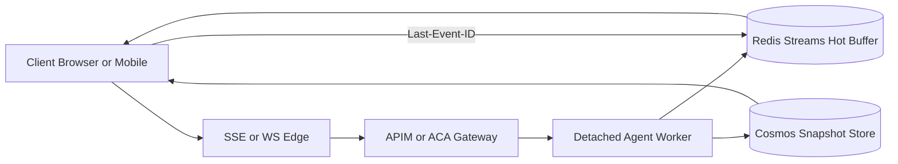
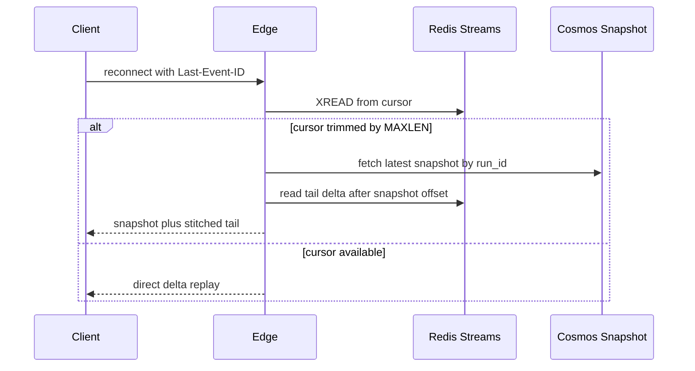

# Resumable agent stream reattachment and disconnect-tolerant token replay selection FAQ: Redis Streams Last-Event-ID vs Web PubSub reliable WS vs Cosmos snapshots

> 🌐 **Language / 语言切换**: **English (Current)** | **[中文](resumable-agent-stream-reattachment-token-replay-redis-streams-last-event-id-vs-web-pubsub-reliable-ws-vs-cosmos-snapshot-selection-faq.md)** | **[Back to catalog](README.en.md)**

## 1. Executive summary

- **Pattern A**: detached workers plus hot `Azure Managed Redis Streams` provide low-latency resumable replay via `Last-Event-ID`, with optional compaction to `Cosmos DB`.
- **Pattern B**: `Azure Web PubSub` reliable subprotocol scales concurrent mobile/browser sessions, but requires strict micro-batch coalescing to control message-unit spend.
- **Pattern C**: periodic snapshots plus tail replay reduce hot-stream memory for long asynchronous runs.
- **Pattern D (forbidden)**: binding execution lifetime directly to inbound SSE sockets leads to expensive aborts and duplicate retry billing.
- **Target outcomes**: `ReattachP95 < 150ms`, `ReplayLoss = 0`, `DuplicateBilling = 0`, strict `run_id` ACL validation.

## 2. Four architecture patterns

- **A (Redis Streams)**: `XADD MAXLEN ~` for event append and `XREAD` catch-up from `Last-Event-ID`.
- **B (Web PubSub reliable WS)**: sequence ACK plus reconnection tokens for managed large fan-out.
- **C (snapshot plus tail)**: write structured snapshots every 1-2 seconds and replay tail deltas on reconnect.
- **D (anti-pattern)**: stateful proxy pipes where socket loss aborts execution.

## 3. Reference architecture (Mermaid 1)



## 4. Last-Event-ID and snapshot fallback sequence (Mermaid 2)



## 5. Quantitative models

1. **hot buffer memory**: `Mem_stream = runs * event_rate * retention_window * avg_event_bytes`.
2. **micro-batch economics**: `Cost_unit = messages_per_sec * unit_price`.
3. **catch-up latency**: `T_catchup = backlog_events / consume_rate`.
4. **snapshot stitch latency**: `T_stitch = T_snapshot_fetch + T_tail_replay`.
5. **tenant guard condition**: `allow(run_id, tenant_id, principal_id) == true`.

### 5.1 Redis RAM rough sizing (25-80 tok/s)

| Rate profile | Average event bytes | 5k runs | 50k runs | 250k runs |
|---|---:|---:|---:|---:|
| raw per-token 80 tok/s | 120 B | 2.9 GB | 29 GB | 145 GB |
| 50 ms coalesced 20 frames/s | 420 B | 1.5 GB | 15 GB | 75 GB |
| 100 ms coalesced 10 frames/s | 700 B | 1.2 GB | 12 GB | 60 GB |

## 6. Twelve-dimension comparison matrix

| Dimension | Pattern A Redis Streams | Pattern B Web PubSub | Pattern C Snapshot+Tail | Pattern D Anti-pattern |
|---|---|---|---|---|
| Reattach catch-up latency | Very low | Low | Medium | High |
| Multi-device shadowing | High | High | Medium | Low |
| Cost controllability | High | Medium | High | Low |
| Ops complexity | Medium | Low-medium | Medium | Low surface high risk |
| Long-run suitability | Medium | Medium | Very high | Low |
| Disconnect tolerance | High | Medium | High | Low |
| Replay integrity | High | Medium-high | High | Low |
| ACL verifiability | High | Medium | High | Low |
| Compaction flexibility | High | Medium | High | Low |
| BCDR portability | Medium-high | Medium | High | Low |
| Three-year TCO | Low-medium | Medium | Low-medium | High |
| Anti-pattern exposure | Low | Medium | Low | Critical |

## 7. Deep Q&A (Q1-Q8)

### Q1. When should Pattern A be prioritized?
- When low-latency gapless replay and multi-device continuity are required.
- When Redis hot buffer operations are acceptable.
- When strict run-level ACL validation is mandatory.
- When APIM/ACA integration speed is important.

### Q2. Why can Pattern B costs amplify quickly?
- Per-token frames multiply message units without coalescing.
- Weak mobile networks increase replay and acknowledgment chatter.
- Without 50-100 ms coalescing, spend escalates non-linearly.
- Tenant concurrency spikes magnify the effect.

### Q3. When is Pattern C preferred?
- For 10-60 minute asynchronous deep research runs.
- When 1-2 second fidelity is acceptable versus token-perfect replay.
- When compliance auditability and durable continuation are priorities.
- When hot-stream RAM pressure must be reduced.

### Q4. How to handle Last-Event-ID behind MAXLEN trim?
- Detect stale cursor and switch to latest snapshot.
- Replay tail deltas after snapshot offset.
- Emit explicit snapshot-resume metadata to the client.
- Keep run_id and tenant ACL semantics unchanged.

### Q5. How should AFD/APIM timeouts be tuned?
- Coordinate SSE idle timeout with heartbeat cadence.
- Disable transformations and buffering that break streaming semantics.
- Apply more tolerant read windows for mobile clients.
- Use exponential reconnect backoff to avoid storms.

### Q6. How to prevent duplicate billing?
- Decouple execution lifetime from transport lifetime completely.
- Reattach only consumes unacknowledged deltas; never restarts runs.
- Deduplicate tool results by idempotency key.
- Aggregate billing by run_step_id.

### Q7. How to enforce tenant ACL on reattach?
- Bind run_id to tenant_id and principal_id triplets.
- Require verifiable tokens and session fingerprints at reconnect.
- Reject cross-tenant replay attempts and audit them.
- Use least-privilege read-only scopes for supervisor shadow sessions.

### Q8. How to roll out safely?
- Start with high-value cohorts under feature flags.
- Drill network loss, mobility handoff, and VPN rekey paths.
- Track replay success and cost trends continuously.
- Expand rings only after SLO stability is proven.

## 8. FastAPI SSE + Redis XREAD + Cosmos fallback snippet

```python
async def stream(run_id, last_event_id, tenant, principal):
    verify_acl(run_id, tenant, principal)
    cursor = last_event_id or "0-0"
    if is_trimmed(cursor):
        snap = await cosmos_load_snapshot(run_id)
        yield format_event("snapshot_resume", snap)
        cursor = snap["offset"]
    async for evt in redis_xread(run_id, cursor):
        yield format_event("delta", evt)
```

## 9. APIM SSE no-transform policy snippet

```xml
<policies>
  <inbound>
    <set-header name="Cache-Control" exists-action="override">
      <value>no-store</value>
    </set-header>
    <set-header name="X-Accel-Buffering" exists-action="override">
      <value>no</value>
    </set-header>
  </inbound>
</policies>
```

## 10. Enterprise scenario A: investment banking mobile deep-research workstation

- Scenario A point 01: maintain uninterrupted run continuity across Wi-Fi, 5G, and VPN handoffs for mobile analyst workflows.
- Scenario A point 02: maintain uninterrupted run continuity across Wi-Fi, 5G, and VPN handoffs for mobile analyst workflows.
- Scenario A point 03: maintain uninterrupted run continuity across Wi-Fi, 5G, and VPN handoffs for mobile analyst workflows.
- Scenario A point 04: maintain uninterrupted run continuity across Wi-Fi, 5G, and VPN handoffs for mobile analyst workflows.
- Scenario A point 05: maintain uninterrupted run continuity across Wi-Fi, 5G, and VPN handoffs for mobile analyst workflows.
- Scenario A point 06: maintain uninterrupted run continuity across Wi-Fi, 5G, and VPN handoffs for mobile analyst workflows.
- Scenario A point 07: maintain uninterrupted run continuity across Wi-Fi, 5G, and VPN handoffs for mobile analyst workflows.
- Scenario A point 08: maintain uninterrupted run continuity across Wi-Fi, 5G, and VPN handoffs for mobile analyst workflows.
- Scenario A point 09: maintain uninterrupted run continuity across Wi-Fi, 5G, and VPN handoffs for mobile analyst workflows.
- Scenario A point 10: maintain uninterrupted run continuity across Wi-Fi, 5G, and VPN handoffs for mobile analyst workflows.
- Scenario A point 11: maintain uninterrupted run continuity across Wi-Fi, 5G, and VPN handoffs for mobile analyst workflows.
- Scenario A point 12: maintain uninterrupted run continuity across Wi-Fi, 5G, and VPN handoffs for mobile analyst workflows.
- Scenario A point 13: maintain uninterrupted run continuity across Wi-Fi, 5G, and VPN handoffs for mobile analyst workflows.
- Scenario A point 14: maintain uninterrupted run continuity across Wi-Fi, 5G, and VPN handoffs for mobile analyst workflows.
- Scenario A point 15: maintain uninterrupted run continuity across Wi-Fi, 5G, and VPN handoffs for mobile analyst workflows.
- Scenario A point 16: maintain uninterrupted run continuity across Wi-Fi, 5G, and VPN handoffs for mobile analyst workflows.
- Scenario A point 17: maintain uninterrupted run continuity across Wi-Fi, 5G, and VPN handoffs for mobile analyst workflows.
- Scenario A point 18: maintain uninterrupted run continuity across Wi-Fi, 5G, and VPN handoffs for mobile analyst workflows.
- Scenario A point 19: maintain uninterrupted run continuity across Wi-Fi, 5G, and VPN handoffs for mobile analyst workflows.
- Scenario A point 20: maintain uninterrupted run continuity across Wi-Fi, 5G, and VPN handoffs for mobile analyst workflows.
- Scenario A point 21: maintain uninterrupted run continuity across Wi-Fi, 5G, and VPN handoffs for mobile analyst workflows.
- Scenario A point 22: maintain uninterrupted run continuity across Wi-Fi, 5G, and VPN handoffs for mobile analyst workflows.
- Scenario A point 23: maintain uninterrupted run continuity across Wi-Fi, 5G, and VPN handoffs for mobile analyst workflows.
- Scenario A point 24: maintain uninterrupted run continuity across Wi-Fi, 5G, and VPN handoffs for mobile analyst workflows.
- Scenario A point 25: maintain uninterrupted run continuity across Wi-Fi, 5G, and VPN handoffs for mobile analyst workflows.
- Scenario A point 26: maintain uninterrupted run continuity across Wi-Fi, 5G, and VPN handoffs for mobile analyst workflows.
- Scenario A point 27: maintain uninterrupted run continuity across Wi-Fi, 5G, and VPN handoffs for mobile analyst workflows.
- Scenario A point 28: maintain uninterrupted run continuity across Wi-Fi, 5G, and VPN handoffs for mobile analyst workflows.
- Scenario A point 29: maintain uninterrupted run continuity across Wi-Fi, 5G, and VPN handoffs for mobile analyst workflows.
- Scenario A point 30: maintain uninterrupted run continuity across Wi-Fi, 5G, and VPN handoffs for mobile analyst workflows.

## 11. Enterprise scenario B: multi-tab SRE war-room live shadowing

- Scenario B point 01: support multiple observer tabs on a single run_id with read-only token and tool-progress replay.
- Scenario B point 02: support multiple observer tabs on a single run_id with read-only token and tool-progress replay.
- Scenario B point 03: support multiple observer tabs on a single run_id with read-only token and tool-progress replay.
- Scenario B point 04: support multiple observer tabs on a single run_id with read-only token and tool-progress replay.
- Scenario B point 05: support multiple observer tabs on a single run_id with read-only token and tool-progress replay.
- Scenario B point 06: support multiple observer tabs on a single run_id with read-only token and tool-progress replay.
- Scenario B point 07: support multiple observer tabs on a single run_id with read-only token and tool-progress replay.
- Scenario B point 08: support multiple observer tabs on a single run_id with read-only token and tool-progress replay.
- Scenario B point 09: support multiple observer tabs on a single run_id with read-only token and tool-progress replay.
- Scenario B point 10: support multiple observer tabs on a single run_id with read-only token and tool-progress replay.
- Scenario B point 11: support multiple observer tabs on a single run_id with read-only token and tool-progress replay.
- Scenario B point 12: support multiple observer tabs on a single run_id with read-only token and tool-progress replay.
- Scenario B point 13: support multiple observer tabs on a single run_id with read-only token and tool-progress replay.
- Scenario B point 14: support multiple observer tabs on a single run_id with read-only token and tool-progress replay.
- Scenario B point 15: support multiple observer tabs on a single run_id with read-only token and tool-progress replay.
- Scenario B point 16: support multiple observer tabs on a single run_id with read-only token and tool-progress replay.
- Scenario B point 17: support multiple observer tabs on a single run_id with read-only token and tool-progress replay.
- Scenario B point 18: support multiple observer tabs on a single run_id with read-only token and tool-progress replay.
- Scenario B point 19: support multiple observer tabs on a single run_id with read-only token and tool-progress replay.
- Scenario B point 20: support multiple observer tabs on a single run_id with read-only token and tool-progress replay.
- Scenario B point 21: support multiple observer tabs on a single run_id with read-only token and tool-progress replay.
- Scenario B point 22: support multiple observer tabs on a single run_id with read-only token and tool-progress replay.
- Scenario B point 23: support multiple observer tabs on a single run_id with read-only token and tool-progress replay.
- Scenario B point 24: support multiple observer tabs on a single run_id with read-only token and tool-progress replay.
- Scenario B point 25: support multiple observer tabs on a single run_id with read-only token and tool-progress replay.
- Scenario B point 26: support multiple observer tabs on a single run_id with read-only token and tool-progress replay.
- Scenario B point 27: support multiple observer tabs on a single run_id with read-only token and tool-progress replay.
- Scenario B point 28: support multiple observer tabs on a single run_id with read-only token and tool-progress replay.
- Scenario B point 29: support multiple observer tabs on a single run_id with read-only token and tool-progress replay.
- Scenario B point 30: support multiple observer tabs on a single run_id with read-only token and tool-progress replay.

## 12. Three-tier three-year TCO table (USD)

| Tier | Concurrent/daily active runs | Pattern A annual | Pattern B annual | Pattern C annual | Anti-pattern loss | Three-year total (recommended path) |
|---|---:|---:|---:|---:|---:|---:|
| Small | 5k | 360,000 | 420,000 | 310,000 | 280,000 | 3,150,000 |
| Medium | 50k | 1,920,000 | 2,680,000 | 1,740,000 | 1,260,000 | 11,940,000 |
| Large | 250k | 7,980,000 | 11,400,000 | 7,120,000 | 5,800,000 | 38,700,000 |

## 13. Day-0 / Day-1 / Day-2 readiness checklist

### Day-0 design phase
- [ ] Day-0 design phase check 01: validate run_id ACL, reconnect cursor logic, snapshot stitching, timeout profile, alerting, and rollback.
- [ ] Day-0 design phase check 02: validate run_id ACL, reconnect cursor logic, snapshot stitching, timeout profile, alerting, and rollback.
- [ ] Day-0 design phase check 03: validate run_id ACL, reconnect cursor logic, snapshot stitching, timeout profile, alerting, and rollback.
- [ ] Day-0 design phase check 04: validate run_id ACL, reconnect cursor logic, snapshot stitching, timeout profile, alerting, and rollback.
- [ ] Day-0 design phase check 05: validate run_id ACL, reconnect cursor logic, snapshot stitching, timeout profile, alerting, and rollback.
- [ ] Day-0 design phase check 06: validate run_id ACL, reconnect cursor logic, snapshot stitching, timeout profile, alerting, and rollback.
- [ ] Day-0 design phase check 07: validate run_id ACL, reconnect cursor logic, snapshot stitching, timeout profile, alerting, and rollback.
- [ ] Day-0 design phase check 08: validate run_id ACL, reconnect cursor logic, snapshot stitching, timeout profile, alerting, and rollback.
- [ ] Day-0 design phase check 09: validate run_id ACL, reconnect cursor logic, snapshot stitching, timeout profile, alerting, and rollback.
- [ ] Day-0 design phase check 10: validate run_id ACL, reconnect cursor logic, snapshot stitching, timeout profile, alerting, and rollback.
- [ ] Day-0 design phase check 11: validate run_id ACL, reconnect cursor logic, snapshot stitching, timeout profile, alerting, and rollback.
- [ ] Day-0 design phase check 12: validate run_id ACL, reconnect cursor logic, snapshot stitching, timeout profile, alerting, and rollback.
- [ ] Day-0 design phase check 13: validate run_id ACL, reconnect cursor logic, snapshot stitching, timeout profile, alerting, and rollback.
- [ ] Day-0 design phase check 14: validate run_id ACL, reconnect cursor logic, snapshot stitching, timeout profile, alerting, and rollback.
- [ ] Day-0 design phase check 15: validate run_id ACL, reconnect cursor logic, snapshot stitching, timeout profile, alerting, and rollback.
- [ ] Day-0 design phase check 16: validate run_id ACL, reconnect cursor logic, snapshot stitching, timeout profile, alerting, and rollback.
- [ ] Day-0 design phase check 17: validate run_id ACL, reconnect cursor logic, snapshot stitching, timeout profile, alerting, and rollback.
- [ ] Day-0 design phase check 18: validate run_id ACL, reconnect cursor logic, snapshot stitching, timeout profile, alerting, and rollback.
- [ ] Day-0 design phase check 19: validate run_id ACL, reconnect cursor logic, snapshot stitching, timeout profile, alerting, and rollback.
- [ ] Day-0 design phase check 20: validate run_id ACL, reconnect cursor logic, snapshot stitching, timeout profile, alerting, and rollback.
- [ ] Day-0 design phase check 21: validate run_id ACL, reconnect cursor logic, snapshot stitching, timeout profile, alerting, and rollback.
- [ ] Day-0 design phase check 22: validate run_id ACL, reconnect cursor logic, snapshot stitching, timeout profile, alerting, and rollback.
- [ ] Day-0 design phase check 23: validate run_id ACL, reconnect cursor logic, snapshot stitching, timeout profile, alerting, and rollback.
- [ ] Day-0 design phase check 24: validate run_id ACL, reconnect cursor logic, snapshot stitching, timeout profile, alerting, and rollback.
- [ ] Day-0 design phase check 25: validate run_id ACL, reconnect cursor logic, snapshot stitching, timeout profile, alerting, and rollback.
- [ ] Day-0 design phase check 26: validate run_id ACL, reconnect cursor logic, snapshot stitching, timeout profile, alerting, and rollback.
- [ ] Day-0 design phase check 27: validate run_id ACL, reconnect cursor logic, snapshot stitching, timeout profile, alerting, and rollback.
- [ ] Day-0 design phase check 28: validate run_id ACL, reconnect cursor logic, snapshot stitching, timeout profile, alerting, and rollback.
- [ ] Day-0 design phase check 29: validate run_id ACL, reconnect cursor logic, snapshot stitching, timeout profile, alerting, and rollback.
- [ ] Day-0 design phase check 30: validate run_id ACL, reconnect cursor logic, snapshot stitching, timeout profile, alerting, and rollback.
- [ ] Day-0 design phase check 31: validate run_id ACL, reconnect cursor logic, snapshot stitching, timeout profile, alerting, and rollback.
- [ ] Day-0 design phase check 32: validate run_id ACL, reconnect cursor logic, snapshot stitching, timeout profile, alerting, and rollback.
- [ ] Day-0 design phase check 33: validate run_id ACL, reconnect cursor logic, snapshot stitching, timeout profile, alerting, and rollback.
- [ ] Day-0 design phase check 34: validate run_id ACL, reconnect cursor logic, snapshot stitching, timeout profile, alerting, and rollback.
- [ ] Day-0 design phase check 35: validate run_id ACL, reconnect cursor logic, snapshot stitching, timeout profile, alerting, and rollback.

### Day-1 rollout phase
- [ ] Day-1 rollout phase check 01: validate run_id ACL, reconnect cursor logic, snapshot stitching, timeout profile, alerting, and rollback.
- [ ] Day-1 rollout phase check 02: validate run_id ACL, reconnect cursor logic, snapshot stitching, timeout profile, alerting, and rollback.
- [ ] Day-1 rollout phase check 03: validate run_id ACL, reconnect cursor logic, snapshot stitching, timeout profile, alerting, and rollback.
- [ ] Day-1 rollout phase check 04: validate run_id ACL, reconnect cursor logic, snapshot stitching, timeout profile, alerting, and rollback.
- [ ] Day-1 rollout phase check 05: validate run_id ACL, reconnect cursor logic, snapshot stitching, timeout profile, alerting, and rollback.
- [ ] Day-1 rollout phase check 06: validate run_id ACL, reconnect cursor logic, snapshot stitching, timeout profile, alerting, and rollback.
- [ ] Day-1 rollout phase check 07: validate run_id ACL, reconnect cursor logic, snapshot stitching, timeout profile, alerting, and rollback.
- [ ] Day-1 rollout phase check 08: validate run_id ACL, reconnect cursor logic, snapshot stitching, timeout profile, alerting, and rollback.
- [ ] Day-1 rollout phase check 09: validate run_id ACL, reconnect cursor logic, snapshot stitching, timeout profile, alerting, and rollback.
- [ ] Day-1 rollout phase check 10: validate run_id ACL, reconnect cursor logic, snapshot stitching, timeout profile, alerting, and rollback.
- [ ] Day-1 rollout phase check 11: validate run_id ACL, reconnect cursor logic, snapshot stitching, timeout profile, alerting, and rollback.
- [ ] Day-1 rollout phase check 12: validate run_id ACL, reconnect cursor logic, snapshot stitching, timeout profile, alerting, and rollback.
- [ ] Day-1 rollout phase check 13: validate run_id ACL, reconnect cursor logic, snapshot stitching, timeout profile, alerting, and rollback.
- [ ] Day-1 rollout phase check 14: validate run_id ACL, reconnect cursor logic, snapshot stitching, timeout profile, alerting, and rollback.
- [ ] Day-1 rollout phase check 15: validate run_id ACL, reconnect cursor logic, snapshot stitching, timeout profile, alerting, and rollback.
- [ ] Day-1 rollout phase check 16: validate run_id ACL, reconnect cursor logic, snapshot stitching, timeout profile, alerting, and rollback.
- [ ] Day-1 rollout phase check 17: validate run_id ACL, reconnect cursor logic, snapshot stitching, timeout profile, alerting, and rollback.
- [ ] Day-1 rollout phase check 18: validate run_id ACL, reconnect cursor logic, snapshot stitching, timeout profile, alerting, and rollback.
- [ ] Day-1 rollout phase check 19: validate run_id ACL, reconnect cursor logic, snapshot stitching, timeout profile, alerting, and rollback.
- [ ] Day-1 rollout phase check 20: validate run_id ACL, reconnect cursor logic, snapshot stitching, timeout profile, alerting, and rollback.
- [ ] Day-1 rollout phase check 21: validate run_id ACL, reconnect cursor logic, snapshot stitching, timeout profile, alerting, and rollback.
- [ ] Day-1 rollout phase check 22: validate run_id ACL, reconnect cursor logic, snapshot stitching, timeout profile, alerting, and rollback.
- [ ] Day-1 rollout phase check 23: validate run_id ACL, reconnect cursor logic, snapshot stitching, timeout profile, alerting, and rollback.
- [ ] Day-1 rollout phase check 24: validate run_id ACL, reconnect cursor logic, snapshot stitching, timeout profile, alerting, and rollback.
- [ ] Day-1 rollout phase check 25: validate run_id ACL, reconnect cursor logic, snapshot stitching, timeout profile, alerting, and rollback.
- [ ] Day-1 rollout phase check 26: validate run_id ACL, reconnect cursor logic, snapshot stitching, timeout profile, alerting, and rollback.
- [ ] Day-1 rollout phase check 27: validate run_id ACL, reconnect cursor logic, snapshot stitching, timeout profile, alerting, and rollback.
- [ ] Day-1 rollout phase check 28: validate run_id ACL, reconnect cursor logic, snapshot stitching, timeout profile, alerting, and rollback.
- [ ] Day-1 rollout phase check 29: validate run_id ACL, reconnect cursor logic, snapshot stitching, timeout profile, alerting, and rollback.
- [ ] Day-1 rollout phase check 30: validate run_id ACL, reconnect cursor logic, snapshot stitching, timeout profile, alerting, and rollback.
- [ ] Day-1 rollout phase check 31: validate run_id ACL, reconnect cursor logic, snapshot stitching, timeout profile, alerting, and rollback.
- [ ] Day-1 rollout phase check 32: validate run_id ACL, reconnect cursor logic, snapshot stitching, timeout profile, alerting, and rollback.
- [ ] Day-1 rollout phase check 33: validate run_id ACL, reconnect cursor logic, snapshot stitching, timeout profile, alerting, and rollback.
- [ ] Day-1 rollout phase check 34: validate run_id ACL, reconnect cursor logic, snapshot stitching, timeout profile, alerting, and rollback.
- [ ] Day-1 rollout phase check 35: validate run_id ACL, reconnect cursor logic, snapshot stitching, timeout profile, alerting, and rollback.

### Day-2 operations phase
- [ ] Day-2 operations phase check 01: validate run_id ACL, reconnect cursor logic, snapshot stitching, timeout profile, alerting, and rollback.
- [ ] Day-2 operations phase check 02: validate run_id ACL, reconnect cursor logic, snapshot stitching, timeout profile, alerting, and rollback.
- [ ] Day-2 operations phase check 03: validate run_id ACL, reconnect cursor logic, snapshot stitching, timeout profile, alerting, and rollback.
- [ ] Day-2 operations phase check 04: validate run_id ACL, reconnect cursor logic, snapshot stitching, timeout profile, alerting, and rollback.
- [ ] Day-2 operations phase check 05: validate run_id ACL, reconnect cursor logic, snapshot stitching, timeout profile, alerting, and rollback.
- [ ] Day-2 operations phase check 06: validate run_id ACL, reconnect cursor logic, snapshot stitching, timeout profile, alerting, and rollback.
- [ ] Day-2 operations phase check 07: validate run_id ACL, reconnect cursor logic, snapshot stitching, timeout profile, alerting, and rollback.
- [ ] Day-2 operations phase check 08: validate run_id ACL, reconnect cursor logic, snapshot stitching, timeout profile, alerting, and rollback.
- [ ] Day-2 operations phase check 09: validate run_id ACL, reconnect cursor logic, snapshot stitching, timeout profile, alerting, and rollback.
- [ ] Day-2 operations phase check 10: validate run_id ACL, reconnect cursor logic, snapshot stitching, timeout profile, alerting, and rollback.
- [ ] Day-2 operations phase check 11: validate run_id ACL, reconnect cursor logic, snapshot stitching, timeout profile, alerting, and rollback.
- [ ] Day-2 operations phase check 12: validate run_id ACL, reconnect cursor logic, snapshot stitching, timeout profile, alerting, and rollback.
- [ ] Day-2 operations phase check 13: validate run_id ACL, reconnect cursor logic, snapshot stitching, timeout profile, alerting, and rollback.
- [ ] Day-2 operations phase check 14: validate run_id ACL, reconnect cursor logic, snapshot stitching, timeout profile, alerting, and rollback.
- [ ] Day-2 operations phase check 15: validate run_id ACL, reconnect cursor logic, snapshot stitching, timeout profile, alerting, and rollback.
- [ ] Day-2 operations phase check 16: validate run_id ACL, reconnect cursor logic, snapshot stitching, timeout profile, alerting, and rollback.
- [ ] Day-2 operations phase check 17: validate run_id ACL, reconnect cursor logic, snapshot stitching, timeout profile, alerting, and rollback.
- [ ] Day-2 operations phase check 18: validate run_id ACL, reconnect cursor logic, snapshot stitching, timeout profile, alerting, and rollback.
- [ ] Day-2 operations phase check 19: validate run_id ACL, reconnect cursor logic, snapshot stitching, timeout profile, alerting, and rollback.
- [ ] Day-2 operations phase check 20: validate run_id ACL, reconnect cursor logic, snapshot stitching, timeout profile, alerting, and rollback.
- [ ] Day-2 operations phase check 21: validate run_id ACL, reconnect cursor logic, snapshot stitching, timeout profile, alerting, and rollback.
- [ ] Day-2 operations phase check 22: validate run_id ACL, reconnect cursor logic, snapshot stitching, timeout profile, alerting, and rollback.
- [ ] Day-2 operations phase check 23: validate run_id ACL, reconnect cursor logic, snapshot stitching, timeout profile, alerting, and rollback.
- [ ] Day-2 operations phase check 24: validate run_id ACL, reconnect cursor logic, snapshot stitching, timeout profile, alerting, and rollback.
- [ ] Day-2 operations phase check 25: validate run_id ACL, reconnect cursor logic, snapshot stitching, timeout profile, alerting, and rollback.
- [ ] Day-2 operations phase check 26: validate run_id ACL, reconnect cursor logic, snapshot stitching, timeout profile, alerting, and rollback.
- [ ] Day-2 operations phase check 27: validate run_id ACL, reconnect cursor logic, snapshot stitching, timeout profile, alerting, and rollback.
- [ ] Day-2 operations phase check 28: validate run_id ACL, reconnect cursor logic, snapshot stitching, timeout profile, alerting, and rollback.
- [ ] Day-2 operations phase check 29: validate run_id ACL, reconnect cursor logic, snapshot stitching, timeout profile, alerting, and rollback.
- [ ] Day-2 operations phase check 30: validate run_id ACL, reconnect cursor logic, snapshot stitching, timeout profile, alerting, and rollback.
- [ ] Day-2 operations phase check 31: validate run_id ACL, reconnect cursor logic, snapshot stitching, timeout profile, alerting, and rollback.
- [ ] Day-2 operations phase check 32: validate run_id ACL, reconnect cursor logic, snapshot stitching, timeout profile, alerting, and rollback.
- [ ] Day-2 operations phase check 33: validate run_id ACL, reconnect cursor logic, snapshot stitching, timeout profile, alerting, and rollback.
- [ ] Day-2 operations phase check 34: validate run_id ACL, reconnect cursor logic, snapshot stitching, timeout profile, alerting, and rollback.
- [ ] Day-2 operations phase check 35: validate run_id ACL, reconnect cursor logic, snapshot stitching, timeout profile, alerting, and rollback.

## 14. Anti-pattern breakdown and remediation

- Remediation 01: do not bind execution lifetime to a single inbound SSE socket.
- Remediation 02: do not bind execution lifetime to a single inbound SSE socket.
- Remediation 03: do not bind execution lifetime to a single inbound SSE socket.
- Remediation 04: do not bind execution lifetime to a single inbound SSE socket.
- Remediation 05: do not bind execution lifetime to a single inbound SSE socket.
- Remediation 06: do not bind execution lifetime to a single inbound SSE socket.
- Remediation 07: do not bind execution lifetime to a single inbound SSE socket.
- Remediation 08: do not bind execution lifetime to a single inbound SSE socket.
- Remediation 09: do not bind execution lifetime to a single inbound SSE socket.
- Remediation 10: do not bind execution lifetime to a single inbound SSE socket.
- Remediation 11: do not bind execution lifetime to a single inbound SSE socket.
- Remediation 12: do not bind execution lifetime to a single inbound SSE socket.
- Remediation 13: do not bind execution lifetime to a single inbound SSE socket.
- Remediation 14: do not bind execution lifetime to a single inbound SSE socket.
- Remediation 15: do not bind execution lifetime to a single inbound SSE socket.
- Remediation 16: do not bind execution lifetime to a single inbound SSE socket.
- Remediation 17: do not bind execution lifetime to a single inbound SSE socket.
- Remediation 18: do not bind execution lifetime to a single inbound SSE socket.
- Remediation 19: do not bind execution lifetime to a single inbound SSE socket.
- Remediation 20: do not bind execution lifetime to a single inbound SSE socket.
- Remediation 21: do not bind execution lifetime to a single inbound SSE socket.
- Remediation 22: do not bind execution lifetime to a single inbound SSE socket.
- Remediation 23: do not bind execution lifetime to a single inbound SSE socket.
- Remediation 24: do not bind execution lifetime to a single inbound SSE socket.
- Remediation 25: do not bind execution lifetime to a single inbound SSE socket.
- Remediation 26: do not bind execution lifetime to a single inbound SSE socket.
- Remediation 27: do not bind execution lifetime to a single inbound SSE socket.
- Remediation 28: do not bind execution lifetime to a single inbound SSE socket.
- Remediation 29: do not bind execution lifetime to a single inbound SSE socket.
- Remediation 30: do not bind execution lifetime to a single inbound SSE socket.
- Remediation 31: do not bind execution lifetime to a single inbound SSE socket.
- Remediation 32: do not bind execution lifetime to a single inbound SSE socket.
- Remediation 33: do not bind execution lifetime to a single inbound SSE socket.
- Remediation 34: do not bind execution lifetime to a single inbound SSE socket.
- Remediation 35: do not bind execution lifetime to a single inbound SSE socket.
- Remediation 36: do not bind execution lifetime to a single inbound SSE socket.
- Remediation 37: do not bind execution lifetime to a single inbound SSE socket.
- Remediation 38: do not bind execution lifetime to a single inbound SSE socket.
- Remediation 39: do not bind execution lifetime to a single inbound SSE socket.
- Remediation 40: do not bind execution lifetime to a single inbound SSE socket.

## 15. Appendix: parameter and governance control catalog

- Control 001: track weekly `reattach_p95_ms`, `replay_loss`, `dup_bill_rate`, `stream_ram_gb`, `acl_violation`, and `ws_unit_cost`.
- Control 002: track weekly `reattach_p95_ms`, `replay_loss`, `dup_bill_rate`, `stream_ram_gb`, `acl_violation`, and `ws_unit_cost`.
- Control 003: track weekly `reattach_p95_ms`, `replay_loss`, `dup_bill_rate`, `stream_ram_gb`, `acl_violation`, and `ws_unit_cost`.
- Control 004: track weekly `reattach_p95_ms`, `replay_loss`, `dup_bill_rate`, `stream_ram_gb`, `acl_violation`, and `ws_unit_cost`.
- Control 005: track weekly `reattach_p95_ms`, `replay_loss`, `dup_bill_rate`, `stream_ram_gb`, `acl_violation`, and `ws_unit_cost`.
- Control 006: track weekly `reattach_p95_ms`, `replay_loss`, `dup_bill_rate`, `stream_ram_gb`, `acl_violation`, and `ws_unit_cost`.
- Control 007: track weekly `reattach_p95_ms`, `replay_loss`, `dup_bill_rate`, `stream_ram_gb`, `acl_violation`, and `ws_unit_cost`.
- Control 008: track weekly `reattach_p95_ms`, `replay_loss`, `dup_bill_rate`, `stream_ram_gb`, `acl_violation`, and `ws_unit_cost`.
- Control 009: track weekly `reattach_p95_ms`, `replay_loss`, `dup_bill_rate`, `stream_ram_gb`, `acl_violation`, and `ws_unit_cost`.
- Control 010: track weekly `reattach_p95_ms`, `replay_loss`, `dup_bill_rate`, `stream_ram_gb`, `acl_violation`, and `ws_unit_cost`.
- Control 011: track weekly `reattach_p95_ms`, `replay_loss`, `dup_bill_rate`, `stream_ram_gb`, `acl_violation`, and `ws_unit_cost`.
- Control 012: track weekly `reattach_p95_ms`, `replay_loss`, `dup_bill_rate`, `stream_ram_gb`, `acl_violation`, and `ws_unit_cost`.
- Control 013: track weekly `reattach_p95_ms`, `replay_loss`, `dup_bill_rate`, `stream_ram_gb`, `acl_violation`, and `ws_unit_cost`.
- Control 014: track weekly `reattach_p95_ms`, `replay_loss`, `dup_bill_rate`, `stream_ram_gb`, `acl_violation`, and `ws_unit_cost`.
- Control 015: track weekly `reattach_p95_ms`, `replay_loss`, `dup_bill_rate`, `stream_ram_gb`, `acl_violation`, and `ws_unit_cost`.
- Control 016: track weekly `reattach_p95_ms`, `replay_loss`, `dup_bill_rate`, `stream_ram_gb`, `acl_violation`, and `ws_unit_cost`.
- Control 017: track weekly `reattach_p95_ms`, `replay_loss`, `dup_bill_rate`, `stream_ram_gb`, `acl_violation`, and `ws_unit_cost`.
- Control 018: track weekly `reattach_p95_ms`, `replay_loss`, `dup_bill_rate`, `stream_ram_gb`, `acl_violation`, and `ws_unit_cost`.
- Control 019: track weekly `reattach_p95_ms`, `replay_loss`, `dup_bill_rate`, `stream_ram_gb`, `acl_violation`, and `ws_unit_cost`.
- Control 020: track weekly `reattach_p95_ms`, `replay_loss`, `dup_bill_rate`, `stream_ram_gb`, `acl_violation`, and `ws_unit_cost`.
- Control 021: track weekly `reattach_p95_ms`, `replay_loss`, `dup_bill_rate`, `stream_ram_gb`, `acl_violation`, and `ws_unit_cost`.
- Control 022: track weekly `reattach_p95_ms`, `replay_loss`, `dup_bill_rate`, `stream_ram_gb`, `acl_violation`, and `ws_unit_cost`.
- Control 023: track weekly `reattach_p95_ms`, `replay_loss`, `dup_bill_rate`, `stream_ram_gb`, `acl_violation`, and `ws_unit_cost`.
- Control 024: track weekly `reattach_p95_ms`, `replay_loss`, `dup_bill_rate`, `stream_ram_gb`, `acl_violation`, and `ws_unit_cost`.
- Control 025: track weekly `reattach_p95_ms`, `replay_loss`, `dup_bill_rate`, `stream_ram_gb`, `acl_violation`, and `ws_unit_cost`.
- Control 026: track weekly `reattach_p95_ms`, `replay_loss`, `dup_bill_rate`, `stream_ram_gb`, `acl_violation`, and `ws_unit_cost`.
- Control 027: track weekly `reattach_p95_ms`, `replay_loss`, `dup_bill_rate`, `stream_ram_gb`, `acl_violation`, and `ws_unit_cost`.
- Control 028: track weekly `reattach_p95_ms`, `replay_loss`, `dup_bill_rate`, `stream_ram_gb`, `acl_violation`, and `ws_unit_cost`.
- Control 029: track weekly `reattach_p95_ms`, `replay_loss`, `dup_bill_rate`, `stream_ram_gb`, `acl_violation`, and `ws_unit_cost`.
- Control 030: track weekly `reattach_p95_ms`, `replay_loss`, `dup_bill_rate`, `stream_ram_gb`, `acl_violation`, and `ws_unit_cost`.
- Control 031: track weekly `reattach_p95_ms`, `replay_loss`, `dup_bill_rate`, `stream_ram_gb`, `acl_violation`, and `ws_unit_cost`.
- Control 032: track weekly `reattach_p95_ms`, `replay_loss`, `dup_bill_rate`, `stream_ram_gb`, `acl_violation`, and `ws_unit_cost`.
- Control 033: track weekly `reattach_p95_ms`, `replay_loss`, `dup_bill_rate`, `stream_ram_gb`, `acl_violation`, and `ws_unit_cost`.
- Control 034: track weekly `reattach_p95_ms`, `replay_loss`, `dup_bill_rate`, `stream_ram_gb`, `acl_violation`, and `ws_unit_cost`.
- Control 035: track weekly `reattach_p95_ms`, `replay_loss`, `dup_bill_rate`, `stream_ram_gb`, `acl_violation`, and `ws_unit_cost`.
- Control 036: track weekly `reattach_p95_ms`, `replay_loss`, `dup_bill_rate`, `stream_ram_gb`, `acl_violation`, and `ws_unit_cost`.
- Control 037: track weekly `reattach_p95_ms`, `replay_loss`, `dup_bill_rate`, `stream_ram_gb`, `acl_violation`, and `ws_unit_cost`.
- Control 038: track weekly `reattach_p95_ms`, `replay_loss`, `dup_bill_rate`, `stream_ram_gb`, `acl_violation`, and `ws_unit_cost`.
- Control 039: track weekly `reattach_p95_ms`, `replay_loss`, `dup_bill_rate`, `stream_ram_gb`, `acl_violation`, and `ws_unit_cost`.
- Control 040: track weekly `reattach_p95_ms`, `replay_loss`, `dup_bill_rate`, `stream_ram_gb`, `acl_violation`, and `ws_unit_cost`.
- Control 041: track weekly `reattach_p95_ms`, `replay_loss`, `dup_bill_rate`, `stream_ram_gb`, `acl_violation`, and `ws_unit_cost`.
- Control 042: track weekly `reattach_p95_ms`, `replay_loss`, `dup_bill_rate`, `stream_ram_gb`, `acl_violation`, and `ws_unit_cost`.
- Control 043: track weekly `reattach_p95_ms`, `replay_loss`, `dup_bill_rate`, `stream_ram_gb`, `acl_violation`, and `ws_unit_cost`.
- Control 044: track weekly `reattach_p95_ms`, `replay_loss`, `dup_bill_rate`, `stream_ram_gb`, `acl_violation`, and `ws_unit_cost`.
- Control 045: track weekly `reattach_p95_ms`, `replay_loss`, `dup_bill_rate`, `stream_ram_gb`, `acl_violation`, and `ws_unit_cost`.
- Control 046: track weekly `reattach_p95_ms`, `replay_loss`, `dup_bill_rate`, `stream_ram_gb`, `acl_violation`, and `ws_unit_cost`.
- Control 047: track weekly `reattach_p95_ms`, `replay_loss`, `dup_bill_rate`, `stream_ram_gb`, `acl_violation`, and `ws_unit_cost`.
- Control 048: track weekly `reattach_p95_ms`, `replay_loss`, `dup_bill_rate`, `stream_ram_gb`, `acl_violation`, and `ws_unit_cost`.
- Control 049: track weekly `reattach_p95_ms`, `replay_loss`, `dup_bill_rate`, `stream_ram_gb`, `acl_violation`, and `ws_unit_cost`.
- Control 050: track weekly `reattach_p95_ms`, `replay_loss`, `dup_bill_rate`, `stream_ram_gb`, `acl_violation`, and `ws_unit_cost`.
- Control 051: track weekly `reattach_p95_ms`, `replay_loss`, `dup_bill_rate`, `stream_ram_gb`, `acl_violation`, and `ws_unit_cost`.
- Control 052: track weekly `reattach_p95_ms`, `replay_loss`, `dup_bill_rate`, `stream_ram_gb`, `acl_violation`, and `ws_unit_cost`.
- Control 053: track weekly `reattach_p95_ms`, `replay_loss`, `dup_bill_rate`, `stream_ram_gb`, `acl_violation`, and `ws_unit_cost`.
- Control 054: track weekly `reattach_p95_ms`, `replay_loss`, `dup_bill_rate`, `stream_ram_gb`, `acl_violation`, and `ws_unit_cost`.
- Control 055: track weekly `reattach_p95_ms`, `replay_loss`, `dup_bill_rate`, `stream_ram_gb`, `acl_violation`, and `ws_unit_cost`.
- Control 056: track weekly `reattach_p95_ms`, `replay_loss`, `dup_bill_rate`, `stream_ram_gb`, `acl_violation`, and `ws_unit_cost`.
- Control 057: track weekly `reattach_p95_ms`, `replay_loss`, `dup_bill_rate`, `stream_ram_gb`, `acl_violation`, and `ws_unit_cost`.
- Control 058: track weekly `reattach_p95_ms`, `replay_loss`, `dup_bill_rate`, `stream_ram_gb`, `acl_violation`, and `ws_unit_cost`.
- Control 059: track weekly `reattach_p95_ms`, `replay_loss`, `dup_bill_rate`, `stream_ram_gb`, `acl_violation`, and `ws_unit_cost`.
- Control 060: track weekly `reattach_p95_ms`, `replay_loss`, `dup_bill_rate`, `stream_ram_gb`, `acl_violation`, and `ws_unit_cost`.
- Control 061: track weekly `reattach_p95_ms`, `replay_loss`, `dup_bill_rate`, `stream_ram_gb`, `acl_violation`, and `ws_unit_cost`.
- Control 062: track weekly `reattach_p95_ms`, `replay_loss`, `dup_bill_rate`, `stream_ram_gb`, `acl_violation`, and `ws_unit_cost`.
- Control 063: track weekly `reattach_p95_ms`, `replay_loss`, `dup_bill_rate`, `stream_ram_gb`, `acl_violation`, and `ws_unit_cost`.
- Control 064: track weekly `reattach_p95_ms`, `replay_loss`, `dup_bill_rate`, `stream_ram_gb`, `acl_violation`, and `ws_unit_cost`.
- Control 065: track weekly `reattach_p95_ms`, `replay_loss`, `dup_bill_rate`, `stream_ram_gb`, `acl_violation`, and `ws_unit_cost`.
- Control 066: track weekly `reattach_p95_ms`, `replay_loss`, `dup_bill_rate`, `stream_ram_gb`, `acl_violation`, and `ws_unit_cost`.
- Control 067: track weekly `reattach_p95_ms`, `replay_loss`, `dup_bill_rate`, `stream_ram_gb`, `acl_violation`, and `ws_unit_cost`.
- Control 068: track weekly `reattach_p95_ms`, `replay_loss`, `dup_bill_rate`, `stream_ram_gb`, `acl_violation`, and `ws_unit_cost`.
- Control 069: track weekly `reattach_p95_ms`, `replay_loss`, `dup_bill_rate`, `stream_ram_gb`, `acl_violation`, and `ws_unit_cost`.
- Control 070: track weekly `reattach_p95_ms`, `replay_loss`, `dup_bill_rate`, `stream_ram_gb`, `acl_violation`, and `ws_unit_cost`.
- Control 071: track weekly `reattach_p95_ms`, `replay_loss`, `dup_bill_rate`, `stream_ram_gb`, `acl_violation`, and `ws_unit_cost`.
- Control 072: track weekly `reattach_p95_ms`, `replay_loss`, `dup_bill_rate`, `stream_ram_gb`, `acl_violation`, and `ws_unit_cost`.
- Control 073: track weekly `reattach_p95_ms`, `replay_loss`, `dup_bill_rate`, `stream_ram_gb`, `acl_violation`, and `ws_unit_cost`.
- Control 074: track weekly `reattach_p95_ms`, `replay_loss`, `dup_bill_rate`, `stream_ram_gb`, `acl_violation`, and `ws_unit_cost`.
- Control 075: track weekly `reattach_p95_ms`, `replay_loss`, `dup_bill_rate`, `stream_ram_gb`, `acl_violation`, and `ws_unit_cost`.
- Control 076: track weekly `reattach_p95_ms`, `replay_loss`, `dup_bill_rate`, `stream_ram_gb`, `acl_violation`, and `ws_unit_cost`.
- Control 077: track weekly `reattach_p95_ms`, `replay_loss`, `dup_bill_rate`, `stream_ram_gb`, `acl_violation`, and `ws_unit_cost`.
- Control 078: track weekly `reattach_p95_ms`, `replay_loss`, `dup_bill_rate`, `stream_ram_gb`, `acl_violation`, and `ws_unit_cost`.
- Control 079: track weekly `reattach_p95_ms`, `replay_loss`, `dup_bill_rate`, `stream_ram_gb`, `acl_violation`, and `ws_unit_cost`.
- Control 080: track weekly `reattach_p95_ms`, `replay_loss`, `dup_bill_rate`, `stream_ram_gb`, `acl_violation`, and `ws_unit_cost`.
- Control 081: track weekly `reattach_p95_ms`, `replay_loss`, `dup_bill_rate`, `stream_ram_gb`, `acl_violation`, and `ws_unit_cost`.
- Control 082: track weekly `reattach_p95_ms`, `replay_loss`, `dup_bill_rate`, `stream_ram_gb`, `acl_violation`, and `ws_unit_cost`.
- Control 083: track weekly `reattach_p95_ms`, `replay_loss`, `dup_bill_rate`, `stream_ram_gb`, `acl_violation`, and `ws_unit_cost`.
- Control 084: track weekly `reattach_p95_ms`, `replay_loss`, `dup_bill_rate`, `stream_ram_gb`, `acl_violation`, and `ws_unit_cost`.
- Control 085: track weekly `reattach_p95_ms`, `replay_loss`, `dup_bill_rate`, `stream_ram_gb`, `acl_violation`, and `ws_unit_cost`.
- Control 086: track weekly `reattach_p95_ms`, `replay_loss`, `dup_bill_rate`, `stream_ram_gb`, `acl_violation`, and `ws_unit_cost`.
- Control 087: track weekly `reattach_p95_ms`, `replay_loss`, `dup_bill_rate`, `stream_ram_gb`, `acl_violation`, and `ws_unit_cost`.
- Control 088: track weekly `reattach_p95_ms`, `replay_loss`, `dup_bill_rate`, `stream_ram_gb`, `acl_violation`, and `ws_unit_cost`.
- Control 089: track weekly `reattach_p95_ms`, `replay_loss`, `dup_bill_rate`, `stream_ram_gb`, `acl_violation`, and `ws_unit_cost`.
- Control 090: track weekly `reattach_p95_ms`, `replay_loss`, `dup_bill_rate`, `stream_ram_gb`, `acl_violation`, and `ws_unit_cost`.
- Control 091: track weekly `reattach_p95_ms`, `replay_loss`, `dup_bill_rate`, `stream_ram_gb`, `acl_violation`, and `ws_unit_cost`.
- Control 092: track weekly `reattach_p95_ms`, `replay_loss`, `dup_bill_rate`, `stream_ram_gb`, `acl_violation`, and `ws_unit_cost`.
- Control 093: track weekly `reattach_p95_ms`, `replay_loss`, `dup_bill_rate`, `stream_ram_gb`, `acl_violation`, and `ws_unit_cost`.
- Control 094: track weekly `reattach_p95_ms`, `replay_loss`, `dup_bill_rate`, `stream_ram_gb`, `acl_violation`, and `ws_unit_cost`.
- Control 095: track weekly `reattach_p95_ms`, `replay_loss`, `dup_bill_rate`, `stream_ram_gb`, `acl_violation`, and `ws_unit_cost`.
- Control 096: track weekly `reattach_p95_ms`, `replay_loss`, `dup_bill_rate`, `stream_ram_gb`, `acl_violation`, and `ws_unit_cost`.
- Control 097: track weekly `reattach_p95_ms`, `replay_loss`, `dup_bill_rate`, `stream_ram_gb`, `acl_violation`, and `ws_unit_cost`.
- Control 098: track weekly `reattach_p95_ms`, `replay_loss`, `dup_bill_rate`, `stream_ram_gb`, `acl_violation`, and `ws_unit_cost`.
- Control 099: track weekly `reattach_p95_ms`, `replay_loss`, `dup_bill_rate`, `stream_ram_gb`, `acl_violation`, and `ws_unit_cost`.
- Control 100: track weekly `reattach_p95_ms`, `replay_loss`, `dup_bill_rate`, `stream_ram_gb`, `acl_violation`, and `ws_unit_cost`.
- Control 101: track weekly `reattach_p95_ms`, `replay_loss`, `dup_bill_rate`, `stream_ram_gb`, `acl_violation`, and `ws_unit_cost`.
- Control 102: track weekly `reattach_p95_ms`, `replay_loss`, `dup_bill_rate`, `stream_ram_gb`, `acl_violation`, and `ws_unit_cost`.
- Control 103: track weekly `reattach_p95_ms`, `replay_loss`, `dup_bill_rate`, `stream_ram_gb`, `acl_violation`, and `ws_unit_cost`.
- Control 104: track weekly `reattach_p95_ms`, `replay_loss`, `dup_bill_rate`, `stream_ram_gb`, `acl_violation`, and `ws_unit_cost`.
- Control 105: track weekly `reattach_p95_ms`, `replay_loss`, `dup_bill_rate`, `stream_ram_gb`, `acl_violation`, and `ws_unit_cost`.
- Control 106: track weekly `reattach_p95_ms`, `replay_loss`, `dup_bill_rate`, `stream_ram_gb`, `acl_violation`, and `ws_unit_cost`.
- Control 107: track weekly `reattach_p95_ms`, `replay_loss`, `dup_bill_rate`, `stream_ram_gb`, `acl_violation`, and `ws_unit_cost`.
- Control 108: track weekly `reattach_p95_ms`, `replay_loss`, `dup_bill_rate`, `stream_ram_gb`, `acl_violation`, and `ws_unit_cost`.
- Control 109: track weekly `reattach_p95_ms`, `replay_loss`, `dup_bill_rate`, `stream_ram_gb`, `acl_violation`, and `ws_unit_cost`.
- Control 110: track weekly `reattach_p95_ms`, `replay_loss`, `dup_bill_rate`, `stream_ram_gb`, `acl_violation`, and `ws_unit_cost`.
- Control 111: track weekly `reattach_p95_ms`, `replay_loss`, `dup_bill_rate`, `stream_ram_gb`, `acl_violation`, and `ws_unit_cost`.
- Control 112: track weekly `reattach_p95_ms`, `replay_loss`, `dup_bill_rate`, `stream_ram_gb`, `acl_violation`, and `ws_unit_cost`.
- Control 113: track weekly `reattach_p95_ms`, `replay_loss`, `dup_bill_rate`, `stream_ram_gb`, `acl_violation`, and `ws_unit_cost`.
- Control 114: track weekly `reattach_p95_ms`, `replay_loss`, `dup_bill_rate`, `stream_ram_gb`, `acl_violation`, and `ws_unit_cost`.
- Control 115: track weekly `reattach_p95_ms`, `replay_loss`, `dup_bill_rate`, `stream_ram_gb`, `acl_violation`, and `ws_unit_cost`.
- Control 116: track weekly `reattach_p95_ms`, `replay_loss`, `dup_bill_rate`, `stream_ram_gb`, `acl_violation`, and `ws_unit_cost`.
- Control 117: track weekly `reattach_p95_ms`, `replay_loss`, `dup_bill_rate`, `stream_ram_gb`, `acl_violation`, and `ws_unit_cost`.
- Control 118: track weekly `reattach_p95_ms`, `replay_loss`, `dup_bill_rate`, `stream_ram_gb`, `acl_violation`, and `ws_unit_cost`.
- Control 119: track weekly `reattach_p95_ms`, `replay_loss`, `dup_bill_rate`, `stream_ram_gb`, `acl_violation`, and `ws_unit_cost`.
- Control 120: track weekly `reattach_p95_ms`, `replay_loss`, `dup_bill_rate`, `stream_ram_gb`, `acl_violation`, and `ws_unit_cost`.
- Control 121: track weekly `reattach_p95_ms`, `replay_loss`, `dup_bill_rate`, `stream_ram_gb`, `acl_violation`, and `ws_unit_cost`.
- Control 122: track weekly `reattach_p95_ms`, `replay_loss`, `dup_bill_rate`, `stream_ram_gb`, `acl_violation`, and `ws_unit_cost`.
- Control 123: track weekly `reattach_p95_ms`, `replay_loss`, `dup_bill_rate`, `stream_ram_gb`, `acl_violation`, and `ws_unit_cost`.
- Control 124: track weekly `reattach_p95_ms`, `replay_loss`, `dup_bill_rate`, `stream_ram_gb`, `acl_violation`, and `ws_unit_cost`.
- Control 125: track weekly `reattach_p95_ms`, `replay_loss`, `dup_bill_rate`, `stream_ram_gb`, `acl_violation`, and `ws_unit_cost`.
- Control 126: track weekly `reattach_p95_ms`, `replay_loss`, `dup_bill_rate`, `stream_ram_gb`, `acl_violation`, and `ws_unit_cost`.
- Control 127: track weekly `reattach_p95_ms`, `replay_loss`, `dup_bill_rate`, `stream_ram_gb`, `acl_violation`, and `ws_unit_cost`.
- Control 128: track weekly `reattach_p95_ms`, `replay_loss`, `dup_bill_rate`, `stream_ram_gb`, `acl_violation`, and `ws_unit_cost`.
- Control 129: track weekly `reattach_p95_ms`, `replay_loss`, `dup_bill_rate`, `stream_ram_gb`, `acl_violation`, and `ws_unit_cost`.
- Control 130: track weekly `reattach_p95_ms`, `replay_loss`, `dup_bill_rate`, `stream_ram_gb`, `acl_violation`, and `ws_unit_cost`.
- Control 131: track weekly `reattach_p95_ms`, `replay_loss`, `dup_bill_rate`, `stream_ram_gb`, `acl_violation`, and `ws_unit_cost`.
- Control 132: track weekly `reattach_p95_ms`, `replay_loss`, `dup_bill_rate`, `stream_ram_gb`, `acl_violation`, and `ws_unit_cost`.
- Control 133: track weekly `reattach_p95_ms`, `replay_loss`, `dup_bill_rate`, `stream_ram_gb`, `acl_violation`, and `ws_unit_cost`.
- Control 134: track weekly `reattach_p95_ms`, `replay_loss`, `dup_bill_rate`, `stream_ram_gb`, `acl_violation`, and `ws_unit_cost`.
- Control 135: track weekly `reattach_p95_ms`, `replay_loss`, `dup_bill_rate`, `stream_ram_gb`, `acl_violation`, and `ws_unit_cost`.
- Control 136: track weekly `reattach_p95_ms`, `replay_loss`, `dup_bill_rate`, `stream_ram_gb`, `acl_violation`, and `ws_unit_cost`.
- Control 137: track weekly `reattach_p95_ms`, `replay_loss`, `dup_bill_rate`, `stream_ram_gb`, `acl_violation`, and `ws_unit_cost`.
- Control 138: track weekly `reattach_p95_ms`, `replay_loss`, `dup_bill_rate`, `stream_ram_gb`, `acl_violation`, and `ws_unit_cost`.
- Control 139: track weekly `reattach_p95_ms`, `replay_loss`, `dup_bill_rate`, `stream_ram_gb`, `acl_violation`, and `ws_unit_cost`.
- Control 140: track weekly `reattach_p95_ms`, `replay_loss`, `dup_bill_rate`, `stream_ram_gb`, `acl_violation`, and `ws_unit_cost`.
- Control 141: track weekly `reattach_p95_ms`, `replay_loss`, `dup_bill_rate`, `stream_ram_gb`, `acl_violation`, and `ws_unit_cost`.
- Control 142: track weekly `reattach_p95_ms`, `replay_loss`, `dup_bill_rate`, `stream_ram_gb`, `acl_violation`, and `ws_unit_cost`.
- Control 143: track weekly `reattach_p95_ms`, `replay_loss`, `dup_bill_rate`, `stream_ram_gb`, `acl_violation`, and `ws_unit_cost`.
- Control 144: track weekly `reattach_p95_ms`, `replay_loss`, `dup_bill_rate`, `stream_ram_gb`, `acl_violation`, and `ws_unit_cost`.
- Control 145: track weekly `reattach_p95_ms`, `replay_loss`, `dup_bill_rate`, `stream_ram_gb`, `acl_violation`, and `ws_unit_cost`.
- Control 146: track weekly `reattach_p95_ms`, `replay_loss`, `dup_bill_rate`, `stream_ram_gb`, `acl_violation`, and `ws_unit_cost`.
- Control 147: track weekly `reattach_p95_ms`, `replay_loss`, `dup_bill_rate`, `stream_ram_gb`, `acl_violation`, and `ws_unit_cost`.
- Control 148: track weekly `reattach_p95_ms`, `replay_loss`, `dup_bill_rate`, `stream_ram_gb`, `acl_violation`, and `ws_unit_cost`.
- Control 149: track weekly `reattach_p95_ms`, `replay_loss`, `dup_bill_rate`, `stream_ram_gb`, `acl_violation`, and `ws_unit_cost`.
- Control 150: track weekly `reattach_p95_ms`, `replay_loss`, `dup_bill_rate`, `stream_ram_gb`, `acl_violation`, and `ws_unit_cost`.
- Control 151: track weekly `reattach_p95_ms`, `replay_loss`, `dup_bill_rate`, `stream_ram_gb`, `acl_violation`, and `ws_unit_cost`.
- Control 152: track weekly `reattach_p95_ms`, `replay_loss`, `dup_bill_rate`, `stream_ram_gb`, `acl_violation`, and `ws_unit_cost`.
- Control 153: track weekly `reattach_p95_ms`, `replay_loss`, `dup_bill_rate`, `stream_ram_gb`, `acl_violation`, and `ws_unit_cost`.
- Control 154: track weekly `reattach_p95_ms`, `replay_loss`, `dup_bill_rate`, `stream_ram_gb`, `acl_violation`, and `ws_unit_cost`.
- Control 155: track weekly `reattach_p95_ms`, `replay_loss`, `dup_bill_rate`, `stream_ram_gb`, `acl_violation`, and `ws_unit_cost`.
- Control 156: track weekly `reattach_p95_ms`, `replay_loss`, `dup_bill_rate`, `stream_ram_gb`, `acl_violation`, and `ws_unit_cost`.
- Control 157: track weekly `reattach_p95_ms`, `replay_loss`, `dup_bill_rate`, `stream_ram_gb`, `acl_violation`, and `ws_unit_cost`.
- Control 158: track weekly `reattach_p95_ms`, `replay_loss`, `dup_bill_rate`, `stream_ram_gb`, `acl_violation`, and `ws_unit_cost`.
- Control 159: track weekly `reattach_p95_ms`, `replay_loss`, `dup_bill_rate`, `stream_ram_gb`, `acl_violation`, and `ws_unit_cost`.
- Control 160: track weekly `reattach_p95_ms`, `replay_loss`, `dup_bill_rate`, `stream_ram_gb`, `acl_violation`, and `ws_unit_cost`.
