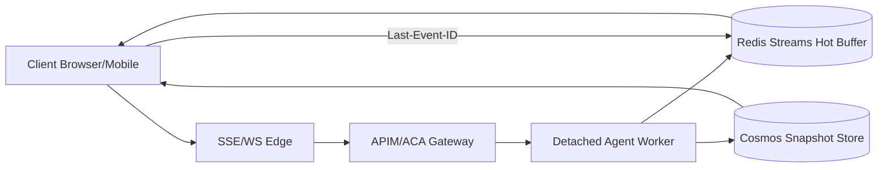
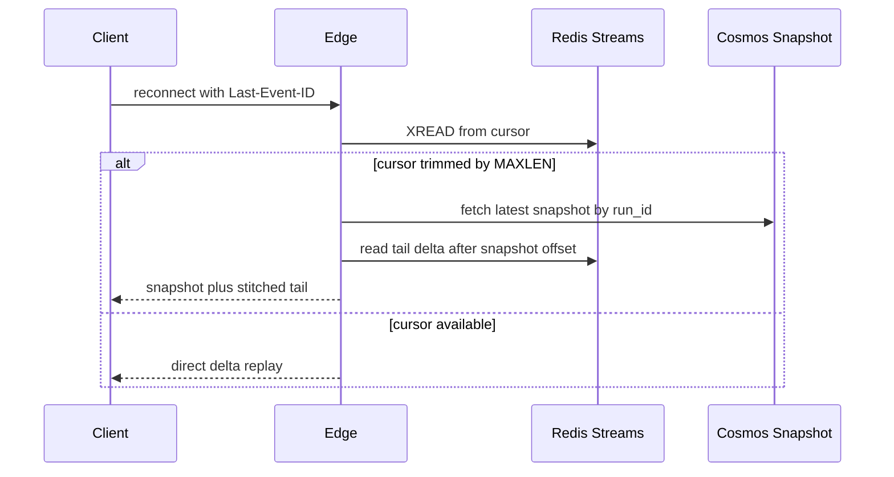

# 可恢复 Agent 流重连与断连容错 Token/工具增量回放选型 FAQ：Redis Streams Last-Event-ID vs Web PubSub 可靠 WS vs Cosmos Snapshot

> 🌐 **Language / 语言切换**: **中文版（当前）** | **[English](resumable-agent-stream-reattachment-token-replay-redis-streams-last-event-id-vs-web-pubsub-reliable-ws-vs-cosmos-snapshot-selection-faq.en.md)** | **[返回目录](README.md)**

## 1. 一页结论（Executive Summary）

- **Pattern A**：后台 Worker 与前端 SSE 链路解耦，核心事件写入 `Azure Managed Redis Streams`，客户端用 `Last-Event-ID` 追平，适合低延迟重连与多终端影子观测。
- **Pattern B**：`Azure Web PubSub` 可靠子协议适合超大连接数与移动端高抖动场景，需严格做 token 微批合并控制消息单元成本。
- **Pattern C**：长任务用周期快照 + 尾增量拼接，牺牲亚 token 级精度换取更低内存压力。
- **Pattern D（禁用）**：将 Agent 执行生命周期绑定到入站 SSE socket，一旦 VPN 重协商或页面刷新即中断昂贵推理。
- **目标指标**：`ReattachP95 < 150ms`、`ReplayLoss = 0`、`DuplicateBilling = 0`、`TenantACLByRunID = strict`。

## 2. 四种架构模式定义

- **A（Redis Streams）**：`XADD MAXLEN ~` 写入事件，客户端 `XREAD` 基于 `Last-Event-ID` 回放，完成后压缩到 `Cosmos DB`。
- **B（Web PubSub Reliable WS）**：依赖 `reconnectionToken` 与序列 ACK，快速处理多端重连。
- **C（Snapshot + Tail）**：每 `1~2s` 写结构化快照，重连先取快照再追尾增量。
- **D（反模式）**：直接 stateful proxy 管道，断链即任务中断/重试双计费。

## 3. 参考架构（Mermaid 1）



## 4. Last-Event-ID 与快照回退时序（Mermaid 2）



## 5. 定量模型

1. **热缓冲内存**：`Mem_stream = runs * event_rate * retention_window * avg_event_bytes`。
2. **微批收益**：`Cost_unit = messages_per_sec * unit_price`，50ms 合并可显著降低 `messages_per_sec`。
3. **重连追平延迟**：`T_catchup = backlog_events / consume_rate`。
4. **快照拼接延迟**：`T_stitch = T_snapshot_fetch + T_tail_replay`。
5. **租户隔离约束**：`allow(run_id, tenant_id, principal_id) == true` 才允许回放。

### 5.1 Redis RAM 粗估（25–80 tok/s）

| 速率与策略 | 平均事件大小 | 5k runs | 50k runs | 250k runs |
|---|---:|---:|---:|---:|
| 原始逐 token 80 tok/s | 120 B | 2.9 GB | 29 GB | 145 GB |
| 50ms 微批 20 帧/s | 420 B | 1.5 GB | 15 GB | 75 GB |
| 100ms 微批 10 帧/s | 700 B | 1.2 GB | 12 GB | 60 GB |

## 6. 12 维度对比矩阵

| 维度 | Pattern A Redis Streams | Pattern B Web PubSub | Pattern C Snapshot+Tail | Pattern D 反模式 |
|---|---|---|---|---|
| 重连追平延迟 | 很低 | 低 | 中 | 高 |
| 多终端影子能力 | 高 | 高 | 中 | 低 |
| 成本可控性 | 高 | 中 | 高 | 低 |
| 运维复杂度 | 中 | 低-中 | 中 | 低(表面) |
| 长任务适配 | 中 | 中 | 很高 | 低 |
| 断网容忍 | 高 | 中 | 高 | 低 |
| replay 完整性 | 高 | 中-高 | 高 | 低 |
| ACL 可验证性 | 高 | 中 | 高 | 低 |
| 压缩回收策略 | 高 | 中 | 高 | 低 |
| BCDR 迁移 | 中-高 | 中 | 高 | 低 |
| 三年 TCO（中规模） | 低-中 | 中 | 低-中 | 高 |
| 反模式暴露 | 低 | 中 | 低 | 极高 |

## 7. 深度问答（Q1–Q8）

### Q1. 何时优先 Pattern A？
- 追求低延迟无缝重连和多设备同步观测时。
- 可接受维护 Redis 热缓冲并做 TTL/压缩策略时。
- 需要严格基于 run_id 的 ACL 校验时。
- 需要与现有 APIM/ACA 边缘层快速集成时。

### Q2. Pattern B 成本为何容易放大？
- 逐 token 小包会导致消息单元成倍增长。
- 移动端弱网会触发更多补包与 ACK 交互。
- 若无 50~100ms 微批，单位请求成本失控。
- 高峰多租户并发会放大放大器效应。

### Q3. Pattern C 适合哪些任务？
- 10~60 分钟深研究、批量编码、合规审查等长任务。
- 用户可接受 1~2 秒可见性粒度而非逐 token 粒度。
- 重点是可靠续跑与证据沉淀，而非实时字级动画。
- 适合跨班次交接与异步审阅。

### Q4. Last-Event-ID 落后于 MAXLEN 怎么办？
- 检测 cursor 失效后自动切到 Cosmos 快照。
- 根据 snapshot offset 回放尾增量并拼接连续流。
- 向客户端标注“snapshot_resume”事件来源。
- 整个过程保持 run_id/tenant_id ACL 不变。

### Q5. 如何调 AFD/APIM 超时？
- 将 SSE idle timeout 与心跳间隔协同配置。
- 避免中间层压缩/缓冲破坏流式语义。
- 对移动端设置更宽松 read timeout。
- 配合断线重连指数退避减少风暴。

### Q6. 如何避免双计费？
- 执行层与传输层完全解耦，run_id 全局唯一。
- 客户端重连只消费未确认增量，不重启 run。
- 工具调用结果以幂等键去重。
- 计费系统按 run_step_id 聚合。

### Q7. 如何做租户 ACL 校验？
- run_id -> tenant_id -> principal_id 三元绑定。
- 重连请求必须携带可验证令牌和会话指纹。
- 跨租户 replay 一律拒绝并审计。
- 对 supervisor shadow 会话设置只读最小权限。

### Q8. 如何推进落地？
- 先灰度关键高价值租户。
- 建立断网、换网、刷新、VPN 重协商演练。
- 持续观测 replay 成功率与成本曲线。
- 达到 SLO 后再全量扩展。

## 8. FastAPI SSE + Redis XREAD + Cosmos fallback 片段

```python
async def stream(run_id, last_event_id, tenant, principal):
    verify_acl(run_id, tenant, principal)
    cursor = last_event_id or "0-0"
    if is_trimmed(cursor):
        snap = await cosmos_load_snapshot(run_id)
        yield format_event("snapshot_resume", snap)
        cursor = snap["offset"]
    async for evt in redis_xread(run_id, cursor):
        yield format_event("delta", evt)
```

## 9. APIM SSE no-transform 策略片段

```xml
<policies>
  <inbound>
    <set-header name="Cache-Control" exists-action="override">
      <value>no-store</value>
    </set-header>
    <set-header name="X-Accel-Buffering" exists-action="override">
      <value>no</value>
    </set-header>
  </inbound>
</policies>
```

## 10. 企业场景 A：投行 M&A 移动深研究工作台

- 场景A要点01：在 Wi-Fi/5G/VPN 频繁切换下，研究流保持连续并可跨 iPad/PC 无缝接续。
- 场景A要点02：在 Wi-Fi/5G/VPN 频繁切换下，研究流保持连续并可跨 iPad/PC 无缝接续。
- 场景A要点03：在 Wi-Fi/5G/VPN 频繁切换下，研究流保持连续并可跨 iPad/PC 无缝接续。
- 场景A要点04：在 Wi-Fi/5G/VPN 频繁切换下，研究流保持连续并可跨 iPad/PC 无缝接续。
- 场景A要点05：在 Wi-Fi/5G/VPN 频繁切换下，研究流保持连续并可跨 iPad/PC 无缝接续。
- 场景A要点06：在 Wi-Fi/5G/VPN 频繁切换下，研究流保持连续并可跨 iPad/PC 无缝接续。
- 场景A要点07：在 Wi-Fi/5G/VPN 频繁切换下，研究流保持连续并可跨 iPad/PC 无缝接续。
- 场景A要点08：在 Wi-Fi/5G/VPN 频繁切换下，研究流保持连续并可跨 iPad/PC 无缝接续。
- 场景A要点09：在 Wi-Fi/5G/VPN 频繁切换下，研究流保持连续并可跨 iPad/PC 无缝接续。
- 场景A要点10：在 Wi-Fi/5G/VPN 频繁切换下，研究流保持连续并可跨 iPad/PC 无缝接续。
- 场景A要点11：在 Wi-Fi/5G/VPN 频繁切换下，研究流保持连续并可跨 iPad/PC 无缝接续。
- 场景A要点12：在 Wi-Fi/5G/VPN 频繁切换下，研究流保持连续并可跨 iPad/PC 无缝接续。
- 场景A要点13：在 Wi-Fi/5G/VPN 频繁切换下，研究流保持连续并可跨 iPad/PC 无缝接续。
- 场景A要点14：在 Wi-Fi/5G/VPN 频繁切换下，研究流保持连续并可跨 iPad/PC 无缝接续。
- 场景A要点15：在 Wi-Fi/5G/VPN 频繁切换下，研究流保持连续并可跨 iPad/PC 无缝接续。
- 场景A要点16：在 Wi-Fi/5G/VPN 频繁切换下，研究流保持连续并可跨 iPad/PC 无缝接续。
- 场景A要点17：在 Wi-Fi/5G/VPN 频繁切换下，研究流保持连续并可跨 iPad/PC 无缝接续。
- 场景A要点18：在 Wi-Fi/5G/VPN 频繁切换下，研究流保持连续并可跨 iPad/PC 无缝接续。
- 场景A要点19：在 Wi-Fi/5G/VPN 频繁切换下，研究流保持连续并可跨 iPad/PC 无缝接续。
- 场景A要点20：在 Wi-Fi/5G/VPN 频繁切换下，研究流保持连续并可跨 iPad/PC 无缝接续。
- 场景A要点21：在 Wi-Fi/5G/VPN 频繁切换下，研究流保持连续并可跨 iPad/PC 无缝接续。
- 场景A要点22：在 Wi-Fi/5G/VPN 频繁切换下，研究流保持连续并可跨 iPad/PC 无缝接续。
- 场景A要点23：在 Wi-Fi/5G/VPN 频繁切换下，研究流保持连续并可跨 iPad/PC 无缝接续。
- 场景A要点24：在 Wi-Fi/5G/VPN 频繁切换下，研究流保持连续并可跨 iPad/PC 无缝接续。
- 场景A要点25：在 Wi-Fi/5G/VPN 频繁切换下，研究流保持连续并可跨 iPad/PC 无缝接续。
- 场景A要点26：在 Wi-Fi/5G/VPN 频繁切换下，研究流保持连续并可跨 iPad/PC 无缝接续。
- 场景A要点27：在 Wi-Fi/5G/VPN 频繁切换下，研究流保持连续并可跨 iPad/PC 无缝接续。
- 场景A要点28：在 Wi-Fi/5G/VPN 频繁切换下，研究流保持连续并可跨 iPad/PC 无缝接续。
- 场景A要点29：在 Wi-Fi/5G/VPN 频繁切换下，研究流保持连续并可跨 iPad/PC 无缝接续。
- 场景A要点30：在 Wi-Fi/5G/VPN 频繁切换下，研究流保持连续并可跨 iPad/PC 无缝接续。

## 11. 企业场景 B：SRE 战情室多标签页实时影子观测

- 场景B要点01：多个观察者标签页共享同一 run_id，只读追踪工具进度与 token 增量。
- 场景B要点02：多个观察者标签页共享同一 run_id，只读追踪工具进度与 token 增量。
- 场景B要点03：多个观察者标签页共享同一 run_id，只读追踪工具进度与 token 增量。
- 场景B要点04：多个观察者标签页共享同一 run_id，只读追踪工具进度与 token 增量。
- 场景B要点05：多个观察者标签页共享同一 run_id，只读追踪工具进度与 token 增量。
- 场景B要点06：多个观察者标签页共享同一 run_id，只读追踪工具进度与 token 增量。
- 场景B要点07：多个观察者标签页共享同一 run_id，只读追踪工具进度与 token 增量。
- 场景B要点08：多个观察者标签页共享同一 run_id，只读追踪工具进度与 token 增量。
- 场景B要点09：多个观察者标签页共享同一 run_id，只读追踪工具进度与 token 增量。
- 场景B要点10：多个观察者标签页共享同一 run_id，只读追踪工具进度与 token 增量。
- 场景B要点11：多个观察者标签页共享同一 run_id，只读追踪工具进度与 token 增量。
- 场景B要点12：多个观察者标签页共享同一 run_id，只读追踪工具进度与 token 增量。
- 场景B要点13：多个观察者标签页共享同一 run_id，只读追踪工具进度与 token 增量。
- 场景B要点14：多个观察者标签页共享同一 run_id，只读追踪工具进度与 token 增量。
- 场景B要点15：多个观察者标签页共享同一 run_id，只读追踪工具进度与 token 增量。
- 场景B要点16：多个观察者标签页共享同一 run_id，只读追踪工具进度与 token 增量。
- 场景B要点17：多个观察者标签页共享同一 run_id，只读追踪工具进度与 token 增量。
- 场景B要点18：多个观察者标签页共享同一 run_id，只读追踪工具进度与 token 增量。
- 场景B要点19：多个观察者标签页共享同一 run_id，只读追踪工具进度与 token 增量。
- 场景B要点20：多个观察者标签页共享同一 run_id，只读追踪工具进度与 token 增量。
- 场景B要点21：多个观察者标签页共享同一 run_id，只读追踪工具进度与 token 增量。
- 场景B要点22：多个观察者标签页共享同一 run_id，只读追踪工具进度与 token 增量。
- 场景B要点23：多个观察者标签页共享同一 run_id，只读追踪工具进度与 token 增量。
- 场景B要点24：多个观察者标签页共享同一 run_id，只读追踪工具进度与 token 增量。
- 场景B要点25：多个观察者标签页共享同一 run_id，只读追踪工具进度与 token 增量。
- 场景B要点26：多个观察者标签页共享同一 run_id，只读追踪工具进度与 token 增量。
- 场景B要点27：多个观察者标签页共享同一 run_id，只读追踪工具进度与 token 增量。
- 场景B要点28：多个观察者标签页共享同一 run_id，只读追踪工具进度与 token 增量。
- 场景B要点29：多个观察者标签页共享同一 run_id，只读追踪工具进度与 token 增量。
- 场景B要点30：多个观察者标签页共享同一 run_id，只读追踪工具进度与 token 增量。

## 12. 三档三年 TCO（单位：USD）

| 规模 | 并发/日活 runs | Pattern A 年成本 | Pattern B 年成本 | Pattern C 年成本 | 反模式损失 | 三年总计（推荐路径） |
|---|---:|---:|---:|---:|---:|---:|
| Small | 5k | 360,000 | 420,000 | 310,000 | 280,000 | 3,150,000 |
| Medium | 50k | 1,920,000 | 2,680,000 | 1,740,000 | 1,260,000 | 11,940,000 |
| Large | 250k | 7,980,000 | 11,400,000 | 7,120,000 | 5,800,000 | 38,700,000 |

## 13. Day-0 / Day-1 / Day-2 上线核查清单

### Day-0 设计阶段
- [ ] Day-0 设计阶段 检查项01：校验 run_id ACL、重连游标、快照拼接、超时、告警、回滚。
- [ ] Day-0 设计阶段 检查项02：校验 run_id ACL、重连游标、快照拼接、超时、告警、回滚。
- [ ] Day-0 设计阶段 检查项03：校验 run_id ACL、重连游标、快照拼接、超时、告警、回滚。
- [ ] Day-0 设计阶段 检查项04：校验 run_id ACL、重连游标、快照拼接、超时、告警、回滚。
- [ ] Day-0 设计阶段 检查项05：校验 run_id ACL、重连游标、快照拼接、超时、告警、回滚。
- [ ] Day-0 设计阶段 检查项06：校验 run_id ACL、重连游标、快照拼接、超时、告警、回滚。
- [ ] Day-0 设计阶段 检查项07：校验 run_id ACL、重连游标、快照拼接、超时、告警、回滚。
- [ ] Day-0 设计阶段 检查项08：校验 run_id ACL、重连游标、快照拼接、超时、告警、回滚。
- [ ] Day-0 设计阶段 检查项09：校验 run_id ACL、重连游标、快照拼接、超时、告警、回滚。
- [ ] Day-0 设计阶段 检查项10：校验 run_id ACL、重连游标、快照拼接、超时、告警、回滚。
- [ ] Day-0 设计阶段 检查项11：校验 run_id ACL、重连游标、快照拼接、超时、告警、回滚。
- [ ] Day-0 设计阶段 检查项12：校验 run_id ACL、重连游标、快照拼接、超时、告警、回滚。
- [ ] Day-0 设计阶段 检查项13：校验 run_id ACL、重连游标、快照拼接、超时、告警、回滚。
- [ ] Day-0 设计阶段 检查项14：校验 run_id ACL、重连游标、快照拼接、超时、告警、回滚。
- [ ] Day-0 设计阶段 检查项15：校验 run_id ACL、重连游标、快照拼接、超时、告警、回滚。
- [ ] Day-0 设计阶段 检查项16：校验 run_id ACL、重连游标、快照拼接、超时、告警、回滚。
- [ ] Day-0 设计阶段 检查项17：校验 run_id ACL、重连游标、快照拼接、超时、告警、回滚。
- [ ] Day-0 设计阶段 检查项18：校验 run_id ACL、重连游标、快照拼接、超时、告警、回滚。
- [ ] Day-0 设计阶段 检查项19：校验 run_id ACL、重连游标、快照拼接、超时、告警、回滚。
- [ ] Day-0 设计阶段 检查项20：校验 run_id ACL、重连游标、快照拼接、超时、告警、回滚。
- [ ] Day-0 设计阶段 检查项21：校验 run_id ACL、重连游标、快照拼接、超时、告警、回滚。
- [ ] Day-0 设计阶段 检查项22：校验 run_id ACL、重连游标、快照拼接、超时、告警、回滚。
- [ ] Day-0 设计阶段 检查项23：校验 run_id ACL、重连游标、快照拼接、超时、告警、回滚。
- [ ] Day-0 设计阶段 检查项24：校验 run_id ACL、重连游标、快照拼接、超时、告警、回滚。
- [ ] Day-0 设计阶段 检查项25：校验 run_id ACL、重连游标、快照拼接、超时、告警、回滚。
- [ ] Day-0 设计阶段 检查项26：校验 run_id ACL、重连游标、快照拼接、超时、告警、回滚。
- [ ] Day-0 设计阶段 检查项27：校验 run_id ACL、重连游标、快照拼接、超时、告警、回滚。
- [ ] Day-0 设计阶段 检查项28：校验 run_id ACL、重连游标、快照拼接、超时、告警、回滚。
- [ ] Day-0 设计阶段 检查项29：校验 run_id ACL、重连游标、快照拼接、超时、告警、回滚。
- [ ] Day-0 设计阶段 检查项30：校验 run_id ACL、重连游标、快照拼接、超时、告警、回滚。
- [ ] Day-0 设计阶段 检查项31：校验 run_id ACL、重连游标、快照拼接、超时、告警、回滚。
- [ ] Day-0 设计阶段 检查项32：校验 run_id ACL、重连游标、快照拼接、超时、告警、回滚。
- [ ] Day-0 设计阶段 检查项33：校验 run_id ACL、重连游标、快照拼接、超时、告警、回滚。
- [ ] Day-0 设计阶段 检查项34：校验 run_id ACL、重连游标、快照拼接、超时、告警、回滚。
- [ ] Day-0 设计阶段 检查项35：校验 run_id ACL、重连游标、快照拼接、超时、告警、回滚。

### Day-1 发布阶段
- [ ] Day-1 发布阶段 检查项01：校验 run_id ACL、重连游标、快照拼接、超时、告警、回滚。
- [ ] Day-1 发布阶段 检查项02：校验 run_id ACL、重连游标、快照拼接、超时、告警、回滚。
- [ ] Day-1 发布阶段 检查项03：校验 run_id ACL、重连游标、快照拼接、超时、告警、回滚。
- [ ] Day-1 发布阶段 检查项04：校验 run_id ACL、重连游标、快照拼接、超时、告警、回滚。
- [ ] Day-1 发布阶段 检查项05：校验 run_id ACL、重连游标、快照拼接、超时、告警、回滚。
- [ ] Day-1 发布阶段 检查项06：校验 run_id ACL、重连游标、快照拼接、超时、告警、回滚。
- [ ] Day-1 发布阶段 检查项07：校验 run_id ACL、重连游标、快照拼接、超时、告警、回滚。
- [ ] Day-1 发布阶段 检查项08：校验 run_id ACL、重连游标、快照拼接、超时、告警、回滚。
- [ ] Day-1 发布阶段 检查项09：校验 run_id ACL、重连游标、快照拼接、超时、告警、回滚。
- [ ] Day-1 发布阶段 检查项10：校验 run_id ACL、重连游标、快照拼接、超时、告警、回滚。
- [ ] Day-1 发布阶段 检查项11：校验 run_id ACL、重连游标、快照拼接、超时、告警、回滚。
- [ ] Day-1 发布阶段 检查项12：校验 run_id ACL、重连游标、快照拼接、超时、告警、回滚。
- [ ] Day-1 发布阶段 检查项13：校验 run_id ACL、重连游标、快照拼接、超时、告警、回滚。
- [ ] Day-1 发布阶段 检查项14：校验 run_id ACL、重连游标、快照拼接、超时、告警、回滚。
- [ ] Day-1 发布阶段 检查项15：校验 run_id ACL、重连游标、快照拼接、超时、告警、回滚。
- [ ] Day-1 发布阶段 检查项16：校验 run_id ACL、重连游标、快照拼接、超时、告警、回滚。
- [ ] Day-1 发布阶段 检查项17：校验 run_id ACL、重连游标、快照拼接、超时、告警、回滚。
- [ ] Day-1 发布阶段 检查项18：校验 run_id ACL、重连游标、快照拼接、超时、告警、回滚。
- [ ] Day-1 发布阶段 检查项19：校验 run_id ACL、重连游标、快照拼接、超时、告警、回滚。
- [ ] Day-1 发布阶段 检查项20：校验 run_id ACL、重连游标、快照拼接、超时、告警、回滚。
- [ ] Day-1 发布阶段 检查项21：校验 run_id ACL、重连游标、快照拼接、超时、告警、回滚。
- [ ] Day-1 发布阶段 检查项22：校验 run_id ACL、重连游标、快照拼接、超时、告警、回滚。
- [ ] Day-1 发布阶段 检查项23：校验 run_id ACL、重连游标、快照拼接、超时、告警、回滚。
- [ ] Day-1 发布阶段 检查项24：校验 run_id ACL、重连游标、快照拼接、超时、告警、回滚。
- [ ] Day-1 发布阶段 检查项25：校验 run_id ACL、重连游标、快照拼接、超时、告警、回滚。
- [ ] Day-1 发布阶段 检查项26：校验 run_id ACL、重连游标、快照拼接、超时、告警、回滚。
- [ ] Day-1 发布阶段 检查项27：校验 run_id ACL、重连游标、快照拼接、超时、告警、回滚。
- [ ] Day-1 发布阶段 检查项28：校验 run_id ACL、重连游标、快照拼接、超时、告警、回滚。
- [ ] Day-1 发布阶段 检查项29：校验 run_id ACL、重连游标、快照拼接、超时、告警、回滚。
- [ ] Day-1 发布阶段 检查项30：校验 run_id ACL、重连游标、快照拼接、超时、告警、回滚。
- [ ] Day-1 发布阶段 检查项31：校验 run_id ACL、重连游标、快照拼接、超时、告警、回滚。
- [ ] Day-1 发布阶段 检查项32：校验 run_id ACL、重连游标、快照拼接、超时、告警、回滚。
- [ ] Day-1 发布阶段 检查项33：校验 run_id ACL、重连游标、快照拼接、超时、告警、回滚。
- [ ] Day-1 发布阶段 检查项34：校验 run_id ACL、重连游标、快照拼接、超时、告警、回滚。
- [ ] Day-1 发布阶段 检查项35：校验 run_id ACL、重连游标、快照拼接、超时、告警、回滚。

### Day-2 运营阶段
- [ ] Day-2 运营阶段 检查项01：校验 run_id ACL、重连游标、快照拼接、超时、告警、回滚。
- [ ] Day-2 运营阶段 检查项02：校验 run_id ACL、重连游标、快照拼接、超时、告警、回滚。
- [ ] Day-2 运营阶段 检查项03：校验 run_id ACL、重连游标、快照拼接、超时、告警、回滚。
- [ ] Day-2 运营阶段 检查项04：校验 run_id ACL、重连游标、快照拼接、超时、告警、回滚。
- [ ] Day-2 运营阶段 检查项05：校验 run_id ACL、重连游标、快照拼接、超时、告警、回滚。
- [ ] Day-2 运营阶段 检查项06：校验 run_id ACL、重连游标、快照拼接、超时、告警、回滚。
- [ ] Day-2 运营阶段 检查项07：校验 run_id ACL、重连游标、快照拼接、超时、告警、回滚。
- [ ] Day-2 运营阶段 检查项08：校验 run_id ACL、重连游标、快照拼接、超时、告警、回滚。
- [ ] Day-2 运营阶段 检查项09：校验 run_id ACL、重连游标、快照拼接、超时、告警、回滚。
- [ ] Day-2 运营阶段 检查项10：校验 run_id ACL、重连游标、快照拼接、超时、告警、回滚。
- [ ] Day-2 运营阶段 检查项11：校验 run_id ACL、重连游标、快照拼接、超时、告警、回滚。
- [ ] Day-2 运营阶段 检查项12：校验 run_id ACL、重连游标、快照拼接、超时、告警、回滚。
- [ ] Day-2 运营阶段 检查项13：校验 run_id ACL、重连游标、快照拼接、超时、告警、回滚。
- [ ] Day-2 运营阶段 检查项14：校验 run_id ACL、重连游标、快照拼接、超时、告警、回滚。
- [ ] Day-2 运营阶段 检查项15：校验 run_id ACL、重连游标、快照拼接、超时、告警、回滚。
- [ ] Day-2 运营阶段 检查项16：校验 run_id ACL、重连游标、快照拼接、超时、告警、回滚。
- [ ] Day-2 运营阶段 检查项17：校验 run_id ACL、重连游标、快照拼接、超时、告警、回滚。
- [ ] Day-2 运营阶段 检查项18：校验 run_id ACL、重连游标、快照拼接、超时、告警、回滚。
- [ ] Day-2 运营阶段 检查项19：校验 run_id ACL、重连游标、快照拼接、超时、告警、回滚。
- [ ] Day-2 运营阶段 检查项20：校验 run_id ACL、重连游标、快照拼接、超时、告警、回滚。
- [ ] Day-2 运营阶段 检查项21：校验 run_id ACL、重连游标、快照拼接、超时、告警、回滚。
- [ ] Day-2 运营阶段 检查项22：校验 run_id ACL、重连游标、快照拼接、超时、告警、回滚。
- [ ] Day-2 运营阶段 检查项23：校验 run_id ACL、重连游标、快照拼接、超时、告警、回滚。
- [ ] Day-2 运营阶段 检查项24：校验 run_id ACL、重连游标、快照拼接、超时、告警、回滚。
- [ ] Day-2 运营阶段 检查项25：校验 run_id ACL、重连游标、快照拼接、超时、告警、回滚。
- [ ] Day-2 运营阶段 检查项26：校验 run_id ACL、重连游标、快照拼接、超时、告警、回滚。
- [ ] Day-2 运营阶段 检查项27：校验 run_id ACL、重连游标、快照拼接、超时、告警、回滚。
- [ ] Day-2 运营阶段 检查项28：校验 run_id ACL、重连游标、快照拼接、超时、告警、回滚。
- [ ] Day-2 运营阶段 检查项29：校验 run_id ACL、重连游标、快照拼接、超时、告警、回滚。
- [ ] Day-2 运营阶段 检查项30：校验 run_id ACL、重连游标、快照拼接、超时、告警、回滚。
- [ ] Day-2 运营阶段 检查项31：校验 run_id ACL、重连游标、快照拼接、超时、告警、回滚。
- [ ] Day-2 运营阶段 检查项32：校验 run_id ACL、重连游标、快照拼接、超时、告警、回滚。
- [ ] Day-2 运营阶段 检查项33：校验 run_id ACL、重连游标、快照拼接、超时、告警、回滚。
- [ ] Day-2 运营阶段 检查项34：校验 run_id ACL、重连游标、快照拼接、超时、告警、回滚。
- [ ] Day-2 运营阶段 检查项35：校验 run_id ACL、重连游标、快照拼接、超时、告警、回滚。

## 14. 反模式剖析与纠偏

- 纠偏建议01：禁止把 Agent 执行生命周期绑定到单一入站 SSE socket。
- 纠偏建议02：禁止把 Agent 执行生命周期绑定到单一入站 SSE socket。
- 纠偏建议03：禁止把 Agent 执行生命周期绑定到单一入站 SSE socket。
- 纠偏建议04：禁止把 Agent 执行生命周期绑定到单一入站 SSE socket。
- 纠偏建议05：禁止把 Agent 执行生命周期绑定到单一入站 SSE socket。
- 纠偏建议06：禁止把 Agent 执行生命周期绑定到单一入站 SSE socket。
- 纠偏建议07：禁止把 Agent 执行生命周期绑定到单一入站 SSE socket。
- 纠偏建议08：禁止把 Agent 执行生命周期绑定到单一入站 SSE socket。
- 纠偏建议09：禁止把 Agent 执行生命周期绑定到单一入站 SSE socket。
- 纠偏建议10：禁止把 Agent 执行生命周期绑定到单一入站 SSE socket。
- 纠偏建议11：禁止把 Agent 执行生命周期绑定到单一入站 SSE socket。
- 纠偏建议12：禁止把 Agent 执行生命周期绑定到单一入站 SSE socket。
- 纠偏建议13：禁止把 Agent 执行生命周期绑定到单一入站 SSE socket。
- 纠偏建议14：禁止把 Agent 执行生命周期绑定到单一入站 SSE socket。
- 纠偏建议15：禁止把 Agent 执行生命周期绑定到单一入站 SSE socket。
- 纠偏建议16：禁止把 Agent 执行生命周期绑定到单一入站 SSE socket。
- 纠偏建议17：禁止把 Agent 执行生命周期绑定到单一入站 SSE socket。
- 纠偏建议18：禁止把 Agent 执行生命周期绑定到单一入站 SSE socket。
- 纠偏建议19：禁止把 Agent 执行生命周期绑定到单一入站 SSE socket。
- 纠偏建议20：禁止把 Agent 执行生命周期绑定到单一入站 SSE socket。
- 纠偏建议21：禁止把 Agent 执行生命周期绑定到单一入站 SSE socket。
- 纠偏建议22：禁止把 Agent 执行生命周期绑定到单一入站 SSE socket。
- 纠偏建议23：禁止把 Agent 执行生命周期绑定到单一入站 SSE socket。
- 纠偏建议24：禁止把 Agent 执行生命周期绑定到单一入站 SSE socket。
- 纠偏建议25：禁止把 Agent 执行生命周期绑定到单一入站 SSE socket。
- 纠偏建议26：禁止把 Agent 执行生命周期绑定到单一入站 SSE socket。
- 纠偏建议27：禁止把 Agent 执行生命周期绑定到单一入站 SSE socket。
- 纠偏建议28：禁止把 Agent 执行生命周期绑定到单一入站 SSE socket。
- 纠偏建议29：禁止把 Agent 执行生命周期绑定到单一入站 SSE socket。
- 纠偏建议30：禁止把 Agent 执行生命周期绑定到单一入站 SSE socket。
- 纠偏建议31：禁止把 Agent 执行生命周期绑定到单一入站 SSE socket。
- 纠偏建议32：禁止把 Agent 执行生命周期绑定到单一入站 SSE socket。
- 纠偏建议33：禁止把 Agent 执行生命周期绑定到单一入站 SSE socket。
- 纠偏建议34：禁止把 Agent 执行生命周期绑定到单一入站 SSE socket。
- 纠偏建议35：禁止把 Agent 执行生命周期绑定到单一入站 SSE socket。
- 纠偏建议36：禁止把 Agent 执行生命周期绑定到单一入站 SSE socket。
- 纠偏建议37：禁止把 Agent 执行生命周期绑定到单一入站 SSE socket。
- 纠偏建议38：禁止把 Agent 执行生命周期绑定到单一入站 SSE socket。
- 纠偏建议39：禁止把 Agent 执行生命周期绑定到单一入站 SSE socket。
- 纠偏建议40：禁止把 Agent 执行生命周期绑定到单一入站 SSE socket。

## 15. 附录：参数与治理控制目录

- 控制项001：持续记录 `reattach_p95_ms`、`replay_loss`、`dup_bill_rate`、`stream_ram_gb`、`acl_violation`、`ws_unit_cost`。
- 控制项002：持续记录 `reattach_p95_ms`、`replay_loss`、`dup_bill_rate`、`stream_ram_gb`、`acl_violation`、`ws_unit_cost`。
- 控制项003：持续记录 `reattach_p95_ms`、`replay_loss`、`dup_bill_rate`、`stream_ram_gb`、`acl_violation`、`ws_unit_cost`。
- 控制项004：持续记录 `reattach_p95_ms`、`replay_loss`、`dup_bill_rate`、`stream_ram_gb`、`acl_violation`、`ws_unit_cost`。
- 控制项005：持续记录 `reattach_p95_ms`、`replay_loss`、`dup_bill_rate`、`stream_ram_gb`、`acl_violation`、`ws_unit_cost`。
- 控制项006：持续记录 `reattach_p95_ms`、`replay_loss`、`dup_bill_rate`、`stream_ram_gb`、`acl_violation`、`ws_unit_cost`。
- 控制项007：持续记录 `reattach_p95_ms`、`replay_loss`、`dup_bill_rate`、`stream_ram_gb`、`acl_violation`、`ws_unit_cost`。
- 控制项008：持续记录 `reattach_p95_ms`、`replay_loss`、`dup_bill_rate`、`stream_ram_gb`、`acl_violation`、`ws_unit_cost`。
- 控制项009：持续记录 `reattach_p95_ms`、`replay_loss`、`dup_bill_rate`、`stream_ram_gb`、`acl_violation`、`ws_unit_cost`。
- 控制项010：持续记录 `reattach_p95_ms`、`replay_loss`、`dup_bill_rate`、`stream_ram_gb`、`acl_violation`、`ws_unit_cost`。
- 控制项011：持续记录 `reattach_p95_ms`、`replay_loss`、`dup_bill_rate`、`stream_ram_gb`、`acl_violation`、`ws_unit_cost`。
- 控制项012：持续记录 `reattach_p95_ms`、`replay_loss`、`dup_bill_rate`、`stream_ram_gb`、`acl_violation`、`ws_unit_cost`。
- 控制项013：持续记录 `reattach_p95_ms`、`replay_loss`、`dup_bill_rate`、`stream_ram_gb`、`acl_violation`、`ws_unit_cost`。
- 控制项014：持续记录 `reattach_p95_ms`、`replay_loss`、`dup_bill_rate`、`stream_ram_gb`、`acl_violation`、`ws_unit_cost`。
- 控制项015：持续记录 `reattach_p95_ms`、`replay_loss`、`dup_bill_rate`、`stream_ram_gb`、`acl_violation`、`ws_unit_cost`。
- 控制项016：持续记录 `reattach_p95_ms`、`replay_loss`、`dup_bill_rate`、`stream_ram_gb`、`acl_violation`、`ws_unit_cost`。
- 控制项017：持续记录 `reattach_p95_ms`、`replay_loss`、`dup_bill_rate`、`stream_ram_gb`、`acl_violation`、`ws_unit_cost`。
- 控制项018：持续记录 `reattach_p95_ms`、`replay_loss`、`dup_bill_rate`、`stream_ram_gb`、`acl_violation`、`ws_unit_cost`。
- 控制项019：持续记录 `reattach_p95_ms`、`replay_loss`、`dup_bill_rate`、`stream_ram_gb`、`acl_violation`、`ws_unit_cost`。
- 控制项020：持续记录 `reattach_p95_ms`、`replay_loss`、`dup_bill_rate`、`stream_ram_gb`、`acl_violation`、`ws_unit_cost`。
- 控制项021：持续记录 `reattach_p95_ms`、`replay_loss`、`dup_bill_rate`、`stream_ram_gb`、`acl_violation`、`ws_unit_cost`。
- 控制项022：持续记录 `reattach_p95_ms`、`replay_loss`、`dup_bill_rate`、`stream_ram_gb`、`acl_violation`、`ws_unit_cost`。
- 控制项023：持续记录 `reattach_p95_ms`、`replay_loss`、`dup_bill_rate`、`stream_ram_gb`、`acl_violation`、`ws_unit_cost`。
- 控制项024：持续记录 `reattach_p95_ms`、`replay_loss`、`dup_bill_rate`、`stream_ram_gb`、`acl_violation`、`ws_unit_cost`。
- 控制项025：持续记录 `reattach_p95_ms`、`replay_loss`、`dup_bill_rate`、`stream_ram_gb`、`acl_violation`、`ws_unit_cost`。
- 控制项026：持续记录 `reattach_p95_ms`、`replay_loss`、`dup_bill_rate`、`stream_ram_gb`、`acl_violation`、`ws_unit_cost`。
- 控制项027：持续记录 `reattach_p95_ms`、`replay_loss`、`dup_bill_rate`、`stream_ram_gb`、`acl_violation`、`ws_unit_cost`。
- 控制项028：持续记录 `reattach_p95_ms`、`replay_loss`、`dup_bill_rate`、`stream_ram_gb`、`acl_violation`、`ws_unit_cost`。
- 控制项029：持续记录 `reattach_p95_ms`、`replay_loss`、`dup_bill_rate`、`stream_ram_gb`、`acl_violation`、`ws_unit_cost`。
- 控制项030：持续记录 `reattach_p95_ms`、`replay_loss`、`dup_bill_rate`、`stream_ram_gb`、`acl_violation`、`ws_unit_cost`。
- 控制项031：持续记录 `reattach_p95_ms`、`replay_loss`、`dup_bill_rate`、`stream_ram_gb`、`acl_violation`、`ws_unit_cost`。
- 控制项032：持续记录 `reattach_p95_ms`、`replay_loss`、`dup_bill_rate`、`stream_ram_gb`、`acl_violation`、`ws_unit_cost`。
- 控制项033：持续记录 `reattach_p95_ms`、`replay_loss`、`dup_bill_rate`、`stream_ram_gb`、`acl_violation`、`ws_unit_cost`。
- 控制项034：持续记录 `reattach_p95_ms`、`replay_loss`、`dup_bill_rate`、`stream_ram_gb`、`acl_violation`、`ws_unit_cost`。
- 控制项035：持续记录 `reattach_p95_ms`、`replay_loss`、`dup_bill_rate`、`stream_ram_gb`、`acl_violation`、`ws_unit_cost`。
- 控制项036：持续记录 `reattach_p95_ms`、`replay_loss`、`dup_bill_rate`、`stream_ram_gb`、`acl_violation`、`ws_unit_cost`。
- 控制项037：持续记录 `reattach_p95_ms`、`replay_loss`、`dup_bill_rate`、`stream_ram_gb`、`acl_violation`、`ws_unit_cost`。
- 控制项038：持续记录 `reattach_p95_ms`、`replay_loss`、`dup_bill_rate`、`stream_ram_gb`、`acl_violation`、`ws_unit_cost`。
- 控制项039：持续记录 `reattach_p95_ms`、`replay_loss`、`dup_bill_rate`、`stream_ram_gb`、`acl_violation`、`ws_unit_cost`。
- 控制项040：持续记录 `reattach_p95_ms`、`replay_loss`、`dup_bill_rate`、`stream_ram_gb`、`acl_violation`、`ws_unit_cost`。
- 控制项041：持续记录 `reattach_p95_ms`、`replay_loss`、`dup_bill_rate`、`stream_ram_gb`、`acl_violation`、`ws_unit_cost`。
- 控制项042：持续记录 `reattach_p95_ms`、`replay_loss`、`dup_bill_rate`、`stream_ram_gb`、`acl_violation`、`ws_unit_cost`。
- 控制项043：持续记录 `reattach_p95_ms`、`replay_loss`、`dup_bill_rate`、`stream_ram_gb`、`acl_violation`、`ws_unit_cost`。
- 控制项044：持续记录 `reattach_p95_ms`、`replay_loss`、`dup_bill_rate`、`stream_ram_gb`、`acl_violation`、`ws_unit_cost`。
- 控制项045：持续记录 `reattach_p95_ms`、`replay_loss`、`dup_bill_rate`、`stream_ram_gb`、`acl_violation`、`ws_unit_cost`。
- 控制项046：持续记录 `reattach_p95_ms`、`replay_loss`、`dup_bill_rate`、`stream_ram_gb`、`acl_violation`、`ws_unit_cost`。
- 控制项047：持续记录 `reattach_p95_ms`、`replay_loss`、`dup_bill_rate`、`stream_ram_gb`、`acl_violation`、`ws_unit_cost`。
- 控制项048：持续记录 `reattach_p95_ms`、`replay_loss`、`dup_bill_rate`、`stream_ram_gb`、`acl_violation`、`ws_unit_cost`。
- 控制项049：持续记录 `reattach_p95_ms`、`replay_loss`、`dup_bill_rate`、`stream_ram_gb`、`acl_violation`、`ws_unit_cost`。
- 控制项050：持续记录 `reattach_p95_ms`、`replay_loss`、`dup_bill_rate`、`stream_ram_gb`、`acl_violation`、`ws_unit_cost`。
- 控制项051：持续记录 `reattach_p95_ms`、`replay_loss`、`dup_bill_rate`、`stream_ram_gb`、`acl_violation`、`ws_unit_cost`。
- 控制项052：持续记录 `reattach_p95_ms`、`replay_loss`、`dup_bill_rate`、`stream_ram_gb`、`acl_violation`、`ws_unit_cost`。
- 控制项053：持续记录 `reattach_p95_ms`、`replay_loss`、`dup_bill_rate`、`stream_ram_gb`、`acl_violation`、`ws_unit_cost`。
- 控制项054：持续记录 `reattach_p95_ms`、`replay_loss`、`dup_bill_rate`、`stream_ram_gb`、`acl_violation`、`ws_unit_cost`。
- 控制项055：持续记录 `reattach_p95_ms`、`replay_loss`、`dup_bill_rate`、`stream_ram_gb`、`acl_violation`、`ws_unit_cost`。
- 控制项056：持续记录 `reattach_p95_ms`、`replay_loss`、`dup_bill_rate`、`stream_ram_gb`、`acl_violation`、`ws_unit_cost`。
- 控制项057：持续记录 `reattach_p95_ms`、`replay_loss`、`dup_bill_rate`、`stream_ram_gb`、`acl_violation`、`ws_unit_cost`。
- 控制项058：持续记录 `reattach_p95_ms`、`replay_loss`、`dup_bill_rate`、`stream_ram_gb`、`acl_violation`、`ws_unit_cost`。
- 控制项059：持续记录 `reattach_p95_ms`、`replay_loss`、`dup_bill_rate`、`stream_ram_gb`、`acl_violation`、`ws_unit_cost`。
- 控制项060：持续记录 `reattach_p95_ms`、`replay_loss`、`dup_bill_rate`、`stream_ram_gb`、`acl_violation`、`ws_unit_cost`。
- 控制项061：持续记录 `reattach_p95_ms`、`replay_loss`、`dup_bill_rate`、`stream_ram_gb`、`acl_violation`、`ws_unit_cost`。
- 控制项062：持续记录 `reattach_p95_ms`、`replay_loss`、`dup_bill_rate`、`stream_ram_gb`、`acl_violation`、`ws_unit_cost`。
- 控制项063：持续记录 `reattach_p95_ms`、`replay_loss`、`dup_bill_rate`、`stream_ram_gb`、`acl_violation`、`ws_unit_cost`。
- 控制项064：持续记录 `reattach_p95_ms`、`replay_loss`、`dup_bill_rate`、`stream_ram_gb`、`acl_violation`、`ws_unit_cost`。
- 控制项065：持续记录 `reattach_p95_ms`、`replay_loss`、`dup_bill_rate`、`stream_ram_gb`、`acl_violation`、`ws_unit_cost`。
- 控制项066：持续记录 `reattach_p95_ms`、`replay_loss`、`dup_bill_rate`、`stream_ram_gb`、`acl_violation`、`ws_unit_cost`。
- 控制项067：持续记录 `reattach_p95_ms`、`replay_loss`、`dup_bill_rate`、`stream_ram_gb`、`acl_violation`、`ws_unit_cost`。
- 控制项068：持续记录 `reattach_p95_ms`、`replay_loss`、`dup_bill_rate`、`stream_ram_gb`、`acl_violation`、`ws_unit_cost`。
- 控制项069：持续记录 `reattach_p95_ms`、`replay_loss`、`dup_bill_rate`、`stream_ram_gb`、`acl_violation`、`ws_unit_cost`。
- 控制项070：持续记录 `reattach_p95_ms`、`replay_loss`、`dup_bill_rate`、`stream_ram_gb`、`acl_violation`、`ws_unit_cost`。
- 控制项071：持续记录 `reattach_p95_ms`、`replay_loss`、`dup_bill_rate`、`stream_ram_gb`、`acl_violation`、`ws_unit_cost`。
- 控制项072：持续记录 `reattach_p95_ms`、`replay_loss`、`dup_bill_rate`、`stream_ram_gb`、`acl_violation`、`ws_unit_cost`。
- 控制项073：持续记录 `reattach_p95_ms`、`replay_loss`、`dup_bill_rate`、`stream_ram_gb`、`acl_violation`、`ws_unit_cost`。
- 控制项074：持续记录 `reattach_p95_ms`、`replay_loss`、`dup_bill_rate`、`stream_ram_gb`、`acl_violation`、`ws_unit_cost`。
- 控制项075：持续记录 `reattach_p95_ms`、`replay_loss`、`dup_bill_rate`、`stream_ram_gb`、`acl_violation`、`ws_unit_cost`。
- 控制项076：持续记录 `reattach_p95_ms`、`replay_loss`、`dup_bill_rate`、`stream_ram_gb`、`acl_violation`、`ws_unit_cost`。
- 控制项077：持续记录 `reattach_p95_ms`、`replay_loss`、`dup_bill_rate`、`stream_ram_gb`、`acl_violation`、`ws_unit_cost`。
- 控制项078：持续记录 `reattach_p95_ms`、`replay_loss`、`dup_bill_rate`、`stream_ram_gb`、`acl_violation`、`ws_unit_cost`。
- 控制项079：持续记录 `reattach_p95_ms`、`replay_loss`、`dup_bill_rate`、`stream_ram_gb`、`acl_violation`、`ws_unit_cost`。
- 控制项080：持续记录 `reattach_p95_ms`、`replay_loss`、`dup_bill_rate`、`stream_ram_gb`、`acl_violation`、`ws_unit_cost`。
- 控制项081：持续记录 `reattach_p95_ms`、`replay_loss`、`dup_bill_rate`、`stream_ram_gb`、`acl_violation`、`ws_unit_cost`。
- 控制项082：持续记录 `reattach_p95_ms`、`replay_loss`、`dup_bill_rate`、`stream_ram_gb`、`acl_violation`、`ws_unit_cost`。
- 控制项083：持续记录 `reattach_p95_ms`、`replay_loss`、`dup_bill_rate`、`stream_ram_gb`、`acl_violation`、`ws_unit_cost`。
- 控制项084：持续记录 `reattach_p95_ms`、`replay_loss`、`dup_bill_rate`、`stream_ram_gb`、`acl_violation`、`ws_unit_cost`。
- 控制项085：持续记录 `reattach_p95_ms`、`replay_loss`、`dup_bill_rate`、`stream_ram_gb`、`acl_violation`、`ws_unit_cost`。
- 控制项086：持续记录 `reattach_p95_ms`、`replay_loss`、`dup_bill_rate`、`stream_ram_gb`、`acl_violation`、`ws_unit_cost`。
- 控制项087：持续记录 `reattach_p95_ms`、`replay_loss`、`dup_bill_rate`、`stream_ram_gb`、`acl_violation`、`ws_unit_cost`。
- 控制项088：持续记录 `reattach_p95_ms`、`replay_loss`、`dup_bill_rate`、`stream_ram_gb`、`acl_violation`、`ws_unit_cost`。
- 控制项089：持续记录 `reattach_p95_ms`、`replay_loss`、`dup_bill_rate`、`stream_ram_gb`、`acl_violation`、`ws_unit_cost`。
- 控制项090：持续记录 `reattach_p95_ms`、`replay_loss`、`dup_bill_rate`、`stream_ram_gb`、`acl_violation`、`ws_unit_cost`。
- 控制项091：持续记录 `reattach_p95_ms`、`replay_loss`、`dup_bill_rate`、`stream_ram_gb`、`acl_violation`、`ws_unit_cost`。
- 控制项092：持续记录 `reattach_p95_ms`、`replay_loss`、`dup_bill_rate`、`stream_ram_gb`、`acl_violation`、`ws_unit_cost`。
- 控制项093：持续记录 `reattach_p95_ms`、`replay_loss`、`dup_bill_rate`、`stream_ram_gb`、`acl_violation`、`ws_unit_cost`。
- 控制项094：持续记录 `reattach_p95_ms`、`replay_loss`、`dup_bill_rate`、`stream_ram_gb`、`acl_violation`、`ws_unit_cost`。
- 控制项095：持续记录 `reattach_p95_ms`、`replay_loss`、`dup_bill_rate`、`stream_ram_gb`、`acl_violation`、`ws_unit_cost`。
- 控制项096：持续记录 `reattach_p95_ms`、`replay_loss`、`dup_bill_rate`、`stream_ram_gb`、`acl_violation`、`ws_unit_cost`。
- 控制项097：持续记录 `reattach_p95_ms`、`replay_loss`、`dup_bill_rate`、`stream_ram_gb`、`acl_violation`、`ws_unit_cost`。
- 控制项098：持续记录 `reattach_p95_ms`、`replay_loss`、`dup_bill_rate`、`stream_ram_gb`、`acl_violation`、`ws_unit_cost`。
- 控制项099：持续记录 `reattach_p95_ms`、`replay_loss`、`dup_bill_rate`、`stream_ram_gb`、`acl_violation`、`ws_unit_cost`。
- 控制项100：持续记录 `reattach_p95_ms`、`replay_loss`、`dup_bill_rate`、`stream_ram_gb`、`acl_violation`、`ws_unit_cost`。
- 控制项101：持续记录 `reattach_p95_ms`、`replay_loss`、`dup_bill_rate`、`stream_ram_gb`、`acl_violation`、`ws_unit_cost`。
- 控制项102：持续记录 `reattach_p95_ms`、`replay_loss`、`dup_bill_rate`、`stream_ram_gb`、`acl_violation`、`ws_unit_cost`。
- 控制项103：持续记录 `reattach_p95_ms`、`replay_loss`、`dup_bill_rate`、`stream_ram_gb`、`acl_violation`、`ws_unit_cost`。
- 控制项104：持续记录 `reattach_p95_ms`、`replay_loss`、`dup_bill_rate`、`stream_ram_gb`、`acl_violation`、`ws_unit_cost`。
- 控制项105：持续记录 `reattach_p95_ms`、`replay_loss`、`dup_bill_rate`、`stream_ram_gb`、`acl_violation`、`ws_unit_cost`。
- 控制项106：持续记录 `reattach_p95_ms`、`replay_loss`、`dup_bill_rate`、`stream_ram_gb`、`acl_violation`、`ws_unit_cost`。
- 控制项107：持续记录 `reattach_p95_ms`、`replay_loss`、`dup_bill_rate`、`stream_ram_gb`、`acl_violation`、`ws_unit_cost`。
- 控制项108：持续记录 `reattach_p95_ms`、`replay_loss`、`dup_bill_rate`、`stream_ram_gb`、`acl_violation`、`ws_unit_cost`。
- 控制项109：持续记录 `reattach_p95_ms`、`replay_loss`、`dup_bill_rate`、`stream_ram_gb`、`acl_violation`、`ws_unit_cost`。
- 控制项110：持续记录 `reattach_p95_ms`、`replay_loss`、`dup_bill_rate`、`stream_ram_gb`、`acl_violation`、`ws_unit_cost`。
- 控制项111：持续记录 `reattach_p95_ms`、`replay_loss`、`dup_bill_rate`、`stream_ram_gb`、`acl_violation`、`ws_unit_cost`。
- 控制项112：持续记录 `reattach_p95_ms`、`replay_loss`、`dup_bill_rate`、`stream_ram_gb`、`acl_violation`、`ws_unit_cost`。
- 控制项113：持续记录 `reattach_p95_ms`、`replay_loss`、`dup_bill_rate`、`stream_ram_gb`、`acl_violation`、`ws_unit_cost`。
- 控制项114：持续记录 `reattach_p95_ms`、`replay_loss`、`dup_bill_rate`、`stream_ram_gb`、`acl_violation`、`ws_unit_cost`。
- 控制项115：持续记录 `reattach_p95_ms`、`replay_loss`、`dup_bill_rate`、`stream_ram_gb`、`acl_violation`、`ws_unit_cost`。
- 控制项116：持续记录 `reattach_p95_ms`、`replay_loss`、`dup_bill_rate`、`stream_ram_gb`、`acl_violation`、`ws_unit_cost`。
- 控制项117：持续记录 `reattach_p95_ms`、`replay_loss`、`dup_bill_rate`、`stream_ram_gb`、`acl_violation`、`ws_unit_cost`。
- 控制项118：持续记录 `reattach_p95_ms`、`replay_loss`、`dup_bill_rate`、`stream_ram_gb`、`acl_violation`、`ws_unit_cost`。
- 控制项119：持续记录 `reattach_p95_ms`、`replay_loss`、`dup_bill_rate`、`stream_ram_gb`、`acl_violation`、`ws_unit_cost`。
- 控制项120：持续记录 `reattach_p95_ms`、`replay_loss`、`dup_bill_rate`、`stream_ram_gb`、`acl_violation`、`ws_unit_cost`。
- 控制项121：持续记录 `reattach_p95_ms`、`replay_loss`、`dup_bill_rate`、`stream_ram_gb`、`acl_violation`、`ws_unit_cost`。
- 控制项122：持续记录 `reattach_p95_ms`、`replay_loss`、`dup_bill_rate`、`stream_ram_gb`、`acl_violation`、`ws_unit_cost`。
- 控制项123：持续记录 `reattach_p95_ms`、`replay_loss`、`dup_bill_rate`、`stream_ram_gb`、`acl_violation`、`ws_unit_cost`。
- 控制项124：持续记录 `reattach_p95_ms`、`replay_loss`、`dup_bill_rate`、`stream_ram_gb`、`acl_violation`、`ws_unit_cost`。
- 控制项125：持续记录 `reattach_p95_ms`、`replay_loss`、`dup_bill_rate`、`stream_ram_gb`、`acl_violation`、`ws_unit_cost`。
- 控制项126：持续记录 `reattach_p95_ms`、`replay_loss`、`dup_bill_rate`、`stream_ram_gb`、`acl_violation`、`ws_unit_cost`。
- 控制项127：持续记录 `reattach_p95_ms`、`replay_loss`、`dup_bill_rate`、`stream_ram_gb`、`acl_violation`、`ws_unit_cost`。
- 控制项128：持续记录 `reattach_p95_ms`、`replay_loss`、`dup_bill_rate`、`stream_ram_gb`、`acl_violation`、`ws_unit_cost`。
- 控制项129：持续记录 `reattach_p95_ms`、`replay_loss`、`dup_bill_rate`、`stream_ram_gb`、`acl_violation`、`ws_unit_cost`。
- 控制项130：持续记录 `reattach_p95_ms`、`replay_loss`、`dup_bill_rate`、`stream_ram_gb`、`acl_violation`、`ws_unit_cost`。
- 控制项131：持续记录 `reattach_p95_ms`、`replay_loss`、`dup_bill_rate`、`stream_ram_gb`、`acl_violation`、`ws_unit_cost`。
- 控制项132：持续记录 `reattach_p95_ms`、`replay_loss`、`dup_bill_rate`、`stream_ram_gb`、`acl_violation`、`ws_unit_cost`。
- 控制项133：持续记录 `reattach_p95_ms`、`replay_loss`、`dup_bill_rate`、`stream_ram_gb`、`acl_violation`、`ws_unit_cost`。
- 控制项134：持续记录 `reattach_p95_ms`、`replay_loss`、`dup_bill_rate`、`stream_ram_gb`、`acl_violation`、`ws_unit_cost`。
- 控制项135：持续记录 `reattach_p95_ms`、`replay_loss`、`dup_bill_rate`、`stream_ram_gb`、`acl_violation`、`ws_unit_cost`。
- 控制项136：持续记录 `reattach_p95_ms`、`replay_loss`、`dup_bill_rate`、`stream_ram_gb`、`acl_violation`、`ws_unit_cost`。
- 控制项137：持续记录 `reattach_p95_ms`、`replay_loss`、`dup_bill_rate`、`stream_ram_gb`、`acl_violation`、`ws_unit_cost`。
- 控制项138：持续记录 `reattach_p95_ms`、`replay_loss`、`dup_bill_rate`、`stream_ram_gb`、`acl_violation`、`ws_unit_cost`。
- 控制项139：持续记录 `reattach_p95_ms`、`replay_loss`、`dup_bill_rate`、`stream_ram_gb`、`acl_violation`、`ws_unit_cost`。
- 控制项140：持续记录 `reattach_p95_ms`、`replay_loss`、`dup_bill_rate`、`stream_ram_gb`、`acl_violation`、`ws_unit_cost`。
- 控制项141：持续记录 `reattach_p95_ms`、`replay_loss`、`dup_bill_rate`、`stream_ram_gb`、`acl_violation`、`ws_unit_cost`。
- 控制项142：持续记录 `reattach_p95_ms`、`replay_loss`、`dup_bill_rate`、`stream_ram_gb`、`acl_violation`、`ws_unit_cost`。
- 控制项143：持续记录 `reattach_p95_ms`、`replay_loss`、`dup_bill_rate`、`stream_ram_gb`、`acl_violation`、`ws_unit_cost`。
- 控制项144：持续记录 `reattach_p95_ms`、`replay_loss`、`dup_bill_rate`、`stream_ram_gb`、`acl_violation`、`ws_unit_cost`。
- 控制项145：持续记录 `reattach_p95_ms`、`replay_loss`、`dup_bill_rate`、`stream_ram_gb`、`acl_violation`、`ws_unit_cost`。
- 控制项146：持续记录 `reattach_p95_ms`、`replay_loss`、`dup_bill_rate`、`stream_ram_gb`、`acl_violation`、`ws_unit_cost`。
- 控制项147：持续记录 `reattach_p95_ms`、`replay_loss`、`dup_bill_rate`、`stream_ram_gb`、`acl_violation`、`ws_unit_cost`。
- 控制项148：持续记录 `reattach_p95_ms`、`replay_loss`、`dup_bill_rate`、`stream_ram_gb`、`acl_violation`、`ws_unit_cost`。
- 控制项149：持续记录 `reattach_p95_ms`、`replay_loss`、`dup_bill_rate`、`stream_ram_gb`、`acl_violation`、`ws_unit_cost`。
- 控制项150：持续记录 `reattach_p95_ms`、`replay_loss`、`dup_bill_rate`、`stream_ram_gb`、`acl_violation`、`ws_unit_cost`。
- 控制项151：持续记录 `reattach_p95_ms`、`replay_loss`、`dup_bill_rate`、`stream_ram_gb`、`acl_violation`、`ws_unit_cost`。
- 控制项152：持续记录 `reattach_p95_ms`、`replay_loss`、`dup_bill_rate`、`stream_ram_gb`、`acl_violation`、`ws_unit_cost`。
- 控制项153：持续记录 `reattach_p95_ms`、`replay_loss`、`dup_bill_rate`、`stream_ram_gb`、`acl_violation`、`ws_unit_cost`。
- 控制项154：持续记录 `reattach_p95_ms`、`replay_loss`、`dup_bill_rate`、`stream_ram_gb`、`acl_violation`、`ws_unit_cost`。
- 控制项155：持续记录 `reattach_p95_ms`、`replay_loss`、`dup_bill_rate`、`stream_ram_gb`、`acl_violation`、`ws_unit_cost`。
- 控制项156：持续记录 `reattach_p95_ms`、`replay_loss`、`dup_bill_rate`、`stream_ram_gb`、`acl_violation`、`ws_unit_cost`。
- 控制项157：持续记录 `reattach_p95_ms`、`replay_loss`、`dup_bill_rate`、`stream_ram_gb`、`acl_violation`、`ws_unit_cost`。
- 控制项158：持续记录 `reattach_p95_ms`、`replay_loss`、`dup_bill_rate`、`stream_ram_gb`、`acl_violation`、`ws_unit_cost`。
- 控制项159：持续记录 `reattach_p95_ms`、`replay_loss`、`dup_bill_rate`、`stream_ram_gb`、`acl_violation`、`ws_unit_cost`。
- 控制项160：持续记录 `reattach_p95_ms`、`replay_loss`、`dup_bill_rate`、`stream_ram_gb`、`acl_violation`、`ws_unit_cost`。
