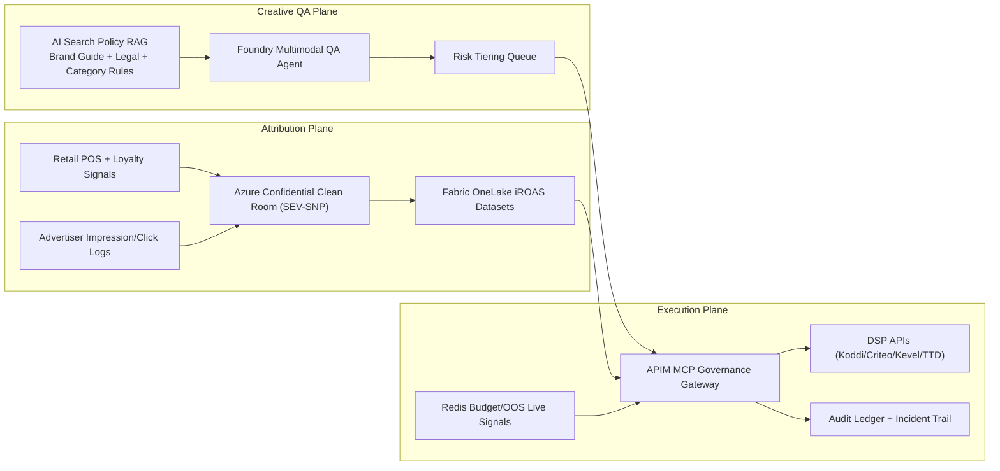
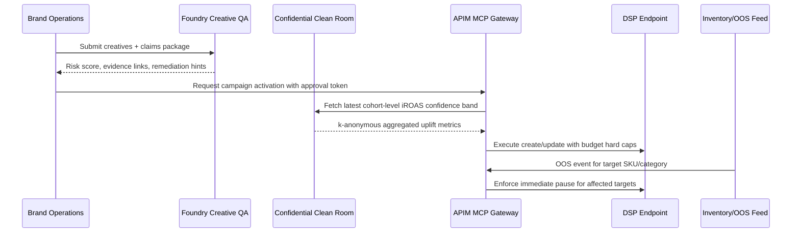

# Retail Media Network (RMN) Architecture Selection FAQ: Confidential Clean-Room iROAS Attribution vs Foundry Creative Compliance QA vs APIM+DSP MCP Budget Execution

> 🌐 **Language switch**: [中文](retail-media-network-adtech-clean-room-roas-fabric-vs-foundry-creative-qa-vs-dsp-mcp-selection-faq.md) · **English (current)**

> Audience: Cloud & AI Solution Architects, RMN commercialization leaders, ad-tech platform owners, legal and privacy governance teams.  
> Scope: tier-1 retailers, grocers, marketplaces, and CPG advertiser ecosystems with annual media revenue in the `USD 500M–5B` range.  
> Core challenge: deliver closed-loop attribution, creative governance, and autonomous pacing without exposing household-level sensitive data or causing runaway spend.  
> Outcome: a production-grade decision framework across `Option A / B / C`, including isolation boundaries, TCO, operating guardrails, and rollout order.  

## 1. Why RMN architecture is not just storefront checkout automation or M&A identity integration

This domain is materially different from storefront checkout engineering.  
Checkout systems optimize cart completion, payment success, and order consistency.  
RMN systems optimize media efficiency, privacy-safe attribution, and campaign control loops.

This domain is also different from Day-1 M&A identity integration programs.  
Identity integration focuses on tenant trust, directory federation, and access migration.  
RMN architecture must control data collaboration, creative compliance, and spend governance across organizational boundaries.

Three production risk vectors dominate RMN:

- attribution joins that cross company boundaries,  
- creative assets that cross regulatory and brand-policy boundaries,  
- bidding and pacing actions that cross budget and contractual boundaries.

If those controls are not isolated by design,  
small model or policy mistakes can rapidly become financial incidents.

Therefore, the architecture should explicitly separate:

1. attribution truth generation,  
2. creative risk assessment,  
3. execution permission and pacing controls.

## 2. Business boundary contract: what can be automated, what must remain gated

A durable operating model starts with explicit action classes:

1. **Informational**: policy lookup, campaign status, inventory health checks.  
2. **Advisory**: bid suggestions, creative edits, audience recommendations.  
3. **Execution**: campaign activation, budget uplift, bid-floor overrides, insertion-order changes.

Automation policy should be tiered:

- informational actions can be near-fully automated,  
- advisory actions can be auto-drafted with human approval,  
- execution actions must require policy token validation and hard threshold checks.

Without this contract, teams frequently deploy a capable assistant  
that still fails internal audit and procurement controls.

The issue is not model quality alone.  
The issue is action governance without deterministic boundaries.

## 3. Option map: A attribution-trust plane, B creative-compliance plane, C execution-governance plane

**Option A**: `Azure Confidential Clean Rooms + Microsoft Fabric`  
Primary value: privacy-preserving closed-loop attribution and incrementality (`iROAS`) computation.

**Option B**: `Azure AI Foundry + AI Search + Content Safety`  
Primary value: multimodal creative QA, claim validation support, and policy-grounded risk triage.

**Option C**: `APIM + Azure Managed Redis + DSP MCP connectors`  
Primary value: deterministic budget hard stops, out-of-stock (`OOS`) circuit breakers, and cross-DSP pacing control.

In enterprise RMN programs, these are usually complementary, not mutually exclusive.  
A provides attribution credibility.  
B provides creative throughput and compliance consistency.  
C provides execution safety under high update frequency.

## 4. Option A deep dive: Confidential clean-room attribution with Fabric

### 4.1 Fit profile

Option A is strongest when organizations need:

- retailer first-party transaction and loyalty joins with advertiser logs,  
- proof that household-level raw rows are never exposed,  
- standardized iROAS and incrementality products for internal and external stakeholders.

### 4.2 Typical architecture

- `DCasv5 / ECasv5` confidential compute for secure query execution,  
- clean-room templates for approved joins and aggregations,  
- Fabric OneLake for governed downstream metrics,  
- deterministic DP modules for noise-injected publishable outputs.

### 4.3 Core governance conditions

- `k-anonymity >= 50` for externally shareable cohort outputs,  
- approved query-template allowlist,  
- blocked fields for household-level exports,  
- mandatory metadata on snapshot version and privacy parameters.

### 4.4 Strengths

- strongest trust posture for cross-party attribution products,  
- improved regulator and partner confidence,  
- enables productized measurement offerings.

### 4.5 Constraints

- higher data-platform maturity required,  
- low-volume cohorts can become analytically sparse,  
- query latency and compute cost are typically higher than unconstrained analytics.

## 5. Option B deep dive: Foundry multimodal creative QA and policy-grounded review

### 5.1 Fit profile

Option B is highly effective when teams process:

- `10,000+` creatives per week,  
- mixed agency and in-house submissions,  
- multilingual assets with regional legal variation.

### 5.2 Core capabilities

- image/video/text multimodal parsing,  
- policy RAG over retailer style guides and legal libraries,  
- risk tiering for GARM safety categories,  
- claim-substantiation assistance for FTC/EU DSA sensitive categories.

### 5.3 Mandatory controls

- every reject/escalate decision must cite evidence anchors,  
- high-risk assets must route to mandatory human review,  
- the QA plane must not directly publish creatives,  
- all decisions must be retained with explainability logs.

### 5.4 Strengths

- large throughput uplift for creative pre-screening,  
- reduced repetitive review burden,  
- faster rejection of clearly non-compliant materials.

### 5.5 Constraints

- legal policy drift requires frequent content updates,  
- multilingual consistency calibration is non-trivial,  
- edge-case adjudication remains human-specialist heavy.

## 6. Option C deep dive: APIM + Redis + DSP MCP execution controls

### 6.1 Fit profile

Option C becomes essential when organizations need:

- hourly or sub-hourly pacing and bid adjustments,  
- deterministic spend ceilings,  
- inventory-aware automatic pause mechanisms,  
- one governance layer across multiple DSPs.

### 6.2 Core controls

- insertion-order daily budget hard caps,  
- category/SKU OOS-triggered forced pause logic,  
- bounded bid-adjustment deltas,  
- idempotent execution semantics and replay-safe audit trails.

### 6.3 Strengths

- strongest anti-runaway-spend posture,  
- robust cross-platform execution consistency,  
- high auditability for every budget-impacting action.

### 6.4 Constraints

- policy engineering complexity is significant,  
- control quality depends on near-real-time signal reliability,  
- requires mature SRE and incident processes.

## 7. Twelve-dimension selection matrix (A vs B vs C)

| Dimension | Option A: Clean Room + Fabric | Option B: Foundry Creative QA | Option C: APIM + DSP MCP |
|---|---|---|---|
| Closed-loop attribution credibility | Very High | Medium | Medium |
| Privacy-preserving collaboration strength | Very High | High | High |
| Creative QA throughput | Medium | Very High | Medium |
| Creative policy coverage depth | Medium | Very High | Medium |
| Real-time budget control | Medium | Medium | Very High |
| OOS auto-pause capability | Low to Medium | Low | Very High |
| Multi-DSP consistency | Low | Medium | High |
| Audit traceability | High | High | Very High |
| Delivery complexity | High | Medium to High | High |
| Time-to-initial-value | Medium to Slow | Medium | Medium |
| 3-year infra+ops TCO | Medium to High | Medium | Medium to High |
| Primary strategic role | Attribution trust plane | Creative governance plane | Execution guardrail plane |

Field guidance:

- Start with C when financial bleed control is urgent.  
- Add B to unlock review throughput safely.  
- Add A to elevate measurement credibility and partner monetization.

## 8. Reference architecture: attribution plane, creative plane, execution plane



Design principle:

- attribution truth should not require direct ad-execution privileges,  
- creative QA should not bypass execution policy gates,  
- execution should always carry deterministic guardrails and audit context.

## 9. Controlled execution sequence: creative launch and pacing loop



Critical safety points:

- no approval token means no activation path,  
- no cohort privacy threshold means no publishable attribution signal,  
- OOS pause wins over bid-increase instructions.

## 10. Production APIM policy snippet: insertion-order budget cap + OOS circuit breaker

```xml
<policies>
  <inbound>
    <base />
    <set-variable name="ioBudget"
      value="@(decimal.Parse((string)context.Request.Body.As<JObject>(preserveContent:true)?["payload"]?["io_daily_budget_usd"] ?? "0"))" />
    <set-variable name="todaySpend"
      value="@(decimal.Parse((string)context.Request.Headers.GetValueOrDefault("x-spend-today-usd","0")))" />
    <set-variable name="oosFlag"
      value="@((string)context.Request.Headers.GetValueOrDefault("x-oos-flag","false"))" />

    <choose>
      <when condition="@((decimal)context.Variables["todaySpend"] >= (decimal)context.Variables["ioBudget"])">
        <return-response>
          <set-status code="409" reason="BudgetCapReached" />
          <set-body>{"error":"daily insertion-order budget exhausted; execution blocked"}</set-body>
        </return-response>
      </when>
    </choose>

    <choose>
      <when condition="@((string)context.Variables["oosFlag"] == "true")">
        <set-variable name="forcedAction" value="@("pause")" />
      </when>
      <otherwise>
        <set-variable name="forcedAction" value="@("allow")" />
      </otherwise>
    </choose>

    <set-header name="x-exec-mode" exists-action="override">
      <value>@((string)context.Variables["forcedAction"])</value>
    </set-header>
  </inbound>
  <backend><base /></backend>
  <outbound><base /></outbound>
</policies>
```

This policy guarantees:

1. deterministic spend hard-stop enforcement,  
2. inventory-linked pause dominance,  
3. explicit execution mode propagation for audit replay.

## 11. Governance SQL snippet: clean-room `k-anonymity` and DP-safe cohort outputs

```sql
WITH cohort AS (
  SELECT
    retailer_id,
    campaign_id,
    audience_segment,
    COUNT(DISTINCT household_hash) AS hh_count,
    SUM(attributed_sales_usd) AS sales_usd,
    SUM(media_cost_usd) AS cost_usd
  FROM cleanroom_joined_events
  WHERE event_date BETWEEN @start_date AND @end_date
  GROUP BY retailer_id, campaign_id, audience_segment
),
filtered AS (
  SELECT *
  FROM cohort
  WHERE hh_count >= 50
)
SELECT
  retailer_id,
  campaign_id,
  audience_segment,
  hh_count,
  sales_usd + dp_laplace_noise(@epsilon) AS dp_sales_usd,
  cost_usd + dp_laplace_noise(@epsilon) AS dp_cost_usd,
  (sales_usd - cost_usd) / NULLIF(cost_usd, 0) AS raw_roas
FROM filtered;
```

Operational governance guidance:

- manage `@epsilon` by reporting sensitivity class,  
- deny deep drilldowns for sparse cohorts,  
- require output metadata on snapshot and privacy settings.

## 12. Capacity planning and 3-year TCO (USD, $k): attribution + QA + execution

### 12.1 Baseline assumptions

- Annual RMN revenue: `1.8B`.  
- Weekly creative submissions: `42,000`.  
- Daily bid/pacing updates: `6.5M`.  
- Store footprint covered by campaigns: `2,800`.

### 12.2 Monthly cost model (USD, $k/month)

| Cost category | Option A heavy | Option B heavy | Option C heavy |
|---|---:|---:|---:|
| Confidential compute and secure joins | 96 | 41 | 34 |
| Fabric data and metric pipelines | 72 | 38 | 32 |
| Foundry multimodal QA inference | 24 | 102 | 45 |
| AI Search policy retrieval | 11 | 29 | 14 |
| APIM gateway and policy runtime | 17 | 21 | 56 |
| Redis live signal processing | 8 | 10 | 23 |
| Operations/compliance labor allocation | 39 | 42 | 58 |
| **Total** | **267** | **283** | **262** |

### 12.3 Three-year TCO (USD, $k)

- Option A: `9,612`.  
- Option B: `10,188`.  
- Option C: `9,432`.

### 12.4 Economic interpretation

Pure infrastructure accounting can make C appear cheapest.  
However, the full business case should include:

- compliance failure remediation,  
- campaign rework and rollback operations,  
- brand-risk incidents and make-good exposure,  
- missed incrementality opportunity due to low-trust attribution.

In mature RMN programs,  
those indirect costs can exceed model serving costs.

## 13. Scenario A: 2,800-store omnichannel grocer launching self-serve CPG RMN

### 13.1 Business targets

- enable self-serve sponsored product buying,  
- enforce minute-level OOS ad pause,  
- maintain strict insertion-order daily spend controls.

### 13.2 Architecture composition

- A for privacy-safe cohort attribution and weekly iROAS refresh,  
- B for pre-launch creative risk triage and policy evidence,  
- C for hard execution controls with OOS dominance logic.

### 13.3 Measured/target outcomes

- overspend incidents: `-71%`,  
- OOS-served impression ratio: `9.8% -> 1.4%`,  
- median first-pass review time per creative: `18 min -> 4.5 min`,  
- monthly iROAS reconstruction cycle: `5 days -> 1.8 days`.

## 14. Scenario B: global CPG advertiser reallocating spend across retailers via clean-room incrementality

### 14.1 Business targets

- compare incremental outcomes across multiple retailer RMNs,  
- avoid exposure of retailer-sensitive SKU/household details,  
- execute weekly budget reallocation under strict spend guardrails.

### 14.2 Architecture composition

- A for privacy-safe cross-party aggregation,  
- B for region-specific creative and claim compliance triage,  
- C for bounded bid execution and daily cap enforcement.

### 14.3 Measured/target outcomes

- budget reallocation response cycle: `14 days -> 3 days`,  
- ineffective impression share: `-22%`,  
- regulatory takedown events: quarterly `37 -> 11`.

## 15. Quantitative FAQ + five-step rollout (Good fit vs Not for)

### 15.1 Quantitative FAQ

**Q1. Does `k-anonymity >= 50` reduce usability for niche categories?**  
A1. Yes, it can reduce granularity, but it is often necessary for defensible privacy posture.  
Mitigations include longer windows, hierarchy rollups, and segment consolidation.

**Q2. Is `<30s` QA SLA realistic for multimodal creatives?**  
A2. It is feasible with parallelized low/medium-risk routing.  
High-risk assets should be routed asynchronously to human second-line review.

**Q3. Why enforce spend control at the gateway, not only inside DSP scripts?**  
A3. Gateway controls provide consistent cross-DSP enforcement and unified audit trails, which are difficult to guarantee with fragmented downstream logic.

**Q4. How should differential privacy `epsilon` be set?**  
A4. Use tiered values by sensitivity class and reporting grain.  
Recalibrate quarterly with legal, privacy, and analytics stakeholders.

**Q5. Does OOS auto-pause sacrifice performance?**  
A5. It may reduce short-term impression volume, but usually improves user trust and media efficiency by preventing wasted delivery against unavailable products.

**Q6. Which plane should be built first for fastest ROI?**  
A6. Most operators start with C for loss prevention, then B for throughput, then A for measurement credibility and partner-grade analytics products.

### 15.2 Five-step rollout

1. **Codify hard boundaries first**: privacy, creative, and budget constraints in policy-as-code form.  
2. **Deploy execution guardrails first**: launch C to control overspend and OOS leakage quickly.  
3. **Scale creative governance second**: launch B to increase review throughput and consistency.  
4. **Institutionalize attribution trust third**: launch A for closed-loop, partner-defensible measurement.  
5. **Operate with recurring calibration**: monthly threshold tuning, quarterly legal refresh, semiannual TCO and architecture review.

### 15.3 Good fit

- Large RMN operations with multi-channel ad inventory.  
- Organizations with explicit legal/privacy ownership and policy governance maturity.  
- Teams needing deterministic budget controls across heterogeneous DSP endpoints.

### 15.4 Not for

- Small pilot programs without sustained ad supply.  
- Organizations unwilling to maintain policy and audit operations.  
- Teams expecting high-risk campaign execution without human escalation pathways.

---

**Bottom line**:  
production RMN architecture should not be reduced to a single tool choice.  
The resilient design is layered:  
`A = privacy-safe attribution trust`,  
`B = creative compliance throughput`,  
`C = deterministic execution guardrails`.  
This combination protects data boundaries while improving iROAS and spend efficiency.  
