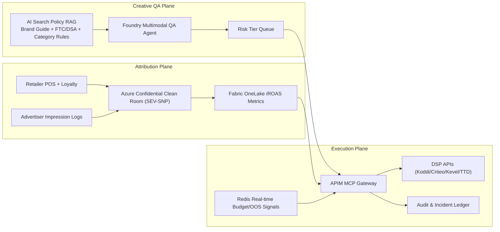
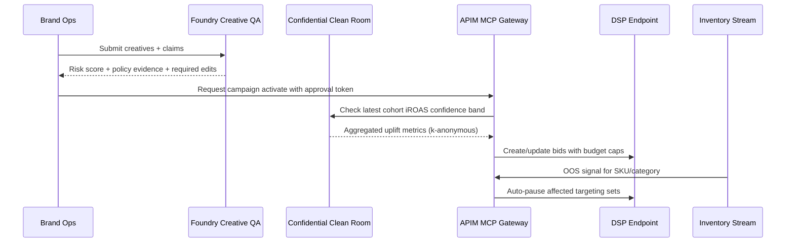

# 零售媒体网络（RMN）架构选型 FAQ：Confidential Clean Room iROAS 归因 vs Foundry 创意合规质检 vs APIM+DSP MCP 预算执行

> 🌐 **语言切换**：**中文（当前）** · [English](retail-media-network-adtech-clean-room-roas-fabric-vs-foundry-creative-qa-vs-dsp-mcp-selection-faq.en.md)

> 读者对象：Cloud & AI Solution Architect、零售媒体商业化负责人、广告技术平台主管、法务与隐私合规团队。  
> 适用范围：年广告收入 `5 亿–50 亿 USD` 的大型零售商、连锁商超、到家平台、品牌广告主协同网络。  
> 核心问题：如何在不暴露原始用户/竞品交易明细的前提下实现闭环归因、创意审核、实时投放调控。  
> 目标输出：在 `Option A / B / C` 三类架构中明确分层职责、TCO、风险边界和落地路线。  

## 1. 为什么 RMN 架构不是电商结账系统或并购 Day-1 身份整合的重复题

本题与 `#32` 电商结账不同。  
结账系统关注订单成功率与支付一致性。  
RMN 关注的是广告预算效率与归因可信度。  

本题与 `#63` 并购身份整合不同。  
并购身份整合关注目录、访问、租户互信。  
RMN 关注的是多方数据协同下的隐私计算与投放治理。  

RMN 的三个高风险现实：  

- 归因数据跨公司边界。  
- 创意内容跨法律边界。  
- 出价执行跨预算边界。  

任何一个边界失守，  
都会导致高额财务与监管风险。  

因此架构必须把“可解释归因、可审计审核、可控执行”拆成不同平面。  

## 2. 业务边界：哪些可以自动，哪些必须强制人工复核

可自动化的通常是：  

- 创意元数据抽取。  
- 关键词映射与类目建议。  
- 低风险素材初筛。  
- 预算消耗节奏建议。  

必须强制人工复核的通常是：  

- 酒类、医药、母婴等受监管类目。  
- 涉及竞品贬损或比较宣传的素材。  
- 触发高预算提升或跨媒体再分配请求。  
- 低样本分群导致可能重识别风险的归因查询。  

建议采用三层动作级别：  

1. **Assist**：仅建议，不改状态。  
2. **Propose**：可生成草案，需审批。  
3. **Execute**：可执行，但必须满足政策令牌与阈值。  

## 3. 三种主路径：A 归因可信主轴 / B 创意审核主轴 / C 执行控制主轴

**Option A**：`Azure Confidential Clean Rooms + Microsoft Fabric`。  
定位：隐私保护闭环归因与增量分析（iROAS）。  

**Option B**：`Azure AI Foundry + AI Search + Content Safety`。  
定位：创意多模态质检、政策比对、风险分级。  

**Option C**：`APIM + Azure Managed Redis + DSP MCP`。  
定位：预算上限、OOS 自动暂停、实时出价节流。  

常见误区：  
把三者中的任意一个当成“全能平台”。  
实际生产中，  
A/B/C 需要分层组合。  

## 4. Option A 深入：Confidential Clean Room + Fabric 的隐私归因主平面

### 4.1 适用条件

- 需要零售方 POS 与品牌方曝光日志联合分析。  
- 需要证明“未泄露原始家庭级明细”。  
- 需要跨平台统一 iROAS 指标口径。  

### 4.2 典型技术组合

- `DCasv5 / ECasv5` 承载 SEV-SNP 机密计算。  
- Clean Room 执行联合查询。  
- Fabric OneLake 承载聚合结果。  
- 差分隐私引擎注入 `epsilon` 噪声。  

### 4.3 关键治理条件

- `k-anonymity >= 50` 作为最小可发布分群。  
- 查询模板白名单与字段级禁用。  
- 输出仅允许聚合指标。  
- 原始 household 级明细不出房间。  

### 4.4 优势

- 隐私与商业价值可兼得。  
- 对广告主更具信任背书。  
- 便于形成标准化归因商品。  

### 4.5 局限

- 对数据工程与治理成熟度要求高。  
- 低样本类目可用性下降。  
- 查询成本与延迟高于普通数仓。  

## 5. Option B 深入：Foundry 多模态创意 QA 与法规校验

### 5.1 适用条件

- 每周素材审核量在 `10,000+`。  
- 创意来自多代理商/多品牌团队。  
- 需要跨地区法规与品牌手册统一检查。  

### 5.2 核心能力

- 图像/视频/文案联合理解。  
- GARM 品牌安全风险分层。  
- FTC/DSA 声称合规提示。  
- 品牌词、禁词、竞品影射识别。  

### 5.3 关键控制

- 审核模型输出必须带证据片段。  
- 高风险结论必须入人工复核队列。  
- 不允许模型直接“发布上线”。  
- 所有判定理由写入审计日志。  

### 5.4 优势

- 提高审核吞吐。  
- 减少低价值人工重复劳动。  
- 更快拦截明显违规素材。  

### 5.5 局限

- 法规语义变化需要持续维护。  
- 多语种素材一致性校准复杂。  
- 对边缘案例仍需资深审核员。  

## 6. Option C 深入：APIM + Redis + DSP MCP 的预算与库存执行闸门

### 6.1 适用条件

- 需要小时级预算节奏控制。  
- 需要库存波动驱动自动暂停。  
- 需要多 DSP 出价统一防失控。  

### 6.2 核心控制点

- 插入订单（IO）日预算硬上限。  
- 品类/活动级 OOS 自动熔断。  
- 出价调整幅度上下限。  
- 幂等执行防重复扣费。  

### 6.3 优势

- 执行动作可审计。  
- 可显著降低超花风险。  
- 对多 DSP 协调效果最好。  

### 6.4 局限

- 策略维护复杂。  
- 对实时信号质量依赖高。  
- 需要 7x24 运行保障。  

## 7. 12 维选型矩阵：A / B / C

| 维度 | Option A：Clean Room + Fabric | Option B：Foundry Creative QA | Option C：APIM+DSP MCP |
|---|---|---|---|
| 闭环归因可信度 | 极高 | 中 | 中 |
| 隐私保护强度 | 极高 | 高 | 高 |
| 创意审核吞吐 | 中 | 极高 | 中 |
| 创意法规覆盖 | 中 | 很高 | 中 |
| 实时预算控制 | 中 | 中 | 极高 |
| OOS 自动暂停能力 | 低到中 | 低 | 极高 |
| 多 DSP 协同 | 低 | 中 | 很高 |
| 审计可追溯性 | 高 | 高 | 极高 |
| 实施复杂度 | 高 | 中到高 | 高 |
| 上线速度 | 中到慢 | 中 | 中 |
| 3 年 TCO | 中到高 | 中 | 中到高 |
| 推荐角色 | 归因可信中台 | 创意审核副驾 | 执行闸门引擎 |

实践建议：  
大多数 Tier-1 零售 RMN 应采用 `A+B+C`。  
其中 A 决定“数据能不能用”，  
B 决定“素材能不能上”，  
C 决定“预算能不能控”。  

## 8. 参考架构图：归因、审核、执行三平面解耦



关键思想：  
A 输出归因事实。  
B 输出审核结论。  
C 执行动作且可回溯。  

## 9. 执行时序图：创意发布与预算调控的受控闭环



控制点：  

- 无审批令牌不得激活活动。  
- 归因结果不返回原始用户级记录。  
- OOS 信号优先级高于加预算指令。  

## 10. 生产策略片段：APIM 日预算硬闸门 + OOS 熔断策略

```xml
<policies>
  <inbound>
    <base />
    <set-variable name="ioBudget"
      value="@(decimal.Parse((string)context.Request.Body.As<JObject>(preserveContent:true)?["payload"]?["io_daily_budget_usd"] ?? "0"))" />
    <set-variable name="todaySpend"
      value="@(decimal.Parse((string)context.Request.Headers.GetValueOrDefault("x-spend-today-usd","0")))" />
    <set-variable name="oosFlag"
      value="@((string)context.Request.Headers.GetValueOrDefault("x-oos-flag","false"))" />

    <choose>
      <when condition="@((decimal)context.Variables["todaySpend"] >= (decimal)context.Variables["ioBudget"])">
        <return-response>
          <set-status code="409" reason="BudgetCapReached" />
          <set-body>{"error":"daily insertion-order budget exhausted; execution blocked"}</set-body>
        </return-response>
      </when>
    </choose>

    <choose>
      <when condition="@((string)context.Variables["oosFlag"] == "true")">
        <set-variable name="forcedAction" value="@("pause")" />
      </when>
      <otherwise>
        <set-variable name="forcedAction" value="@("allow")" />
      </otherwise>
    </choose>

    <set-header name="x-exec-mode" exists-action="override">
      <value>@((string)context.Variables["forcedAction"])</value>
    </set-header>
  </inbound>
  <backend><base /></backend>
  <outbound><base /></outbound>
</policies>
```

这段策略落地了三类硬约束：  

1. 日预算到顶即阻断。  
2. OOS 信号触发强制暂停。  
3. 下游执行模式可审计。  

## 11. 治理片段：Clean Room `k-anonymity` + 差分隐私聚合 SQL

```sql
WITH cohort AS (
  SELECT
    retailer_id,
    campaign_id,
    audience_segment,
    COUNT(DISTINCT household_hash) AS hh_count,
    SUM(attributed_sales_usd) AS sales_usd,
    SUM(media_cost_usd) AS cost_usd
  FROM cleanroom_joined_events
  WHERE event_date BETWEEN @start_date AND @end_date
  GROUP BY retailer_id, campaign_id, audience_segment
),
filtered AS (
  SELECT *
  FROM cohort
  WHERE hh_count >= 50
)
SELECT
  retailer_id,
  campaign_id,
  audience_segment,
  hh_count,
  sales_usd + dp_laplace_noise(@epsilon) AS dp_sales_usd,
  cost_usd + dp_laplace_noise(@epsilon) AS dp_cost_usd,
  (sales_usd - cost_usd) / NULLIF(cost_usd, 0) AS raw_roas
FROM filtered;
```

发布规则建议：  

- `@epsilon` 按报表层级分级管理。  
- 低样本分群禁止下钻。  
- 聚合结果需带版本与参数元数据。  

## 12. 容量规划与 3 年 TCO（USD，$k）：含归因、审核、执行三平面

### 12.1 基线假设（示例）

- 年 RMN 收入：`1.8B`。  
- 每周创意审核量：`42,000`。  
- 每日活动/关键词出价更新：`6.5M` 次。  
- 活动触达门店：`2,800`。  

### 12.2 月度成本模型（USD，$k/月）

| 成本项 | Option A 主导 | Option B 主导 | Option C 主导 |
|---|---:|---:|---:|
| 机密计算与数据联合分析 | 96 | 41 | 34 |
| Fabric 数据与指标管道 | 72 | 38 | 32 |
| Foundry 多模态审核推理 | 24 | 102 | 45 |
| AI Search 合规模板检索 | 11 | 29 | 14 |
| APIM 网关与策略执行 | 17 | 21 | 56 |
| Redis 实时信号与熔断 | 8 | 10 | 23 |
| 运维与合规人力折算 | 39 | 42 | 58 |
| **合计** | **267** | **283** | **262** |

### 12.3 三年 TCO（USD，$k）

- Option A：`9,612`。  
- Option B：`10,188`。  
- Option C：`9,432`。  

### 12.4 综合价值解释

只看基础设施账单，  
C 看起来更省。  

但若把违规下线、品牌索赔、超花损失算入，  
`A+B+C` 组合通常更优。  

在成熟 RMN 中，  
创意误投和预算失控的机会成本，  
往往高于模型调用成本。  

## 13. 场景一：2,800 门店商超 RMN 的自助 CPG 广告平台

### 13.1 业务目标

- 支持品牌方自助投放。  
- 门店缺货时分钟级暂停。  
- 控制日预算不超限。  

### 13.2 架构落点

- A：Clean Room 联合归因，周级回看 iROAS。  
- B：创意上线前自动审查。  
- C：执行网关接入 OOS 熔断。  

### 13.3 指标变化（示例）

- 超花事件：`-71%`。  
- OOS 仍投比例：`9.8% -> 1.4%`。  
- 创意人工初审时间：`18 min -> 4.5 min`。  
- iROAS 月度复盘时长：`5 天 -> 1.8 天`。  

## 14. 场景二：全球 CPG 广告主跨零售商增量归因与预算重分配

### 14.1 业务目标

- 在多个零售渠道间比较真实增量。  
- 避免共享竞品敏感明细。  
- 按周自动给出预算重分配建议。  

### 14.2 架构落点

- A：多方数据在机密房间做聚合。  
- B：创意按区域法规差异分层审查。  
- C：DSP 侧按建议执行但受预算硬闸门限制。  

### 14.3 指标变化（示例）

- 预算重分配响应周期：`14 天 -> 3 天`。  
- 无效曝光占比：`-22%`。  
- 法规违规下线次数：季度 `37 -> 11`。  

## 15. 深度定量 FAQ + 五步落地（Good fit vs Not for）

### 15.1 定量 FAQ

**Q1：`k-anonymity >= 50` 会不会影响小众品类可用性？**  
A1：会降低细分可见度。  
但这是合规换取可信商业化的必要代价。  
可通过时间窗拉长和相近分群合并缓解。  

**Q2：创意 QA 的 `<30s` SLA 现实吗？**  
A2：在批处理并行 + 风险分层路径下可实现。  
高风险素材可进入异步二审，不强求同 SLA。  

**Q3：为什么预算控制要放网关而不是 DSP 侧脚本？**  
A3：网关层可统一多 DSP 控制逻辑，  
并提供跨渠道一致审计证据。  

**Q4：差分隐私 `epsilon` 应如何设定？**  
A4：建议按报表粒度分级。  
高敏感维度使用更小 epsilon。  
并结合业务可用性做季度校准。  

**Q5：OOS 熔断会不会损失潜在转化？**  
A5：短期可能损失少量曝光。  
但可显著减少“缺货仍投”带来的品牌负反馈。  

**Q6：三平面中先做哪个 ROI 更快？**  
A6：通常先做 C（预算/库存失控止血），  
再做 B（审核提效），  
最后做 A（归因可信升级）。  

### 15.2 五步落地

1. **先立红线**：定义隐私、创意、预算三类不可突破规则。  
2. **先做执行兜底**：上线 C，先把超花和 OOS 投放降下来。  
3. **再做创意提效**：上线 B，提升审核吞吐。  
4. **再建归因可信**：上线 A，统一 iROAS 口径。  
5. **持续治理**：按月校准阈值、按季复核法规、半年重估 TCO。  

### 15.3 Good fit

- 具备中大型 RMN 运营规模。  
- 有明确法务与隐私治理职责。  
- 需要跨渠道统一预算治理。  

### 15.4 Not for

- 仅有小规模试点且无稳定广告供给。  
- 不愿建立审计与策略中台。  
- 期望“全自动放量”且不接受人工复核。  

---

**结论**：  
RMN 生产架构不是单点工具比拼。  
应以 `A（隐私归因）+ B（创意审核）+ C（执行闸门）` 分层协同，  
在保护数据边界的同时提升 iROAS 与预算利用效率。  
