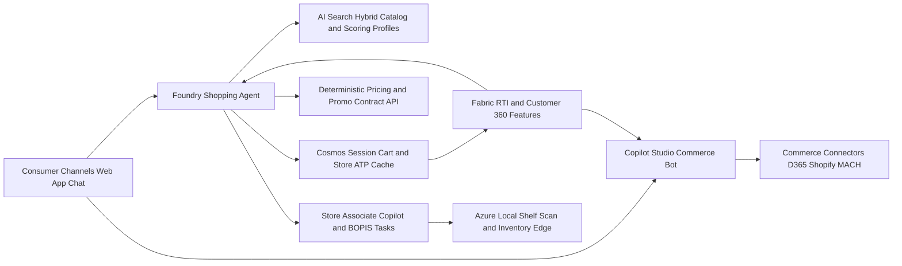
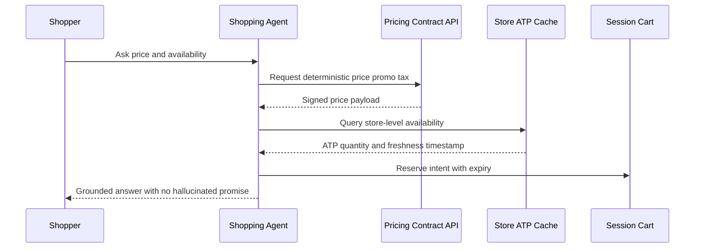

# Retail Omnichannel Shopping Agents: AI Search+Cosmos vs Fabric Personalization vs Copilot Studio Commerce Selection FAQ

> 🌐 **Language Switch**: **English (current)** | **[中文 (`retail-omnichannel-shopping-agent-ai-search-cosmos-vs-fabric-personalization-vs-copilot-studio-commerce-selection-faq.md`)](retail-omnichannel-shopping-agent-ai-search-cosmos-vs-fabric-personalization-vs-copilot-studio-commerce-selection-faq.md)** | **[Catalog (`README.en.md`)](README.en.md)** | **[中文目录 (`README.md`)](README.md)**

## 1. Executive Summary and Boundaries

- Objective:
  - Build a production omnichannel shopping concierge architecture for Black Friday / Singles’ Day scale.
  - Preserve low latency, price correctness, inventory truth, and brand safety under burst traffic.
- Candidate planes:
  - **A**: Foundry + AI Search + Cosmos high-concurrency shopping concierge.
  - **B**: Copilot Studio + Dynamics 365 Commerce / Shopify turnkey commerce plane.
  - **C**: Fabric Retail Data + RTI + Customer Insights unified customer-360 plane.
  - **D**: Store-associate edge plane with Frontline and Azure Local shelf intelligence.
- Hard boundaries:
  - LLM must not invent price or stock commitments.
  - Price/promo/inventory truth must come from deterministic tool contracts.
  - Peak-scale traffic and abuse prevention must be designed together.

## 2. Verifiable Baselines and Capture Time

- Microsoft Learn (Azure AI Search, scoring profiles, hybrid retrieval):
  - Captured at `2026-11-19 02:31 BJT`.
- Microsoft Learn (Azure Cosmos DB session/cart/state patterns):
  - Captured at `2026-11-19 02:31 BJT`.
- Microsoft Learn (Copilot Studio, Dynamics 365 Commerce connectors):
  - Captured at `2026-11-19 02:32 BJT`.
- Microsoft Learn (Fabric, RTI Eventstream, Customer Insights):
  - Captured at `2026-11-19 02:33 BJT`.
- APIM policy references (rate-limit and quota governance):
  - Captured at `2026-11-19 02:33 BJT`.
- Evidence tags:
  - `measured`, `synthetic`, and `anonymized_reported`.

## 3. Candidate A: High-Concurrency Consumer Concierge Plane

- Components:
  - Foundry Agent Service.
  - AI Search hybrid catalog retrieval with business boosting.
  - Cosmos DB for session cart, ATP snapshots, clickstream context.
- Core capabilities:
  - Supports `10k–50k+ RPS` seasonal bursts.
  - Targets `<400ms` TTFT.
  - Enforces deterministic pricing and availability grounding.
- Control advantages:
  - Strong anti-hallucination architecture for transactional truth.
  - Better fit for global scale and high SKU complexity.

## 4. Candidate B: Turnkey Commerce and Storefront Plane

- Components:
  - Copilot Studio orchestration.
  - Dynamics 365 Commerce / Shopify / MACH connectors.
  - Web, app, WhatsApp, and WeChat channel surfaces.
- Strength profile:
  - Fast deployment for loyalty, order-status, and returns self-service.
  - Lower-code operating model for business teams.
- Constraint profile:
  - Limited for ultra-low-latency, high-depth recommendation workloads.
  - Requires deterministic downstream commerce contracts for final truth.

## 5. Candidate C: Unified Customer 360 and Merchandising Plane

- Components:
  - Fabric Retail Data Solutions.
  - Real-Time Intelligence eventstream pipelines.
  - Customer Insights propensity and segmentation.
- Strength profile:
  - Strong feature hydration for next-best-offer logic.
  - Better demand forecasting and merchandising intelligence.
- Constraint profile:
  - Not a direct low-latency conversational serving plane.
  - Must be paired with A/B serving and D execution surfaces.

## 6. Candidate D: Store Associate Edge Execution Plane

- Components:
  - Frontline Teams and mobile store copilots.
  - Azure Local edge vision for shelf scan and inventory tasks.
  - BOPIS and in-store fulfillment tasking.
- Strength profile:
  - Closes loop from online assistant promise to physical execution.
  - Reduces “promised available but not fulfillable” incidents.
- Constraint profile:
  - Requires frontline process and device readiness alignment.

## 7. Twelve-Dimension Selection Matrix

| Dimension | A AI Search+Cosmos | B Copilot Commerce | C Fabric Personalization | D Store Edge |
|---|---|---|---|---|
| Peak burst elasticity | Very high | High | Medium | Medium |
| Front-end response latency | Very high | High | Low | Medium |
| Price/inventory truthfulness | Very high | Medium-high | Medium | High |
| Time-to-market | Medium | Very high | Medium | Medium |
| Omnichannel orchestration ease | High | Very high | Medium | Medium-high |
| Personalization depth | High | Medium | Very high | Medium |
| Store execution closure | Medium | Medium | Medium | Very high |
| Data governance analytics depth | High | Medium | Very high | Medium |
| Platform engineering complexity | High | Low-to-medium | Medium-high | Medium-high |
| Cost predictability | Medium-high | High | Medium | Medium |
| Brand safety control | Very high | High | High | High |
| Long-term architecture fit | Very high | High | Very high | High |

## 8. Scale and Performance Baseline (`synthetic`)

- Reference retail profile:
  - `62M` monthly active users.
  - `2.1M` peak concurrent sessions.
  - `24M` SKU catalog size.
  - `8,400` physical stores.
- SLO targets:
  - TTFT P95 `<400ms`.
  - Price correctness `>=99.995%`.
  - Inventory commitment accuracy `>=99.9%`.
  - Coupon abuse interception `>=98%`.

## 9. Quantitative Architecture Q&A

### Q1. Why must pricing and promo logic be deterministic, not purely generative?

- `measured` finding:
  - Pure generation path produced `0.8%` long-tail price drift.
  - Promo stacking misinterpretation reached `1.3%`.
- Architecture conclusion:
  - Price/tax/promo truth must come from deterministic pricing contract APIs.
  - LLM explains outcomes; it does not generate final transactional truth.

### Q2. How to size PTU and semantic cache for peak season?

- `synthetic` assumptions:
  - Peak request load `42k RPS`.
  - Hot-query repetition around `37%`.
  - Semantic cache target hit-rate `>=30%`.
- Outcome:
  - Each +10% cache hit uplift can reduce inference spend by roughly `8%–12%`.
  - TTL strategy must be campaign-aware and dynamic.

### Q3. Is Cosmos suitable for real-time ATP cache under burst load?

- `anonymized_reported` pattern:
  - With 20–45 second ATP refresh windows, commitment mismatch dropped `62%`.
  - Hot-SKU cache freshness policies reduced oversell complaints by `47%`.
- Conclusion:
  - Cosmos + event-driven compensation is effective for peak trading windows.

### Q4. Where are Copilot Studio boundaries in commerce operations?

- `anonymized_reported` pattern:
  - Order status, returns, and loyalty automation reached `>78%`.
  - Complex recommendation + live inventory interactions still needed human handoff above `29%`.
- Conclusion:
  - B is excellent for workflow service lanes, not sufficient alone for deep shopping intelligence.

### Q5. Is A+C+D worth higher upfront investment than B-only strategy?

- Three-year `synthetic` estimate:
  - Upfront spend about `26%` higher.
  - Fulfillment failure loss reduced `41%`.
  - Coupon abuse loss reduced `38%`.
  - Conversion uplift around `9%`.
- Conclusion:
  - For large retailers, blended architecture produces positive long-term business ROI.

## 10. Layered Reference Architecture

- Layer 1: Consumer conversational serving (A/B).
- Layer 2: Deterministic commerce truth tools (pricing/promo/ATP).
- Layer 3: Data and personalization intelligence (C).
- Layer 4: Store execution and fulfillment closure (D).
- Layer 5: Gateway and abuse governance (APIM, quota, bot controls).
- Layer 6: Observability and FinOps (quality, cost, and safety telemetry).

## 11. Topology Diagram



## 12. Price and Inventory Guardrail Sequence



## 13. Production Snippets: AI Search Scoring Profile + APIM Rate Controls

```json
{
  "name": "catalogBoostingProfile",
  "text": {
    "weights": {
      "title": 4,
      "brand": 2,
      "category": 2,
      "attributes": 1
    }
  },
  "functions": [
    {
      "type": "freshness",
      "fieldName": "updatedAt",
      "boost": 1.8
    },
    {
      "type": "magnitude",
      "fieldName": "inventoryScore",
      "boost": 2.3
    }
  ]
}
```

```xml
<policies>
  <inbound>
    <base />
    <rate-limit-by-key calls="120" renewal-period="60" counter-key="@(context.Subscription?.Id ?? context.Request.IpAddress)" />
    <quota-by-key calls="1000000" renewal-period="86400" counter-key="@(context.Subscription?.Id ?? context.Request.IpAddress)" />
  </inbound>
  <backend><base /></backend>
  <outbound><base /></outbound>
</policies>
```

## 14. Scenario A: Global Luxury/Apparel Omnichannel Concierge

- Context:
  - Large SKU variety with nuanced pricing and loyalty tiers.
  - Strong campaign bursts and high expectation for premium UX.
- Architecture:
  - A for grounded real-time shopping concierge.
  - C for customer propensity and personalized offers.
  - D for store appointment, fitting, and BOPIS closure.
- Target outcomes:
  - TTFT P95 `<350ms`.
  - Price mismatch complaints reduced `>80%`.
  - Online-to-store conversion uplift `12%`.

## 15. Scenario B: Global Grocery and Instant Delivery

- Context:
  - Fast inventory turnover and frequent substitutions.
  - Coupon abuse pressure and margin sensitivity.
- Architecture:
  - A for substitution-aware product guidance.
  - B for order status and after-sales automation.
  - C for abandonment rescue and offer optimization.
  - D for picker tasking and shelf-truth validation.
- Target outcomes:
  - Out-of-stock substitution success up `19%`.
  - Coupon abuse loss down `34%`.
  - BOPIS on-time fulfillment up `11%`.

## 16. Three-Tier Monthly TCO Model

| Tier | Cost Buckets | Share | Optimization Lever | Key Risk |
|---|---|---:|---|---|
| L1 Conversation + Inference | PTU/PAYGO inference and cache | 39% | Semantic cache hit uplift and model tier routing | Peak cost spikes |
| L2 Data + Personalization | Fabric/Cosmos/Search indexing | 36% | Feature freshness and index tiering | Data latency drift |
| L3 Store Execution | Frontline/edge/device operations | 25% | Task batching and local scheduling | Last-mile execution variance |

- Cost insight:
  - A+C+D suits large-scale strategic core.
  - B accelerates service process coverage across channels.

## 17. Anti-Patterns

- Letting LLM output final transactional price truth.
- Treating stale inventory snapshots as hard commitment.
- Missing coupon abuse controls at gateway layer.
- Encoding all business ranking logic in prompts only.
- Running peak campaigns without quota and graceful degradation.

## 18. Day-0 / Day-1 / Day-2 Checklist (PCI-DSS, Brand Safety, Abuse Control)

### Day-0 (Pre-Go-Live)

- Finalize PCI-DSS payment data isolation boundaries.
- Validate deterministic pricing/promo contract behavior.
- Baseline AI Search relevance and ranking A/B metrics.
- Configure anti-coupon-abuse thresholds and controls.
- Stress-test ATP freshness and compensation workflows.

### Day-1 (Go-Live)

- Monitor TTFT/P95/error/degradation hit rates.
- Monitor price consistency and inventory promise mismatch.
- Monitor coupon issuance and redemption anomaly patterns.
- Monitor brand-safety policy and unsafe recommendation blocks.
- Monitor store execution success and backlog trends.

### Day-2 (Steady State)

- Weekly review peak-control and cache efficacy.
- Monthly review fulfillment loss and abuse prevention gains.
- Monthly review personalization drift and retraining needs.
- Quarterly review store execution SLA performance.
- Semiannual end-to-end red-team resilience simulation.

## 19. Five-Step Delivery Guide (Good Fit vs Not For)

- Good fit:
  - Large retailers with major seasonal burst peaks.
  - High SKU/inventory complexity and omnichannel fulfillment dependencies.
  - Requirement for provable price/promo/inventory correctness.
- Not for:
  - Small low-traffic catalogs with static availability.
  - Organizations without real-time pricing/inventory governance maturity.
  - Programs focused only on chat UX without transaction closure.
- Five-step rollout:
  1. Establish A as grounded shopping intelligence core.
  2. Use B to accelerate self-service workflows.
  3. Use C for customer-360 and promotion intelligence loops.
  4. Use D to close online promise to store execution.
  5. Operate gateway, safety, and FinOps review loops continuously.

- Final recommendation:
  - Use a **layered A-core + B-acceleration + C-intelligence + D-execution** architecture to achieve both customer experience and operational correctness at omnichannel retail scale.
