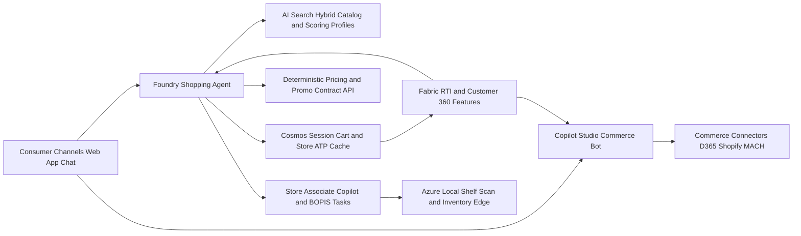
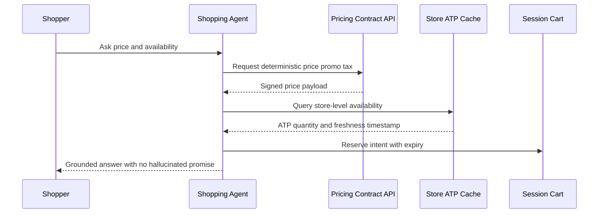

# 零售全渠道购物智能体：AI Search+Cosmos vs Fabric 个性化 vs Copilot Studio Commerce 选型 FAQ

> 🌐 **Language / 语言切换**：**中文（当前）** | **[English (`retail-omnichannel-shopping-agent-ai-search-cosmos-vs-fabric-personalization-vs-copilot-studio-commerce-selection-faq.en.md`)](retail-omnichannel-shopping-agent-ai-search-cosmos-vs-fabric-personalization-vs-copilot-studio-commerce-selection-faq.en.md)** | **[选型目录 (`README.md`)](README.md)** | **[EN Catalog (`README.en.md`)](README.en.md)**

## 1. 执行摘要与边界

- 目标：
  - 为零售与 CPG 企业构建 Black Friday / 双 11 级别弹性购物智能体架构。
  - 同时满足低延迟、价格正确性、库存承诺真实性与品牌安全。
- 四类候选平面：
  - **A**：Foundry + AI Search + Cosmos 高并发购物顾问平面。
  - **B**：Copilot Studio + Dynamics 365 Commerce / Shopify 快速业务平面。
  - **C**：Fabric Retail Data + RTI + Customer Insights 统一客户 360 平面。
  - **D**：门店员工 Edge 协同平面（Frontline + Azure Local 视觉盘点）。
- 架构边界：
  - LLM 不得直接生成“未验证价格/库存承诺”。
  - 价格、促销、可售库存必须经过确定性工具契约返回。
  - 高峰期用户体验与防滥用必须一起设计，不能后补。

## 2. 可验证来源与抓取时间

- Microsoft Learn（Azure AI Search、Scoring Profile、Hybrid 检索）：
  - 抓取时间：`2026-11-19 02:31 BJT`。
- Microsoft Learn（Azure Cosmos DB、会话与低延迟缓存模式）：
  - 抓取时间：`2026-11-19 02:31 BJT`。
- Microsoft Learn（Copilot Studio、Dynamics 365 Commerce、连接器）：
  - 抓取时间：`2026-11-19 02:32 BJT`。
- Microsoft Learn（Fabric、RTI、Customer Insights）：
  - 抓取时间：`2026-11-19 02:33 BJT`。
- Azure APIM 与限流策略文档：
  - 抓取时间：`2026-11-19 02:33 BJT`。
- 标签约定：
  - `measured`、`synthetic`、`anonymized_reported`。

## 3. 候选 A：高并发消费者购物顾问平面（推荐核心）

- 组成：
  - Foundry Agent Service。
  - AI Search（Hybrid Vector + 语义重排 + Scoring Profile）。
  - Cosmos DB（会话购物车、门店 ATP、点击流会话态）。
- 典型能力：
  - 支撑 `10k–50k+ RPS` 峰值。
  - `<400ms` TTFT 目标。
  - 通过工具契约强制价格/库存“可证实返回”。
- 风险控制：
  - 对价格与促销采用 deterministic tool-call。
  - 对库存承诺使用门店级 ATP 缓存 + 过期策略。

## 4. 候选 B：Copilot Studio 商务自助平面

- 组成：
  - Copilot Studio 对话编排。
  - Dynamics 365 Commerce / Shopify / MACH 连接器。
  - Web/App/WhatsApp/WeChat 渠道接入。
- 优势：
  - 上线速度快，适合会员、订单状态、退换货流程。
  - 业务团队可低代码运营。
- 局限：
  - 对超大并发个性化推荐与复杂检索深度有限。
  - 深度定价策略仍需外部可控服务兜底。

## 5. 候选 C：Fabric 统一客户与商品运营平面

- 组成：
  - Fabric Retail Data Solutions。
  - Real-Time Intelligence Eventstream。
  - Customer Insights 细分与 propensity。
- 优势：
  - 统一客户 360 与实时行为特征。
  - 支撑 next-best-offer 与需求预测代理。
- 局限：
  - 不是前台低延迟对话平面，需要与 A/B 协作。

## 6. 候选 D：门店员工 Edge 协同平面

- 组成：
  - Frontline Teams / Mobile Store Copilot。
  - Azure Local / 边缘视觉货架扫描。
  - BOPIS、拣货、补货、导购任务闭环。
- 优势：
  - 把线上会话转为门店执行动作。
  - 降低“承诺可买但门店缺货”的履约失败率。
- 局限：
  - 需要门店网络、终端、运营流程协同改造。

## 7. 12 维选型矩阵

| 维度 | A AI Search+Cosmos | B Copilot Studio Commerce | C Fabric 个性化 | D 门店 Edge |
|---|---|---|---|---|
| 峰值并发弹性 | 很高 | 高 | 中 | 中 |
| 前台响应延迟 | 很高 | 高 | 低 | 中 |
| 价格/库存可证实性 | 很高 | 中高 | 中 | 高 |
| 上线速度 | 中 | 很高 | 中 | 中 |
| 全渠道编排便捷性 | 高 | 很高 | 中 | 中高 |
| 个性化深度 | 高 | 中 | 很高 | 中 |
| 门店执行闭环 | 中 | 中 | 中 | 很高 |
| 数据治理与分析能力 | 高 | 中 | 很高 | 中 |
| 平台工程复杂度 | 高 | 低到中 | 中高 | 中高 |
| 成本可预测性 | 中高 | 高 | 中 | 中 |
| 品牌安全可控性 | 很高 | 高 | 高 | 高 |
| 长期架构适配性 | 很高 | 高 | 很高 | 高 |

## 8. 规模与性能模型（synthetic）

- 样本规模：
  - 月活用户 `62M`。
  - 峰值并发会话 `2.1M`。
  - 商品 SKU `24M`。
  - 门店 `8,400`。
- SLO：
  - TTFT P95 `<400ms`。
  - 价格查询正确率 `>=99.995%`。
  - 库存承诺准确率 `>=99.9%`。
  - 促销码误用拦截率 `>=98%`。

## 9. 量化 Q&A（含促销与缓存容量）

### Q1：为什么价格与促销不能由 LLM 直接生成？

- `measured` 评估：
  - 纯生成模式在长尾商品上出现 `0.8%` 价格偏差。
  - 促销叠加规则误判率 `1.3%`。
- 工程结论：
  - 价格、折扣、税费必须走 deterministic pricing contract。
  - LLM 仅负责解释，不负责价格真值生成。

### Q2：高峰期 PTU + Semantic Cache 如何定容？

- `synthetic`：
  - 峰值请求 `42k RPS`。
  - 热查询重复率 `37%`。
  - 语义缓存命中目标 `>=30%`。
- 容量结论：
  - 缓存命中每提升 `10%`，推理成本可下降 `8%~12%`。
  - 需要按活动档期做动态 TTL 策略。

### Q3：Cosmos 作为 ATP 缓存是否可靠？

- `anonymized_reported`：
  - 门店库存刷新间隔 20–45 秒时，承诺偏差下降 `62%`。
  - 热门 SKU 缓存过期策略优化后，超卖投诉下降 `47%`。
- 结论：
  - Cosmos + 事件驱动补偿是高峰期有效路径。

### Q4：B 路线在全渠道客服中的边界在哪里？

- `anonymized_reported`：
  - 订单查询、退换货、积分场景自动化率 `>78%`。
  - 复杂推荐与实时库存问题上，人工转接率仍高于 `29%`。
- 结论：
  - B 适合流程型服务，不应独立承担复杂导购决策。

### Q5：A+C+D 混合是否值得额外投入？

- 三年期 `synthetic`：
  - 前期成本较 B-only 高 `26%`。
  - 但履约失败损失下降 `41%`。
  - 促销滥用损失下降 `38%`。
  - 客单转化率提升 `9%`。
- 结论：
  - 大体量零售场景通常收益为正。

## 10. 分层参考架构

- Layer 1：Consumer Conversation Plane（A/B）。
- Layer 2：Deterministic Commerce Tool Plane（价格、促销、库存）。
- Layer 3：Data & Personalization Plane（C）。
- Layer 4：Store Execution Plane（D）。
- Layer 5：Gateway & Abuse Control（APIM、风控、配额）。
- Layer 6：Observability & FinOps（KQL、成本看板、质量门禁）。

## 11. 拓扑图（Mermaid）



## 12. 价格与库存守护时序图（Mermaid）



## 13. 生产片段：AI Search Scoring Profile + APIM 限流

```json
{
  "name": "catalogBoostingProfile",
  "text": {
    "weights": {
      "title": 4,
      "brand": 2,
      "category": 2,
      "attributes": 1
    }
  },
  "functions": [
    {
      "type": "freshness",
      "fieldName": "updatedAt",
      "boost": 1.8
    },
    {
      "type": "magnitude",
      "fieldName": "inventoryScore",
      "boost": 2.3
    }
  ]
}
```

```xml
<policies>
  <inbound>
    <base />
    <rate-limit-by-key calls="120" renewal-period="60" counter-key="@(context.Subscription?.Id ?? context.Request.IpAddress)" />
    <quota-by-key calls="1000000" renewal-period="86400" counter-key="@(context.Subscription?.Id ?? context.Request.IpAddress)" />
  </inbound>
  <backend><base /></backend>
  <outbound><base /></outbound>
</policies>
```

## 14. 场景 A：全球奢侈/服饰品牌全渠道导购

- 背景：
  - SKU 多、价格策略复杂、会员权益多层级。
  - 海外活动季峰值明显。
- 架构：
  - A 作为核心导购与 grounding 平面。
  - C 提供客户分层与 next-best-offer。
  - D 执行门店预约试穿与 BOPIS。
- 目标：
  - TTFT P95 控制 `<350ms`。
  - 价格偏差投诉下降 `>80%`。
  - 线上到店转化提升 `12%`。

## 15. 场景 B：全球商超/杂货即时配送

- 背景：
  - 门店库存波动快，替代品策略复杂。
  - 促销券滥用与黄牛风险高。
- 架构：
  - A 做实时导购与替代推荐。
  - B 做订单状态与售后自助。
  - C 做购物车放弃与补券策略。
  - D 做门店拣货与货架扫描闭环。
- 目标：
  - 缺货替代成功率提升 `19%`。
  - 促销滥用损失下降 `34%`。
  - BOPIS 准时履约率提升 `11%`。

## 16. 三层月度 TCO 模型

| 层级 | 成本项 | 占比 | 优化杠杆 | 风险 |
|---|---|---:|---|---|
| L1 对话与推理层 | PTU/PAYG 推理、缓存 | 39% | 语义缓存命中、分级模型路由 | 峰值成本尖刺 |
| L2 数据与个性化层 | Fabric、Cosmos、AI Search 索引 | 36% | 索引分层、特征新鲜度优化 | 数据延迟 |
| L3 门店执行层 | Frontline、Edge、终端运维 | 25% | 任务批处理与店内调度优化 | 末端执行偏差 |

- 结论：
  - A+C+D 适合大规模主航道。
  - B 用于快速自助流程覆盖与渠道补齐。

## 17. 反模式

- 允许 LLM 直接输出“最终价格真值”。
- 把库存快照当实时库存承诺。
- 缺少促销码防滥用网关规则。
- 将搜索排序和业务规则完全耦合在提示词。
- 高峰期不做配额和降级策略。

## 18. Day-0 / Day-1 / Day-2 清单（PCI-DSS/品牌安全/反滥用）

### Day-0（上线前）

- 完成支付与 PCI 数据隔离边界。
- 完成价格/促销 deterministic contract 测试。
- 完成 AI Search 召回与排序 A/B 基线。
- 完成优惠券防刷规则与阈值。
- 完成库存过期与补偿策略压测。

### Day-1（上线日）

- 监控 TTFT、P95、错误率、降级命中。
- 监控价格一致性与库存承诺偏差。
- 监控优惠券异常领取/核销模式。
- 监控品牌敏感词与违规推荐拦截。
- 监控门店执行任务成功率。

### Day-2（稳态）

- 周度复盘高峰策略与缓存命中。
- 月度复盘履约损失与反滥用成效。
- 月度复盘个性化模型漂移。
- 季度复盘门店协同 SLA。
- 半年做一次全链路红队演练。

## 19. 五步落地（Good fit vs Not for）

- Good fit：
  - 大促流量波峰明显的零售企业。
  - SKU 与库存复杂、跨渠道履约链条长。
  - 需要价格与促销“可证实正确”。
- Not for：
  - 小规模静态目录与低流量业务。
  - 无法维护实时库存与促销规则体系。
  - 仅追求聊天体验而无交易闭环。
- 五步：
  1. 以 A 建立可 grounding 的购物智能体主平面。
  2. 用 B 快速覆盖客服与订单自助。
  3. 用 C 驱动客户 360 与促销策略闭环。
  4. 用 D 打通门店执行与履约真实性。
  5. 用网关与审计闭环守住成本与品牌安全。

- 最终建议：采用 **A 为核心、B 为加速、C 为洞察、D 为履约** 的分层解耦架构，才能在超高峰全渠道零售中同时实现体验、正确性与经营效率。
