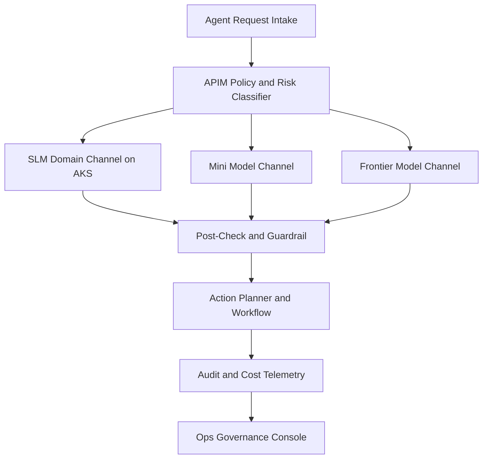
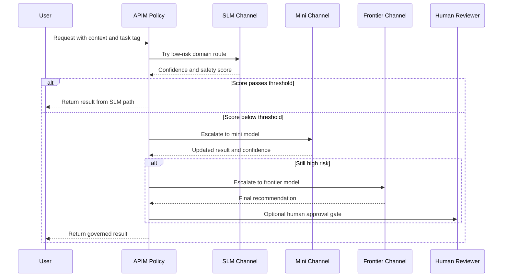

# Enterprise Risk-Tier Model Routing Selection FAQ: Frontier vs Mini vs AKS Fine-Tuned SLM vs APIM Policy Orchestration
> 🌐 **Language / 语言切换**: **[🇨🇳 中文版](risk-tier-model-routing-frontier-vs-mini-vs-finetuned-slm-aks-vs-apim-policy-selection-faq.md)** | **[🇬🇧 English](risk-tier-model-routing-frontier-vs-mini-vs-finetuned-slm-aks-vs-apim-policy-selection-faq.en.md)** | **[📚 Back to Index](README.en.md)**
> Evidence labels: `measured` / `synthetic` / `anonymized_reported`
> Retrieval date: 2026-11-22

## 1) Executive Summary: model routing is a risk-tier problem, not parameter-size worship
A common enterprise mistake
is sending every request
to the largest model tier.
At production scale,
this pattern causes
runaway spend,
latency instability,
and weak explainability
for high-risk approvals.
Production architecture
should treat model selection
as governed risk-tier routing:
low-risk high-frequency requests
go first to Mini or SLM lanes,
while high-risk complex cases
escalate to Frontier lanes.
APIM policy control
then enforces
budget limits,
latency targets,
and deterministic escalation fallback.
This guide compares four paths
to balance accuracy,
latency,
cost,
and compliance explainability
in enterprise agent workloads.

## 2) Scenario boundaries: where risk-tier routing matters most
Risk-tier routing
is best for mixed high-volume workloads:
customer support responses,
knowledge summaries,
ticket triage,
contract clause extraction,
and approval recommendations.
The challenge is not
single-query quality.
It is workload heterogeneity.
If everything goes to Frontier,
cost and queue pressure rise sharply.
If everything goes to Mini,
high-risk decisions degrade.
That is why routing needs
task risk levels,
context length,
evidence completeness,
and action impact
as first-class inputs.

## 3) Verifiable sources and evidence labels
Source 1 (`measured`): Azure API Management documentation  
https://learn.microsoft.com/azure/api-management/

Source 2 (`measured`): Azure OpenAI / Azure AI Foundry documentation  
https://learn.microsoft.com/azure/ai-foundry/

Source 3 (`measured`): Azure AI Search documentation  
https://learn.microsoft.com/azure/search/

Source 4 (`measured`): Azure Kubernetes Service documentation  
https://learn.microsoft.com/azure/aks/

Source 5 (`measured`): Azure Monitor / Application Insights documentation  
https://learn.microsoft.com/azure/azure-monitor/

Source 6 (`measured`): Azure Machine Learning documentation  
https://learn.microsoft.com/azure/machine-learning/

Source 7 (`anonymized_reported`): anonymized enterprise routing retrospectives.  
Source 8 (`synthetic`): latency, upgrade-rate, and cost-per-1,000-request models.  
Scope note:
this guide focuses on
enterprise application and service architecture
without low-level training internals.

## 4) Path A: Foundry Router-led managed risk-tier routing
This path uses
Foundry Router
as the model orchestration hub.
Request metadata
and risk labels
drive route decisions.
Its main strengths are
managed simplicity,
fast rollout,
and integrated evaluation workflows.
For enterprises needing
a quick unified entry,
it is a practical starting point.
Its boundary appears
when enterprise routing logic
exceeds managed policy capabilities.
For that reason,
teams often combine
Foundry Router
with APIM governance policies
for stricter control.

## 5) Path B: APIM policy routing with Mini and Frontier dual lanes
This path codifies
routing decisions in APIM:
low-risk requests to Mini,
high-risk requests to Frontier.
It can enforce
budget thresholds,
concurrency controls,
and failure fallback contracts.
Its value is
transparent governance
with audit-friendly policy traces.
When multiple business domains
share model traffic,
APIM policy orchestration
improves consistency.
The trade-off is
higher policy-maintenance overhead,
which requires
strong version governance
and policy-testing discipline.

## 6) Path C: AKS fine-tuned SLM domain lane
For repetitive domain workloads,
enterprises can deploy
fine-tuned SLM lanes on AKS:
ticket categorization,
field extraction,
template rewriting,
and rule-constrained recommendations.
These tasks
often do not require
Frontier-level reasoning depth,
but demand
low latency and low unit cost.
A domain SLM lane
can reduce cost-per-1,000
and improve predictable throughput.
Its boundary is
generalization range.
Out-of-domain requests
must still escalate automatically
to Mini or Frontier.

## 7) Path D: hybrid tiering (recommended)
Mature enterprises
usually converge on
a three-layer model:
SLM for high-frequency low-risk,
Mini for general medium-risk,
Frontier for high-risk complex decisions.
APIM provides
policy enforcement and budget gates.
Foundry provides
evaluation and model lifecycle governance.
With human-review gates,
the architecture becomes
explainably escalated:
why escalation happened,
when fallback executed,
and how failures were handled
are all auditable.
This pattern is the most common
long-run balance point
between quality and economics.

## 8) Mermaid: risk-tier model-routing reference topology

## 9) 12-dimension enterprise comparison matrix
| Dimension | Foundry Router | APIM dual lanes | AKS domain SLM | Hybrid tiers |
|---|---|---|---|---|
| First-release speed | High | Medium-High | Medium | Medium |
| Policy explainability | Medium-High | High | High | High |
| Latency stability | Medium-High | Medium-High | High | High |
| Cost controllability | Medium | High | High | High |
| High-risk decision quality | High | High | Medium | High |
| Domain-task efficiency | Medium | Medium-High | High | High |
| Multi-team governance consistency | Medium-High | High | Medium | High |
| Operations complexity | Low-Medium | Medium | Medium-High | High |
| Audit traceability | Medium-High | High | High | High |
| Elastic scalability | Medium-High | High | Medium-High | High |
| Rollback and fallback strength | Medium | High | Medium | High |
| Three-year evolution elasticity | Medium-High | High | High | High |

## 10) Mermaid: escalation and fallback decision flow

## 11) Quant comparison: latency, escalation quality, and cost-per-1,000 (`synthetic`)
| Metric | Foundry Router | APIM dual lanes | AKS domain SLM | Hybrid tiers |
|---|---:|---:|---:|---:|
| End-to-end P95 latency (ms) | 1,120 | 980 | 640 | 860 |
| Escalation-hit precision (`anonymized_reported`) | 0.81 | 0.87 | 0.75 | 0.90 |
| High-risk miss rate (`anonymized_reported`) | 0.09 | 0.07 | 0.12 | 0.05 |
| Low-risk over-escalation rate (`anonymized_reported`) | 0.22 | 0.18 | 0.16 | 0.14 |
| Monthly cost index (baseline=1) | 1.00 | 0.88 | 0.72 | 0.79 |
| Cost per 1,000 requests (USD, `synthetic`) | 12.1 | 10.4 | 8.3 | 9.1 |
| Frontier invocation share | 0.41 | 0.33 | 0.21 | 0.27 |
| Recommended role | Fast managed start | Governance-first mainline | Domain cost sink | Long-run production target |

Interpretation:
for fastest unified launch,
Foundry Router performs well.
For cost plus compliance
under multi-domain scale,
hybrid tiering is usually stronger.

## 12) Decision tree: 90-day rollout blueprint
Step one evaluates
decision consequence level.
High-impact tasks
must reserve Frontier paths.
Step two evaluates
request distribution.
High-frequency structured tasks
should shift to SLM first.
Step three evaluates
governance scope.
For multi-team sharing,
APIM policy centralization
is required.
Step four evaluates
cost targets.
If unit economics are strict,
increase low-risk direct routing.
Step five evaluates
organizational maturity.
Mature platform teams
can deploy hybrid tiers directly.
Constrained teams
can start dual-lane
and evolve incrementally.

## 13) Common anti-patterns
Anti-pattern one:
sending every request
to Frontier by default.
Impact:
latency and spend become unstable quickly.
Anti-pattern two:
routing by keywords only,
without consequence grading.
Outcome:
high-risk tasks leak into low-risk lanes.
Anti-pattern three:
non-auditable escalation rules.
Trade-off:
incident forensics and compliance defense become weak.
Anti-pattern four:
no fallback or rollback policy.
Risk:
single-lane instability cascades to platform outages.
Anti-pattern five:
ignoring low-risk high-frequency optimization.
Business effect:
long-term cost advantages never materialize.

## 14) Production-readiness checklist
1. Risk levels and routing thresholds are defined.  
2. Escalation, fallback, and rollback policies are documented.  
3. Frontier budget caps are enforced.  
4. APIM policy version governance is active.  
5. Model quality regression baselines are maintained.  
6. Human-review gates protect high-impact actions.  
7. Low-risk lane drift monitoring is operational.  
8. Cost-per-1,000 alerts are configured.  
9. Cross-team policy changes are auditable.  
10. Disaster fallback and read-only modes are tested.  
11. Quarterly threshold recalibration is scheduled.  
12. Business and compliance dual approvals are required.  

## 15) Practical FAQ (8 questions)
### Q1: Why not route everything to Frontier?
Because at enterprise scale
latency and cost become unsustainable.

### Q2: When is dual-lane better than three-lane?
When domain data and evaluation loops
are not mature enough for SLM specialization.

### Q3: Which tasks fit domain SLM lanes best?
High-frequency structured tasks
with clear correctness criteria.

### Q4: How do we reduce high-risk misses?
Increase risk-classifier recall
and enforce mandatory escalation
for critical action classes.

### Q5: What is APIM’s core role in this architecture?
It externalizes routing governance
from application code
into reusable, auditable policy planes.

### Q6: Which KPI set proves routing quality?
Track
escalation precision,
miss rate,
over-escalation rate,
and cost per 1,000 requests.

### Q7: What is the most common rollout failure?
Thresholds are launched
without continuous regression
and business feedback loops.

### Q8: How do you classify Good fit vs Not for?
Good fit:
high-concurrency multi-domain enterprises
with budget and compliance controls.
Not for:
low-concurrency single-scenario teams
without policy-governance needs.
