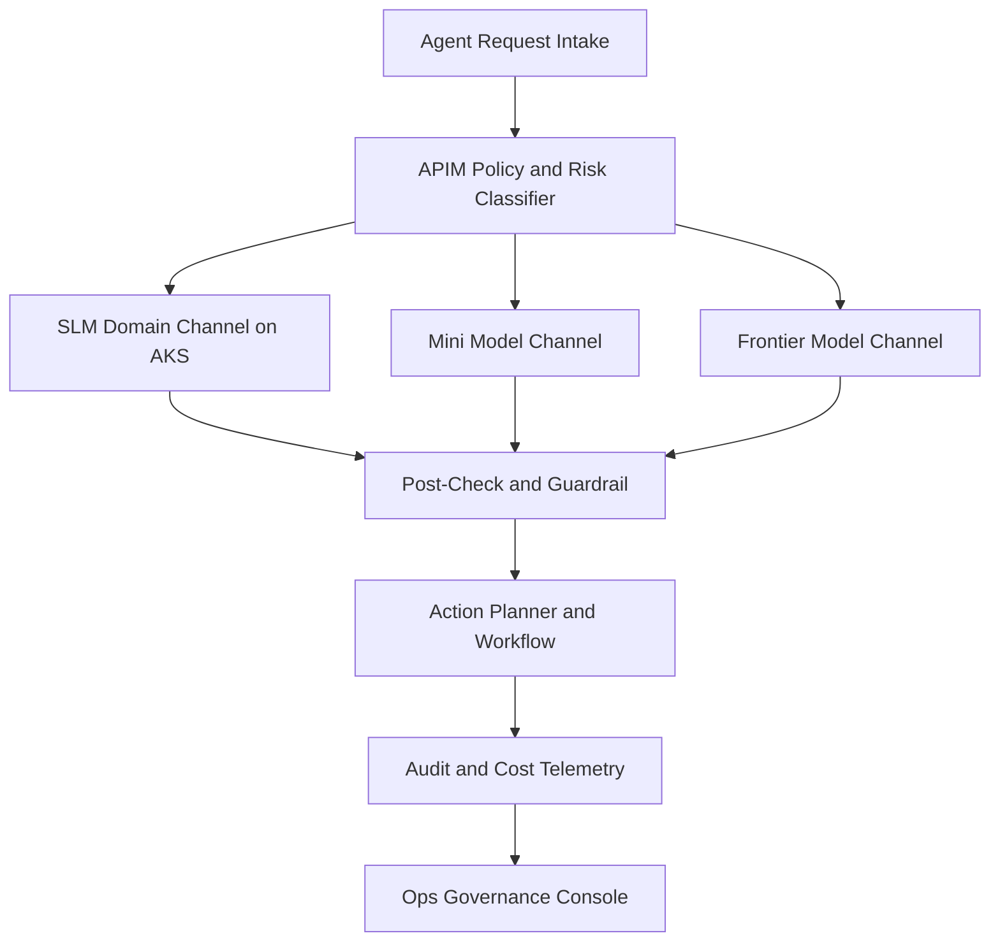
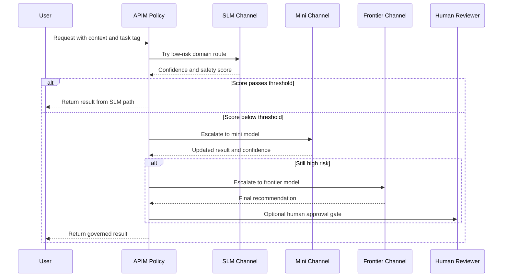

# 企业风险分层模型路由选型 FAQ：Frontier vs Mini vs AKS 微调 SLM vs APIM 策略编排
> 🌐 **Language / 语言切换**: **[🇨🇳 中文版](risk-tier-model-routing-frontier-vs-mini-vs-finetuned-slm-aks-vs-apim-policy-selection-faq.md)** | **[🇬🇧 English](risk-tier-model-routing-frontier-vs-mini-vs-finetuned-slm-aks-vs-apim-policy-selection-faq.en.md)** | **[📚 返回目录](README.md)**
> 证据标签：`measured` / `synthetic` / `anonymized_reported`
> 抓取日期：2026-11-22

## 1) 执行摘要：模型路由的本质是风险分层，而非参数规模崇拜
企业在落地智能体时，
常见误区是
把所有请求
都送往最强大模型。
这会导致
成本快速失控、
延迟抖动放大、
并且难以解释
高风险任务为何被放行。
生产级架构
应把“模型选择”
升级为“风险分层路由”：
低风险高频任务
优先走 Mini/SLM 通道，
高风险复杂任务
才升级到 Frontier 通道。
并通过 APIM 策略平面
统一执行预算、
延迟目标、
与升级回退规则。
本指南比较四条路径，
帮助企业在准确率、
时延、
成本、
与合规解释性之间
取得可复制平衡。

## 2) 场景边界：风险分层路由适用哪些任务
风险分层路由
适用于高并发混合任务池：
客服问答、
知识检索摘要、
工单分类与优先级判断、
合同条款提取、
以及审批建议生成。
这类任务
难点不在单次模型质量，
而在任务分布差异大。
若一刀切采用 Frontier，
会带来高成本与高队列。
若一刀切采用 Mini，
高风险场景会失真。
因此需要
按任务风险等级、
上下文长度、
证据完整性、
与行动后果
做动态路由决策。

## 3) 可验证来源与证据标签
来源 1（`measured`）：Azure API Management 文档  
https://learn.microsoft.com/azure/api-management/

来源 2（`measured`）：Azure OpenAI / Azure AI Foundry 文档  
https://learn.microsoft.com/azure/ai-foundry/

来源 3（`measured`）：Azure AI Search 文档  
https://learn.microsoft.com/azure/search/

来源 4（`measured`）：Azure Kubernetes Service 文档  
https://learn.microsoft.com/azure/aks/

来源 5（`measured`）：Azure Monitor / App Insights 文档  
https://learn.microsoft.com/azure/azure-monitor/

来源 6（`measured`）：Azure Machine Learning 文档  
https://learn.microsoft.com/azure/machine-learning/

来源 7（`anonymized_reported`）：匿名化企业模型路由改造复盘。  
来源 8（`synthetic`）：延迟、命中率、每千请求成本与升级率模型。  
说明：
本文聚焦企业应用与服务架构，
不展开底层训练细节。

## 4) 路径 A：Foundry Router 主导的托管风险分层
该路径以 Foundry Router
作为模型编排中枢，
结合任务标签
与策略元数据
完成路由决策。
其优势是
托管化程度高，
落地速度快，
并可结合平台评测闭环。
对于希望快速统一
多模型入口的企业，
这是低门槛起点。
边界在于
复杂企业策略
若超出托管能力，
仍需要外部网关协同。
因此通常建议
将 Foundry Router
与 APIM 策略平面配合使用。

## 5) 路径 B：APIM 策略路由 + Mini/Frontier 双通道
该路径将模型路由规则
固化在 APIM：
先根据请求标签
判定风险等级，
低风险直达 Mini，
高风险升级 Frontier。
同时启用
预算阈值、
并发保护、
和故障降级策略。
这种方式的价值是
策略透明可审计，
并可跨团队共享。
在多业务线
共用模型通道时，
APIM 路径
有明显治理优势。
其挑战是
策略维护工作量上升，
需建立清晰版本治理。

## 6) 路径 C：AKS 微调 SLM 专域通道
当企业存在
高频且结构化任务，
可在 AKS 上部署
微调 SLM 专域通道：
例如票据分类、
字段抽取、
模板化改写、
或规则驱动建议。
这类任务
通常不需要 Frontier 推理深度，
但要求稳定低时延与低成本。
SLM 通道可显著降低
每千请求成本，
并提高可预测吞吐。
其边界是
泛化能力有限，
超出边界任务
仍需自动升级到 Frontier。

## 7) 路径 D：混合分层（推荐）
成熟企业通常采用
三层混合：
SLM 专域通道承接高频低风险，
Mini 通道承接通用中风险，
Frontier 通道承接高风险复杂任务。
APIM 负责策略决策与预算守门，
Foundry 负责评测与模型治理。
再叠加人工复核闸门，
可形成“可解释升级”体系：
为什么升级、
何时降级、
失败如何回退
都可审计追踪。
这也是在成本与质量之间
最常见的企业平衡解。

## 8) Mermaid：风险分层模型路由参考拓扑

## 9) 12 维企业选型对比矩阵
| 维度 | Foundry Router | APIM 双通道 | AKS SLM 专域 | 混合分层 |
|---|---|---|---|---|
| 首版交付速度 | 高 | 中高 | 中 | 中 |
| 策略可解释性 | 中高 | 高 | 高 | 高 |
| 延迟稳定性 | 中高 | 中高 | 高 | 高 |
| 成本可控性 | 中 | 高 | 高 | 高 |
| 高风险任务质量 | 高 | 高 | 中 | 高 |
| 专域任务效率 | 中 | 中高 | 高 | 高 |
| 多团队治理一致性 | 中高 | 高 | 中 | 高 |
| 运维复杂度 | 低中 | 中 | 中高 | 高 |
| 审计可追溯性 | 中高 | 高 | 高 | 高 |
| 扩展弹性 | 中高 | 高 | 中高 | 高 |
| 回退与降级能力 | 中 | 高 | 中 | 高 |
| 三年演进弹性 | 中高 | 高 | 高 | 高 |

## 10) Mermaid：风险升级与回退决策流

## 11) 量化对比：时延、升级率与每千请求成本（`synthetic`）
| 指标 | Foundry Router | APIM 双通道 | AKS SLM 专域 | 混合分层 |
|---|---:|---:|---:|---:|
| P95 端到端时延（ms） | 1,120 | 980 | 640 | 860 |
| 升级命中准确率（`anonymized_reported`） | 0.81 | 0.87 | 0.75 | 0.90 |
| 高风险漏检率（`anonymized_reported`） | 0.09 | 0.07 | 0.12 | 0.05 |
| 低风险误升级率（`anonymized_reported`） | 0.22 | 0.18 | 0.16 | 0.14 |
| 月度成本指数（基线=1） | 1.00 | 0.88 | 0.72 | 0.79 |
| 每千请求成本（美元，`synthetic`） | 12.1 | 10.4 | 8.3 | 9.1 |
| Frontier 调用占比 | 0.41 | 0.33 | 0.21 | 0.27 |
| 推荐定位 | 快速托管起步 | 策略治理主线 | 专域高频降本 | 长期生产目标 |

解读：
若目标是
最短时间上线统一路由，
Foundry Router 具备优势。
若目标是
成本与合规并重，
混合分层表现更稳健。

## 12) 决策树：90 天分层路由落地路径
第一步看任务后果等级。
高后果任务
必须预留 Frontier 通道。
第二步看请求分布。
高频结构化任务
应优先导入 SLM 通道。
第三步看治理要求。
多团队共享时
应由 APIM 统一策略。
第四步看成本目标。
若单位成本压力高，
需提高低风险直达比例。
第五步看组织能力。
平台能力成熟时，
可直接部署混合分层；
能力有限时，
先双通道再逐步演进。
第六步看评测闭环。
若缺少持续评测，
阈值会快速漂移。
应建立
周级别回归与抽检机制。
第七步看变更节奏。
若模型更新频繁，
应采用
灰度路由发布、
并保留快速回退闸门。

## 13) 常见反模式
反模式一：
所有请求直接打 Frontier。
影响：
成本与延迟快速失控。
反模式二：
只按关键词路由，
不看任务后果等级。
结果：
高风险任务误入低风险通道。
反模式三：
升级规则不可审计。
代价：
异常回溯困难且难以合规解释。
反模式四：
未设置降级与回退策略。
风险：
主通道波动时整体可用性骤降。
反模式五：
忽略低风险高频任务优化。
业务影响：
长期成本优势无法兑现。

## 14) 生产就绪检查清单
1. 已定义任务风险等级与路由阈值。  
2. 已定义升级、降级、回退策略。  
3. 已定义 Frontier 调用预算上限。  
4. 已建立 APIM 策略版本管理。  
5. 已建立模型输出质量回归基线。  
6. 已建立高风险任务人工复核闸门。  
7. 已建立低风险通道漂移监控。  
8. 已建立每千请求成本告警阈值。  
9. 已建立跨团队策略变更审计机制。  
10. 已建立灾备降级与只读模式。  
11. 已建立季度阈值重校与复盘流程。  
12. 已建立业务与合规双签核机制。  

## 15) 实战 FAQ（8 问）
### Q1：为什么不直接全量 Frontier？
因为企业规模化后，
成本和延迟都不可持续。

### Q2：何时优先双通道而不是三通道？
当你尚未积累
稳定专域样本与评测闭环时。

### Q3：SLM 通道最适合哪些任务？
高频、结构化、
可判定正确性的任务。

### Q4：如何防止高风险漏检？
提高风险分类召回，
并对关键任务设置强制升级规则。

### Q5：APIM 在路由中的核心价值是什么？
把策略治理从应用代码抽离，
形成可审计可复用的统一平面。

### Q6：如何衡量路由策略成效？
看四项：
升级命中准确率、
漏检率、
误升级率、
每千请求成本。

### Q7：最常见落地失败点是什么？
阈值设定缺少持续回归与业务反馈。

### Q8：Good fit vs Not for 如何划分？
Good fit：
多业务域高并发、
并且有明确预算与合规约束的企业。
Not for：
低并发单场景、
无需策略治理的小团队。
