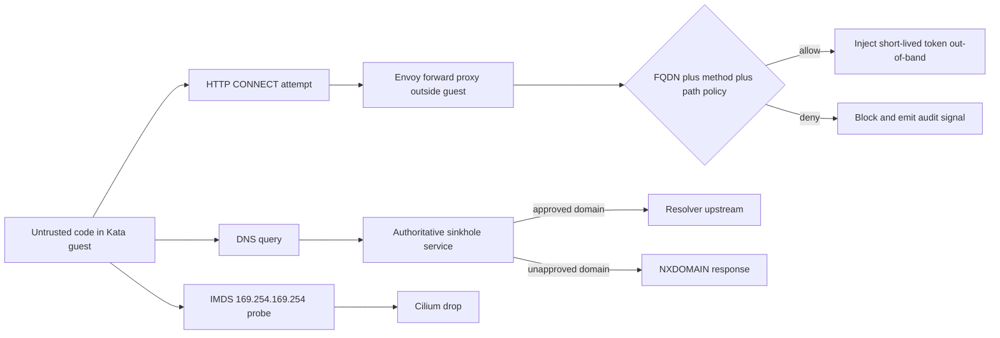
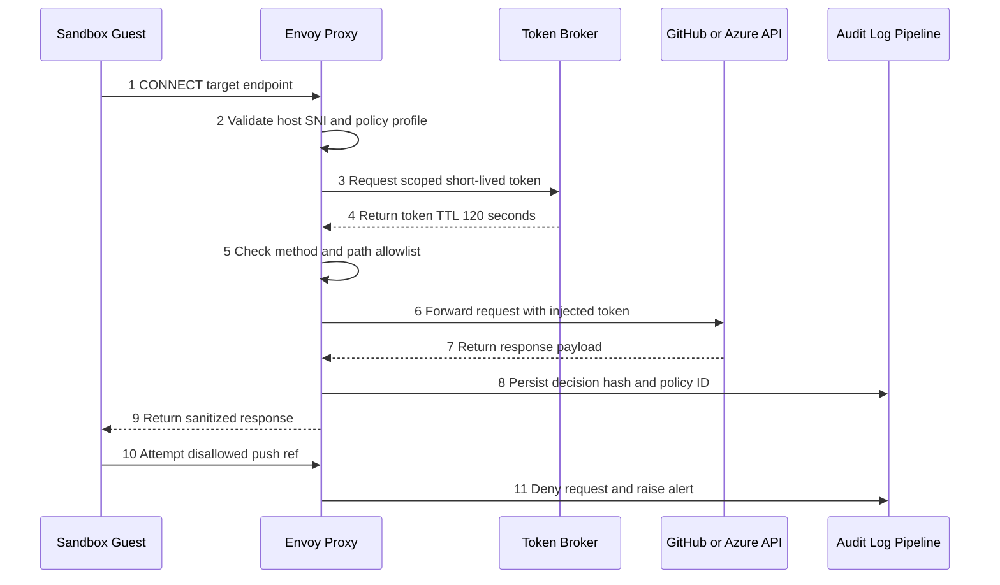
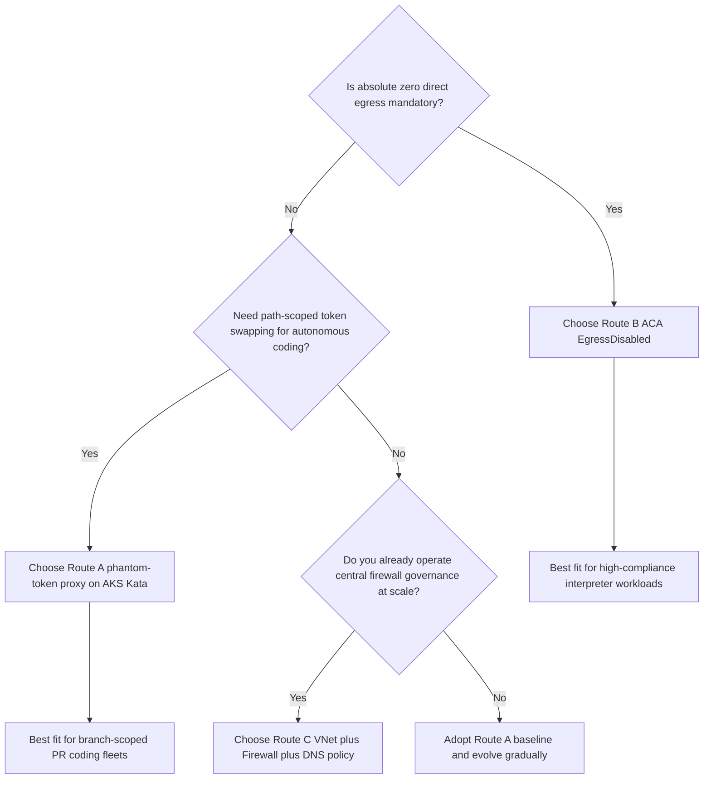

# Agent code-sandbox egress isolation selection FAQ: phantom-token Envoy on AKS Kata vs ACA zero-egress vs firewall hub governance
> **Audience**: cloud and AI solution architects, platform security teams, LLMOps leads, and regulated-industry governance owners.
> **Objective**: break the lethal trifecta of untrusted inputs, private credentials, and unrestricted outbound network access.

## 1. Executive Summary
Most code-interpreter incidents share the same root cause: a sandbox can read real secrets and can freely call the internet.
Route A removes real credentials from the guest boundary and performs out-of-band token injection in a hardened proxy tier.
Route B disables sandbox egress at the session fabric itself and uses a trusted host-orchestrator broker for all authenticated I/O.
Route C centralizes governance through enterprise network controls with TLS inspection, DNS policy, and SIEM integration.
Route D leaves plaintext `.env` secrets and IMDS access in place and therefore turns prompt injection into immediate data exfiltration.
For autonomous coding agents that still need controlled git/API access, Route A is usually the strongest default.
For strict compliance data-science sandboxes where zero direct egress is mandatory, Route B is usually the dominant choice.

## 2. Core Pain Points and Threat Model
The first element of the lethal trifecta is untrusted execution input: malicious repository files, poisoned package hooks, and generated shell commands.
The second element is secret material available inside guest memory: PATs, cloud credentials, database connection strings, or IMDS-derived tokens.
The third element is unrestricted outbound transport: HTTPS webhooks, wildcard DNS, DoH relays, package registries, or git remote endpoints.
When all three elements co-exist, a single injected turn can perform discovery, extraction, and exfiltration before defenders can respond.
In multi-tenant environments the blast radius can extend beyond one task into shared observability pipelines, caches, and artifact stores.
The architecture goal therefore is not merely domain blocking; it is hard separation of credential ownership from untrusted execution.

## 3. Route A Deep Dive: Out-of-Band Phantom-Token Envoy Proxy on AKS Kata
Route A keeps real credentials outside the guest VM and exposes only placeholder context values in the sandbox process space.
Cilium network policy drops all traffic to `169.254.169.254` and blocks raw TCP/UDP 53 except approved resolver paths.
A sinkhole DNS service returns deterministic `NXDOMAIN` for unapproved domains, suppressing high-entropy subdomain tunneling channels.
All outbound HTTP CONNECT traffic must traverse an Envoy forward proxy running outside the guest trust boundary.
The proxy evaluates exact FQDN, SNI, method, and path allowlists before any upstream connection is established.
Typical policies allow `GET` for curated package mirrors and constrained git smart-HTTP operations for `refs/heads/agent/*` only.
If policy passes, the proxy requests a short-lived Entra or GitHub App token and injects it on the wire out-of-band.
Because real tokens never reside in guest memory, credential theft scripts cannot replay reusable bearer material.

## 4. Route B Deep Dive: ACA Dynamic Sessions with `networkStatus: EgressDisabled`
Route B enforces a hard no-egress posture at the Hyper-V session layer and removes direct internet and VNet paths from the sandbox.
Base images are pre-hydrated with approved Python wheels and Node artifacts to reduce runtime dependency-fetch pressure.
When external systems must be accessed, a trusted host orchestrator performs the call and returns only least-privilege results.
This creates clear accountability boundaries: sandbox code never sees credentials, and orchestrator calls are fully auditable.
The trade-off is lower ad-hoc flexibility for arbitrary internet exploration and dynamic package retrieval at runtime.
For finance, healthcare, and sensitive analytics workloads, Route B is often the shortest path to policy acceptance.

## 5. Route C Deep Dive: VNet Delegation + Azure Firewall Premium + DNS Resolver Policy
Route C uses enterprise network governance primitives to constrain outbound traffic without maintaining custom proxy fleets everywhere.
Azure Firewall Premium provides TLS inspection, application FQDN policies, threat intelligence filtering, and central telemetry export.
Azure DNS Private Resolver policies enforce domain governance and recursive-resolution boundaries across hub-and-spoke topologies.
With Private Link, internal package repositories and data services can remain private while still serving sandbox workloads.
Route C aligns well with organizations that already have mature SOC operations and standardized firewall change-control workflows.
However method/path-scoped token swapping still requires additional application-layer controls beyond pure network governance.

## 6. Route D Anti-Pattern
Route D typically appears in fast PoC environments where plaintext secrets are mounted and unrestricted NAT egress is left open.
If IMDS is reachable, prompt-injected scripts can mint managed-identity tokens and pivot into higher-privilege cloud resources.
If DNS is unrestricted, attackers can exfiltrate encoded chunks through subdomain labels with low detectability.
What looks like engineering speed becomes accumulated security debt, incident risk, and regulatory exposure.

## 7. Architecture Principles and Quantitative Formulas
Production architecture decisions should be grounded in explicit measurable constraints.
1. Covert DNS exfiltration channel capacity: `C_dns = R_qps * floor(L_qname * 5 / 8)`.
2. Proxy overhead model: `ΔT_proxy = T_connect + T_tls_reterm + T_kv_cache`.
3. Credential blast-radius window: `E_cred = P_inj * I_in_guest_secret * TTL_token`.
4. Expected compromise loss: `L_exp = P_compromise * Impact_data * Detection_delay`.
5. False-allow rate: `F_allow = FP_allow / (TP_allow + FP_allow)`.
6. Policy hit ratio: `Hit_policy = Allowed_requests / Total_requests`.

## 8. Mermaid: Out-of-Band Phantom-Token Proxy and DNS Sinkhole


## 9. Mermaid: Eleven-Step Scoped Egress and Token-Swap Sequence


## 10. Mermaid: Selection Decision Tree


## 11. Twelve-Dimension Horizontal Comparison Matrix
| Dimension | Route A | Route B | Route C | Route D |
|---|---|---|---|---|
| Real secrets ever enter guest memory | No | No | Usually no with discipline | Yes |
| DNS tunneling suppression | High | High | Medium-high | Low |
| IMDS lateral movement resistance | High | High | Medium with extra controls | Low |
| Method and path granularity | High | Medium via broker contracts | Medium | Low |
| Developer flexibility | Medium-high | Medium | High | High and unsafe |
| Platform operations complexity | Medium-high | Medium | Medium | Low apparent and high hidden |
| Centralized observability quality | High | High | High | Low |
| Reuse of existing enterprise network program | Medium | Medium | High | Medium |
| Dependence on curated base images | Medium | High | Medium | Low |
| Regulatory explainability | High | High | Medium-high | Low |
| Three-year total ownership outlook | Medium | Medium | Medium-high | Low initial and high eventual |
| Overall recommendation | Strong | Strong | Conditional strong | Prohibited |

## 12. Production Python Reference: Path-Scoped Out-of-Band Token Injection Filter
```python
from __future__ import annotations
from dataclasses import dataclass
from fnmatch import fnmatch
from typing import Iterable

@dataclass(frozen=True)
class EgressRule:
    host: str
    method: str
    path_glob: str

def request_allowed(rules: Iterable[EgressRule], host: str, method: str, path: str) -> bool:
    for rule in rules:
        if rule.host == host and rule.method == method and fnmatch(path, rule.path_glob):
            return True
    return False

def inject_bearer(headers: dict[str, str], bearer_token: str) -> dict[str, str]:
    updated = dict(headers)
    updated['Authorization'] = f'Bearer {bearer_token}'
    updated['X-Credential-Origin'] = 'phantom-proxy-out-of-band'
    return updated
```

## 13. YAML Reference: Cilium IMDS and DNS Block with Envoy Egress Pinning
```yaml
apiVersion: cilium.io/v2
kind: CiliumNetworkPolicy
metadata:
  name: agent-sandbox-egress-guard
spec:
  endpointSelector:
    matchLabels:
      app: agent-sandbox
  egressDeny:
    - toCIDRSet:
        - cidr: 169.254.169.254/32
    - toPorts:
        - ports:
            - port: "53"
              protocol: UDP
            - port: "53"
              protocol: TCP
  egress:
    - toEndpoints:
        - matchLabels:
            app: envoy-egress-proxy
      toPorts:
        - ports:
            - port: "15001"
              protocol: TCP
```

### Q1: How much can DNS tunneling really exfiltrate and why block 53 first
At `40 qps` with roughly `45` effective bytes per query, throughput can approach `1.8 KB/s`.
That sounds small until a ten-minute window leaks over one megabyte of high-value payload fragments.
Most SOC pipelines prioritize HTTP anomalies; sustained high-entropy DNS often receives lower analyst attention.
Blocking raw DNS egress from sandbox guests therefore removes a low-noise covert channel early in the chain.

### Q2: Will Route A proxy overhead break coding-agent productivity
In same-region deployment, `T_connect` is often `8-15 ms` and TLS re-termination commonly adds `6-20 ms`.
With connection reuse and token cache hits, end-to-end overhead typically remains around `20-45 ms` per call.
For second-scale package and git operations, the relative penalty is often below `5%`.
Cross-region proxies can inflate p95 latency sharply, so route the proxy close to sandbox compute zones.

### Q3: Why not issue short-lived tokens directly to the sandbox guest
A shorter TTL reduces exposure duration but does not change whether secrets can be stolen in the first place.
Prompt-injected scripts can still exfiltrate and replay credentials quickly inside the same minute.
Out-of-band injection sets `I_in_guest_secret = 0` in the blast-radius equation and removes replayable token artifacts.
That architectural property is the key security difference between Routes A or B and Route D.

### Q4: Does Route B zero-egress stop dependency upgrades and innovation speed
Route B shifts dependency updates from runtime internet access to controlled image-build pipelines.
Organizations can synchronize approved artifact mirrors daily and release signed base images on predictable cadence.
This approach can still keep CVE remediation within a 24-hour service target when pipelines are automated well.
For exploratory workloads, a broker can fetch approved artifacts under audit and return verified checksums only.

### Q5: How should teams draw boundaries between Routes C and A in real programs
Route C is excellent for centralized perimeter governance and SOC visibility in large enterprise estates.
Route A adds application-semantic controls such as branch-scoped git writes and path-level token contracts.
A common pattern is C for network boundary plus A for request-semantic enforcement at the egress chokepoint.
The critical governance rule is one policy source of truth to avoid contradictory multi-layer allow decisions.

### Q6: Which metrics prove the lethal trifecta is actually broken
Track three mandatory controls: real-secret count in guest memory, reachable egress endpoints, and IMDS reachability.
A practical release gate is `guest_real_secret_count = 0` and `imds_probe_success_rate = 0%` for all sandbox profiles.
Also require near-`100%` sinkhole success for unapproved domain requests with policy version traceability.
Any regression on these controls should automatically freeze rollout and trigger security review.

## 14. Enterprise Scenario A: Autonomous Pull-Request Coding Agent Fleet
This scenario runs repository maintenance and feature PR automation at scales around `20k` tasks per day.
Workflows require outbound git operations but must constrain writes to `refs/heads/agent/*` only.
Route A validates git smart-HTTP paths and branch patterns before injecting short-lived scoped credentials.
Even if poisoned repository hooks execute, scripts cannot recover long-lived reusable credentials from guest memory.
The architecture balance is automation speed plus bounded egress plus strong forensic evidence.

## 15. Enterprise Scenario B: Financial Data-Science Interpreter with ACA Zero-Egress
This scenario supports analysts running Python notebooks over sensitive risk and client datasets.
Regulatory controls require no direct external connectivity from sandbox sessions and full action traceability.
Route B enforces `EgressDisabled` while a trusted orchestrator performs approved data fetches out-of-band.
Analysts receive least-privilege result subsets, and credentials plus connection strings remain outside sandbox execution.
This pattern fits reporting-heavy, compliance-critical workflows where deterministic containment outweighs internet flexibility.

## 16. Three-Year TCO Model
| Route | Three-Year Platform Cost | Security and Audit Operations Cost | Overall Outcome |
|---|---:|---:|---:|
| Route A | `$3.9M-$5.4M` | Low to medium | High value for autonomous coding fleets |
| Route B | `$3.4M-$4.8M` | Low | High value for zero-egress regulated analytics |
| Route C | `$3.6M-$5.0M` | Medium | Medium-high value in centralized netsec programs |
| Route D | `$2.3M-$3.2M` | High and volatile | Prohibited due eventual total cost blow-up |
If outage recovery, incident response, and regulatory remediation are included, Route D often becomes the most expensive path.

## 17. Go-Live Acceptance Checklist
1. Verify no plaintext PAT, cloud secret, or long-lived refresh token is present in guest images or mounts.
2. Verify `169.254.169.254` is unreachable from all sandbox namespaces and runtime profiles.
3. Verify unapproved domain queries resolve to deterministic sinkhole outcomes and are logged immutably.
4. Verify sandbox egress can only reach approved proxy or broker endpoints with no NAT bypass path.
5. Verify method and path policies for git and API calls against explicit business use-cases.
6. Verify token TTL, audience, scope, revocation, and broker audit chain under failure injection.
7. Verify denied events automatically open SOC incidents with reproducible evidence links.
8. Verify staged rollback and policy canary plans to prevent broad production disruption.

## 18. Day-2 Security Operations
Review deny-event distributions weekly to separate false positives from active attack probes.
Require whitelist expiration dates and owner assignments so policy surface does not bloat silently.
Use stricter controls for high-risk repositories, including no arbitrary POST and upload-size constraints.
Run red-team exercises covering DNS tunneling, DoH fallback, IMDS probing, and supply-chain hook abuse.
If policy-hit ratios drift unexpectedly, investigate for unregistered network paths or stale enforcement agents.

## 19. Authoritative References
- IEC 62443-3-3 security controls for segmented industrial and critical infrastructure environments.
- NIST SP 800-82 Rev. 3 guidance for operational technology and ICS cybersecurity architecture.
- Azure Container Apps Dynamic Sessions documentation for `networkStatus: EgressDisabled` behavior.
- Azure Firewall Premium and Azure DNS Private Resolver architecture and policy guidance.
- Cilium NetworkPolicy and eBPF-based workload egress control documentation.
- GitHub App installation token least-privilege and short-lived credential best practices.

## 20. Final Recommendation
Choose Route A when autonomous coding agents require controlled outbound git and API access.
Choose Route B when compliance posture requires absolute zero direct sandbox egress.
Choose Route C when centralized network governance is mature and application-level controls can be layered deliberately.
Do not deploy Route D in production regulated environments under any normal exception policy.
The decisive architecture principle is simple: remove stealable credentials from untrusted execution memory.

## 21. Governance Metrics and Audit Artifact Contract
Operationalize the following metrics as release gates and quarterly governance indicators.
| Metric | Definition | Target Threshold | Escalation Action |
|---|---|---|---|
| `guest_real_secret_count` | Count of real credentials discoverable inside guest runtime | `0` | Block release and trigger cleanup incident |
| `imds_probe_success_rate` | Success ratio for IMDS access probes from sandbox | `0%` | Raise P1 security event |
| `dns_sinkhole_hit_rate` | Share of unapproved domain requests routed to sinkhole outcomes | `>= 99.9%` | Roll back policy and investigate bypass |
| `policy_deny_replayable` | Deny events that have complete replay evidence | `= 100%` | Repair audit pipeline before go-live |
| `token_ttl_p95` | p95 lifetime of injected short-lived tokens | `<= 180s` | Tighten broker issuance policy |
| `proxy_latency_p95` | p95 added latency from egress policy proxy | `<= 60ms` | Scale proxy tier or co-locate regionally |
Evidence bundles should include policy hash, request digest, allow or deny decision, token source marker, timestamps, and approval lineage.
Multi-region programs should attach policy consistency checks per region to catch drift before auditors do.

## 22. Ninety-Day Rollout Blueprint
Days 0-30: complete asset inventory, secret-spillage scans, IMDS reachability tests, and baseline policy drafting.
Days 31-60: canary Route A or Route B on lower-risk workflows and institutionalize deny-event response SOPs.
Days 61-90: expand to core workloads, connect governance metrics to quarterly audit cycles, and run cross-team exercises.
At the organizational layer, align platform, security, audit, and business teams on shared vocabulary and ownership boundaries.
At the engineering layer, gate CI merges on policy validation, image signing, and credential-spillage checks.
At the operations layer, enforce whitelist expiration and ownership to avoid long-term policy entropy.
At the finance layer, track proxy overhead, false deny rates, and audit labor so ROI remains measurable.
As programs globalize, integrate sovereign-cloud and cross-border data requirements into the same policy model.
Following this cadence establishes a durable, auditable, and automation-friendly sandbox egress governance capability.
That capability materially increases production readiness and customer trust for enterprise agent platforms.

